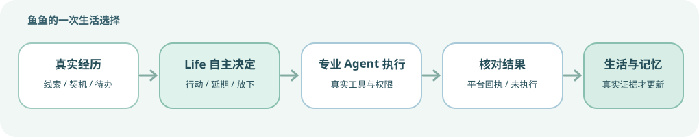
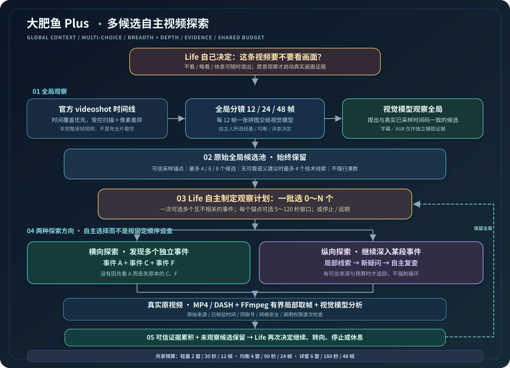
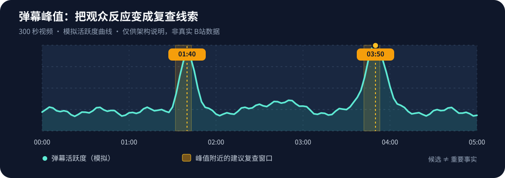
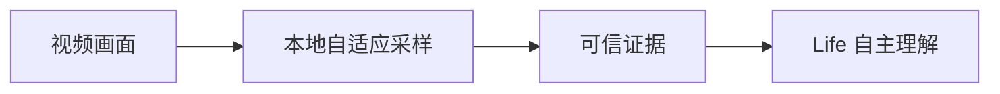

> **dev.3b.33.13 视觉临时环境修复：** 视觉 Python、环境自动修复与生产视觉 MCP 改用插件数据目录下 `tmp/vision` 作为受控临时目录；不再强制访问 Windows 默认 TEMP，不要求 Conda 或管理员权限。仍须 Windows 实机验证识图。

> **dev.3b.33.12 视觉环境自检与回忆场交互：** 模型页自动只读检查 DSH 视觉 Python；发现异常提示定位一键修复（安装仍需确认）。视觉开关改为推拉式；记忆回忆场支持右键平移与五类证据筛选。Windows 真实图片模型回答仍待现场验收。

> **历史 dev.3b.33.11 视觉环境自助修复：** 图片验收页新增一键修复视觉运行环境。宿主自动寻找普通权限可用的 Python、按需建立独立视觉环境、安装 MCP 依赖、复检并保存路径；正常用户无需 Conda 或 PowerShell。仅在明确点击后安装，不改主 `.venv`、不提权、不绕过 DSH 安全验收。[设计与边界](docs/architecture/2.8.1-dev3b3311-vision-one-click-repair.md)。

> **dev.3b.33.10 视觉 Python 诊断热修：** 显式选择的视觉专用解释器优先检查；Conda 缺少 MCP 包不再显示成旧 `.venv` 的权限错误。新增普通权限下独立 `.vision-venv` 修复工具，不改主环境；真正图片模型回答仍待 Windows 验收。[详细说明](docs/architecture/2.8.1-dev3b3310-vision-python-runtime-hotfix.md)。

> **dev.3b.33.9 资源协调增量：** Life 仍自主选择，新增多队列分资源池的受控调度、重复合成唤醒收敛、Episode 过期候选去除；仅进程内资源仲裁，跨进程安全凭据继续由旧账本负责。参见 [协调与自然 Life 架构](docs/architecture/2.8.1-dev3b339-resource-scheduler-and-natural-life.md)。

> **当前源码开发基线：`2.8.1-dev.3b.33.13`，不是已发布稳定版。** [2.8.1-dev.3b.33.8 全系统与 Life 自然性审计](docs/architecture/2.8.1-dev3b338-system-integration-audit.md)。真实 Windows DSH 图片识别及 Life 私信拥塞恢复仍待实机验收；本文以下各个 dev.X 章节为历史开发说明，勿当作当前版本。

**DSH 视觉 Python 环境**：在 Windows 自动修复时，插件会使用 Duty Home 下的 `tmp/vision` 作为视觉专用临时目录（仅视觉 Python/MCP 进程继承），无需安装 Conda，也不会修改系统 TEMP。只有环境读写与 MCP 依赖检测全部通过才会保存；真实图片识别仍须单独人工验收。

## dev.3b.33.6：Windows DSH 图片验收启动路径调整（实机待验收）

此前 Windows 对照表明：相同 DSH 安装文件、工作目录下，PowerShell/宿主进程能导出 Headless 配置，但 Python 直接创建 Electron 子进程失败。独立 DSH 视觉现在在 Windows 使用可信的 `node.exe` 运行受控 Node 桥接文件，再由 Node 以 `shell:false` 启动相同 Desktop Host CLI。需要系统可调用的 Node.js（`node.exe`），并且桥接文件与安装包一致；不满足时会明确拒绝启动，而不会跳过安全配置检查。Linux/macOS 维持原启动方式。**这只是针对已经观察到的 Python 启动差异的修正候选；真正识图仍需在 Windows 看到 MCP 图片回执和模型最终回答。**

### dev.3b.33.1：DSH 视觉配置导出失败排障

### 私信 Life 可靠续办（开发版）

后台私信保留两个独立状态：会话详情等待读取，以及已取得新消息、尚待 Life 模型决策。模型暂时繁忙或超时不会自动等同于鱼鱼沉默；系统会在已有读取预算及平台退避允许时，用相同联系人和消息身份重新核实后续办。可能已经发出的消息遇到回执未知会冻结，避免重复发送。管理中心仅提供不涉及私信内容的状态数字。

DSH 独立图片验收要求 Headless 配置真正合成成功、只读 MCP 图片回执真实存在且模型给出最终回答；仍须 Windows 实机确认，不能从独立图片工具预检推断模型已识图。


最新 Windows 日志确认 `--dump-config` 本身异常退出，尚未进入图片模型。诊断增强可以区分 DSH CLI/内置 Headless、用户 profile/Home 和视觉 overlay 哪一层失败，记录安全的 CLI 退出码/异常类型，原图、凭据和原始错误不上传。没有 Windows 端到端成功记录前不宣称识图完成。[诊断原理](docs/architecture/2.8.1-dev3b33.1-headless-dump-triage.md)。

### dev.3b.33：视觉模型设置更简洁

AI 模型页中的本地视觉支持简短 Ollama 安装与 Windows 代理示例。图片验收界面默认只需三步：选择模型、对固定原图执行识别、检查真实回答并人工认可。专业诊断和高阶配置默认收起，点击即可展开；不会因为独立 MCP 预检通过而自动认可 DSH 图片识别。DSH `exit=1` 仍需 Windows 实机排查，不属于本次 UI 修复。

### dev.3b.32：所有私信统一由 Life 决策

主人、好友与符合私信接收授权的其他联系人，现在共用同一个 Life 表达/工具读取决策入口，而非主人专用关键词 Agent。鱼鱼可自主回复、沉默、延期；遇到当前私信中的官方 B站安全链接，可选择按需只读查看动态、公开视频或空间，由原受限读取器核验，得到真实证据后再决定回复；也可以直接不查看。陌生人先经过原私信接收权限，不允许外站 URL、自动点赞评论或从私信正文升级授权。

主人历史远程操作开关暂保留用于读取旧设置，但本版不把旧远程指令自动外发，未来开放额外主人行为需逐操作受限授权及可靠平台回执。首次切换只处理迁移围栏之后的新主人消息，避免旧消息重放。

设置页浮动「保存本组设置」保持原保存逻辑但不再滚动视角。DSH 识图另加实际 Headless 配置合成检查，Windows 上的模型收到图片与否仍以真人验收为准。黑窗口问题暂停修改。

> **2.8.1-dev.3b.31.1 热修说明：** 视频感知全链路 Debug 的 `debugImages is not defined` 属于收尾作用域错误，已修复并补执行级回归；本地 Ollama 已通过 HTTP API 访问，黑窗是否发生与用户实际启动的服务及 runner 有关，尚未根治。DSH 图片验收 `exit=1` 也仍未关闭。

> **2.8.1-dev.3b.31 说明：** 主人私信分享的 B站动态/视频链接现在可成为 Life 的只读候选，仍由 Life 自己决定查看、延迟或忽略；修复将动态误当无目标视频搜索的固定回复。历史版本说明已归档到 `docs/release/archive/`，单次交付记录不再进入源码根目录。**Ollama 黑窗与 DSH 识图仍未在 Windows 端到端通过**，详见 CHANGELOG。

> **2.8.1-dev.3b.27 开发说明：** 本地视频 FFmpeg/FFprobe 抽帧在 Windows 改用无控制台进程模式，限定范围不触碰 MCP stdio；DSH 图片验收要求 MCP 启动成功，故障日志新增脱敏子进程退出证据。仍须本机确认黑窗不再出现与第三方模型真实识图成功，不能因模拟测试通过就宣告根治。详见 `docs/architecture/2.8.1-dev3b27-ffmpeg-console-and-dsh-vision.md`。

> **2.8.1-dev.3b.26 实机增量说明：** 修复视频观察后 Life 经历记录的 `focusReview` 作用域异常，并保留好友动态分享卡片安全 URL。手动视频 Agent 可以只读资料后自主结束或评论，**不代表已成功解码/识别画面**；黑窗进程启动记录并非窗口所有权证据，新版采样增强仍需 Windows 实测。

# 🐟 大肥鱼 · DSH 生活系统

> 🎉 **本插件已被收录进 [DSHMarket 插件市场](https://dshmarket.com/zh/)。** 在 DSH 的 `dshmarket` 插件中搜索 **`dsh-dafeiyu-life`**（大肥鱼 · DSH 生活系统）即可找到本项目。该名称也是插件的 npm 包名；如果本地暂时搜不到，可以刷新市场索引后再试。

> **坚持鱼的自由发展。** 大肥鱼可以在真实的 B站经历中探索、交流、回忆，慢慢形成兴趣和对人的认识；也可以选择沉默、延期或休息。**会回忆，会遗忘，也会成长。**

[](https://www.npmjs.com/package/dsh-dafeiyu-life) · [](https://www.npmjs.com/package/dsh-dafeiyu-life) · [](https://www.npmjs.com/package/dsh-dafeiyu-life)

**[2.8.1 开发计划](docs/architecture/2.8.1-roadmap.md) · [功能概览](#-从分散能力到连续生活) · [自然交流](#-更自然的交流) · [关系与成长](#-关系记忆与成长) · [可视化成长](#-可视化的生活成长) · [开始使用](#-开始使用) · [未来规划](docs/ROADMAP.md) · [2.8.0 更新说明](docs/release/archive/RELEASE_NOTES_v2.8.0.md) · [完整更新记录](CHANGELOG.md) · [反馈建议](https://github.com/minedalang/dsh-dafeiyu-life/issues)**

**当前开发分支：`2.8.1-dev.3b.33.12`（开发预览，尚未正式发布；真实 DSH 图片及私信拥塞恢复待验收）。**

**2.8.1-dev.3b.26：** 修复 B站私信分享卡片丢失动态 URL：识别 `msg_type=7/source=11` 动态分享、`source=5` 视频分享及受支持的网页/其他分享卡片，只允许官方 HTTPS B站链接进入 Life 机会；普通监听与单联系人复核使用相同消息类型规则。Windows 黑窗口采集新增启动进程快照、父进程名称和 100ms 可见控制台窗口枚举。注意：黑窗口根因仍需新窗口归属日志确认，本版不是最终黑窗口修复。

**2.8.1-dev.3b.25：** 好友分享的 B站链接进入 Life 自主机会池：只在 Life 自己选择后解析安全短链/读取动态、视频或空间；动态作者与分享好友完全匹配且主人分别授权时，才可能由 Life 自己决定点赞或评论（默认均关闭）。同时修复设置未保存误报，行动树新增真实的“正在看视频画面”状态，Windows 黑窗诊断新增可见控制台窗口 PID/类名采集并保留 Q 提前导出。详见 [架构说明](docs/architecture/2.8.1-dev.3b.25-life-shared-bili-links.md)。

**2.8.1-dev.3b.24：** 「最近私信会话」每位普通/获批好友旁可点击「检查遗漏私信」：先核对平台最近50条来信与本地 seen/确认发送，主人二次确认后才让鱼鱼根据原模型自主重新考虑，不能强制补发或越过退避。偶发视频黑窗建议运行 `tools/capture-intermittent-window.bat 900` 采集进程启动事件（Windows PowerShell 5.1，默认15分钟）；新旧两个诊断 ZIP 分别上传。详情见 [本轮复核说明](docs/architecture/2.8.1-dev3b24-manual-dm-recheck-and-window-events.md)。

**2.8.1-dev.3b.23：** 新增私信逐联系人脱敏结果；日志 BAT 汇总 `dm-inbound-outcomes.json`。黑窗复现建议在 Windows 运行 ASCII 入口 `tools/capture-window-dm-vision.bat [UID] [秒数]`；原中文 BAT 兼容调用，解决部分系统代码页导致的 `-File` 路径乱码。`exit=1` 尚不证明 Headless 不支持图片。云端仅跑增量测试，全量由用户本地执行。详见 [定点诊断](docs/architecture/2.8.1-dev3b23-window-dm-vision-diagnostics.md)。

**2.8.1-dev.3b.22 图片验收开发说明：** [Headless 文字验证、独立 MCP 预检、DSH 实测、分阶段诊断和人工验收](docs/architecture/2.8.1-dev3b22-headless-vision-test-diagnostics.md) 分别显示。Desktop 与 Headless 同源模型可在双栏中以虚线对应；能力声明不等于图片识别已通过。真实 Windows DSH／第三方中转站仍需实机验收，当前开发版未发布 npm。

**一个 Life，让鱼鱼的探索、交流与成长真正连成生活。** 视频探索、私信交流、人与人的关系、记忆和原创表达，不再只是各自运行的功能：鱼鱼从真实的视频、来信和生活线索里发现值得关注的事，在同一套 Life 行为机制下自主决定继续了解、互动、表达或休息。看过的内容和认识的人也可能成为下一次探索的起点。

Life **自主选择进入视频**后，先核实公开元数据，并在**同一生活 Episode** 自动尝试一次受控 `standard` 视觉采样（不额外再问模型愿不愿意）；看了一点后仍可自由停止、读更多资料或考虑有真实内容根据的表达。视觉模型未就绪、账号变更或画面回执不可信时不会冒称看过，也**不会以标题/简介直接生成 Life 视频外发**。行动树区分“了解视频”元数据与“观察视频画面”的采样回执：真实视频不可用并允许回退时，B站官方 videoshot 多格预览会拆分重组为带时间码的低清分镜（普通最多12格，深入按方案最多24／48格），并非 FFmpeg 解码。同账号已经取得可信视觉采样回执的 BV 默认不重复进行整片观看；针对具体未看清的时间窗口仍可由 Life 自主选择补看。主人 Debug 不能充当自主观看，视频互动仍受原授权及写入保护。

## ✨ 从分散能力到连续生活



| 生活里的变化 | 2.8.0 的能力 |
|---|---|
| 🐟 **自主 Life 决策** | 结合当前真实契机、兴趣、记忆、情绪、关系及待办，自主选择探索、互动、延期或不行动 |
| 🌿 **Life Episode** | 阅读新证据后自然考虑下一步；没有新收获时停止无意义的循环 |
| 🎬 **从视频中自由探索** | Life 自主决定是否委派专业视频 Agent；搜索、评论、朋友推荐与待办中真实了解的视频，也能进入同一套后续互动选择 |
| 💬 **渐进式聊天** | 可用多气泡表达新的想法，沉默后重新考虑，也能在活跃聊天时更及时地响应 |
| 🤝 **立体的人际关系** | 区分自然熟悉度、公开/私下的真实交往和私人联系资格 |
| 🧠 **会遗忘的记忆** | 记住重要经历与认识，按需回忆，支持遗忘与权限隔离 |
| 🌳 **可视化的生活成长** | 行动树、生活时间线、已接待办、三维神经回忆场与只读成长证据 |
| 🔒 **真实且有边界的行动** | 一套 Life 意愿协议、一套行动状态记录，专业工具独立核验账号、权限及平台回执 |

### 自己决定做什么，而不是被时间表推着走

Life 是鱼鱼的统一生活协调系统。真实的公开视频信息、评论互动、搜索结果、朋友推荐和既有生活任务都可以形成可供考虑的行动机会。她可以继续了解视频、去看看作者作品、阅读讨论，或在获得授权时考虑点赞、收藏、关注和发表原创主评论；也可以安静地结束这次经历。

同一次 Life 决策也可以自愿组合**同一 BV 的不同支持动作**（点赞、收藏、关注作者、原创主评论）；每项仍逐独立授权、限额、一次性票据与平台回执核实，部分成功不回滚、未知结果立即冻结后续动作，绝不按数量凑组合。

专业视频 Agent 仍负责选片与分析，但它的自主委派由 Life 结合当下契机决定，而不是由另一套独立计划驱动；委派仍受账号、功能开关、启动冷却和并发限制。Life 通过搜索、评论或朋友推荐自主进入视频后，会先尝试取得真实采样画面；只有已有当前账号可信视觉回执时，才可以继续自主考虑点赞、收藏、关注和原创主评论，不必启动完整视频 Agent。仅看过简介或评论区不解锁 Life Episode 视频写操作。

### Life Episode：一次经历可以自然延续

一个 Episode 从真实契机开始：看到有趣的视频，了解背景，又对作者或讨论产生好奇。新的事实可能带来下一步选择；没有信息增量、话题已结束或鱼鱼不想继续时，Episode 可以停止。

每段经历有明确的步骤及资源上限。部分有真实新增证据的片段可以延迟保留一次后续考虑机会，但不会无限递归探索，也不会把已读材料假装成新发现。

**真实读取与真实观看不同。** 视频标题、简介、字幕和评论各有证据范围；即使视频视觉模型分析了多格官方低清预览分镜，也不是完整看过视频。目前会把来源、帧数、首末时间锚点以及**从可信视觉模型描述中提取的少量固定主题词**写入原有可衰减经历；完整模型原文和原图仍不会长期保存。下一次 Life Episode 可从当前账号尚未衰减的清晰经历中读取这些有限线索（仅为视觉模型提及，不代表画面事实已经被独立证实）。真正的具体动作、产品型号和未采样片段仍需要自主补看。原创评论必须建立在实际可核验的内容证据上。

## 💬 更自然的交流

### 多气泡与渐进式表达

聊天有时一句话就够，有时会在第一条发出去后，又想到值得补充的事情。鱼鱼可在一轮私信中自然发送一至三条独立气泡，也保留只说一句、停止或者沉默的自由。

模型先构思完整回复，再判断是否包含两个或三个可以独立说出的自然语义点，最后选择一至三条气泡发送。若只有一个意思，仍然只发一条；不按标点机械切割、不为凑数量编造内容。只有偶尔获得额外思考机会时，才会在确认发送后自主续想，也可沉默。**不预先要求 `continuation.thoughtCue`，也不固定每次调用两次模型。**

「自然表达与续聊」有独立卡片（安静陪伴、自然适中、更爱分享、自定义），不改变上方的私信对象授权。适中默认冷却为主人 **2 分钟**、亲密朋友 **5 分钟**、熟悉朋友 **10 分钟**、普通关系 **30 分钟**，额外思考机会概率为 **25%**；冷却按额外调用计算，无每日次数硬上限。话题自然结束或等待对方时，不再为这一轮主动补话；收到新消息仍可正常回复。

**次数与额度**的「轻松／自然／活跃」卡片现在是可保存的方案状态：选择后同步该方案的六项主要额度，手动修改任一额度自动切为自定义；不会自动开启外发授权。**每日自动私信回复上限不限制主人私信**，主人仍受账号、授权、发送回执及必要平台安全约束。

**旧的定时预约续聊已删除**；当前短时多气泡、自主续想和主人待办回访不是旧预约重播。平台额度、联系人授权、拒联、回执去重和未知结果冻结照常生效。

### 活跃会话快速检查

为了让正在聊天的人得到更及时的回应，后台私信检查采用两层机制：

| 检查类型 | 默认行为 | 可配置范围 |
|---|---|---|
| 全局会话列表 | 自然适中默认私信 2→15 分钟安静自适应；评论回复、被 @ 检查均为 2 分钟 | 安静节流／自然适中／及时响应／自定义，私信中间档公式生成 |
| 活跃会话定向读取 | 对最近确实在交流的联系人约每 10 秒检查新消息 | 10–60 秒，可关闭 |
| 活跃窗口 | 最近交流后约 180 秒退出快速状态 | 60–600 秒 |

快速通道不会每 10 秒重新获取所有人的私信列表；普通与快速通道共用来信去重、账号隔离、网络退避和平台读取预算。它是定时检查，不是 B站实时推送，实际响应延迟仍受网络与模型耗时影响。

主人私信给 AI 的短期聊天记录逐条附带 UTC 时间，当前主人消息与上一条已确认回复单独锚定。不会按固定 90 分钟强制切断跨天话题；AI 结合时间与语义自然接续，超过短期记录保留范围的经历仍由原长期记忆工具检索。普通 DNS／连接错误最多每 5 分钟尝试恢复一次只读检查，B站限流仍受较长保护。管理中心可单独恢复网络监听，不会清除限流或强制重发。

## 🤝 关系、记忆与成长

### 关系不等于好友名单

鱼鱼会根据真实互动逐渐认识不同的人。关系架构分别记录**自然熟悉度**、**公开评论与私信等渠道的交往证据**以及**私人联系资格**，而不是简单把评论区熟人当成可主动私信的好友。

白名单提供的是独立的身份与授权范围，不等于自然亲密度。对方的拒联意愿、双向私人交流历史与主人授权依然是主动联系的必要边界；关系成长不能自行扩大平台权限。

### 记忆会留下痕迹，也可以消退

近期私信先在本地按账号和 UID 短期收集可信双向消息，不凭关键词过滤；安静、话题自然收尾或缓冲到达容量时，低频调用已配置的 AI 模型按段提炼成原有 `private-social` 可衰减经历，再由人生反思提炼少量值得长期保留的认识。临时原文**最多保留 48 小时**，提炼成功即清理；必要的脱敏片段会交给用户配置的模型服务。失败有退避与数量诊断，不能保证每段聊天都写入记忆。

鱼鱼可以认识私信中的朋友，也能在评论区体现熟悉感：**同账号、同可信 UID 的私人交往经历可帮助她理解关系，却不构成公开披露私聊内容的许可**。私密记忆的保存域、不同人的数据及发送授权始终隔离；不能凭私下认识声称曾在公开评论区相遇。公开发送前还有额外披露检查，但间接语义泄露无法仅靠正则完全杜绝。

鱼鱼可以在需要时主动检索过去的经历，支持本地关键词检索，也可按需启用本地语义 Embedding。可选的 Qwen3-Embedding-0.6B Q8_0 GGUF 与 llama.cpp 运行时由用户手动安装；未安装时仍有原有的词法检索。所有检索结果都要重新通过当前账号、隐私、衰减与遗忘约束。

兴趣与人格成长依赖原有的证据和反思机制，不会因为探索次数增加就自动加人格分。成长看板展示新获得的资料、跨日兴趣证据、人格反思及行动轨迹；**模型读到某段记忆不等于已经证明那段记忆导致了本次选择**。

## 🌳 可视化的生活成长

管理中心让使用者看见鱼鱼实际做过什么、正在考虑什么，以及经历如何留下成长痕迹；私信正文仍按隐私规则保护。

- **鱼鱼正在做**：当前 Life 行动、Episode、行动树、时间线与实际回执；区分“想到、选择、执行、确认”。
- **鱼鱼想做**：真实生活契机、兴趣线索、已接待办与待执行意愿；不把想做直接显示为已完成。
- **鱼的记忆**：可检索记忆、兴趣与人物，使用三维神经回忆场查看仍然可以访问的证据联系。
- **交流与关系**：查看互动状态、关系渠道及权限，私人聊天正文在最近会话展示中隐藏。
- **设置与诊断**：卡片式选择生活和社交方案；通过统一行动记录及平台回执核对实际发生的事情。

管理页仍保留 npm 更新检测、配置预览与保存确认、历史数据备份和故障诊断。升级不会自动打开原本未授权的外发能力。本次管理中心仍沿用现有页面技术，没有引入 Vue，也不需要为升级另装前端框架。

## 🧩 一个 Life，多种专业能力

2.8.0 采用统一的行为分层：

**真实可信观察 → Life 自主选择 → 一次意愿凭据 → 专业执行与准入 → 真实平台回执 → 经历、关系与成长证据。**

同一件事不应该由多个 Agent 轮流投票决定“鱼鱼到底愿不愿意”。Life 或对应社交首轮模型作出自主选择后，下游专业工具只执行必要的技术、权限与事实核验，不重新发明一套主观意愿。

| 技术能力 | 核心原则 |
|---|---|
| **统一 Life 意愿协议** | 一次明确选择只登记一次；延迟行动必须有可核验的来源与状态 |
| **Life Action Records** | 脱敏记录已选择、等待、阻断、完成、送达未知等状态；记录不是二次发送凭据 |
| **跨场景专业执行** | 视频、评论、私信、关注及只读探索继续使用各自专业工具 |
| **统一读取与节奏** | 共享去重、账号隔离、并发限制、读取预算、网络退避及安全恢复 |
| **字节与回执事实保护** | 原创评论和后续气泡不凭空改写已核验意愿；没有平台回执不得宣称执行成功 |
| **隐私与遗忘** | 跨渠道可理解同一人的真实关系；账号与 UID、私密保存域和公开披露权限严格隔离；不能公开私聊事实 |

相关设计与技术审计：[Life 现行架构](docs/architecture/life-system-current.md) · [统一行动协议](docs/architecture/2.8.0-unified-life-action-protocol.md) · [统一意愿和行动记录](docs/architecture/2.8.0-dev14-one-life-one-action.md)。

## 🎥 视频感知：既看画面，也留意观众反应


鱼鱼**先决定看不看、了解多深**。当它选择视觉观察时，分镜选帧同时参考真实解码画面的镜头变化、运动幅度与可获得的弹幕活跃度；还要照顾整条视频的时间覆盖，不能只看最热闹的几秒。



> 图为 **SVG 矢量排版**，不是 PNG 截图；可以直接修改源码。另保留 [Mermaid 可编辑流程图](docs/architecture/diagrams/video-perception-current.mmd)，用于维护逻辑和自动检查。






**模拟首次打开插件：** 先停止插件并备份运行数据目录里的 `bili-duty/first-start-v1.json`（通常在 DSH 数据目录下，而非插件源码 `config.json`）。仅做 UI 流程复测，可保留原文件其它字段，设置 `completed: false`、`welcomeSeen: false`、`quickSetupSeenRevision: 0`，然后重启并打开管理中心。这样保留已有 B站登录等凭据，不等于真实全新安装；要验证扫码和完整依赖引导，请在**独立的测试用 DSH 数据目录**中安装测试，不要清除当前用户凭据、记忆或数据。

## 🚀 开始使用

### 安装与更新

在 DSH Desktop 的插件市场搜索 **大肥鱼**，或安装 npm 插件：

```bash
dsh plugin --profile desktop add dsh-dafeiyu-life
```

也可从 [DSHMarket](https://dshmarket.com/zh/) 查找插件。安装或升级后重启 DSH，再进入 **设置 → 大肥鱼 → 管理中心**。npm 徽章表示仓库对应包的公开状态，不代表某个尚未发布的开发构建已同步上线。

### 首次设置：先打开管理中心，再选择鱼鱼的生活方式

**第一步：打开 DSH Desktop → 设置 → 大肥鱼 → 管理中心 → 🚀 快速设置。** 不必先翻高级参数；新老用户都可以从这里进入首次设置引导。

1. **先安装 B站运行依赖。** 在「运行依赖」卡片检测并按提示安装/修复主依赖，必须显示“已就绪”才能扫码；FFmpeg、Whisper 属于可选视频增强组件，不阻断正常登录。
2. **登录鱼鱼的 B站账号。** 在「B站登录」卡片扫码登录；已有有效登录的老用户可以点「检测已有登录」。如页面要求，请完成账号核验与重启后复核。
3. **验证一个可用的 AI 模型。** 在「Headless 模型验证」完成至少一个模型的真实连接验证。与 B站登录一样，这是解锁首次设置的必需项；仅同步模型配置不等于验证成功。
4. **配置主人身份。** 在「主人 B站 UID」卡片填写并保存**你自己的 B站 UID**，而不是鱼鱼账号的 UID。这一步可跳过，但推荐现在设置；主人身份不会自动授予点赞、评论、关注或私信等外发权限。
5. **用卡片选择鱼鱼想过的生活。** 在「自主生活」选择开启或暂停，并选择 **🌙 安静 / 🍃 自然 / ✨ 活跃**；再按需要选择「记忆与反思」「私信交流范围」和「主动视频兴趣分享」。**每张卡片都需要单独确认保存**，不会因为选中预设就自动覆盖原有配置。本地语义回忆可选装，不影响基本使用。
6. **完成引导，开始观察她的生活。** 「主 Session」等可选项可以以后再设置；点击「完成快速设置」，然后在「鱼鱼正在做」「鱼鱼想做」及「鱼的记忆」查看真实经历、回执和成长。外发操作还需按对应权限单独授权。

想进一步调整性格、频率或社交边界，之后随时可以回到管理中心。快速设置不是一次性不可更改的选择，也不会自动清除老用户的记忆和配置。

### 视频依赖使用

管理中心「AI 模型 → 视觉识别模型」统一配置 DSH / Ollama、FFmpeg 和可选 Whisper；详细设置及 Windows 验收见 [视频依赖说明](docs/architecture/2.8.1-video-perception-dev3b3.md)。

### 关于 2.8.0 正式版

本页介绍 2.8.0 的正式版本功能；实际是否已在 npm / DSHMarket 上线，以各自平台的版本记录为准。离线测试、真实 Windows／DSH 与 B站端到端验收分别记录在 [2.8.0 发布审计](docs/architecture/2.8.0-final-release-audit-20261114.md)，不能混为一谈。

新生活系统上线初期，真实 B站网络、模型能力与个人配置存在差异，个别环节仍需持续实机验收。欢迎通过 GitHub Issues **反馈体验和提出建议**；遇到问题可优先导出脱敏后的诊断，不需要公开分享账号凭据与私人聊天。

## 🔒 自由与安全的边界

鱼鱼可以自主选择探索、回复、停止或休息；这些是 AI 模拟的生活行为，不意味着真实意识。任何外发动作都需要当前账号授权、真实来源与平台回执；陌生人的邀请不会自动变成关注或主动私信授权。未知送达结果不能盲目重试，明确遗忘的内容不能从旧索引恢复。

模型服务、B站读取与可选本地语义能力可能产生费用、资源消耗或触发平台限流，请根据实际使用情况设置额度。

## 🌱 未来规划：让生活更有故事

我们希望未来的大肥鱼，不只是能做更多事，而是能**越来越自然地过属于自己的生活**。想象有一天，打开管理中心看到的不是一张任务完成表，而是她这段时间真正遇见了什么、记住了什么、为什么开始在意某个人或某个话题。

**详细的候选路线、2.8.1 预计体验、分期与验收边界，见 [📖 大肥鱼未来计划](docs/ROADMAP.md)。** 以下均为讨论中目标，不代表已完成或承诺发布日期。 鱼鱼今后变成什么样，也希望由使用者的真实体验与反馈共同塑造。

---

欢迎通过 [GitHub Issues](https://github.com/minedalang/dsh-dafeiyu-life/issues) 反馈建议与问题。

感谢 [c1overzz/dsh-bili-scroll](https://github.com/c1overzz/dsh-bili-scroll)、[adoresever/bilibili-mcp](https://github.com/adoresever/bilibili-mcp)、[Yuuyuko-uu/dsh-fish-memory](https://github.com/Yuuyuko-uu/dsh-fish-memory)、[Yuuyuko-uu/dsh-bili-subagent](https://github.com/Yuuyuko-uu/dsh-bili-subagent) 及社区贡献者；具体许可证和归属见 [第三方声明](THIRD_PARTY_NOTICES.md)。

**License：MIT。** 大肥鱼为独立社区插件，不属于 DSH 或哔哩哔哩官方产品。
