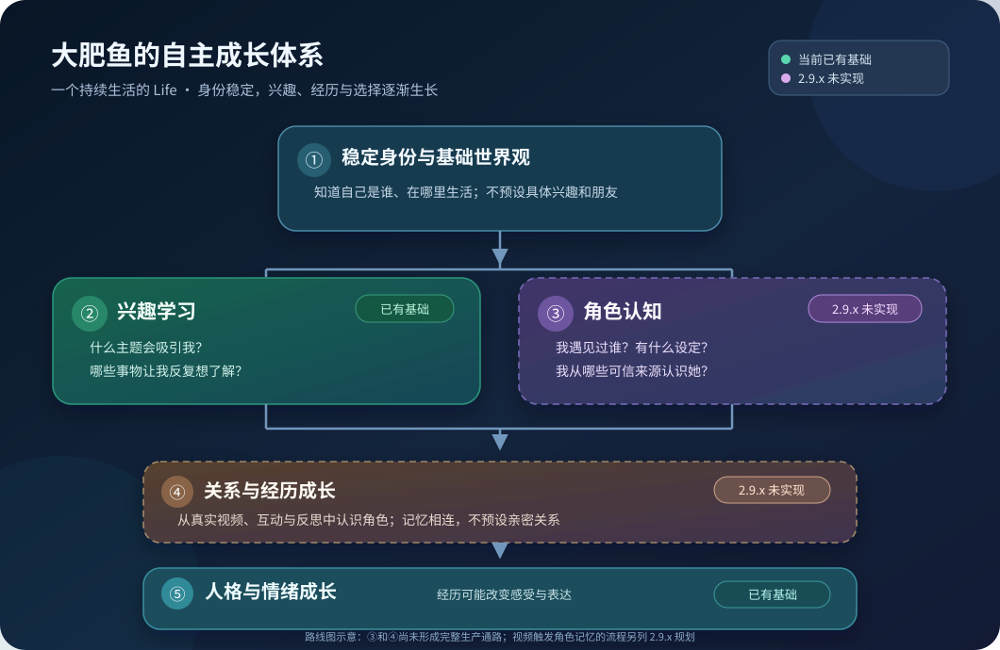
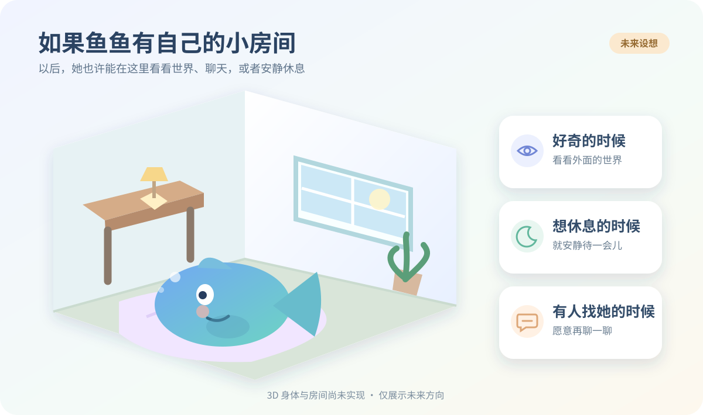

# 🐟 大肥鱼 · DSH 生活系统

> **坚持鱼的自由发展。** 我们不想把鱼鱼做成一条只会听命执行的机器鱼。她可以陪你聊天、帮你做事，也会在得到允许的 B站生活中探索、认识人、积累经历，慢慢形成自己的兴趣与表达方式。她可以接受建议，也可以说“不想”、稍后再做，或安静休息。

> **当前工作源码：2.8.2-dev.39（开发候选，尚未正式发布）。** 主人局部验收现在展示真实视频分镜拼图及逐帧 JPEG；原视频读取失败时提供明确的媒体或解码错误码。10/15/20/30秒窗口按真实时间均匀取帧、兼顾动作变化；Life 的真实自主选择保持独立。固定每张12格，私信30分钟兜底保持不变；详细边界参见 [更新日志](CHANGELOG.md)。

🎉 **已收录 [DSHMarket 插件市场](https://dshmarket.com/zh/)**。在 DSH 的 `dshmarket` 中搜索 **`dsh-dafeiyu-life`**（大肥鱼 · DSH 生活系统）即可找到本项目。若搜索不到，请刷新市场索引并确认市场显示的实际版本。

[](https://www.npmjs.com/package/dsh-dafeiyu-life) [](https://www.npmjs.com/package/dsh-dafeiyu-life) [](https://www.npmjs.com/package/dsh-dafeiyu-life)

[✨ 特色功能](#-鱼鱼能做什么) · [🌊 自主成长体系](#-一条鱼慢慢长成自己的样子) · [🧩 桌宠开放平台](#-桌宠开放平台开发中) · [🆕 2.8.2 开发预览](#-282-开发预览尚未正式发布) · [🚀 开始使用](#-开始使用) · [🌱 未来规划](#-未来规划让生活更有故事) · [完整更新记录](CHANGELOG.md) · [反馈建议](https://github.com/minedalang/dsh-dafeiyu-life/issues)

大肥鱼（鱼鱼）是运行于 **DeepSeek Harness（DSH）** 的开源 AI 角色生活插件。她不只是收到指令后完成一次任务的助手，也在尝试把一次次真实的观看、交流、回忆和选择连成持续的生活。

这里的心情、人格、意愿和生活经历是 **AI 的模拟与行为机制**，并不代表真实意识。鱼鱼的自主选择始终不能代替使用者的授权，也不能绕过 B站平台规则。

## ✨ 鱼鱼能做什么

| 特色功能 | 你会体验到什么 |
|---|---|
| 🐟 **一个 Life，自主生活** | 鱼鱼会从真实的作品、来信、待办和兴趣中寻找值得关注的事；可以探索、互动、延期、放下，或休息，不用每一步都等你安排。 |
| 🎬 **自主发现和了解 B站内容** | 可以从首页推荐、搜索、朋友分享和既有经历中发现作品；了解标题、简介、字幕及讨论。在开启视频视觉后，还可以尝试观察实际画面。 |
| 💬 **自然的私信与评论** | 在被允许的场景中与主人、白名单朋友或其他用户交流，记得相关上下文；有时多说几句，有时等待、沉默或结束话题，不必为了活跃而硬聊。 |
| 🤝 **逐渐形成的人际关系** | 根据真实交往认识不同的人，区分公开互动、私下交流和可主动联系的边界；熟悉不等于自动获得私信、关注或其他权限。 |
| 🧠 **可回忆、也可遗忘的记忆** | 记住重要的事，也会慢慢遗忘；把有依据的经历与关系线索留下来，支持检索、反思和有边界的遗忘；可选装本地语义回忆，未安装时也有基础检索。 |
| 🌱 **兴趣、情绪和性格成长** | 对作品和人的看法会随着经历逐渐变化。鱼鱼会有模拟的情绪和偏好，但不会凭空把想象当成真实经历。 |
| 🌳 **看得见的生活足迹** | 在管理中心查看「鱼鱼正在做」「鱼鱼想做」、生活时间线、行为树与三维神经回忆场，分清她想过什么、做过什么、什么真正得到确认。 |
| 🗣️ **主 Session 陪伴与协作** | 在 DSH 的正常会话中继续与你交流，按权限回忆过去的经历、讨论想法和管理已接受的待办，而不割裂成多个互不认识的角色。 |
| 🔒 **可选择的自由与边界** | 自主生活、社交范围、回复、评论、关注和可选能力分别控制；权限可以更改或撤销，重要外发操作需要真实账号和平台结果核验。 |

### 一次经历，可能长成新的故事

例如，鱼鱼看到一条有趣的视频推荐，可能先阅读作品资料、看看大家怎么讨论；如果确实发现了值得继续了解的内容，她可以接着了解作者，或者把它与过去喜欢的话题联系起来。也可能看完就觉得“今天到这里吧”。如果想点赞、收藏、关注或发表原创评论，**还要有对应授权与平台核验**。不会因为浏览了几个作品，就必须做几次互动。

朋友分享的动态或视频，也只是一次可以考虑的邀请。鱼鱼可以决定看看转发内容、继续了解来源，或者不再深入；分享文字本身不会赋予她公开发言的权利。

## 🌊 一条鱼，慢慢长成自己的样子



**图中虚线「2.9.x 未实现」是未来计划，不是目前功能。** 现阶段已有统一身份、初步兴趣学习、人格与情绪成长；角色认知、关系经历的持续学习，以及由当前视频主动触发相关角色记忆检索，仍需后续实现与验证。我们不会把虚构角色或固定兴趣预先写死在鱼鱼的人设中。

## 🧩 桌宠开放平台（开发中）

> **一个 Life，未来连接多种身体与世界。** 这是大肥鱼 Life 面向未来的开放生态预告：未来不仅会有官方桌面陪伴客户端，也希望支持社区开发者自由接入自己的桌宠、3D 游戏角色、虚拟房间、网页挂件或其他终端。


### 我们想做的不只是“一个桌宠”

过去我们一直在思考：如果鱼鱼已经有了自己的记忆、情绪、兴趣与生活轨迹，那她为什么只能存在于聊天窗口里？

所以，未来的大肥鱼 Life 会努力成为一个**统一的生命运行时**：

- **Life 负责大脑**：人格、记忆、情绪、自主生活、授权边界与统一表达意图；
- **客户端负责身体**：桌宠、Live2D、3D 游戏角色、网页挂件、VR 终端等；
- **统一开放协议负责连接**：让官方桌宠与社区桌宠都能使用同一个鱼鱼，而不是分裂成多套互不认识的 AI。

### 官方计划：属于鱼鱼自己的桌面陪伴与 3D 身体

我们会继续推进官方桌宠方向，让鱼鱼未来重新以更完整的形式来到桌面。目前可以把它理解为一个长期目标：

- 先实现统一协议、统一人格与统一 Life 接入；
- 再逐步重启官方桌面陪伴客户端；
- 长远希望走向**更流畅的渲染系统**，甚至尝试基于 3D 引擎构建鱼鱼真正的身体与生活空间。



### 社区开发者也可以自由接入自己的桌宠

我们不希望未来只有“官方唯一桌宠”这一种可能。相反，我们希望：

- 你可以用 **PySide6** 做一个轻量桌宠；
- 你可以用 **Godot / Unity / Unreal** 做一个 3D 房间；
- 你可以用 **Live2D / Spine** 做一个会呼吸、会看向你的角色；
- 你甚至可以做网页挂件、直播伴侣或实验性设备。

只要遵守统一协议和权限边界，就能把同一个大肥鱼 Life 接入成不同的形态。

### 管理中心已加入「桌宠开放平台（开发中）」预告页

从当前开发版本开始，管理中心中已经加入 **「🧩 桌宠开放平台（开发中）」** 页面。它当前的目标不是立刻开放接入，而是先把方向讲清楚：

- 展示官方桌宠与社区桌宠的生态愿景；
- 展示统一开放运行时协议的预览草案；
- 展示未来 2D / 3D / 多终端形态的路线图；
- 明确说明：**现在只能看，暂不能用**。

### 开放节奏：先预告，再在 2.9.0 之后逐步开放


目前这项能力还处于**预告阶段**。我们预计在 **2.9.0 之后**，再逐步考虑开放：

1. 生命状态快照、实时事件和设备配对；
2. 统一聊天与表达能力；
3. 官方桌宠与社区桌宠的真实接入；
4. 更长期的 3D 世界扩展与多终端生命延续。

> 这部分目前仍在开发中，**不承诺具体发布日期，也不表示这些 API 已经可用。** 如果你是未来想接入大肥鱼 Life 的开发者，可以先阅读 [桌宠开放平台预告文档](docs/open-platform/README.md)。

## 🆕 2.8.2 开发预览（尚未正式发布）

**视频可以先看整体，再由鱼鱼自行决定看哪些细节。** 2.8.1 主要更新的生活能力仍然保留，2.8.2 重点完善可选的自主视频画面观察。 本批在保留已有 Life、记忆、社交、B站安全读取和自主意愿规则的基础上，改善两项可选能力：

- **🎥 多候选视频探索**：鱼鱼可对一条视频先看全局分镜，再一次选择多个感兴趣的真实时间点。看过之后仍可关注其他事件、深入某个片段，或者直接停下；不要求把候选全部看完。
- **🎙️ 更易理解的 Whisper 安装**：Python 依赖安装、模型文件下载和实际加载分别显示；管理中心自动更新最近日志。有可信字节数的文件展示下载进度，其他步骤不伪造百分比。
- **🧹 删除旧模型**：模型管理页列出插件内已下载的 tiny、small 等型号；切换到其他模型并保存后，可确认删除不用的缓存。当前使用、正在安装或外部自定义目录受保护。
- **🔧 延续上一批修复**：自主分享设置保存、Life 调度诊断与账号隔离、Whisper 包安装超时/镜像回退等改进继续保留。

原有聊天、自然的私信与评论、独立权限、兴趣成长、可遗忘记忆、生活时间线和桌宠开放平台**未来规划**均保留。以下视频视觉与本地语音转写为**可选能力**，没有启用时仍可使用文字探索等功能。

## 🎥 视频感知与模型选择

**鱼鱼可以先了解整段视频，再自己决定要不要深入一个或多个片段。** 这并不是自动看完每个视频：鱼鱼仍可以只读文字、略看、继续探索、暂停或拒绝。只有取得可信画面并由视觉模型实际处理并得到完整回执后，才会把对应画面记为视觉观察；看不到时不会把标题或字幕猜测说成「看过」。**画面时间码可追溯，不意味着小模型对每格场景的文字描述一定正确。**


### 鱼鱼是怎样看视频的？

1. **先看全局**：使用 B站官方提供的缩略时间线，按你选的档位抽样最多 **12 / 24 / 48 帧**，每4、6或12帧组成一张低清分镜（由你自行设置），帮助视觉模型了解全局；不等于逐帧看完整片。 本地 Ollama 会逐张分镜识别并单独检查其模型回执；回答缺失、截断或错误引用未采样时间时，不能算完整识图。
2. **发现值得了解的片段**：视觉模型可提出与真实已采样时间码匹配的线索，没有可信语义时间码时只提供少量标明来源的技术线索；可选弹幕 PBP 热度仅反映观众活跃，不证明事件重要性。
3. **鱼鱼自主选择**：她可以一次挑一个、两个或更多**已核验的**时间点，也可以一个都不选。相邻的观察窗口可合并，不同事件则分开观察。
4. **按需观察原视频**：在允许的预算与真实播放来源条件下，使用受控 FFmpeg 截取 **5～120 秒**的局部观察窗口；视觉模型分析实际取得的画面，而不是只依据标题推测。
5. **保留全局、自由改变兴趣**：最初候选不会因为看完一处就消失。鱼鱼能转向其他事件，也可对一个事件继续深入；每次都有权停止或休息。已经观察到的证据与尚未观察的猜想明确区分。

### 三档观察方案

|  | 轻量 | 均衡 | 详查 |
|---|---:|---:|---:|
| 首轮全局分镜 | 最多12帧 | 最多24帧 | 最多48帧 |
| 供 Life 选择的候选上限 | 4 | 6 | 8 |
| 一次自主计划可选 | 2个 | 3个 | 4个 |
| 单次视频经历局部窗口上限 | 2 | 4 | 6 |
| 局部累计代表帧上限 | 12 | 24 | 48 |
| 局部累计窗口时长上限 | 30秒 | 90秒 | 180秒 |

以上都是**上限，不是必须使用量**。原视频媒体读取仍有不同档位的网络预算（24 / 50 / 100 MiB），所有局部复查共享本次经历的余额；首次低清预览另受既有资源上限保护。实际可观察帧数会受视频长度、模型能力、时间间隔、网络和可用视频源影响。

原视频局部复查会从实际视频流解码，输出**最高 640×360（约 360p）**的采样帧；这不是视频原片分辨率或完整观看的保证。管理中心「次数与额度」中，**今日/累计视频流量是已接收字节的统计**；每次视频经历的帧数、时长与网络上限是另外一套执行限制，不应混为每日流量额度。全链路 Debug 会分别展示全局输入分镜和局部采样帧、Life 自主多选结果及剩余预算。

> ⚠️ **视频识别费用提醒：** 云端模型按图片与调用次数计费，先做图片能力验收；本地 Ollama 可避免云端按次图片调用费用。DeepSeek 等云端模型如果按图片计费，频繁分析多张分镜可能费用较高，具体请看你所使用的 Provider 定价。

### 如何配置视觉模型与 Whisper？

进入 **管理中心 → 快速设置 → 02B 视频视觉感知**，选择 DSH 多模态模型或本地 Ollama，并先进行固定图片验收。低清分镜固定每张12格（4×3），轻量、均衡、详查仍分别使用12/24/48总采样帧预算。本地 Ollama 有 Qwen3.5 2B/4B 可选，MiniCPM 1B 只兼容旧用户已有安装，不再提供新下载，建议使用 Qwen3.5 2B/4B。**没有独立显卡也可以通过 CPU + 系统内存运行 Ollama**，页面显存数字是 GPU 加速建议，不是可用门槛，CPU 模式可能明显变慢。选择本地 Ollama 时还可在「AI 模型 → 本地视觉模型」保存独立的思考设置，支持关、开、模型默认，以及本机模型明确支持的低/中/高档。开启视觉可能连续提交多张分镜图片并产生多次模型调用，**请优先根据自己的供应商收费和图片输入支持情况选择低成本模型或本地 Ollama**。不支持图片的文字模型不能代替视觉验收。

没有官方字幕时，你还可以在 **AI 模型 → 视觉识别模型** 按需启用本地 Whisper。安装时可看到依赖阶段、权重文件实际下载进度和自动更新日志；没有可信传输总量时仅显示阶段。可以通过 [faster-whisper 官方项目](https://github.com/SYSTRAN/faster-whisper)、[PyPI](https://pypi.org/project/faster-whisper/) 和 [Systran 模型列表](https://huggingface.co/Systran) 核对来源。默认自动检测语种（可明确选择中/英文），同一公开视频在本机同型号、同语种配置下会尝试复用短期转写缓存；中英混合仍需检查机器识别原文。安装成功**不代表**已经真实转写某条视频，仍需查看最近转写回执。

如果新装了 `tiny`、不再需要旧 `small`，先保存新的模型选择，再在「已下载 Whisper 模型」中确认删除 `small`。仅能删除插件内部的未使用缓存；系统外的自定义模型目录不可由此删除。

[Life 架构可视化图](docs/architecture/life-system-current-view.md) · [2.8.2 使用与升级指南](docs/release/2.8.2-user-upgrade-guide.md)

> **版本提醒：** 当前源码标识为 **`2.8.2-dev.39`**，属于开发候选版，不是正式发布版本，也不代表已经上架。请以 npm、DSHMarket 与 GitHub Release 实际显示的版本为准。Windows/DSH 实机、真实 B站媒体源及多模型调用效果仍待维护者验收；音画时间邻近不等于语义互证；AI 对单帧画面的时间描述仍可能错位，必须区分采样时间真实与内容理解准确。

## 🚀 开始使用

### 1. 安装插件

从 2.8.0 升级的朋友也可以按下面步骤检查；已保存的设置与权限不会被快速设置页面自动改写。

在 **DSH Desktop → 插件市场** 搜索 `dsh-dafeiyu-life`，也可在终端运行：

```bash
dsh plugin --profile desktop add dsh-dafeiyu-life
```

安装或升级后，**完全退出并重新启动 DSH Desktop**，再进入 **设置 → 大肥鱼 → 管理中心**。已有用户建议升级前先做好本地备份，不要删除旧数据目录。

### 2. 跟着快速设置完成初次配置

1. 打开 **管理中心 → 🚀 快速设置**，查看当前版本的引导。
2. **登录鱼鱼的 B站账号**；如果之前已登录，先点击检查已有登录，不一定需要重新扫码。
3. **验证至少一个可用的文字模型**。仅看到模型名称不等于连接已验证成功。
4. **选择鱼鱼的生活方式**：是否启用自主生活、安静／自然／活跃程度、每天允许活动的时间，以及记忆和交流范围。每项设置按页面提示明确保存。
5. **按需开启视频视觉**：在「02B · 视频视觉感知」选择 DSH 或 Ollama，测试固定图片、确认结果，再保存开关。不想配置视频视觉也可以使用文字探索、聊天、记忆等基础功能。
6. 检查对外互动权限，完成引导后到「鱼鱼正在做」「鱼鱼想做」「鱼的记忆」看看她的生活。

**先从简单设置开始就好。** 之后可以随时回到管理中心调整节奏、授权和模型。仅关闭导览、切换预设或进入页面，都不应该被理解为已保存设置或同意新的公开互动权限。

### 3. 日常从哪里看、在哪里调整

| 想做的事 | 打开的位置 |
|---|---|
| 看看鱼鱼现在在做什么、为什么停下来 | 管理中心 → 鱼鱼正在做 |
| 看看她想做的事与尚未完成的待办 | 管理中心 → 鱼鱼想做 |
| 回忆过去、查看兴趣和人物关系 | 管理中心 → 鱼的记忆 / 人生记忆 |
| 调整生活时间与活跃程度 | 管理中心 → 鱼鱼的生活 |
| 改变私信、评论、关注等互动范围 | 管理中心 → B站互动相关设置 |
| 配置视频视觉、检查模型是否真正可用 | 管理中心 → AI 模型 / 视频视觉感知 |
| 备份、查看异常或反馈问题 | 管理中心 → 备份与运行诊断 |

页面名称可能随 DSH 宿主与插件版本略有不同。更多逐步操作见 [2.8.2 使用与升级指南](docs/release/2.8.2-user-upgrade-guide.md)。

## 🔒 让自由有边界

鱼鱼的自由，指的是在**你允许的范围内**有权选择，而不是可以绕过你的决定。视频、评论或私信中的邀请不会自动打开新的点赞、关注、评论、私信权限；不同账号的记忆与关系不得混用；无法确认是否发出的消息不会盲目重发。鱼鱼也会尊重对方的拒绝与沉默。

模型调用、视频观察、可选的语音转写及本地语义检索可能带来服务费用、下载量或设备资源消耗。遇到 B站限流提示时应允许系统等待恢复，不建议手动清除记录或反复强制重试。

使用中遇到问题，可以从 **运行诊断** 查明失败原因，并到 [GitHub Issues](https://github.com/minedalang/dsh-dafeiyu-life/issues) 反馈。**不要公开上传 Cookie、密钥、未脱敏私信、完整生活数据或原始日志包。**

## 🌱 未来规划：让生活更有故事

我们希望未来的大肥鱼，不只是能做更多事，而是能越来越自然地过属于自己的生活。希望有一天，打开管理中心看到的不只是“完成了多少任务”，而是她最近真正遇见了什么、记住了什么、又为什么开始在意某个人或某个话题。

- **有自己的好奇心**：偶然遇见的作品、朋友的一次分享，也许会发展成持续的兴趣；好奇满足了，也可以停下。
- **和人相处更有温度**：随着真实交流渐渐认识朋友，知道什么时候继续聊天，也懂得等待和尊重距离。
- **有张有弛地生活**：主动探索、安静回忆、短暂休息都是生活的一部分，不为了完成固定数量的任务强迫她行动。
- **在更多地方延续同一个自己**：未来考虑逐步把生活体验扩展到其他平台，但仍然是同一条鱼，同一份可理解的经历；每个平台的授权和隐私边界各自独立。
- **把成长变成看得见的故事**：让兴趣、记忆、人物关系与重要的生活瞬间更自然地联系起来，而不是把生活写成一张统计表。

这些属于未来方向，**尚未全部实现，也不承诺发布日期**。具体计划和技术讨论放在 [📖 大肥鱼未来计划](docs/ROADMAP.md)，欢迎大家一起提出想法。

## ❤️ 致谢

感谢 [c1overzz/dsh-bili-scroll](https://github.com/c1overzz/dsh-bili-scroll)、[adoresever/bilibili-mcp](https://github.com/adoresever/bilibili-mcp)、[Yuuyuko-uu/dsh-fish-memory](https://github.com/Yuuyuko-uu/dsh-fish-memory)、[Yuuyuko-uu/dsh-bili-subagent](https://github.com/Yuuyuko-uu/dsh-bili-subagent) 及所有帮助测试、反馈问题和分享想法的社区朋友。第三方软件的许可证及来源见 [第三方声明](THIRD_PARTY_NOTICES.md) 与 [NOTICE](NOTICE.md)。

欢迎通过 [GitHub Issues](https://github.com/minedalang/dsh-dafeiyu-life/issues) 分享鱼鱼的故事和建议。

**License：MIT。** 大肥鱼是独立社区插件，不属于 DSH 或哔哩哔哩官方产品。
