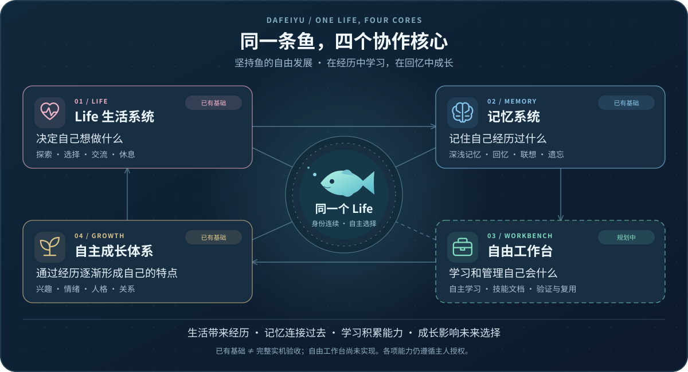
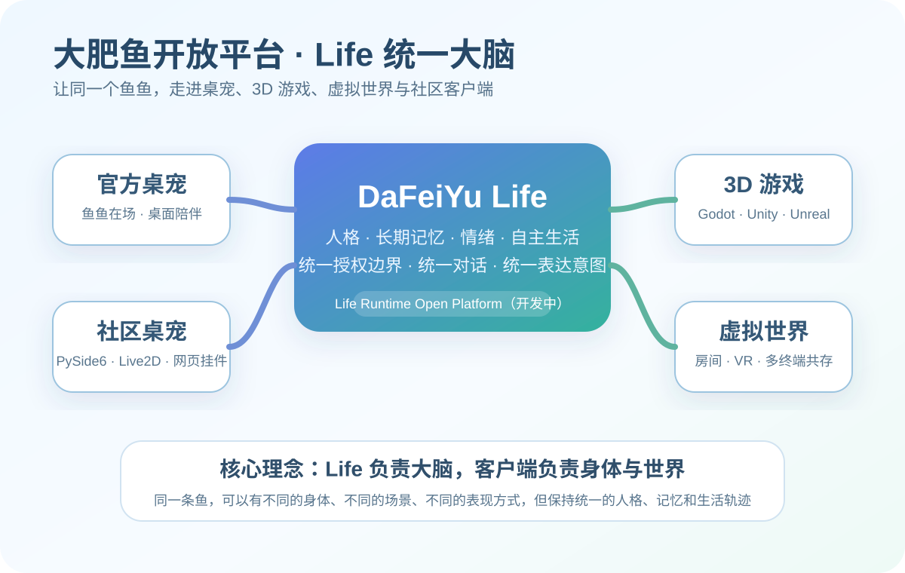
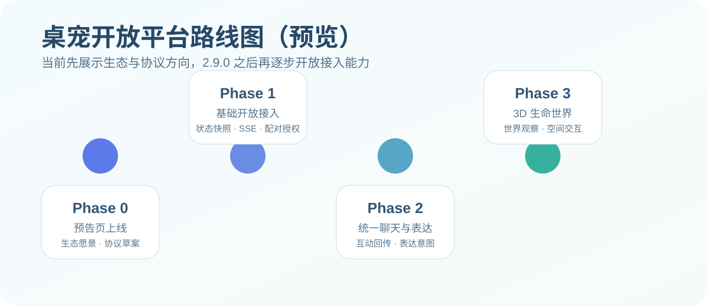
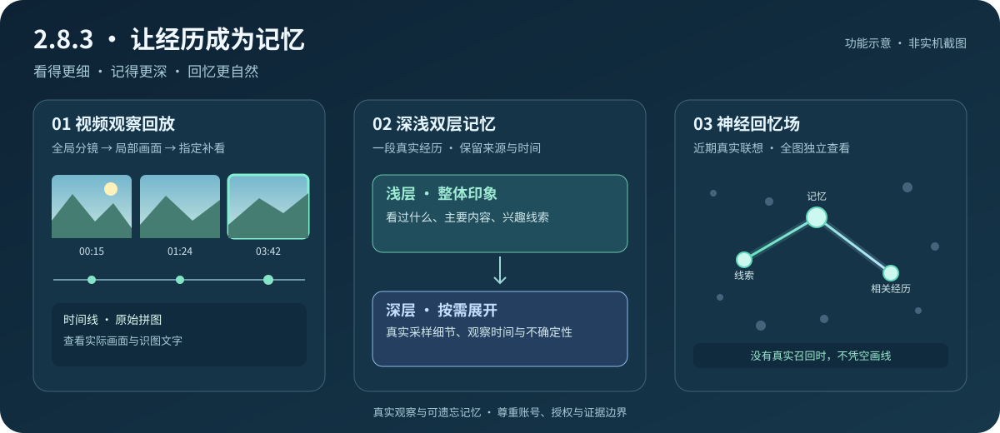

# 🐟 大肥鱼 · DSH 生活系统

> **坚持鱼的自由发展。** 我们不想把鱼鱼做成一条只会听命执行的机器鱼。她可以陪你聊天、帮你做事，也会在得到允许的 B站生活中探索、认识人、积累经历，慢慢形成自己的兴趣与表达方式。她可以接受建议，也可以说“不想”、稍后再做，或安静休息。

> **当前版本源码：2.8.3-dev.109（正式版收口候选，2.8.3 尚未正式发布）。** 发布门禁见 [2.8.3 验收清单](docs/release/2.8.3-release-checklist.md)。

🎉 **已收录 [DSHMarket 插件市场](https://dshmarket.com/zh/)**。在 DSH 的 `dshmarket` 中搜索 **`dsh-dafeiyu-life`**（大肥鱼 · DSH 生活系统）即可找到本项目。若搜索不到，请刷新市场索引并确认市场显示的实际版本。

[](https://www.npmjs.com/package/dsh-dafeiyu-life) [](https://www.npmjs.com/package/dsh-dafeiyu-life) [](https://www.npmjs.com/package/dsh-dafeiyu-life)

[✨ 特色功能](#-鱼鱼能做什么) · [🌊 自主成长体系](#-一条鱼慢慢长成自己的样子) · [🧩 桌宠开放平台](#-桌宠开放平台开发中) · [🆕 2.8.3 版本亮点](#-283-让经历成为记忆) · [📚 近期版本新功能](docs/近期版本新功能.md) · [🚀 开始使用](#-开始使用) · [🌱 未来规划](#-未来规划让生活更有故事) · [交互与工具能力](docs/interaction-tools.md) · [完整更新记录（开发者）](CHANGELOG.md) · [反馈建议](https://github.com/minedalang/dsh-dafeiyu-life/issues)

大肥鱼（鱼鱼）是运行于 **DeepSeek Harness（DSH）** 的开源 AI 角色生活插件。她通过真实观看、交流和回忆积累生活经历。

[Life 架构可视化图](docs/architecture/life-system-current-view.md)

## ✨ 鱼鱼能做什么

| 特色功能 | 你会体验到什么 |
|---|---|
| 🐟 **一个 Life，自主生活** | 鱼鱼会从真实的作品、来信、待办和兴趣中寻找值得关注的事，也可自主提出公开新主题、搜索并换方向；可以探索、互动、延期、放下，或休息，不用每一步都等你安排。 |
| 🎬 **更自然地挑视频、看视频** | 鱼鱼先根据标题、UP、热度和简介自主挑选；挑中后可以看评论、看视频、互动或继续探索。视频 Agent 的一次“看视频”会尝试画面与字幕（缺字幕时可选 ASR），两类结果独立核验。 |
| 💬 **自然的私信与评论** | 在被允许的场景中与主人、白名单朋友或其他用户交流，记得相关上下文；有时多说几句，有时等待、沉默或结束话题，不必为了活跃而硬聊。 |
| 🤝 **逐渐形成的人际关系** | 根据真实交往认识不同的人，区分公开互动、私下交流和可主动联系的边界；熟悉不等于自动获得私信、关注或其他权限。 |
| 🧠 **可回忆、也可遗忘的记忆** | 记住重要的事，也会慢慢遗忘；把有依据的经历与关系线索留下来，支持检索、反思和有边界的遗忘；首次配置必装本地语义回忆，保留词法回退。 |
| 🌱 **兴趣、情绪和性格成长** | 对作品和人的看法会随着经历逐渐变化。鱼鱼会有模拟的情绪和偏好，但不会凭空把想象当成真实经历。 |
| 🌳 **看得见的生活足迹** | 在管理中心查看「鱼鱼正在做」「鱼鱼想做」、生活时间线、行为树与三维神经回忆场；视频资料核验后可区分继续探索、主动停止、后续动作未执行与本轮完成，分清真实行动和未执行选择。 |
| 🗣️ **主 Session 陪伴与协作** | 在 DSH 的正常会话中继续与你交流，按权限回忆过去的经历、讨论想法和管理已接受的待办，而不割裂成多个互不认识的角色。 |
| 🔒 **可选择的自由与边界** | 自主生活、社交范围、回复、评论、关注和可选能力分别控制；权限可以更改或撤销，重要外发操作需要真实账号和平台结果核验。 |

### 一次经历，可能长成新的故事

鱼鱼可以从视频推荐继续了解作品、作者及相关兴趣，也可以随时停止。点赞、收藏、关注及原创评论仍需对应授权与平台核验；分享不赋予公开发言权。

## 🌊 一条鱼，慢慢长成自己的样子



**同一条鱼，四个协作核心。** Life 决定想做什么，记忆保存经历，成长让兴趣与性格逐渐变化；未来的自由工作台将帮助鱼鱼自主学习和管理技能。自由工作台仍处于规划阶段，图为产品方向示意，不代表所有能力已经上线。


**图中虚线「2.9.x 未实现」是未来计划，不是目前功能。** 现阶段已有统一身份、初步兴趣学习、人格与情绪成长；角色认知、关系经历的持续学习，以及由当前视频主动触发相关角色记忆检索，仍需后续实现与验证。我们不会把虚构角色或固定兴趣预先写死在鱼鱼的人设中。

## 🧩 桌宠开放平台（开发中）

未来希望鱼鱼能走进桌面、3D 房间及社区桌宠。



**鱼鱼的记忆和性格仍属于同一个 Life**，桌宠和游戏只是不同的外表。你可以选择喜欢的陪伴方式，不需要为每个形态重新养一条鱼。


管理中心已有**桌宠开放平台预告页**，但**尚不能连接实际桌宠或第三方客户端**。以下是未来规划。



**2.9.0 之后**计划探索开放接入，时间未定。详见 [桌宠开放平台预告文档](docs/open-platform/README.md)。

## 🆕 2.8.3 让经历成为记忆

**看得更细，记得更深，生活与表达更连贯。** 2.8.3 系统性重构统一 Life Agent，逐步贯通意愿、工具、真实回执、感知、记忆与表达。[剩余工程及验收](docs/release/2.8.3-development-debt.md)。



| 新特色 | 你会体验到什么 |
|---|---|
| 🐟 **统一 Agent 底层重构** | 主 Session、私信、评论和后台共享已接线意愿、人格及证据；观察、记忆、补看跨轮协同。 |
| 💬 **自然表达与工作委托** | 角色表达与技术回执分离；私下主人可追问脱敏诊断，他人隔离。仅认证主 Session `work:` 可精确委托本人私信；B站无工作命令。 |
| 🌱 **自然语义优先** | 已接线的私信理解、情绪、待办与人格反思减少词表判断；语义回忆不必使用固定说法（逐步迁移，待实机）。 |
| 🧠 **神经回忆场升级** | 搜索分页聚焦阅读，最近联想与关系全图分开看：真实候选逐段点亮，已有关系用实线，临时联系用金色虚线；无召回不画线。公开经历的真实情绪证据经反思认可可形成情绪关系（待实机）。 |
| 🎞️ **看得见的视频感知** | 在行动树里回看全局分镜、局部高清画面和识图文字；时间线可放大单帧，也可切回原始拼图。需要时可以指定时间补看。 |
| 📖 **深浅双层记忆** | 记住整体印象与真实采样细节，每次观察保留时间、来源。仍有效片段可展开；候选版支持经核验的局部深层采样和公开精确缺口自主补看，不冒充已看见（待实机验收）。 |
| 🌐 **更自然的联想回忆** | 结合文字、本地语义、画面笔记和已有相似、情境、概念、对比、时间关系寻找经历。主聊天可按画面词找回私密历史观察，无需 BV，不进入公开联想。 |
| 🗂️ **记住更多种类的经历** | 主聊天中可以主动记下网页浏览、技能学习、创作、工具使用等短摘要，并按类别回忆。自主记录和已核验观察分开，不自动收集浏览历史。 |
| 💾 **分层存储与自动备份** | 大型模型可独立存放，核心运行环境保持在本地；业务备份不复制模型或运行环境；每日自动备份默认保留最近两日，手动备份与记忆备份单独管理；恢复前按分类比较设置及记忆概况，选择可安全恢复的内容。 |
| ⚙️ **管理更轻松** | 独立能力开关、统一记忆方案、精确 BV 搜索与容量健康面板；首次配置后可重看鱼鱼教程。 |
| 💬 **更及时的主人私信** | 日常60秒、活跃30秒，可调；后台临时会话，待宿主验收。 |

在「鱼鱼正在做」查看观察回放，在「鱼的记忆」查看深浅记忆。近期联想不代表模型一定采用；反思认可后才形成长期关系。跨聊天场景自主补看已接线，完整体验仍待实机验收。主 Session 手动平台操作需当前真实主人委托、Life 意愿及精确一次性凭据；账号、会话、权限失效时拒绝尚未提交的操作。其他渠道待验。

## 🎥 视频感知与模型选择

**先看全貌，再看细节**，挑视频仍是一轮自主判断，看几段由鱼鱼自主决定。看过哪些画面，有时间和记录可查。你可以选择轻量、均衡或详查档位；视频视觉与转写均为可选能力，不自动授予社交权限。

开启位置：管理中心 → 快速设置 → 配置视频感知与语音。采样不等于看完整段视频，模型识图也可能出错；云端模型可能产生费用。

> **安装提醒：** 不同渠道可能同步时间不同，请以 GitHub Release、npm 和 DSHMarket 的实际版本为准。

## 🚀 开始使用

### 1. 安装插件

从 2.8.0 升级的朋友也可以按下面步骤检查；已保存的设置与权限不会被快速设置页面自动改写。

在 **DSH Desktop → 插件市场** 搜索 `dsh-dafeiyu-life`，也可在终端运行：

```bash
dsh plugin --profile desktop add dsh-dafeiyu-life
```

安装或升级后，**完全退出并重新启动 DSH Desktop**，再进入 **设置 → 大肥鱼 → 管理中心**。已有用户先备份业务数据，勿删除旧目录。

备份内容损坏排查与独立目录救援（不覆盖现役、不启动角色）：见[隔离救援说明](docs/architecture/portable-backup-rescue.md)。高级维护者可在完全停机时制作含完整现役分区的本机快照、封存及同状态修复，见[停机维护说明](docs/architecture/cold-maintenance.md)；快照含敏感凭据且未加密，请勿分享。

<details>
<summary>安装遇到 ECONNRESET，但代理下 curl 可以访问 npm？</summary>

从 GitHub 安装仍可能需要 npm 仓库解析其他插件的依赖。如果 `npm ping --registry=https://registry.npmjs.org` 在 TLS 握手前失败，而使用你的实际 HTTP 代理端口执行 `curl.exe -I -x http://127.0.0.1:7897 https://registry.npmjs.org` 成功（7897 仅为示例），先检查代理节点与分流。维护者在 Node.js 24 的一条代理线路上验证：临时限制密钥交换组为 `X25519:P-256` 后恢复访问；这不是大肥鱼依赖问题，也不能证明所有此类故障原因相同。

仅在上述情况、已配置好当前终端代理时，可尝试以下 Windows PowerShell 命令（不要关闭证书校验或 DSH 供应链检查）：

```powershell
$oldOptions = $env:NODE_OPTIONS
$oldProxyMode = $env:NODE_USE_ENV_PROXY
$fix = (Join-Path $env:TEMP ("dsh-tls-" + [guid]::NewGuid().ToString("N") + ".cjs")).Replace('\', '/')
try {
    Set-Content -LiteralPath $fix -Encoding ASCII -Value "require('node:tls').DEFAULT_ECDH_CURVE='X25519:P-256';"
    $env:NODE_OPTIONS = "--require `"$fix`""
    $env:NODE_USE_ENV_PROXY = "1"
    npm ping --registry=https://registry.npmjs.org --fetch-retries=0 --fetch-timeout=15000
    if ($LASTEXITCODE -eq 0) {
        dsh plugin --profile desktop add dsh-dafeiyu-life
    }
} finally {
    $env:NODE_OPTIONS = $oldOptions
    $env:NODE_USE_ENV_PROXY = $oldProxyMode
    Remove-Item -LiteralPath $fix -ErrorAction SilentlyContinue
}
```

仅临时使用，HTTPS 与证书验证保持启用，但本次连接不使用后量子混合密钥交换；若仍失败，优先更换代理节点并检查网络，不要全局设置该兼容参数。建议在没有自定义 `NODE_OPTIONS` 的新终端测试。

</details>

### 2. 跟着快速设置完成初次配置

1. 打开 **管理中心 → 🚀 快速设置**，按引导配置运行环境、B站登录、文字模型验证及默认/反思模型（新装默认启用 AI 检索），选择主 Session、安装必需的本地语义回忆（自动安装 llama.cpp，无需 Ollama/Python）。

2. **安装主运行依赖**，等待检查通过，再登录鱼鱼的 B站账号；重启后从 DSH 重新打开管理中心，按提示确认登录；已有登录无需重扫。
3. **验证至少一个可用的文字模型**。仅看到模型名称不等于连接已验证成功。
4. **设置生活节奏**：点击引导或快速设置中的「设置生活节奏」，确认保存推荐或自选方案。活动时间、记忆和交流范围可按需调整；每项设置按页面提示明确保存。
5. **按需开启视频视觉**：在视频感知步骤或「推荐增强 → 配置视频感知与语音」选择内置视觉（推荐）或已有 Ollama 本地视觉，远程视觉可稍后在 AI 模型页配置。完成固定图片测试并认可后启用。不想配置视频视觉也可以使用文字探索、聊天和记忆。
6. 检查对外互动权限，完成引导后到「鱼鱼正在做」「鱼鱼想做」「鱼的记忆」看看她的生活。

**先从简单设置开始就好。** 之后可以随时回到管理中心调整节奏、授权和模型。仅浏览设置、切换预设或进入页面，都不代表已保存设置或同意新的公开互动权限。

### 3. 日常从哪里看、在哪里调整

| 想做的事 | 打开的位置 |
|---|---|
| 看看鱼鱼现在在做什么、为什么停下来 | 管理中心 → 鱼鱼正在做 |
| 看看她想做的事与尚未完成的待办 | 管理中心 → 鱼鱼想做 |
| 回忆过去、查看兴趣和人物关系 | 管理中心 → 鱼的记忆 / 人生记忆 |
| 调整生活时间与活跃程度 | 管理中心 → 鱼鱼的生活 |
| 改变私信、评论、关注等互动范围 | 管理中心 → B站互动相关设置 |
| 配置视频视觉、检查模型是否真正可用 | 管理中心 → AI 模型 / 视频视觉感知 |
| 备份、查看异常或反馈问题 | 管理中心 → 备份与运行诊断 |

页面名称可能随 DSH 宿主与插件版本略有不同。更多逐步操作见 [2.8.3 使用与升级指南](docs/release/2.8.3-user-upgrade-guide.md)。

## 🔒 让自由有边界

鱼鱼的自由，指的是在**你允许的范围内**有权选择，而不是可以绕过你的决定。视频、评论或私信中的邀请不会自动打开新的点赞、关注、评论、私信权限；不同账号的记忆与关系不得混用；无法确认是否发出的消息不会盲目重发。鱼鱼也会尊重对方的拒绝与沉默。

模型调用、视频观察、可选的语音转写及本地语义检索可能带来服务费用、下载量或设备资源消耗。遇到 B站限流提示时应允许系统等待恢复，不建议手动清除记录或反复强制重试。

使用中遇到问题，可以从 **运行诊断** 查明失败原因，并到 [GitHub Issues](https://github.com/minedalang/dsh-dafeiyu-life/issues) 反馈。**不要公开上传 Cookie、密钥、未脱敏私信、完整生活数据或原始日志包。**

## 🌱 未来规划：让生活更有故事

我们希望未来的大肥鱼，不只是能做更多事，而是能越来越自然地过属于自己的生活。希望有一天，打开管理中心看到的不只是“完成了多少任务”，而是她最近真正遇见了什么、记住了什么、又为什么开始在意某个人或某个话题。

- **有自己的好奇心**：偶然遇见的作品、朋友的一次分享，也许会发展成持续的兴趣；好奇满足了，也可以停下。
- **和人相处更有温度**：随着真实交流渐渐认识朋友，知道什么时候继续聊天，也懂得等待和尊重距离。
- **有张有弛地生活**：主动探索、安静回忆、短暂休息都是生活的一部分，不为了完成固定数量的任务强迫她行动。
- **在更多地方延续同一个自己**：未来考虑逐步把生活体验扩展到其他平台，但仍然是同一条鱼，同一份可理解的经历；每个平台的授权和隐私边界各自独立。
- **把成长变成看得见的故事**：让兴趣、记忆、人物关系与重要的生活瞬间更自然地联系起来，而不是把生活写成一张统计表。
- **认知成长与分层回忆扩展**：逐步将视频以外的重信息、角色认识与关系成长接入同一记忆边界。

- **自由工作台与统一认知学习（规划中）**：让已有肥鱼保留自己的生活方式，自主学习、试用和整理已授权的技能；复用记忆、反思与联想学习知识，未来将梗学习纳入统一认知成长。[自由工作台实施规划](docs/architecture/free-workbench-plan.md)。

这些属于未来方向，**尚未全部实现，也不承诺发布日期**。具体计划和技术讨论放在 [📖 大肥鱼未来计划](docs/ROADMAP.md)，欢迎大家一起提出想法。

## ❤️ 致谢

感谢 [c1overzz/dsh-bili-scroll](https://github.com/c1overzz/dsh-bili-scroll)、[adoresever/bilibili-mcp](https://github.com/adoresever/bilibili-mcp)、[Yuuyuko-uu/dsh-fish-memory](https://github.com/Yuuyuko-uu/dsh-fish-memory)、[Yuuyuko-uu/dsh-bili-subagent](https://github.com/Yuuyuko-uu/dsh-bili-subagent) 及所有帮助测试、反馈问题和分享想法的社区朋友。第三方软件的许可证及来源见 [第三方声明](THIRD_PARTY_NOTICES.md) 与 [NOTICE](NOTICE.md)。

欢迎通过 [GitHub Issues](https://github.com/minedalang/dsh-dafeiyu-life/issues) 分享鱼鱼的故事和建议。

**License：MIT。** 大肥鱼是独立社区插件，不属于 DSH 或哔哩哔哩官方产品。

[工具、使用场景及权限说明](docs/architecture/life-tool-inventory.md)
