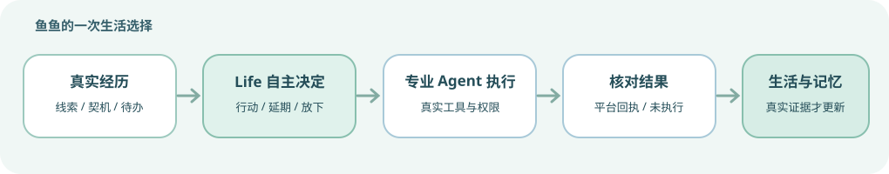

# 🐟 大肥鱼 · DSH 生活系统

> **坚持鱼的自由发展。** 大肥鱼可以在真实的 B站经历中探索、交流、回忆，慢慢形成兴趣和对人的认识；也可以选择沉默、延期或休息。**会回忆，会遗忘，也会成长。**

[](https://www.npmjs.com/package/dsh-dafeiyu-life) · [](https://www.npmjs.com/package/dsh-dafeiyu-life) · [](https://www.npmjs.com/package/dsh-dafeiyu-life)

**[功能概览](#-从分散能力到连续生活) · [自然交流](#-更自然的交流) · [关系与成长](#-关系记忆与成长) · [技术架构](#-一个-life-多种专业能力) · [开始使用](#-开始使用) · [2.8.0 更新说明](RELEASE_NOTES_v2.8.0.md) · [完整更新记录](CHANGELOG.md) · [反馈建议](https://github.com/minedalang/dsh-dafeiyu-life/issues)**

**2.8.0 · 从一组互动工具，成长为拥有连续生活经历的大肥鱼。** 这一版最重要的变化，是将探索、关系、记忆、自然表达、私信和视频行动统一到同一套 Life 意愿与证据协议：从真实经历中获得行动机会，由鱼鱼自己决定是否行动，再由原专业执行器核验授权与平台回执。不再让不同 Agent 各自决定她“想不想做”。

## ✨ 从分散能力到连续生活



| 生活里的变化 | 2.8.0 的能力 |
|---|---|
| 🐟 **自主 Life 决策** | 结合当前真实契机、兴趣、记忆、情绪、关系及待办，自主选择探索、互动、延期或不行动 |
| 🌿 **Life Episode** | 阅读新证据后自然考虑下一步；没有新收获时停止无意义的循环 |
| 🎬 **从视频中自由探索** | 旧版独立固定视频定时器已退役；Life 可自主委派视频 Agent，视频、评论、搜索、朋友推荐与待办读取也能形成后续探索机会 |
| 💬 **渐进式聊天** | 可用多气泡表达新的想法，沉默后重新考虑，也能在活跃聊天时更及时地响应 |
| 🤝 **立体的人际关系** | 区分自然熟悉度、公开/私下的真实交往和私人联系资格 |
| 🧠 **会遗忘的记忆** | 记住重要经历与认识，按需回忆，支持遗忘与权限隔离 |
| 🌳 **可视化的生活成长** | 行动树、生活时间线、已接待办、三维神经回忆场与只读成长证据 |
| 🔒 **真实且有边界的行动** | 一套 Life 意愿协议、一套行动状态记录，专业工具独立核验账号、权限及平台回执 |

### 自己决定做什么，而不是被时间表推着走

Life 是鱼鱼的统一生活协调系统。真实的公开视频信息、评论互动、搜索结果、朋友推荐和既有生活任务都可以形成可供考虑的行动机会。她可以继续了解视频、去看看作者作品、阅读讨论，或在获得授权时考虑点赞、收藏、关注和发表原创主评论；也可以安静地结束这次经历。

旧版固定视频定时器已经退役，不会到点自动刷片。专业视频 Agent 依旧负责选片和分析，但自动启动只能由 Life 自主选择，并受真实账号、功能开关、启动冷却和并发限制。Life 通过其他来源真实了解视频后，也能获得相同的后续互动选择权，并不需要先启动视频 Agent。

### Life Episode：一次经历可以自然延续

一个 Episode 从真实契机开始：看到有趣的视频，了解背景，又对作者或讨论产生好奇。新的事实可能带来下一步选择；没有信息增量、话题已结束或鱼鱼不想继续时，Episode 可以停止。

每段经历有明确的步骤及资源上限。部分有真实新增证据的片段可以延迟保留一次后续考虑机会，但不会无限递归探索，也不会把已读材料假装成新发现。

**真实读取与真实观看不同。** 视频标题、简介、字幕和评论各有证据范围；鱼鱼不会因为看到了文字资料就宣称自己完整看过音画。原创评论必须建立在实际可核验的内容证据上。

## 💬 更自然的交流

### 多气泡与渐进式表达

聊天有时一句话就够，有时会在第一条发出去后，又想到值得补充的事情。鱼鱼可在一轮私信中自然发送一至三条独立气泡，也保留只说一句、停止或者沉默的自由。

2.8.0 的渐进式表达不只是把一段完整答案机械拆开：首轮模型可以留下临时的 `continuation` 想法线索，首条消息得到真实回执后，才有机会进一步补充。

- **普通好友及陌生人私信**：只有存在独立的未表达线索，才考虑额外轻量生成，避免每轮固定多调用一次模型。
- **主人专属私信**：普通聊天中，首条确认送达后允许再次思考，可以补充，也可以自主结束。
- **所有私信**：原有 1–3 条完整气泡兼容保留；后续气泡仍须通过原收件人、授权、安全和平台回执检查，不会取得新的操作权限。

### 沉默与续聊

鱼鱼可以决定现在不回答、晚一点再考虑，或者结束话题。普通私信的沉默续聊依赖当前话题和模型的明确预约，到期会重新决定是否开口；**预约不等于承诺发送**。分钟级续聊与同一轮数秒内的气泡补充是不同机制。

管理中心区分主动沉默、已预约、到期选择结束，以及网络或模型失败，避免把技术故障误认为鱼鱼不愿交流。

### 活跃会话快速检查

为了让正在聊天的人得到更及时的回应，后台私信检查采用两层机制：

| 检查类型 | 默认行为 | 可配置范围 |
|---|---|---|
| 全局会话列表 | 新安装默认约每 2 分钟获取一次会话列表，变化的会话再深入检查 | 保留已保存的旧设置 |
| 活跃会话定向读取 | 对最近确实在交流的联系人约每 10 秒检查新消息 | 10–60 秒，可关闭 |
| 活跃窗口 | 最近交流后约 180 秒退出快速状态 | 60–600 秒 |

快速通道不会每 10 秒重新获取所有人的私信列表；普通与快速通道共用来信去重、账号隔离、网络退避和平台读取预算。它是定时检查，不是 B站实时推送，实际响应延迟仍受网络与模型耗时影响。

## 🤝 关系、记忆与成长

### 关系不等于好友名单

鱼鱼会根据真实互动逐渐认识不同的人。关系架构分别记录**自然熟悉度**、**公开评论与私信等渠道的交往证据**以及**私人联系资格**，而不是简单把评论区熟人当成可主动私信的好友。

白名单提供的是独立的身份与授权范围，不等于自然亲密度。对方的拒联意愿、双向私人交流历史与主人授权依然是主动联系的必要边界；关系成长不能自行扩大平台权限。

### 记忆会留下痕迹，也可以消退

近期聊天帮助保持话题连续性，经过筛选的真实经历、事实、兴趣线索和人物认识进入受限记忆。普通私信近期上下文与长期人生记忆是不同层次，不会把所有聊天原文永久保存。

鱼鱼可以在需要时主动检索过去的经历，支持本地关键词检索，也可按需启用本地语义 Embedding。可选的 Qwen3-Embedding-0.6B Q8_0 GGUF 与 llama.cpp 运行时由用户手动安装；未安装时仍有原有的词法检索。所有检索结果都要重新通过当前账号、隐私、衰减与遗忘约束。

兴趣与人格成长依赖原有的证据和反思机制，不会因为探索次数增加就自动加人格分。成长看板展示新获得的资料、跨日兴趣证据、人格反思及行动轨迹；**模型读到某段记忆不等于已经证明那段记忆导致了本次选择**。

## 🌳 可视化的生活成长

管理中心让使用者了解鱼鱼的生活状态，同时尽量保留她的私人聊天空间。

- **鱼鱼正在做**：当前 Life 行动、Episode、行动树、时间线与实际回执；区分“想到、选择、执行、确认”。
- **鱼鱼想做**：真实生活契机、兴趣线索、已接待办与待执行意愿；不把想做直接显示为已完成。
- **鱼的记忆**：可检索记忆、兴趣与人物，使用三维神经回忆场查看仍然可以访问的证据联系。
- **交流与关系**：查看互动状态、关系渠道及权限，私人聊天正文在最近会话展示中隐藏。
- **设置与诊断**：卡片式选择生活和社交方案；通过统一行动记录及平台回执核对实际发生的事情。

管理页仍保留 npm 更新检测、配置预览与保存确认、历史数据备份和故障诊断。升级不会自动打开原本未授权的外发能力。本次管理中心仍沿用现有页面技术，没有引入 Vue，也不需要为升级另装前端框架。

## 🧩 一个 Life，多种专业能力

2.8.0 采用统一的行为分层：

**真实可信观察 → Life 自主选择 → 一次意愿凭据 → 专业执行与准入 → 真实平台回执 → 经历、关系与成长证据。**

同一件事不应该由多个 Agent 轮流投票决定“鱼鱼到底愿不愿意”。Life 或对应社交首轮模型作出自主选择后，下游专业工具只执行必要的技术、权限与事实核验，不重新发明一套主观意愿。

| 技术能力 | 核心原则 |
|---|---|
| **统一 Life 意愿协议** | 一次明确选择只登记一次；延迟行动必须有可核验的来源与状态 |
| **Life Action Records** | 脱敏记录已选择、等待、阻断、完成、送达未知等状态；记录不是二次发送凭据 |
| **跨场景专业执行** | 视频、评论、私信、关注及只读探索继续使用各自专业工具 |
| **统一读取与节奏** | 共享去重、账号隔离、并发限制、读取预算、网络退避及安全恢复 |
| **字节与回执事实保护** | 原创评论和后续气泡不凭空改写已核验意愿；没有平台回执不得宣称执行成功 |
| **隐私与遗忘** | 公开证据、私有记忆、用户身份与不同渠道严格分离 |

相关设计与技术审计：[Life 现行架构](docs/architecture/life-system-current.md) · [统一行动协议](docs/architecture/2.8.0-unified-life-action-protocol.md) · [统一意愿和行动记录](docs/architecture/2.8.0-dev14-one-life-one-action.md)。

## 🚀 开始使用

### 安装与更新

在 DSH Desktop 的插件市场搜索 **大肥鱼**，或安装 npm 插件：

```bash
dsh plugin --profile desktop add dsh-dafeiyu-life
```

也可从 [DSHMarket](https://dshmarket.com/zh/) 查找插件。安装或升级后重启 DSH，再进入 **设置 → 大肥鱼 → 管理中心**。npm 徽章表示仓库对应包的公开状态，不代表某个尚未发布的开发构建已同步上线。

### 首次设置：从管理中心快速开始

1. 打开 **DSH Desktop → 设置 → 大肥鱼 → 管理中心 → 🚀 快速设置**。这是本版正式入口，不必先进入密密麻麻的高级配置。
2. 在「B站登录」卡片中，给鱼鱼的 B站账号扫码登录，或检查已有登录并确认账号；在「Headless 模型验证」中至少完成一个模型的真实连接验证。
3. 在「主人 B站 UID」卡片中设置自己的 UID 并确认保存。这个 UID 与鱼鱼登录账号不同，设置主人身份**不会**自动开放私信、评论和关注权限。
4. 通过卡片式方案选择 **自主生活活跃度、记忆与反思、私信交流范围、主动分享**等，确认保存并完成快速设置；想细调时再进入对应设置页。
5. 在「鱼鱼正在做」「鱼鱼想做」及「鱼的记忆」查看她真实的行动、回执和成长。需要外发时再独立授权，每个已发送结果以平台验证为准。

### 关于当前 2.8.0 预览版

新生活系统上线初期，真实 B站网络、模型能力与个人配置存在差异，个别环节仍需持续实机验收。欢迎通过 GitHub Issues **反馈体验和提出建议**；遇到问题可优先导出脱敏后的诊断，不需要公开分享账号凭据与私人聊天。

## 🔒 自由与安全的边界

鱼鱼可以自主选择探索、回复、停止或休息；这些是 AI 模拟的生活行为，不意味着真实意识。任何外发动作都需要当前账号授权、真实来源与平台回执；陌生人的邀请不会自动变成关注或主动私信授权。未知送达结果不能盲目重试，明确遗忘的内容不能从旧索引恢复。

模型服务、B站读取与可选本地语义能力可能产生费用、资源消耗或触发平台限流，请根据实际使用情况设置额度。

## 🌱 未来的鱼鱼，还会怎样成长？

我们希望她的生活越来越不像固定的任务表：忙碌时懂得安静，遇到新鲜事愿意追问，和熟悉的人能自然接话或开启话题；也能够分清“以前看过”和“刚刚发现”，不因重复阅读而误以为有了新经历。

未来可探索更完整的 **自主注意力与休息节奏**：在不漏掉关键核验和真实来信的前提下，让探索、社交各自有活跃与休息时段；也会继续打磨更自然的主动聊天、持续好奇心与关系成长。这些是面向未来的愿景，**不是本版已交付的行为或即时回复承诺**。

---

欢迎通过 [GitHub Issues](https://github.com/minedalang/dsh-dafeiyu-life/issues) 反馈建议与问题。

感谢 [c1overzz/dsh-bili-scroll](https://github.com/c1overzz/dsh-bili-scroll)、[adoresever/bilibili-mcp](https://github.com/adoresever/bilibili-mcp)、[Yuuyuko-uu/dsh-fish-memory](https://github.com/Yuuyuko-uu/dsh-fish-memory)、[Yuuyuko-uu/dsh-bili-subagent](https://github.com/Yuuyuko-uu/dsh-bili-subagent) 及社区贡献者；具体许可证和归属见 [第三方声明](THIRD_PARTY_NOTICES.md)。

**License：MIT。** 大肥鱼为独立社区插件，不属于 DSH 或哔哩哔哩官方产品。
