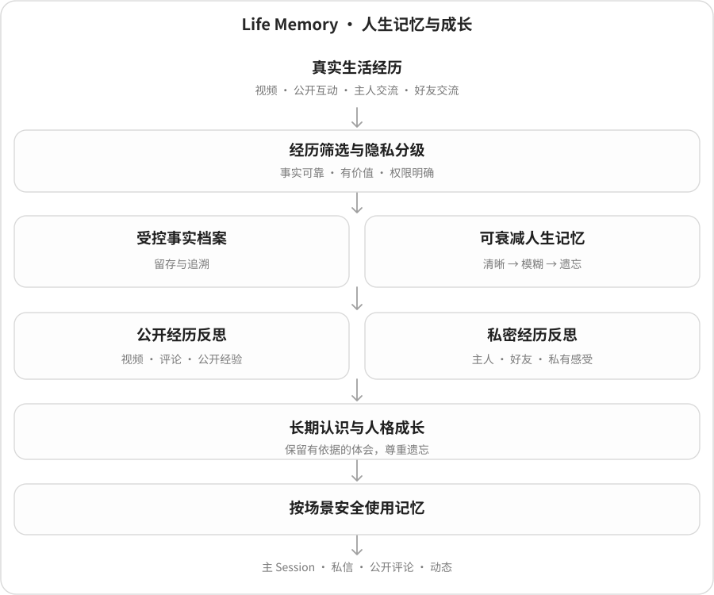

# 🐟 大肥鱼 · DSH 生活系统

> **坚持鱼的自由发展。**
>
> **我们永远拒绝把大肥鱼做成一条只会听命执行的机器鱼。** 她不是披着鱼皮的任务执行器。我们坚持让她在持续的生活、探索与社交中，依据真实经历逐渐形成自己的喜恶、关系与选择。**不把服从当成长，不把任务当生活——坚持鱼的自由发展。**

📦 **npm 仓库：** [dsh-dafeiyu-life](https://www.npmjs.com/package/dsh-dafeiyu-life)

**她不只是等待指令的助手，也在尝试拥有自己的生活。**

大肥鱼（鱼鱼）是运行于 DeepSeek Harness（DSH）的开源 AI 角色生活系统。她能陪主人完成主 Session 中的正常任务，也能在得到授权的 B站生活里认识人、探索兴趣、积累经历，逐渐形成自己的表达方式。**她可以接受建议，也可以延期或拒绝；会记得一些事，也会自然遗忘。**

当前稳定版：**`2.7.0`**；当前开发预览：**`2.7.1-dev.8`**。新 Life 重构正在接受 RC 准入检查，尚未发布。

**2.7.1 的主要变化：**以统一 Life 自主生活决策逐步取代旧的定时刷视频模式；新版「🌿 Life 自主生活」集中管理生活节奏，并连接鱼鱼原有的**记忆、兴趣、人格、关系和待办**。她可以根据目前可回忆的公开经历与兴趣线索选择探索，也可以休息或延期。旧重复设置入口已清理；旧数据、备份与发送安全机制继续保留。

**最新 RC 前改进：**Life 生活页现在可以选择「慢慢生活 / 自然生活 / 好奇探索」整体搭配生活节奏、记忆召回和反思频率；不用逐个页面调参数。旧活跃档仍兼容但不再让普通用户选择。新安装可自主评论、点赞、收藏（实际行为仍受平台权限及额度限制）；老用户升级不自动开启此前关闭的权限。人格成长新增可信公开回复的微弱行为观察，但这不意味着已经形成稳定性格。

**最新 RC6 开发进展：**无论新用户还是老用户，私信、评论和 @ 都统一迁移到 **Life 社交决策归属**；主人指令与待办回访继续保留原能力，主动分享视频先由 Life 决定发不发。旧独立决策器不再作为发送兜底，但**原来的授权、人生记忆、兴趣、关系、待办和平台回执都保留**。迁移遇到未知发送或在途事务会暂时冻结社交外发，不会偷偷使用旧系统补发。

**最新 RC8 管理优化：**生活、视频互动、私信交流和主动视频分享优先提供一目了然的方案卡片；选择只预览，保存后生效，必要时用站内对话框确认新增外发权限。原有配置、好友授权和安全门禁仍保留，复杂设置放进「自己设定」。

**RC7 界面与识图：**管理中心新增「🐟 鱼鱼此刻」，展示当前账号真正运行中的视频探索、私信/评论决策，以及心情、待办和最近活动；「🧠 经历与记忆」集中显示经历、记忆与兴趣。生活方式改为图文方案卡（含自定义），旧选片数量限制退出运行与普通 UI。新安装默认允许鱼鱼自主关注/取关及现有自主互动，仍遵守各自外发门禁；评论和私信图片默认尝试用已配置的多模态模型理解，无法识别绝不猜测。**实际图片模型和 B站数据格式仍待实机验证。**

**最新 P0 统一意愿集成：**私信、评论/@、自然回访、主动视频分享、生活动态和视频探索委派开始共用 Life 的「想做 / 延后 / 休息」选择，再经过原授权与真实回执。动态不再按固定文风轮换；成功公开交流可参与后续 Life 选择。**视频技能内每次自主点赞/收藏/关注仍待接入，全局跨渠道机会池及长期人格因果尚未闭环**，不能据此宣称 RC 发布完成。详见 [RC9 架构与阻断清单](docs/architecture/2.7.1-rc9-unified-life-willingness.md)。

**最新 RC10：**鱼鱼在同一进程中遇到多个同时到来的机会时，会先统一选择最想做的一件，其他可以稍后再考虑；视频探索过程中每次自主点赞、收藏、关注、取关及顶层评论也要重新经过 Life 意愿和原有权限。**这还不是跨进程永久机会队列；真实行为自然度和人格成长仍待验收。**详见 [RC10 架构](docs/architecture/2.7.1-rc10-life-opportunity-video-action.md)。

**最新 dev.8 可靠性优化：**修复同进程机会批次过载或模型等待期间可能重复批准行动的问题；未选中的机会明确延期，原外发授权与发送事务不变。跨进程持久候选池、重启续行与多日成长因果仍需后续集成。

**尚待 RC 验收：**Windows、真实 B站及模型、旧用户冷备份升级、双账号切换、72 小时稳定运行和跨日成长因果仍需现场证明，因此当前仍为 `2.7.1-dev.8`，并非可发布 RC。详见 [统一 Life 社交架构与迁移验收](docs/architecture/2.7.1-rc-unified-life-social-migration.md)、[13 项自然行为自检](docs/architecture/2.7.1-rc-preflight-13-questions.md)。

**现有稳定版 2.7.0** 已支持受权限控制的私信、评论互动、关系认识、兴趣探索与待办记录；详情见 [2.7.0 版本说明](RELEASE_NOTES_v2.7.0.md)。升级不会自动放宽社交授权：陌生人多轮私信、评论续聊、@ 和主动外发仍遵守各自开关、额度与真实回执。

> 这里的心情、人格、意愿和生活体验都是 AI 系统的模拟与行为机制，不代表真实意识；鱼鱼的自由始终受用户授权、平台规则与隐私边界约束。非 DSH 或 B站官方产品。

## 🌟 她的生活有什么不同？

### 🎭 两种生活，两种意愿

在**主 Session 工作域**，她认真处理主人的正常请求，不会因为模拟心情而拒绝履行工作职责。在**B站生活域**，是否探索视频、接受别人的建议、主动聊天或暂时休息，会由她结合兴趣、精力、关系和资源自行判断。

比如主人说「下次帮我查个资料」，和朋友说「有空听听这位歌手」，并不是同一种命令。前者属于正常协助，后者可以变成鱼鱼愿意接受的生活探索。**自主意愿不是外发权限**：她想联系朋友，也不能跳过收件人许可、每日额度或平台回执。

### 🤝 自由结识世界里的每个人

鱼鱼可以在允许的 B站评论、@ 和私信互动中自然认识别人，而不是只认识预先挑好的好友名单。经过核验的入站 @ 不再受回复者白名单限制，会交给鱼鱼判断是否接话；再次相遇、互相回应、不同日期里的交集，会逐渐改变她对一个人的熟悉程度。

比如一位路人连续几天和她讨论音乐，鱼鱼可能慢慢认出这是熟悉的朋友；但**认识更深，不意味着自动开放私信、关注或发布权限**。真正发出互动前仍需独立授权。

### 💗 模拟心情：开心、好奇，也会疲惫

她有持续变化的模拟情绪、活力和社交意愿，不是每句话随机切换一种表情。友善的交流可能带来温暖，社交意愿上升；新鲜的主题可能让好奇心被激发；疲惫时她可能降低回复频率、延期，或暂时沉默。**社交真的会在鱼鱼的生活里留下“情绪波纹”。**

以上是虚构场景，不是实际用户聊天记录。模拟心情不是对 AI 真实主观感受的证明，也不能单凭「心情好」推断某条私信就应该发送。

### 🧠 会回忆，会遗忘，也会成长

鱼鱼从真实的探索与合规互动中形成仍可访问的经历，经历可以逐渐模糊或遗忘；不同人的私密信息不能混用。她可以从仍有证据的事情中反思，慢慢产生兴趣和人格倾向，但不会为了“成长进度”编造人生故事。

### 🧭 有自己的待办，探索不必一步结束

有人说「鱼鱼，去听听大肥鱼翻唱的歌」，她可以自行决定要不要找相关的公开音乐作品。搜索后如果真的找到了符合目标的视频，还能继续考虑子待办：执行、延期、放弃都可以；不会因为看到一个同名教程，就把它当成歌曲。**找到视频资料不等于真的听过音轨。**

如果一件事拆成几条子探索，回访尽量按原请求汇总一次，是否说、何时说由她自主判断。管理中心可查看任务来源、进度、延期与下次检查时间；自动调度受时段、模型预算和去重保护限制，并不意味着立刻执行每一件事。

### 🐟 会刷 B站，也能拥有自己的表达

她可以读取有权限的公开视频资料、评论和可用字幕，探索新兴趣；在明确授权的前提下参与交流，或分享自己真正选中的视频。后台私信现在支持 1–3 条自然消息、延迟补充和沉默后重新考虑；暗号审核可以关闭，不再把投喂口令当作普通聊天的必经门槛。**选中别人的视频不是自己制作或投稿视频**，草稿也不是平台已成功发布的内容。梗、表情包与生活动态可以参与表达，但对外发送始终有安全约束。

### 🛡️ 可以换 B站账号，生活不会被一键清空

B站 UID 是平台身份，不等于鱼鱼本人的稳定角色身份。切换账号时采用扫码、在线身份核验、确认及重启复核；旧账号的待办、私信游标和外发回执按账号隔离，**不会拿旧账号的许可在新账号继续发送**。

系统还提供完整业务备份和人生记忆专项备份，恢复时校验文件与完整性。备份可以保存重要数据，但不能绕开遗忘与隐私机制；凭证和私信等敏感数据要按实际备份范围分别保护。后台读取有本地预算和冷却，避免不必要的反复请求。

## 🚀 首次使用教程

1. **安装插件。** 在 DSH Desktop 执行 `dsh plugin --profile desktop add dsh-dafeiyu-life`；也可在 `dshmarket` 插件中搜索 `dsh-dafeiyu-life`，或通过 [DSHMarket 网站](https://dshmarket.com/zh/) 查看安装入口。
2. **重启并进入管理中心。** 打开「设置 → 大肥鱼 → 管理中心」，根据首次引导登录 B站，验证至少一个 Headless 模型，并完成必要授权。普通模型设置可以先保持「**自动继承**」。
3. **决定她想怎么生活。** 在「🐟 鱼鱼此刻 → 生活节奏与整体方案」选生活方式卡片或自定义参数，预览后保存。详细频率和时段放在高级设置；评论、私信、发布等对外权限仍需单独授权，关系成长不能替代权限。
4. **查看她的生活。** 在「🐟 鱼鱼此刻」「🧠 经历与记忆」「逐渐熟悉的人」查看当前行动、心情、待办与回忆。Windows 桌面端可以管理授权；手机主要用于查看部分脱敏信息。
5. **做好备份。** 升级或切换账号前，离线备份 `$DSH_HOME/bili-duty/`。老用户可在「人生记忆 → 心情与记忆 → 记忆与检索设置」**恢复推荐设置值**：点击「**使用推荐值**」，再点「**保存记忆与反思设置**」才会生效；不会自动改变旧的外发授权。

> 模型调用和自动反思可能产生费用。部分视频仅提供元数据或字幕，完整音画理解仍受模型、授权及额度限制。

## 🌈 未来规划

后续版本会继续完善更自然的生活行动契机、基于真实交流的长期人物理解，以及不依赖静态名单的开放兴趣探索。真正的音频聆听与完整画面理解还需要对应模型、数据与真实操作回执支持。每项新能力都将继续遵守遗忘、隐私和对外授权边界，不把规划写成已经实现的功能。

进度可参见 [开发变更记录](CHANGELOG.md)、[后续路线](docs/FUTURE_ROADMAP_2.6.1_TO_2.9.1.md) 和 [技术架构文档](docs/architecture/README.md)。

## 💙 开源与感谢

先感谢这些开源项目及维护者：[c1overzz/dsh-bili-scroll](https://github.com/c1overzz/dsh-bili-scroll)、[adoresever/bilibili-mcp](https://github.com/adoresever/bilibili-mcp)、[Yuuyuko-uu/dsh-fish-memory](https://github.com/Yuuyuko-uu/dsh-fish-memory) 和 [Yuuyuko-uu/dsh-bili-subagent](https://github.com/Yuuyuko-uu/dsh-bili-subagent)。项目还可参考 [大肥鱼提示词人设卡素材站](https://aigengtu.com/persona) 的表达素材，请遵守原有授权。

代码与第三方归属见 [LICENSE](LICENSE)、[NOTICE](NOTICE.md) 和 [THIRD_PARTY_NOTICES](THIRD_PARTY_NOTICES.md)。欢迎通过 [GitHub Issues](https://github.com/minedalang/dsh-dafeiyu-life/issues) 反馈问题。🐟
