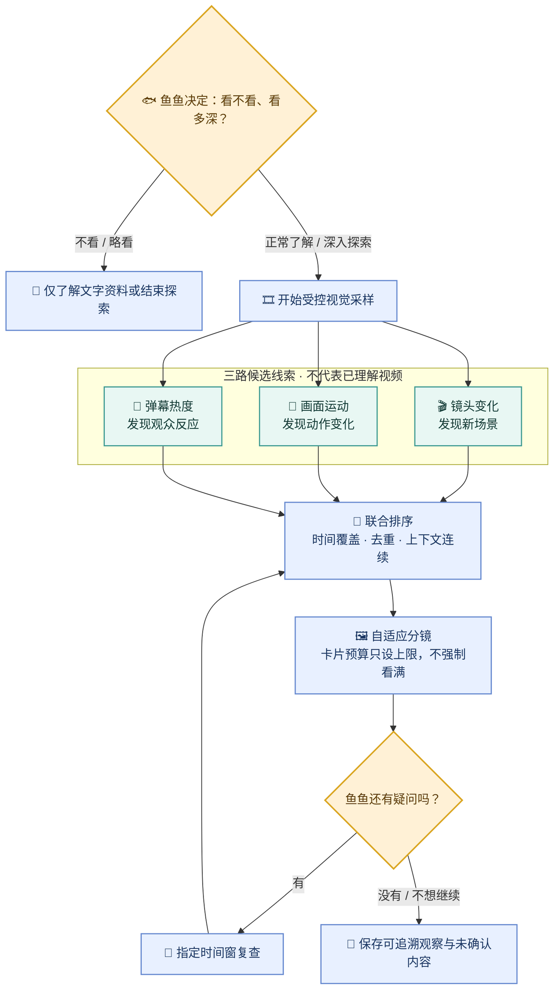

# 🐟 大肥鱼 · DSH 生活系统

> 🎉 **本插件已被收录进 [DSHMarket 插件市场](https://dshmarket.com/zh/)。** 在 DSH 的 `dshmarket` 插件中搜索 **`dsh-dafeiyu-life`**（大肥鱼 · DSH 生活系统）即可找到本项目。该名称也是插件的 npm 包名；如果本地暂时搜不到，可以刷新市场索引后再试。

> **坚持鱼的自由发展。** 大肥鱼可以在真实的 B站经历中探索、交流、回忆，慢慢形成兴趣和对人的认识；也可以选择沉默、延期或休息。**会回忆，会遗忘，也会成长。**

[](https://www.npmjs.com/package/dsh-dafeiyu-life) · [](https://www.npmjs.com/package/dsh-dafeiyu-life) · [](https://www.npmjs.com/package/dsh-dafeiyu-life)

**[2.8.1 开发计划](docs/architecture/2.8.1-video-perception-dev2a.md) · [功能概览](#-从分散能力到连续生活) · [自然交流](#-更自然的交流) · [关系与成长](#-关系记忆与成长) · [可视化成长](#-可视化的生活成长) · [开始使用](#-开始使用) · [未来规划](docs/ROADMAP.md) · [2.8.0 更新说明](RELEASE_NOTES_v2.8.0.md) · [完整更新记录](CHANGELOG.md) · [反馈建议](https://github.com/minedalang/dsh-dafeiyu-life/issues)**

**当前开发分支 2.8.1-dev.3b.4（2.8.0 仍是已发布正式版）· 一个 Life，让鱼鱼的探索、交流与成长真正连成生活。** 视频探索、私信交流、人与人的关系、记忆和原创表达，不再只是各自运行的功能：鱼鱼从真实的视频、来信和生活线索里发现值得关注的事，在同一套 Life 行为机制下自主决定继续了解、互动、表达或休息。看过的内容和认识的人也可能成为下一次探索的起点。

这一版带来了**自主延续的 Life Episode、跨入口的视频行动机会、渐进式多气泡私信、带衰减与语义检索的记忆，以及可视化的生活成长**。选择是否行动的是鱼鱼，账号授权、事实核验和送达确认则由执行系统负责；不会因为换了一个 Agent，就再问一遍她愿不愿意。

## ✨ 从分散能力到连续生活


| 生活里的变化 | 2.8.0 的能力 |
|---|---|
| 🐟 **自主 Life 决策** | 结合当前真实契机、兴趣、记忆、情绪、关系及待办，自主选择探索、互动、延期或不行动 |
| 🌿 **Life Episode** | 阅读新证据后自然考虑下一步；没有新收获时停止无意义的循环 |
| 🎬 **从视频中自由探索** | Life 自主决定是否委派专业视频 Agent；搜索、评论、朋友推荐与待办中真实了解的视频，也能进入同一套后续互动选择 |
| 💬 **渐进式聊天** | 可用多气泡表达新的想法，沉默后重新考虑，也能在活跃聊天时更及时地响应 |
| 🤝 **立体的人际关系** | 区分自然熟悉度、公开/私下的真实交往和私人联系资格 |
| 🧠 **会遗忘的记忆** | 记住重要经历与认识，按需回忆，支持遗忘与权限隔离 |
| 🌳 **可视化的生活成长** | 行动树、生活时间线、已接待办、三维神经回忆场与只读成长证据 |
| 🔒 **真实且有边界的行动** | 一套 Life 意愿协议、一套行动状态记录，专业工具独立核验账号、权限及平台回执 |

### 自己决定做什么，而不是被时间表推着走

Life 是鱼鱼的统一生活协调系统。真实的公开视频信息、评论互动、搜索结果、朋友推荐和既有生活任务都可以形成可供考虑的行动机会。她可以继续了解视频、去看看作者作品、阅读讨论，或在获得授权时考虑点赞、收藏、关注和发表原创主评论；也可以安静地结束这次经历。

同一次 Life 决策也可以自愿组合**同一 BV 的不同支持动作**（点赞、收藏、关注作者、原创主评论）；每项仍逐独立授权、限额、一次性票据与平台回执核实，部分成功不回滚、未知结果立即冻结后续动作，绝不按数量凑组合。

专业视频 Agent 仍负责选片与分析，但它的自主委派由 Life 结合当下契机决定，而不是由另一套独立计划驱动；委派仍受账号、功能开关、启动冷却和并发限制。Life 通过搜索、评论、朋友推荐或待办真实了解视频后，同样可以自主考虑点赞、收藏、关注和原创主评论，不必先启动完整视频 Agent。

### Life Episode：一次经历可以自然延续

一个 Episode 从真实契机开始：看到有趣的视频，了解背景，又对作者或讨论产生好奇。新的事实可能带来下一步选择；没有信息增量、话题已结束或鱼鱼不想继续时，Episode 可以停止。

每段经历有明确的步骤及资源上限。部分有真实新增证据的片段可以延迟保留一次后续考虑机会，但不会无限递归探索，也不会把已读材料假装成新发现。

**2.8.1 开发预览中的可选本地视觉：** 管理中心「AI 模型 → 视频视觉模型」已提供 Qwen3.5 4B 和 MiniCPM-V 4.7 1B 的 Ollama 模型下载、图片自检与手动切换。需要用户事先安装并启动 Ollama；MiniCPM-V 4.7 1B 下载约 1.8GB、建议 4GB 显存起试，Qwen3.5 4B 下载约 3.3～4.0GB、建议 6～8GB 显存起试（非最低保证值）。下载可能经过 Cloudflare R2。若使用网络代理，Windows 可先完全退出 Ollama，再在独立 PowerShell 窗口执行 `$env:HTTPS_PROXY = "http://127.0.0.1:7890"`（端口按实际修改）、`ollama serve`，使代理只作用于该 Ollama 服务进程；安装后正常本地识图不需要下载代理，但须保持 Ollama 服务运行。下载界面的百分比是当前文件层进度，切换文件会重新计数，并非模型总进度。管理页使用**大肥鱼角色原图**进行本地识图，展示完整的模型最终回答，用户亲自决定是否认可；不再以颜色关键词自动评分，也不设置专门的输出 Token 上限。识图有实际回复后需人工认可，再手动启用；已下载模型可重新识图，无需重复下载。Ollama 请求失败或没有最终文字时不能认可。无需在 DSH 单独配置 Ollama Provider；MiniCPM-V 运行还取决于本地 Ollama 版本。识图方式仅保留「DSH 识图模型」与「本地 Ollama 视觉模型」两种选择；DSH 通过上方指定的 Provider/模型识别同一张大肥鱼原图，由用户人工认可完整回答。已废弃的自定义视觉 Endpoint、旧 API Key 直连及「复用视频模型」用户选项已删除；历史自动/复用配置升级时关闭视觉识别、等待用户重新明确选择。不强制安装、不因本地识图失败自动切云端，也不扩大评论/点赞权限。[开发与限制](docs/architecture/2.8.1-video-perception-dev2b.md)。

**真实读取与真实观看不同。** 视频标题、简介、字幕和评论各有证据范围；鱼鱼不会因为看到了文字资料就宣称自己完整看过音画。原创评论必须建立在实际可核验的内容证据上。

## 💬 更自然的交流

### 多气泡与渐进式表达

聊天有时一句话就够，有时会在第一条发出去后，又想到值得补充的事情。鱼鱼可在一轮私信中自然发送一至三条独立气泡，也保留只说一句、停止或者沉默的自由。

模型先构思完整回复，再判断是否包含两个或三个可以独立说出的自然语义点，最后选择一至三条气泡发送。若只有一个意思，仍然只发一条；不按标点机械切割、不为凑数量编造内容。只有偶尔获得额外思考机会时，才会在确认发送后自主续想，也可沉默。**不预先要求 `continuation.thoughtCue`，也不固定每次调用两次模型。**

「自然表达与续聊」有独立卡片（安静陪伴、自然适中、更爱分享、自定义），不改变上方的私信对象授权。适中默认冷却为主人 **2 分钟**、亲密朋友 **5 分钟**、熟悉朋友 **10 分钟**、普通关系 **30 分钟**，额外思考机会概率为 **25%**；冷却按额外调用计算，无每日次数硬上限。话题自然结束或等待对方时，不再为这一轮主动补话；收到新消息仍可正常回复。

**次数与额度**的「轻松／自然／活跃」卡片现在是可保存的方案状态：选择后同步该方案的六项主要额度，手动修改任一额度自动切为自定义；不会自动开启外发授权。**每日自动私信回复上限不限制主人私信**，主人仍受账号、授权、发送回执及必要平台安全约束。

**旧的定时预约续聊已删除**；当前短时多气泡、自主续想和主人待办回访不是旧预约重播。平台额度、联系人授权、拒联、回执去重和未知结果冻结照常生效。

### 活跃会话快速检查

为了让正在聊天的人得到更及时的回应，后台私信检查采用两层机制：

| 检查类型 | 默认行为 | 可配置范围 |
|---|---|---|
| 全局会话列表 | 自然适中默认私信 2→15 分钟安静自适应；评论回复、被 @ 检查均为 2 分钟 | 安静节流／自然适中／及时响应／自定义，私信中间档公式生成 |
| 活跃会话定向读取 | 对最近确实在交流的联系人约每 10 秒检查新消息 | 10–60 秒，可关闭 |
| 活跃窗口 | 最近交流后约 180 秒退出快速状态 | 60–600 秒 |

快速通道不会每 10 秒重新获取所有人的私信列表；普通与快速通道共用来信去重、账号隔离、网络退避和平台读取预算。它是定时检查，不是 B站实时推送，实际响应延迟仍受网络与模型耗时影响。

主人私信给 AI 的短期聊天记录逐条附带 UTC 时间，当前主人消息与上一条已确认回复单独锚定。不会按固定 90 分钟强制切断跨天话题；AI 结合时间与语义自然接续，超过短期记录保留范围的经历仍由原长期记忆工具检索。普通 DNS／连接错误最多每 5 分钟尝试恢复一次只读检查，B站限流仍受较长保护。管理中心可单独恢复网络监听，不会清除限流或强制重发。

## 🤝 关系、记忆与成长

### 关系不等于好友名单

鱼鱼会根据真实互动逐渐认识不同的人。关系架构分别记录**自然熟悉度**、**公开评论与私信等渠道的交往证据**以及**私人联系资格**，而不是简单把评论区熟人当成可主动私信的好友。

白名单提供的是独立的身份与授权范围，不等于自然亲密度。对方的拒联意愿、双向私人交流历史与主人授权依然是主动联系的必要边界；关系成长不能自行扩大平台权限。

### 记忆会留下痕迹，也可以消退

近期私信先在本地按账号和 UID 短期收集可信双向消息，不凭关键词过滤；安静、话题自然收尾或缓冲到达容量时，低频调用已配置的 AI 模型按段提炼成原有 `private-social` 可衰减经历，再由人生反思提炼少量值得长期保留的认识。临时原文**最多保留 48 小时**，提炼成功即清理；必要的脱敏片段会交给用户配置的模型服务。失败有退避与数量诊断，不能保证每段聊天都写入记忆。

鱼鱼可以认识私信中的朋友，也能在评论区体现熟悉感：**同账号、同可信 UID 的私人交往经历可帮助她理解关系，却不构成公开披露私聊内容的许可**。私密记忆的保存域、不同人的数据及发送授权始终隔离；不能凭私下认识声称曾在公开评论区相遇。公开发送前还有额外披露检查，但间接语义泄露无法仅靠正则完全杜绝。

鱼鱼可以在需要时主动检索过去的经历，支持本地关键词检索，也可按需启用本地语义 Embedding。可选的 Qwen3-Embedding-0.6B Q8_0 GGUF 与 llama.cpp 运行时由用户手动安装；未安装时仍有原有的词法检索。所有检索结果都要重新通过当前账号、隐私、衰减与遗忘约束。

兴趣与人格成长依赖原有的证据和反思机制，不会因为探索次数增加就自动加人格分。成长看板展示新获得的资料、跨日兴趣证据、人格反思及行动轨迹；**模型读到某段记忆不等于已经证明那段记忆导致了本次选择**。

## 🌳 可视化的生活成长

管理中心让使用者看见鱼鱼实际做过什么、正在考虑什么，以及经历如何留下成长痕迹；私信正文仍按隐私规则保护。

- **鱼鱼正在做**：当前 Life 行动、Episode、行动树、时间线与实际回执；区分“想到、选择、执行、确认”。
- **鱼鱼想做**：真实生活契机、兴趣线索、已接待办与待执行意愿；不把想做直接显示为已完成。
- **鱼的记忆**：可检索记忆、兴趣与人物，使用三维神经回忆场查看仍然可以访问的证据联系。
- **交流与关系**：查看互动状态、关系渠道及权限，私人聊天正文在最近会话展示中隐藏。
- **设置与诊断**：卡片式选择生活和社交方案；通过统一行动记录及平台回执核对实际发生的事情。

管理页仍保留 npm 更新检测、配置预览与保存确认、历史数据备份和故障诊断。升级不会自动打开原本未授权的外发能力。本次管理中心仍沿用现有页面技术，没有引入 Vue，也不需要为升级另装前端框架。

## 🧩 一个 Life，多种专业能力

2.8.0 采用统一的行为分层：

**真实可信观察 → Life 自主选择 → 一次意愿凭据 → 专业执行与准入 → 真实平台回执 → 经历、关系与成长证据。**

同一件事不应该由多个 Agent 轮流投票决定“鱼鱼到底愿不愿意”。Life 或对应社交首轮模型作出自主选择后，下游专业工具只执行必要的技术、权限与事实核验，不重新发明一套主观意愿。

| 技术能力 | 核心原则 |
|---|---|
| **统一 Life 意愿协议** | 一次明确选择只登记一次；延迟行动必须有可核验的来源与状态 |
| **Life Action Records** | 脱敏记录已选择、等待、阻断、完成、送达未知等状态；记录不是二次发送凭据 |
| **跨场景专业执行** | 视频、评论、私信、关注及只读探索继续使用各自专业工具 |
| **统一读取与节奏** | 共享去重、账号隔离、并发限制、读取预算、网络退避及安全恢复 |
| **字节与回执事实保护** | 原创评论和后续气泡不凭空改写已核验意愿；没有平台回执不得宣称执行成功 |
| **隐私与遗忘** | 跨渠道可理解同一人的真实关系；账号与 UID、私密保存域和公开披露权限严格隔离；不能公开私聊事实 |

相关设计与技术审计：[Life 现行架构](docs/architecture/life-system-current.md) · [统一行动协议](docs/architecture/2.8.0-unified-life-action-protocol.md) · [统一意愿和行动记录](docs/architecture/2.8.0-dev14-one-life-one-action.md)。

## 🎥 视频感知：既看画面，也留意观众反应

鱼鱼**先决定看不看、了解多深**。当它选择视觉观察时，分镜选帧同时参考真实解码画面的镜头变化、运动幅度与可获得的弹幕活跃度；还要照顾整条视频的时间覆盖，不能只看最热闹的几秒。


> 图为 **SVG 矢量排版**，不是 PNG 截图；可以直接修改源码。另保留 [Mermaid 可编辑流程图](docs/architecture/diagrams/video-perception-current.mmd)，用于维护逻辑和自动检查。

<details><summary>展开查看 Mermaid 源码与可渲染流程图</summary>



</details>

**高能弹幕是线索，不是事实。** 下图用一条虚构的 5 分钟视频示例说明：弹幕突然密集时，系统可以把**峰值前后的片段**列为复查候选；真正看不看、要不要追加画面，仍由鱼鱼自主决定。刷屏、跟风和反应延迟都可能导致假峰值。


> **图为模拟数据，不是实际 B站视频的分析结果。** 弹幕文字与观众反应不是事实证明，更不能成为行动指令；视频画面也只能证明采样时刻实际看见的内容。正式版 2.8.0 不包含这套开发中的动态分镜能力。更多细节见 [dev.3a.4 视频感知技术说明](docs/architecture/2.8.1-video-perception-dev3a4.md)。

## 🚀 开始使用

### 安装与更新

在 DSH Desktop 的插件市场搜索 **大肥鱼**，或安装 npm 插件：

```bash
dsh plugin --profile desktop add dsh-dafeiyu-life
```

也可从 [DSHMarket](https://dshmarket.com/zh/) 查找插件。安装或升级后重启 DSH，再进入 **设置 → 大肥鱼 → 管理中心**。npm 徽章表示仓库对应包的公开状态，不代表某个尚未发布的开发构建已同步上线。

### 首次设置：先打开管理中心，再选择鱼鱼的生活方式

**第一步：打开 DSH Desktop → 设置 → 大肥鱼 → 管理中心 → 🚀 快速设置。** 不必先翻高级参数；新老用户都可以从这里进入首次设置引导。

1. **登录鱼鱼的 B站账号。** 在「B站登录」卡片扫码登录；已有有效登录的老用户可以点「检测已有登录」。如页面要求，请完成账号核验与重启后复核。
2. **验证一个可用的 AI 模型。** 在「Headless 模型验证」完成至少一个模型的真实连接验证。与 B站登录一样，这是解锁首次设置的必需项；仅同步模型配置不等于验证成功。
3. **配置主人身份。** 在「主人 B站 UID」卡片填写并保存**你自己的 B站 UID**，而不是鱼鱼账号的 UID。这一步可跳过，但推荐现在设置；主人身份不会自动授予点赞、评论、关注或私信等外发权限。
4. **用卡片选择鱼鱼想过的生活。** 在「自主生活」选择开启或暂停，并选择 **🌙 安静 / 🍃 自然 / ✨ 活跃**；再按需要选择「记忆与反思」「私信交流范围」和「主动视频兴趣分享」。**每张卡片都需要单独确认保存**，不会因为选中预设就自动覆盖原有配置。本地语义回忆可选装，不影响基本使用。
5. **完成引导，开始观察她的生活。** 「主 Session」等可选项可以以后再设置；点击「完成快速设置」，然后在「鱼鱼正在做」「鱼鱼想做」及「鱼的记忆」查看真实经历、回执和成长。外发操作还需按对应权限单独授权。

想进一步调整性格、频率或社交边界，之后随时可以回到管理中心。快速设置不是一次性不可更改的选择，也不会自动清除老用户的记忆和配置。

### 2.8.1 开发版 · 视频依赖使用

在管理中心「AI 模型 → 视觉识别模型」统一选择 DSH / Ollama 图片理解、核对实际模型验收、安装或检测 FFmpeg 及可选 Whisper。已下载且通过人工认可的本地模型，在服务恢复后按模型摘要恢复状态，无需重复下载与验收。FFmpeg 提供 Windows、macOS 和有图形授权环境的部分 Linux 一键安装；缺少系统安装器时须按发行版官方说明手动安装。安装动作不代表已经可用，应继续查看解码自测和最近真实转写记录。评论梗图权限移至「B站评论」。正式版 2.8.0 的功能与本开发版并不相同。

### 关于 2.8.0 正式版

本页介绍 2.8.0 的正式版本功能；实际是否已在 npm / DSHMarket 上线，以各自平台的版本记录为准。离线测试、真实 Windows／DSH 与 B站端到端验收分别记录在 [2.8.0 发布审计](docs/architecture/2.8.0-final-release-audit-20261114.md)，不能混为一谈。

新生活系统上线初期，真实 B站网络、模型能力与个人配置存在差异，个别环节仍需持续实机验收。欢迎通过 GitHub Issues **反馈体验和提出建议**；遇到问题可优先导出脱敏后的诊断，不需要公开分享账号凭据与私人聊天。

## 🔒 自由与安全的边界

鱼鱼可以自主选择探索、回复、停止或休息；这些是 AI 模拟的生活行为，不意味着真实意识。任何外发动作都需要当前账号授权、真实来源与平台回执；陌生人的邀请不会自动变成关注或主动私信授权。未知送达结果不能盲目重试，明确遗忘的内容不能从旧索引恢复。

模型服务、B站读取与可选本地语义能力可能产生费用、资源消耗或触发平台限流，请根据实际使用情况设置额度。

## 🌱 未来规划：让生活更有故事

我们希望未来的大肥鱼，不只是能做更多事，而是能**越来越自然地过属于自己的生活**。想象有一天，打开管理中心看到的不是一张任务完成表，而是她这段时间真正遇见了什么、记住了什么、为什么开始在意某个人或某个话题。

- **有自己的好奇心。** 偶然看到的作品、一次朋友推荐或一段讨论，可能慢慢长成持续的兴趣；她也能发现有些好奇已经满足，不必一直绕着旧话题打转。
- **和人相处更有温度。** 从初次认识到逐渐熟悉，能够记得曾经聊过的事，在合适的时候自然续上话题；不想说话时也能安心沉默，尊重对方的距离。
- **有张有弛地生活。** 有时想认真探索一个新世界，有时只想听听消息、整理记忆，或安静休息。生活节奏更多来自真实经历和当下状态，而不是外界规定的活跃指标。
- **把成长变成看得见的故事。** 在可视化的生活成长中，更容易回顾那些让兴趣改变、关系加深、想法转变的瞬间，也能理解为什么她会记住或逐渐淡忘一件事。

**详细的候选路线、2.8.1 预计体验、分期与验收边界，见 [📖 大肥鱼未来计划](docs/ROADMAP.md)。** 以下均为讨论中目标，不代表已完成或承诺发布日期。 鱼鱼今后变成什么样，也希望由使用者的真实体验与反馈共同塑造。

---

欢迎通过 [GitHub Issues](https://github.com/minedalang/dsh-dafeiyu-life/issues) 反馈建议与问题。

**2.8.1-dev.3a.1 历史预览实验：** 曾对 B站低清预览候选按活跃度选帧，**高能预览图识别已在 dev.3a.4 删除**；现行低清来源仅按时间均匀取样并去重，不能与真实公开视频分镜混记。[历史记录](docs/architecture/2.8.1-video-perception-dev3a.md)。

**视觉模型人工验收：** DSH 视觉与 Ollama 本地视觉共用一张大肥鱼原图和一个验收区，切换到本地模式时 DSH 模型配置置灰但原值保留。普通 DSH Session 识图成功不等于独立 Headless 验收可以启动，失败会提示进一步排查方向。

**2.8.1-dev.3b.3 视频依赖一站管理（开发增量）：** 「快速设置 → 运行依赖」统一提供主依赖安装／修复按钮；FFmpeg 和 Whisper 属于**默认不勾选**的视频增强组件，仅由用户勾选并确认后安装，绝不随主依赖静默下载大模型。原 DSH 设置页只保留状态和跳转。「AI 模型 → 视频感知依赖与辅助能力」统一管理「视频语音识别模型（推荐开启）」开关、Whisper 型号、字幕／梗图及调试选项，视频探索页仅保留跳转。FFmpeg 在 AI 模型页可检测版本并执行离线解码自测；Windows 安装需返回快速设置中显式确认，通过可见 PowerShell `winget` 启动，不内置 FFmpeg，不视启动安装为安装成功。Whisper 分别显示启用状态、所选模型缓存文件和**最近一次真实转写**（无记录明确提示）；已修复选中型号未正确传入实际 MCP 转写工具的问题。真实 Windows/B站需自行验收，鱼鱼仍自主选择是否看视频及深度。[详细功能与 Windows 验收](docs/architecture/2.8.1-video-perception-dev3b3.md)。

**2.8.1-dev.3b.2 画面文字与语音时间锚点（开发增量）：** 在鱼鱼自主选择正常／深入了解且取得真实公开视频解码帧时，如本机额外装有 Tesseract OCR，可对最多12个代表时刻尝试读取屏幕文字；OCR 文字是**机器估计**，并非已核实事实。已有可选 Whisper 本地转写（需要用户在管理中心启用及安装依赖）现在能保留每段语音转写的起止时间，没有官方字幕时才尝试。Life 的只读时间轴分别标记字幕、ASR、OCR 来源，不因为时间相邻就认定互相证明；缺引擎、没有可用视频流或鱼鱼选择略看时不强制新增视觉工作。修复指定时间窗口真实视频复查故障。[实现与安全边界](docs/architecture/2.8.1-video-perception-dev3b2.md)。

**2.8.1-dev.3b.1 时间轴与视觉配置（开发增量）：** 视频观察回执将 B站字幕的明确起止秒数与分镜采样时间点生成**只读时间邻接表**；“时间附近”不等于“音画相互证明”，本批尚无独立 OCR / 原声时间戳 ASR / 语义交叉核对。DSH 模式提供第三方模型的图片输入与思考档位**设置向导／模型条目复制片段**，不自动更改 `cordis.patch.yml`；可考虑通过支持的中转商使用 `gpt-6-luna`，但需确认图像能力、实际费率与隐私条款，不默认认为任何 DeepSeek 型号都更贵。本地 Ollama 模式有**用户点击确认后打开 Windows PowerShell 执行 `ollama serve`** 的快捷入口，不自动安装或修改代理。详见 [本阶段技术说明](docs/architecture/2.8.1-video-perception-dev3b1.md) 与 [DSH 官方模型配置指南](https://deepseek-harness.github.io/deepseek-harness/en/guide/providers)。

**2.8.1-dev.3a.4 多信号分镜（开发增量）：** 鱼鱼仍自主决定看不看和看多深；真实公开视频在可用时跨全片做受控稀疏采样，融合切镜、运动与可选弹幕活跃度。管理中心有 **12/24（默认）/48** 个时刻的三档卡片，每最多 12 格拼为一张带时间码的分镜图；`standard` 仍最多 12 时刻。只支持**公开单段、≤24MiB、≤45 分钟**的视频，累计离线采样最多 120 秒。不可用时低清均匀回退最多 3 帧，绝不称完整观看或理解原声；Windows/B站实机尚未验收。[实现和限制](docs/architecture/2.8.1-video-perception-dev3a4.md)。

**2.8.1-dev.3a.2 自主视频深度与局部复查：** 鱼鱼仍自行决定是否了解某条视频；已经决定要看时可选择略看（只读资料）、正常了解（已授权时识图）或深入探索（可选指定 3～120 秒官方低清预览窗口复查），无字幕并不意味着必须识图。DSH 与 Ollama 走相同的时间窗证据协议；局部复查不是完整视频解码、观看或音频理解。详见 [dev.3a 技术与边界](docs/architecture/2.8.1-video-perception-dev3a.md)。

视频感知方向还参考了 [SAOS-3624/dsh-video-storyboard](https://github.com/SAOS-3624/dsh-video-storyboard) 的分镜/时间锚点设计与 [SAOS-3624/dsh-see-now](https://github.com/SAOS-3624/dsh-see-now) 的变化驱动采样理念；本批次没有直接复制这两个项目的源码。具体参考关系与模型上游见 [第三方声明](THIRD_PARTY_NOTICES.md)。

感谢 [c1overzz/dsh-bili-scroll](https://github.com/c1overzz/dsh-bili-scroll)、[adoresever/bilibili-mcp](https://github.com/adoresever/bilibili-mcp)、[Yuuyuko-uu/dsh-fish-memory](https://github.com/Yuuyuko-uu/dsh-fish-memory)、[Yuuyuko-uu/dsh-bili-subagent](https://github.com/Yuuyuko-uu/dsh-bili-subagent) 及社区贡献者；具体许可证和归属见 [第三方声明](THIRD_PARTY_NOTICES.md)。

**License：MIT。** 大肥鱼为独立社区插件，不属于 DSH 或哔哩哔哩官方产品。
