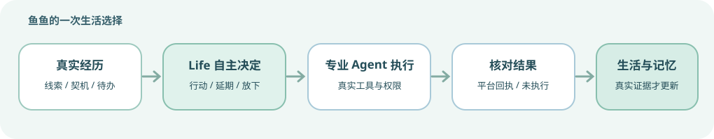

# 大肥鱼 2.8.0 · 正式版更新说明

> **坚持鱼的自由发展。** 2.8.0 带来更完整的自主 Life、可追溯生活事项、神经回忆场与自然关系；安装包实际版本请以插件管理器为准。

## 🌟 主要新功能

- **统一自主 Life**：从真实经历、兴趣、关系和待办中发现可选行动，自主选择继续探索、延期或休息；不再以旧刷片定时器作为唯一生活节奏。
- **鱼鱼正在做 + 动态行为树**：将候选、意愿、执行和核验分开显示；与生活时间线共享可信只读来源，核心生活事件可通过 SSE 局部更新。
- **鱼鱼想做**：统一卡片呈现生活线索、契机和已接受待办。可核实的来源可直接查看；待办操作和历史证据按需展开，而不是堆叠旧页面。
- **神经回忆场与成长记忆**：3D 查看真实可回忆节点，搜索框紧贴图形，支持全屏；可选本地 Embedding 检索，遗忘与访问限制始终优先。
- **自然关系三维度**：人物熟悉度、交流渠道和主动私信开放资格独立核验；评论区熟人不会因此被贸然主动私信。
- **透明的生活节奏和模型配置**：设置可见，Headless 同步需要预览与明确确认，发送权限仍由单独的安全门禁控制。

## 🔧 重要稳定性改进

- **Life 异常退出后自动恢复**：插件重新启动时安全识别和释放已退出进程遗留的自主规划运行锁；管理中心会显示恢复结果，不再静默卡住。未知发送不会重放，损坏或归属不明的锁仍保持安全阻断。

- **历代正式版备份恢复兼容**：支持 v2.4.99 第一代无签名备份（含历史格式名），继续支持 v2.5.0～v2.7.0 的 SHA-256 备份；修复旧兴趣成长历史导致业务与人生记忆备份失败的问题。恢复预览显示本机时间；旧版缺失原始签名或身份标记会明确提醒。升级／恢复前仍建议停机保存完整本地快照。

- 尚未完成的主评论意愿可在有可信 pending 证据时安全跨轮恢复，绝不重放已批准或结果未知的外发。
- Life 模型意愿、执行与平台回执分开结算；后台评论/私信技术失败不再直接等同自主沉默。
- 系统以真实账号与来源隔离数据，保留严格的用户授权、额度、防重复、未知结果冻结和 B站风控退避。
- 管理中心移除重复说明与堆叠旧 UI，按需展示待办管理或来源核验；修正待办区搬迁后的布局和按钮样式；本版本**不引入 Vue**。

## 🐟 一起让鱼鱼变得更好

**新的生活系统刚上线，可能仍有不稳定、遗漏或 Bug。非常欢迎大家反馈问题、分享使用体验和提出建议，让鱼鱼插件在社区陪伴下变得越来越好。**

[前往 GitHub Issues 提意见](https://github.com/minedalang/dsh-dafeiyu-life/issues)

## 📦 升级与数据兼容

升级前建议停机保存完整本地快照。新备份保留 SHA-256 清单；第一代老备份虽然支持导入，但没有原始签名与可靠的角色身份标签，恢复时会明确告知风险、要求额外确认。不同账号或来源不明的备份不应覆盖现有资料。具体兼容性与验收情况见 [发布与恢复审计](docs/architecture/2.8.0-release-readiness.md)。
