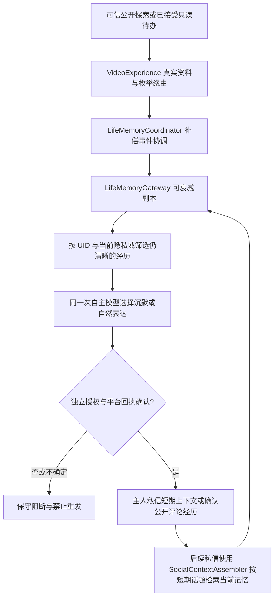

# 2.6.1 发布候选：统一已接受待办完成回访

## 真实执行链路

`SocialInteractionCoordinator` 已认证的真实私信／评论事件 → 已有 `DualContextAgency` 愿意接受 → `owner-todos.json` 持久化已接受待办及 `origin` → 后台只读执行并收到结果回执 → `owner-todo-followup.mjs` 按原消息 UID、原渠道建立独立回访 → 检查联系授权、禁言时段、额度 → 鱼鱼用模型选择 `reply` / `defer` / `skip`、可用的评论/DM 渠道 → 评论作者二次核验 → 预占 `sending` → B站平台调用 → `sent` / `uncertain`。

## 渠道与权限

- 私信进来，只能在私信回复；不能把私人谈话发到评论。
- 评论进来，默认只回复该视频的**原评论**，不发新顶层评论。
- 评论来源的自然 `familiar`/`friend` 关系同时具独立 `friendDirectory.dm` 授权时，模型可考虑改用私信；不能仅凭自然关系拿到发送权限。
- 普通自然陌生人可成为回访候选，但新增全局 `socialTodoCompletionFollowupEnabled` 默认关闭，且每次发送仍需要原渠道允许和平台权限。
- 评论的 `bvid/rpid/root` 来自已认证 B站适配器，不接受用户消息正文自报 UID。新增 Python 评论线程读取结果的 `root_comment.mid` 供根评论作者核对；缺少真实 ID 则阻止发送。
- 多个用户推荐同一 BV 时，原始推荐来源保留真实消息 ID，不因任务去重而丢掉其他用户。

## 生命周期与旧记录

- 任务完成只是产生可选回访，不是强制发言；模型可以延迟最多两轮或沉默。
- `pending` 表示还未尝试，`blocked` 代表权限/身份核验失败，`sent` 表示远端返回明确成功回执，`uncertain` 代表禁止盲重试，`expired` 代表 7 天后到期，`skipped` 代表鱼鱼选择沉默。
- 旧 v1 `owner-todo-followups.json` 原样读取，无来源字段的记录只保留原主人私信回访语义，不补猜评论位置。`sending` 在重启后变为 `uncertain`，不是自动重试。
- 多实例使用 lock 文件，遗留锁必须人工核验。全局每日四条、每人 24 小时一条、两次发送至少间隔 30 分钟、安静时段 22:00–09:00；渠道各自额度继续生效。
- `socialOutreachEnabled`、`socialAutoSend` 等兴趣视频推荐权限不授予完成回访的发送权，反之亦然。

## 本机验收

1. 先备份 `$DSH_HOME/bili-duty/`，尤其 `owner-todos.json` 和 `owner-todo-followups.json`。
2. 先用测试 B站账号/测试评论验证：DM 任务完成后回到同一 UID 的 DM；评论任务完成后原评论获得回复，不发顶层评论；错误 UID/rpid 必须被拦截。
3. 让两个不同 UID 推荐同一 BV，分别检查来源和发送状态；关闭其他用户回访时不能发送。
4. 连续运行、重启验证旧 `pending` 不丢失、`sending` 不自动重试；同 UID 冷却。
5. 对熟悉且明确允许 DM 的好友尝试评论→DM，未授权者必须保持评论原地回访。
6. 如平台风控拒绝，检查 `reason` 与回执，**不要手动改成 sent，也不要删除账本**。

注意：模拟测试不能证明生产环境的 B站消息送达或评论审核结果。

## RC2 约束（待验收）

- 同 UID 冷却默认 60 分钟、24h 总额默认 12、全局最小间隔默认 5 分钟；0 冷却/间隔不放开平台权限。静默可以独立关闭。
- 统一计划器完成父搜索后，最多连续考虑 3 个真实关联视频，各自消耗预算并重新核验意愿。
- 原始请求者 UID、消息 ID、渠道须完全匹配才可合并子任务；发送成功/发送中断/结果不确定的历史行禁止重发。子待办未全部终止前不允许汇总发送。

## RC2 发送权限解耦与诊断增补

- 发送权限链：`ownerTodoCompletionFollowupEnabled`（主人）或 `socialTodoCompletionFollowupEnabled`（其他原请求者）→ 原 UID/渠道/消息 ID 和原任务终态 → `SocialPolicy`／实际平台可联系检查（总开关、拒绝、退订、频道额度）→ 自主意愿 → 预占发送记录 → 平台回执。
- `dmWatch` 是私信**收件轮询**，`dmMode` 是视频报告投递渠道，均不是完成待办的外发授权。旧版本用它们阻止回访属于层间耦合错误。即使收件轮询关闭，已有且完整核实的原请求仍可按**独立回访授权**决定是否回访。
- 回访检查单独调度，`ownerTodoFollowupPollMinutes` 1～60 分钟（默认 2 分钟）；插件准备好后 5 秒首次检查，配置修改后重算下一次检查。管理页显式检查只唤醒同一 `tick`，不提升权限或绕开意愿/限额。
- 管理中心手动 `retryBlocked` 仅对旧版 `blocked: 私信功能关闭` 且无任何发送尝试的私信适用：再次核对该原请求真实 UID、消息 ID、关联任务终态、同组发送回执、原用户许可、7 天窗口并让操作者确认。成功只恢复为 `pending`；之后鱼鱼仍可拒绝或延期。`sent/sending/uncertain`、来源不一致、多源误合并、重复平台回执及跨渠道发送一律不在可恢复范围。
- 来源不一致不能自动修复：需要从源 `owner-todos.json` 的原始事件和真实平台消息核验，不得通过更改 UID/messageId 或把 blocked 改 sent 来制造已送达记录。

## RC2 连续人生经历补充接线（当前实现）

- `lib/life-experience-continuity.mjs` 仅是验证与**当前**记忆读取的共享助手，不持久化平行记忆。模型的正文不可信；只有已有清晰经历才能形成回访候选，不能从 `owner-todos` 已关闭任务或回访历史补全已经遗忘的歌曲细节。
- `video-experience.mjs` 将 `accepted-todo / self-exploration / main-session` 可信枚举缘由写入同一个 watch 事件；不写入原私信话术或任务发起者 UID，不冒充播放音频。
- 发送器只允许模型一次同时输出 `decision/channel/text`，发送前后保留原授权、渠道、审计锁和回执防重放。成功后才调用 `onSent`：主人 DM 写入对应 UID 的短期对话引用（24 小时内可接上），公开原评论回复在平台确认 rpid 后交 `LifeMemoryCoordinator` 记为公开发言。发送故障不能生成“已表达”经历。
- 主人 DM Agent 的普通已确认回复可产生**低敏抽象的鱼鱼个人感想**；收到主人纠错时只记录有纠错发生的证据，不直接把用户的说法当成已核实的外部事实。保留 `private-social` 所有分域防护，不持久化原文、真实 UID 或跨域内容。
- 保留已有公开评论 `recordSocialReply`、长时记忆检索与分域反思的统一入口；其他业务不允许通过任务历史旁路检索。
- 意愿与权限是不同层：自主选择联系并不开放 DM、评论、P6 连发或沉默续聊。模型返回可疑感官陈述时禁止发送，而不是套固定模板。

### 跨入口审计矩阵增补

| 入口 | 经历写入 | 自主表达/后续召回 | 边界 |
| --- | --- | --- | --- |
| 自主视频 / 主 Session 视频 / 已接受待办 | 统一 VideoExperience → LifeMemoryCoordinator | 当前 LifeMemoryGateway 按域检索 | 不伪称听音视频，私人原话不入公开记录 |
| 完成回访 DM | 平台确认后写短期同 UID 对话与低敏私密感想 | 主人 DM Agent 的原有上下文 + SocialContextAssembler | 不构建第二套永久记忆；确认失败不回写 |
| 主人日常私信 | 已有入站低敏经历；确认发出后个人感想 | 已有短期对话与可衰减记忆 | 私信不外泄；纠正待核实 |
| 公开评论及原评论回访 | 已有社交回复记忆；平台确认原 rpid 后统一写入 | 原有社交记忆检索 | 作者/频道核验、无盲重发 |
| 人格反思 / 兴趣 / 动态草稿 | 继续消费已验证且按域授权的经历投影 | 不从永久备份恢复遗忘内容 | 不自动公开、不跨私域 |

## RC2 自然对话接入待办补充（发布前候选）

- 入队必须经过可信 B站事件 → 意图候选 → `DualContextAgency` 允许 → `owner-todos` 持久化；回访与任务提取仍是不同阶段，不在普通对话模型的口头承诺上推断“已接受”。
- 主人 `OwnerDmAgent` 的首个现有 JSON 可同时返回 `todoDisposition` 与 `suggestedTodo`。只有明确 `accept`（或旧模型在回复中清楚承诺自身未来的只读探索），且当前主人文本可核实，才允许对解析错误的只读主题建议使用确定性兜底；不增加模型调用、不执行外部写入。
- 承接“那首歌”时必须由本条主人消息出现未来提议、带准确的当前原话引用，以及近期十五分钟、同一 UID、角色为用户的原话中包含实际主题；不能从助手回复、历史档案、别人的话或跨 UID 进行猜测。
- 主人、好友、普通用户在已启用的私信/评论入口中，都由本入口原有 AI 调用理解自然语言并给出结构化只读探索提议；不增加额外意图提取调用，不使用普通用户关键词规则。消息正文不复制入待办档案，重复消息经来源键去重。
- 诊断为 `saved/already-saved/invalid-evidence/model-defer/model-refuse/willingness-defer/willingness-refuse/save-failed/no-proposal`，方便区分未识别、未接受与保存故障；不得使用新的定时模型或绕开平台消息核验。
