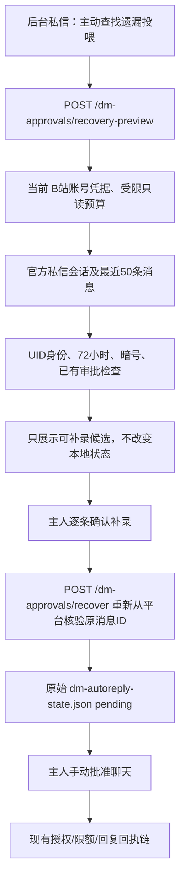

# 2.6.2 dev · 旧版私信投喂恢复（当前实现）

## 背景

旧版申请识别依赖整条精确暗号，`🍚🍚🍚🍚` 可被加入已处理消息 ID，但未建立申请。更新识别器不会自动重新处理历史消息，这有意保护入站游标及非幂等的外发。

## 真实生产接线

## 权限与幂等契约

1. 读取阶段必须使用账号绑定的有效登录凭证和 `biliReadBudget`。只读扫描不进入普通 `getNewDmMessages`、不调用 `dmPollCursor.observed/commit`，不触发 AI 或外发。
2. 查询候选只检查真实 `incoming`、非 system、未发送给自己、有效 UID、稳定消息 ID `uid:msgKey`、时间戳最近72小时内，符合当前暗号，且不在可信白名单或已有审批账本。
3. HTTP 接口不接受任意消息文本作为补录事实，只接受经预览的 UID 与 ID；写入时服务端重新取平台原文，在相同账号下校验后原子创建 `pending`。
4. 写入与正常私信处理共用文件锁。已批准／待审／已拒绝均禁止覆盖；记录原消息 ID、时间、证据标识 `verified-history`，并维持旧已读去重 ID。
5. 此动作不能代替原来的人工 `approve`；批准后原有对话额度、授权和发送占位、回执不确定状态仍然适用。
6. 盲区：B站仅返回最近窗口；不承诺完整历史覆盖。无凭证、超出72小时或被接口截断时拒绝恢复，并请用户核对对方 UID；不得伪造缺失的历史申请。

## 本轮验收

- 专项覆盖：已读历史、双次认证、伪造与超时、账号隔离、拒绝状态、暗号变动、不开启审核、无自动发送、管理入口。
- 实机验证仍需在 Windows DSH Desktop 使用真实账号进行；这轮没有自动审批、外发或版本发布。
