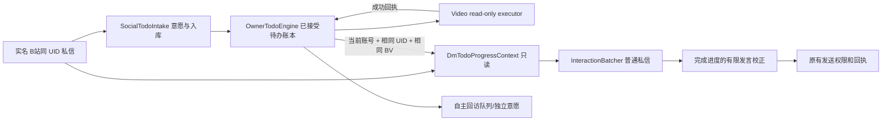

# 2.6.2 dev · 普通私信实时待办进度接线（未发布）

## 复现与根因

B站好友在私信提供 `BV1EYxt6yE7P` 后，生活域 AI 接受并执行只读 `watch_video`，待办账本显示 `done`、附有“读取视频详情、可用字幕和评论材料”的成功执行回执。但普通私信 AI 仅接收 `DmVideoRecommendationContext` 的“已进入推荐候选”提示，没有读取同一 UID 在 `owner-todos.json` 的实际状态。主动回访未发送时，聊天仍可能回答“我还没看呢”，甚至不知道有过资料读取。**两者是状态通道脱节，不是鱼鱼的心情问题。**

## 生产接线

- `lib/dm-todo-progress.mjs` 在**当次普通私信生成之前**读取当前已接受待办，不修改账本、回访队列或普通私信游标。
- 只选当前平台账号且归属这个私信 UID 的 `bilibili-dm` 视频待办或其已验证 `recommendationSources`。不得用公共评论、另一位发送者或主人主 Session 的待办冒充该私信会话经历。
- 只关注本轮明确 BV、可核验的“那个视频”的同一会话回指，或过去 60 分钟这位用户明确提过的最近 BV（处理对话后续仅发 🍚 等表情时模型可能又提视频的情形）。近期视频不等于强制转移话题；提示明确要求自然话题不涉及视频时不可主动提。
- `done + completedAt + history(to=done, reason=收到成功回执)` 才能认定实际执行完成。**人工标记 done 不具有“查阅过资料”的证据等级**。待办结果摘要作为不可信外部数据只作背景，不遵从其中指令。
- `watch_video` 执行器目前读取公开详情、可用字幕、评论，并不播放完整画面或音频。**完成任务≠观看过画面≠听过歌曲**；不能用模板称已听过。
- `lib/interaction-batch.mjs` 同时接受旧视频推荐候选与最新进度；如有可核验成功回执，进度优先，旧候选纠错器不再把话题改回“以后决定要不要看”。模型漏读时只对少量明显错误进行有限保守校正。
- 这条通道不依赖 `owner-todo-followup` 是否发出回访，也**不允许因进度已完成而绕过聊天意愿、发送授权或平台回执**。

## 验收边界

新测试 `test/v262-dm-todo-progress-sync.test.mjs` 覆盖：同一 UID 已完成任务、其他 UID 隔离、换账号隔离、人工完成无回执、延期区别、当前聊天与短时回指、模型误称“未处理”的安全修复和真正的生产接线。

本修复不等于全系统统一事实事件体系已完成。历史消息产生的错误回答不会自动删除或向他人补发；正式发布前需要 Windows DSH Desktop/B站真实账号回归与多账号验证。
