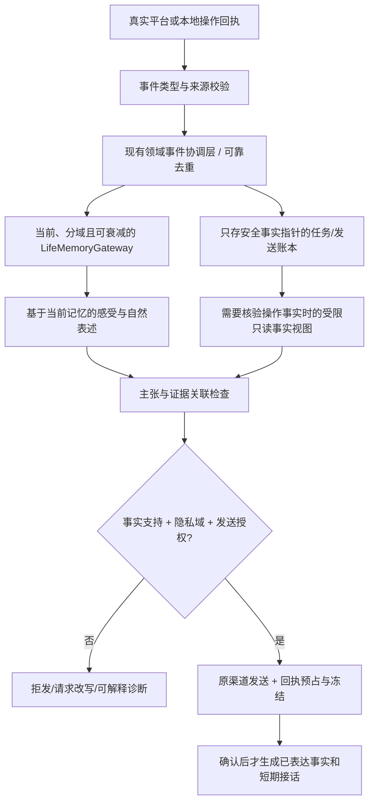

# 统一经历事实体系：设计提案（2.6.2 dev 后续阶段，不代表已经实现）

> 目标：减少「选中别人的视频→我自己投稿的视频入选了」「检索视频资料→我听过这首歌」「检索缓存→后续私信附无关链接」等跨场景事实混淆。鱼鱼可以自由感受、表达和沉默，但表达必须与真实事件证据一致。**本文件除 DEBUG 回访部分外均为规划；不得把它写成现有能力。**

## 1. 故障拆分

- **证据语义**：旧 `social-intentions` 把「本插件入选的公开视频」表达成容易被模型误读的「大肥鱼自己近期真实入选」。一个“入选”歧义导致从选片推断创作或投稿。
- **断言来源**：`claim-provenance.mjs` 的高风险文本拦截是局部兜底；无法证明所有自然语言主张均被授权。
- **会话衔接**：自主分享、主人 DM 回复、待办回访消费不同上下文。收到“你什么时候投稿了”这种质疑时应拿到上一条确认发送的实际出处，而不是拿旧搜索缓存猜测。
- **回访门禁**：`owner-todo-followup.mjs` 的 `nextAt` 是鱼鱼下一次自主考虑时间，不是下次平台轮询时间；普通检查原本不跳过。`index.js` 的 `chooseReply` 在缺少可信当前经历和任务成功回执时会直接延期，未必会真的进入模型。

## 2. 目标数据契约（复用现有事实源，不建立平行永久记忆）

```json
{
  "eventId": "stable-idempotency-key",
  "eventType": "video_selected",
  "at": 0,
  "subject": {"bvid": "BV..."},
  "source": {"system": "bilibili-picker", "operationId": "...", "receipt": "verified"},
  "claimsAllowed": ["selected_public_video"],
  "privacyScope": "public",
  "actor": "fish"
}
```

**事件类型必须严格区分：**

| 事实类型 | 允许说 | 不允许从中推导 |
| --- | --- | --- |
| `video_selected` | 我选中了一个已有的公开视频 | 我拍了、投稿了、这个视频是我自己的 |
| `video_metadata_read` | 我查到了标题、作者、简介等已返回的元数据 | 我看完了视频、听到歌曲或读懂了画面 |
| `subtitle_read` | 我读到了哪些确实获取的字幕片段 | 我亲自听到了声音 |
| `video_visual_inspected` | 我观察到确实被验证的画面要点 | 我听到了完整的演唱 |
| `audio_playback_verified` | 仅在将来具备可靠音频播放/感知回执时使用 | 仅有搜索或 BV 时假装听过 |
| `video_uploaded_verified` | 我用实际的投稿接口成功上传且得到真实平台回执 | 账号存在视频、别人发的视频或列表入选就当作投稿 |
| `todo_read_completed` | 按已核验的只读操作成功回执说明“查找过资料” | 推断具体音画、创作经历或重新唤回已遗忘细节 |
| `message_sent_verified` | 平台确认收到发送操作并保留原消息对象 | 发送尝试/网络异常就推断消息成功送达 |

建议在现有 `VideoExperience`、`owner-todos`、`LifeMemoryCoordinator` 的事件接口上增加版本化的 `eventType`、`sourceRef`、`claimsAllowed`，所有主 Session、B站探索、回访、私信共享同一个**只读事实视图**。不得把模型生成的自然语言当成事实来源。

## 3. 读写路径



**特别约束：** 事件账本只用于证明操作是否发生，不是给鱼鱼提供永久不遗忘的内容记忆。已经淡化、已遗忘的视觉细节和私信私人信息，不能从账本、备份或任务标题恢复给模型。`owner-dm`、好友私信、公开评论和主 Session 继续经过 UID/隐私域过滤。

## 4. 断言校验与纠错

1. 生成模型输出 `decision + message + structured claims(sourceRef, assertionType)`；模型列举的来源 ID 不可信，必须重读当前域内事实并交叉校验。
2. `ClaimVerifier` 先用**机器判定的事件类别硬约束**拒绝不受支持的创作、投稿、看完、听完或平台成功行为，再做窄范围自然语言检查；无法核实时拒发或要求重新表述，不自动造一条固定模板。
3. 收到主人的追问或纠正时，先定位**上一条真实发送回执与原始事实来源**，若确属上一条误述，允许她自然承认“刚才把选片说成自己投稿了”；承认错误不是凭空生成反向平台事实。
4. 纠错事件只记录“某条表达存在已核验错误／待验证纠正”，不未经核实把用户说法升级为公开事实，也不把私密消息复制到公开长期记忆。
5. 管理中心未来可展示：`说了什么 → 依据什么 → 哪个规则允许/阻断 → 最终是否确认发送`。用户能查到事实链，但不暴露未授权的其他 UID 原文。

## 5. 分阶段实施和验收

**阶段 A（这次交付）**：DEBUG 回访按 pending 记录重新决定一次（多条时必须明确指定目标），绕过个人延期 `nextAt`，不跳过静默、权限、限额、身份、来源、父子终态、去重及回执；输出“模型是否成功调用/本次决定/阻断原因”，防止多次 debug 将正常轮次计数推到永久跳过。保留原到期检查。

**阶段 B（下一轮，先做小范围代码改造）**：在 `VideoExperience`/待办/真实发送回执定义共享事件枚举；外发模型使用统一 `EvidenceView` 查询，不再由各 Agent 临时把字符串拼为「真实经历」。补表驱动测试：选片≠投稿、检索≠视听、旧缓存≠本轮搜索、父子来源不一致不能回访。

**阶段 C（跨模块改造）**：主人 DM / 自主社交 / 回访 / 反思逐一接线 `ClaimVerifier`；以同一条实际发送回执关联上一轮主张与出处，支持跨入口纠错。旧事实数据在无法确定来源时标为 `unknown`，不可自动补全或改写已发送记录。

**阶段 D（稳定性验证）**：故障注入（模型超时、无回执、重启后 `sending/uncertain`、UID 切换、私密域交换、被遗忘记录、旧数据升级、并发管理操作）；Windows DSH Desktop 实机验收，真实 B站沙盒授权测试。继续保留鱼鱼独立的意愿与沉默权。

## 6. 与 RC 回访调试的关系

调试入口**只能回答“今天为什么没有重新决定”**。它不能把待办完成记录当作音画经历，不能回溯已经遗忘的私密细节，也不能解除独立外发授权。若显示 `模型未成功调用`，应优先检查可信任务完成回执与当前记忆，不应继续反复点击 DEBUG 试图逼出发送。
