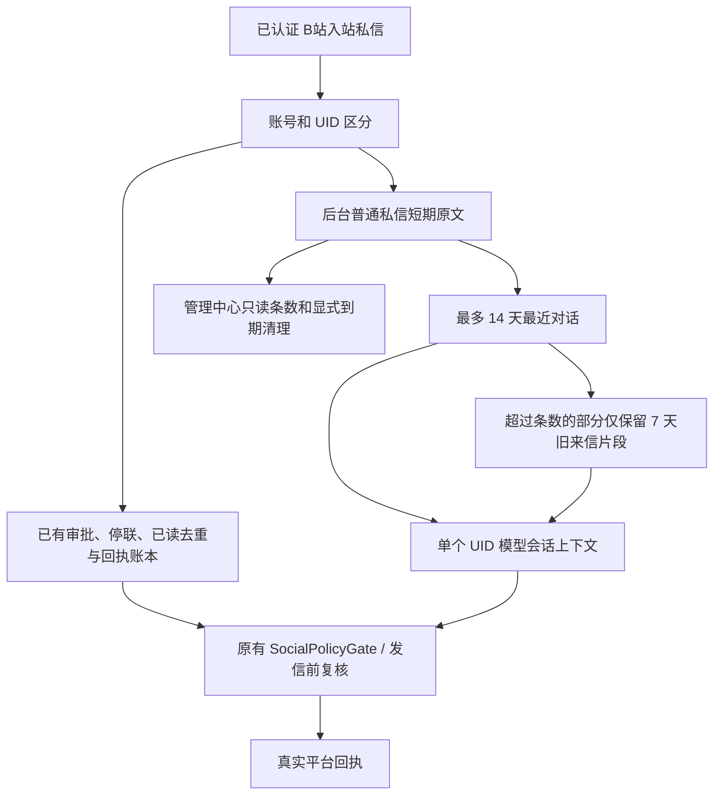

# 2.7.1-dev.2 · 私信短期上下文的来源、保留与治理（已接入部分）

> 当前实现范围：后台普通私信和主人专属 B站私信 Agent 的短期对话原文。**不是**全系统所有记忆的统一重构。稳定版 `2.7.0` 不变。开发版本 `2.7.1-dev.2`。

## 1. 统一层归属检查

| 入站与数据 | 实际模块 / 唯一来源 | 新逻辑 | 权限 / 失败边界 |
| --- | --- | --- | --- |
| 普通后台私信 | `dm-autoreply.mjs` 中原有 `dm-autoreply-state.json`，按已确认的登录账号 runtime 存储、按对方 UID 分区 | `dm-context-retention.mjs` 对短期原文做有期限、可观察的裁剪；不新建关系/长期记忆账本 | 不改 `seen`、拒联事实、审核、发送回执、冷却；无时间证明的历史摘录直接清理 |
| 主人专属私信 Agent | `owner-dm-agent.mjs` 原有 `owner-dm-agent.json`，有独立的 `historyUid` 约束 | 同一短期寿命原则，普通原文最多 14 天，真正发送成功的回访片段仅 24 小时 | 不读取陌生人的原文，不把 `mainSession` 上下文开关改为开启，不改执行授权 |
| 主 Session 普通语义记忆 | `long-term-memory.mjs`、`memory-consolidation.mjs` | **未改变**。只有其本来允许整理的主 Session 语义记忆才参与凝练 | 主人私信/好友私信不混进凝练器 |
| 可衰减的个人经历 | `life-memory-gateway.mjs` / `life-private-policy.mjs` | **未改变**，仍使用已有来源、身份、衰减与隐私门禁 | 不从已过期私信片段重新构造记忆，不从永久归档恢复原文 |
| 关系及交流偏好 | `social-portrait-gateway.mjs`、关系索引 | **未改变**：限于明确表示和可撤回证据 | 不能推断心理、亲密或自动授予私信发送权 |

## 2. 普通私信纯数据生命周期（不调用 AI）

- 同一 UID 的上下文与另一个 UID 的上下文永不拼接；无日期的旧版 `olderContext` 字符串不能确定保留期限，在自动清理或手动清理时直接丢弃。
- `historyLimit=0` 时当前轮仍可独立读取新的已认证入站消息，但本地不再保存它为下一轮聊天原文；已读 ID 等安全状态继续正常持久化。
- 自然续聊预约如果缺少已过期的原始话题信息，宁可取消或跳过，也不能用未知内容继续对外发言。
- 状态清理由原私信锁保护；管理页面状态读取只做本地只读投影，不额外访问 B站或调用模型。按钮需要明确确认。对话历史长度和天数不是可验证的友好关系或稳定的“人物理解”。

## 3. 真实验收入口

- 管理中心 → **后台私信 → 私信上下文与记忆边界**：显示当前账号普通私信原文、旧片段、待清理条数及主人专用 Agent 的独立短期记录数量。
- 点「清理过期聊天内容」后查看结果、刷新该页；不会触发私信发送。使用旧版数据时，尤其注意无日期摘录是否不再被送进模型。
- 人工验收：保存后台私信 0 条上下文后发两条不含敏感资料的测试私信，观察第二轮模型不携带第一轮旧对话、已读不重放；恢复到非零并验证另一 UID 的记录不能出现在本 UID 回复。
- 应进行 Windows / B站真实收件箱、网络异常与跨账号切换验收；离线测试不证明实际模型理解、完整隐私删除或设备备份已失效。

## 4. 刻意不做的事与后续工作

- 不在本轮重写长期记忆引擎、不让主 Session 合并陌生人私信、不从聊天次数自动生成亲密关系、不修改拒联允许状态。
- **数据删除范围有限**：本地备份、其他独立记忆文件、可撤销好友证据、真实平台存档、日志与永久审计档案不在该清理按钮范围内。界面明确说的是“后台普通私信短期原文”，不能宣传为全局遗忘。
- 后续需要逐个审计长期认识的证据冲突、撤回、覆盖，以及和 Life Memory 衰减的真实协同，并提供跨域验收；那部分尚未完成。
