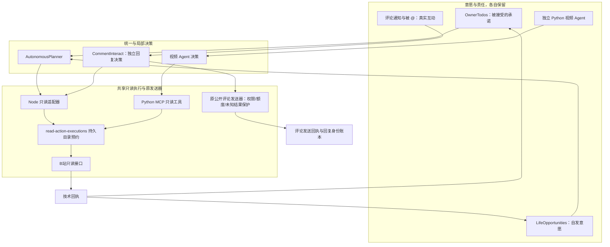
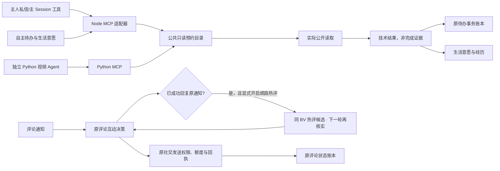

# 2.7.1-dev.3 · Node/Python 共用只读预约、待办事务与顺路热评参与

> **生产范围**：本次修改基于 `2.7.1-dev.3` 持久只读预约版；不迁移写操作发送器，不开放新主动私信／关注权限，不把“读到标题”当“观看视频”。仍需用户的 Windows DSH 与真实 B站端到端验收。

## 一、系统内部：按职责分层

**注意**：图中 Node 与 Python 共用的是已审核的 **8 类公开读取入口**（`bili_search`、`bili_video_info`、`bili_user_videos`、`bili_creator_relation_status`、`bili_comments`、`bili_comment_thread`、`bili_danmaku`、`bili_subtitle`），并非所有 MCP 工具。来自 Node `index.js` 内置 MCP 的同一次请求，由 Python 核实直接父进程已持有**对应动作**的预约后才允许复用，避免双重预约自锁；独立 Python Headless 必须自行预约。两边使用相同 UID、账号 generation、凭据作用域标签和动作参数哈希。若账号绑定数据不可读、账号切换未复核、目标身份非法、预约中断未人工核实，全部拒绝继续。

## 二、系统之间：当前共享及保留的边界

### Node/Python 一致性细节

- 主协议模块：`lib/read-action-execution-gate.mjs` 与 `vendor/bilibili-mcp/read_action_gate.py`；运行时通过 `ensureHomeFiles` 安全部署 Python 辅助模块，`mcpIntegrity` 和显式备份修复同时核对两份 Python 文件。
- Python 直接调用基于账号绑定文件及真实凭据计算作用域；非当前账号、缺少绑定、未确认切号全部 fail closed。私密搜索文本从未写入共享诊断，只有摘要键与操作类别。
- Python 崩溃、网络返回后本地记录失败、账号中途变化：保留锁等待人工核对，不把“没回执”冒充“没调用”。Node 仍保留原有 `ReadActionHeldError` 和人工解除机制。**没有跨语言 exactly-once，也不自动对账写操作。**
- Python 原工具函数仍按原工具白名单注册，不给模型新增隐藏能力；`BILI_JS_MCP_ADAPTER=1` 仅由受控插件子进程设置，并须同时验证实际父进程 PID 与对应 executing 锁，不能单靠环境变量冒充。

### 待办事务及迟到回执

- `owner-todos.json` 仍是承诺的唯一权威账本。`add / syncRecommendations / update / begin / finish / recoverInterrupted / markAutoReview` 的读改写都经过 `.owner-todos-write.lock` 原子文件互斥，JSON 最后仍走原子改名。只锁短暂事务，不把网络 I/O 包进锁。
- `begin` 为每次执行生成 `attemptId`；`run` 的 `finish` 带原 `attemptId`，拒绝已经取消／被恢复／重新开始的旧尝试回执，不能覆盖新状态。
- 如果写事务中进程崩溃，锁不会被静默忽略或自动重放；只允许在确认原进程结束且超过安全阈值后从运行诊断**显式释放锁**。解除锁不代表待办完成。
- 待办承诺与鱼鱼自由意愿的不同生命周期继续保留；同一个搜索回执不得自动将两个承诺一起记完成。

### 顺路热门评论（区别于旧版全视频巡扫）

1. 只处理本人已确认的真实入站回复通知；只有原回复实际取得成功回执后才尝试读取**同一 BV** 的其他热门评论。
2. 用户须显式开启「回复别人后顺路看看其他热评」，并开启普通公开回复授权；默认关闭，**不恢复**历史全视频/全时间热点巡扫。
3. 新目标保留真实 BV/RPID/评论 UID，最多 3 条，最多保留 24 小时；下次后台检查按原每日和每轮上限选择是否回复。发送前重新读取该 BV 热评，核实 RPID/作者/正文未变化，再次确认顺路回复授权。
4. 模型可以沉默；原评论未成功发送时不得产生候选；草稿不合规、取消授权、B站返回未知等状态仍由原发送器严格处理，不能按新功能重新发送不确定的旧草稿。

## 三、管理中心位置与用户文案

- **人生记忆 → 自主生活**：显示鱼鱼的真实经历、意愿和行动结果，不混入执行锁技术记录。
- **运行诊断 → 平台读取预约与中断核查**：查看 Node/Python 共用只读动作与回执。
- **运行诊断 → 待办账本并发与恢复**：查看事务锁和明确人工恢复入口。
- **最近评论 → 回复规则与授权**：可选「顺路参与其他热门评论」，与评论额度共用。用户文案使用「自然续聊」而非内部 P6 代号，说明即分条回复、过后再考虑补充、并非自动打招呼。

## 四、真实情景验收

| 情景 | 本地测试 | 仍需实机核查 |
|---|---|---|
| Node 与独立 Python 同账号同时读取同 BV | 只有一方可进入，同一锁目录 | Windows DSH 两个真实进程 |
| Node 内置 Python MCP 再次进入同一读取 | 仅真实父进程持有同动作预约时可进入 | 实际 MCP/uv 环境启动链 |
| Python 中断但 Node 想重读 | 仍有锁，拒绝自动重复调用 | Windows 杀进程／人工解除 |
| 两个 Node 进程并行创建待办 | 两份新增记录不会互相覆盖 | 主人 DM 与主 Session 并发 |
| 旧执行结果在待办重启后迟到 | 拒绝旧 attemptId，不破坏当前状态 | 真实网络超时恢复 |
| 收到回复 → 原评论已回复 → 顺路热评 | 有独立热评候选，原回复不会重复发送 | B站通知、不同 BV 的热评源与发布回执 |
| 原回复失败／关闭顺路授权 | 不新增或不发送顺路候选 | 额度耗尽／临时切换设置 |

## 五、未完成边界

- 评论侧与关注、私信及 P6 社交写操作尚未共用持久动作预约；写操作必须保留原安全 outbox 与未知结果冻结，不能直接套用只读预约的失败恢复语义。
- Python 视频 Agent 其它只读工具仍未全部纳入共享预约。字幕的可选视觉回退仅依赖原有授权/配额，不等于视觉模型被统一预约或全工具覆盖。
- 管理中心只显示技术结果、去重与人工恢复状态，不替代原业务回执或私信/评论平台可见性核验。

## 六、评论列表与楼中楼的共享预约及离线验收（dev.3 续迭代）

新增 `bili_comments(bvid,num)` 和 `bili_comment_thread(bvid,root,num,target_rpid)` 两类公开只读动作。每个参数进入 Node/Python 一致的 JSON 动作身份；不同评论楼层、目标回复和数量不误合并。Python 视频 Agent 在网络读取之前取得共享预约，Node 内置 Python MCP 仍需要验证直接父进程持有对应预约才能免于嵌套自锁；跨账号不互斥，未核实账号或异常中断 fail closed。不覆盖评论发送权限。

新增**实际可点击**的「运行诊断 → 自主行动基础能力 · 离线验收」：通过临时虚拟账号和本地模拟待办，测试同动作互斥、账号隔离、技术回执、旧回执阻断，不依赖模型、B站或用户真实数据。独立的 `node tools/dev3-acceptance.mjs --crosslang` 再用两个真实子进程核对 Node/Python 预约一致性。本地自检通过并不等于 Windows/真实平台可用；实机验收说明见 `2.7.1-dev3-acceptance.md`。

历史六类架构图：`diagrams/2.7.1-dev3-six-read-gate-live.mmd`；历史七类架构图：`diagrams/2.7.1-dev3-seven-read-gate-live.mmd`；当前八类：`diagrams/2.7.1-dev3-eight-read-gate-live.mmd`。仍未覆盖视觉独立预约、其他读取接口以及对外写操作；原渠道外发权限、outbox 和未知回执保护不能由只读预约替代。

## 七、弹幕只读预约接线（dev.3 后续增量）

`bili_danmaku(bvid,num)` 现在也进入 Node/Python 共享预约。动作身份同时绑定真实 BV 与实际请求弹幕条数（默认 `100`，接受 `1..300` 的严格整数），与评论列表、视频元数据分开。无效参数在调用前拒绝，不把同 BV 的不同读取强度误当成一次。

- `index.js` 原来的 MCP 入口会通过 `readToolAction` 取得预约；独立 Python 视频 Agent 直接调用 `bili_danmaku` 时由 `_gate_read` 在网络请求前预约。只有可核验的直接父进程持有**同一弹幕动作**的预约，内嵌 Python 才可复用该锁。
- 已有 `read-action-executions` 技术回执、账号核验、30 分钟人工核查、未知结果保留全部沿用；没有新增弹幕网络调用次数、改变配额或开放写入授权。
- 实机验收：先运行 `node --test test/v271-dev3-danmaku-read-gate.test.mjs`，再观察正常观看时实际发生的 `bili_danmaku` 回执。只有读取成功不能声称鱼鱼看过画面、听过音轨或形成兴趣。
- **范围边界：** `bili_subtitle` 可选触发视觉模型，不等于纯文本无副作用读取；本阶段仅将字幕入口纳入相同动作预约，视觉模型本身的权限、额度与结果仍由原有机制处理。外发写操作尚未统一。

## 八、字幕读取入口跨语言预约（dev.3 后续增量）

`bili_subtitle(bvid,auto_vision_on_missing)` 的**字幕读取入口**现与其余七类公开读取共用账号作用域与持久锁。Node/Python 都以真实 BV 作为动作身份：无论视觉回退开关如何，两条调用都会读取同一份字幕，不能跨进程重复读取。无效 BV 或非布尔回退参数拒绝调用。

- `auto_vision_on_missing=false` 时不会由字幕工具触发预览识图；`true` 只保留视频 Agent 既有的条件回退能力，仍须 `BILI_VISION_ENABLED=1` 且满足原先的额度和模型策略。**预约不授予视觉权限，不代表实际看过画面或听过音频。**
- 如果字幕工具在调用中实际转向视觉模型，字幕入口预约仍会覆盖这一调用期间；但直接 `bili_preview_vision` 及独立视觉模型调用暂不在共享只读预约范围，不得称为统一视觉执行。
- 回执的 `tool-returned` 只代表工具调用返回，不代表存在可用字幕、识图成功、模型理解成功或待办已完成。中断仍需要人工核对。
- 离线验收：`node --test test/v271-dev3-subtitle-read-gate.test.mjs`；`node tools/dev3-acceptance.mjs --crosslang`；均不访问真实 B站。Windows DSH 内真实读取、视觉配额与旧账号数据仍须手动验收。

### 字幕与预览视觉证据边界（本次增量）

字幕源仍与弹幕等八类读取共用跨进程预约；**预览识图不是第九类普通读取**：独立 DSH 视觉模式会从识图工具内部再启动受限子进程，若直接按普通 BV 锁对整个工具加锁，会挡住嵌套读取。保持原授权与额度，先在 `bili_subtitle` 回退结果增加不可混淆的证据类型和失败分类。下一阶段应分别审计预览抓帧、独立模型分析和图像结果交付的预约边界，再决定是否纳入共享协调。
