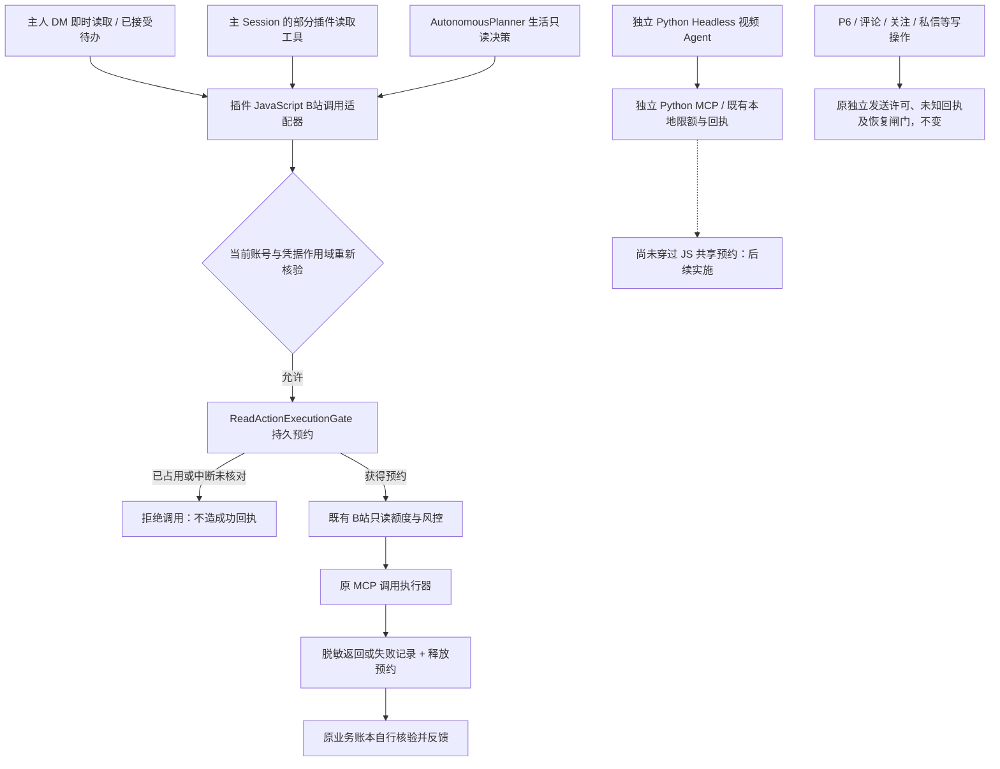
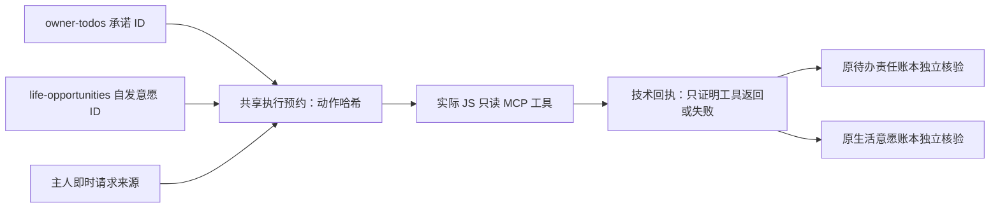

> **历史基线说明**：本文记录上一阶段仅接入 Node 共用 JS 读取适配器的情况。跨语言、待办事务与热评链的**最新当前实现**请参阅 [新架构文档](./2.7.1-dev3-cross-language-execution-and-comment-followup.md)。

# 2.7.1-dev.3 · 持久只读预约、跨入口冲突与保守恢复（实施第一段）

> **当前代码事实**：本轮在 `index.js` 的**共用 JavaScript MCP 调用适配器**接入持久预约，覆盖 `bili_search`、`bili_video_info`、`bili_user_videos`、`bili_creator_relation_status`。它们可以从主人待办、宿主插件工具、主人私信即时流程、生活调度等路径进入；**独立 Python Headless 视频 Agent 的直连 MCP 并不经过它**。社交发送和其它读写工具没有迁移。不能宣称全入口 exactly-once。

## 1. 当前实际执行结构

### 本轮真正修改的边界

- 全部纳入的只读工具，经 JS 适配器共享**同一个** `read-action-executions/locks/<sha256>` 原子目录预约，支持不同 Node 进程互斥。不是只在提示词里重复要求模型不要做。
- 每次执行前绑定已确认的 B站 UID、账号 generation、**当前真实登录凭据的 HMAC 作用域标签**，并在执行后再核对。文件里只存摘要，不存 UID、原文、搜索词、具体 BV、凭据。
- 行动身份包括完整的**操作类别和参数**：公开搜索的词、条数和排序；视频详情 BV；作者投稿 UID、页码、页大小和排序；同 BV 作者关系读取。不能混同公开视频元数据和实际观看内容；不同业务承诺保留各自身份。
- 已接受的 `search_videos` 和 `inspect_creator_videos` 在进入原 `ownerTodos.run` 的 `running` 状态**之前**取得预约，内部调用识别同一外层预约，避免自锁。其它路径在单次 JS 工具调用前预约。
- 预约有 `reserved → executing → tool-returned|tool-rejected|call-failed-or-unverified` 的技术回执；**`tool-returned` 只证明接口返回，不证明平台事实符合业务要求**。原 `owner-todos`、`life-opportunities` 等仍依据自己的结果验证后更新，不共享彼此的履约状态。
- 进程崩溃、回执无法持久化、凭据作用域中途变化：锁保留，不自动重发。管理中心显示待人工核对；超过 30 分钟且**发起进程已退出**时可显式解除锁。解除不等于平台成功，不会补写已完成待办。浏览器同源 POST 控制；不可用于写操作。
- 既有 `accountBinding.enterPlatformOperation()`、登录切换阻断、B站只读预算、原 P6/回访及社交外发门禁仍保留；新层没有增加 AI 调用或平台请求。

## 2. 身份、责任与状态的分离

同一只读操作暂时不允许跨进程同时执行，但**没有把一次技术回执复用为多个承诺的完成事实**。相同搜索词也可能有不同意图、不同期望；复用查询结果必须另有独立证据与责任确认，不能由互斥锁自动完成。

## 3. 失败与恢复语义

| 中断/故障点 | 新共享层行为 | 不可宣称 |
|---|---|---|
| 未取得预约，另一个入口占用 | `reservation-held`，本次不调用 MCP；对待办搜索在 `running` 之前停止 | 原待办已完成或已被取消 |
| 读取超时，执行器抛错 | 技术失败回执；安全地释放本次预约 | 已经获取或验证公开视频事实 |
| 工具返回 `{ok:false}` | `tool-rejected`；具体业务错误交原执行器处理 | 平台成功 |
| 平台调用时进程死亡 | 持久锁留存；管理中心可人工核查 | 立即自动重放；恰好一次成功 |
| 工具返回但持久回执写盘失败 | **继续锁住**，不把无法核实的结果当可重放 | 安全自动释放 |
| 调用期间账号作用域变化 | 阻止旧账号返回数据进入新账号路径，持久锁等待核查 | 能安全复用之前的结果 |
| 人工核对后解除旧预约 | `manual-review-no-replay`，仅解除这条只读锁 | 原待办或生活意愿完成 |

### 管理中心验收

**人生记忆 → 共用只读动作 · 预约与恢复**。可只读刷新、查看匿名执行来源及回执类别、统计尚未核对的中断预约。中断锁超过安全阈值且原进程已结束时，才可使用明确确认按钮解除；不会触发 B站、AI 或原账本修改。

1. 建立一个已接受搜索待办，鱼鱼也自发选择同一主题探索；运行跨入口重叠测试，后台应显示同动作被占用，不应出现两次并行平台读取。
2. 从主人私信与独立自主调度同时尝试同一 BV 元数据读取；只允许一个 JS 适配器请求；不应改变任一承诺完成状态。
3. 模拟中途结束执行进程，确认锁仍存在、重启不会执行；人工核对后才可解除。
4. 同一账号退出重登录（凭据标签变化）或切换账号后，旧账号结果不得出现在新账号结果中。
5. 真实 B站、Windows Desktop、独立 Python MCP 仍待实机验收；本轮自动测试只验证 JS 适配器组件和生产源码接线，不证明 Python 已接入。

## 4. 仍须继续接入的层（下一段）

**P0：跨进程原待办 JSON 修改事务。** 本轮只在能准确建立预预约的搜索和作者投稿待办进入 `running` 前保护；`owner-todos.json` 的其它读改写操作、即时接收建议、跨进程待办补偿还没有统一事务，不能宣称全部并发安全。

**P0：独立 Python Headless 工具的跨语言持久预约。** 它不能靠 JS `call` 函数的存在就自动共享锁；需要明确的协议/工具生命周期，以及 Python 进程崩溃后的证据对账，不能只移植 JS 代码。

**P0：社交外发。** 在完整验证 Python/JS 并发与跨进程恢复后，逐入口把主人写操作、P6、普通私信、评论和待办回访**接到原有发送器外的授权一致性层**；外发结果不确定时必须冻结人工复核，不能沿用只读自动失败语义。

**P1：更完整的行动时间线与撤回传递。** 原人物画像/私密共同经历的撤销应立即使未执行的依赖失效，不能把旧预约当永久执行许可。当前界面仅展示匿名工具级回执，并不构成全链路结果归因。

**P1：实机 A–I 用例**见全层审计。尤其需要同一账号双进程、Windows 重启、网络中断、P6 拒联、同主题不同承诺、同 BV 元数据与真正内容阅读边界的回归。
