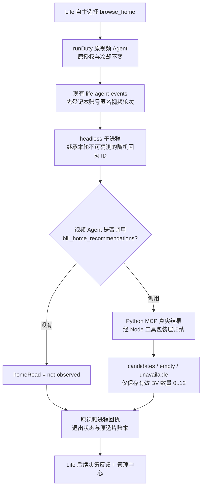

# 2.7.1-dev.32 · 首页闲逛的实际读取回执与 Life 反馈

> 当前开发源码的接口契约；**并非**真实 B站、Windows Desktop 或 72 小时运行验收。

## 为什么要补这一层

dev.31 允许 Life 自主选择 `browse_home`，但 `capability-launched` 只说明视频子进程启动。即使子进程退出码为零，日志仍无法判断是否执行了 `bili_home_recommendations`，以及该接口实际返回多少有效视频。模型未调用工具、接口失败、实际读到空列表和读到列表但主动不挑选，是四种不同原因。

## 统一层接线

- 唯一事实源：`lib/life-agent-events.mjs` 既有按登录账号隔离的视频轮次账本，不新建视频记忆库或定时器。新的 `entryMode` 为 `home|mixed`；`homeRead` 为 `not-observed|candidates|empty|unavailable`，`homeCandidates` 只在有效候选非空时返回 1–12 的数字。
- 主进程在 `spawn` **前**登记轮次，将随机 24 位十六进制 ID 作为 `BILI_DUTY_LIFE_ROUND_ID` 环境变量传给同一个 headless 子进程。外部评论、网页和模型提示词不能指定轮次 ID。原启动失败路径登记为中断，不会误认为正常完成。
- `bili_home_recommendations` 只有在原首页推荐开关允许时才调用原 Python MCP。工具返回后，`summarizeHomeFeedResult` 仅计数实际结构中的不重复合法 BV，不信任来自工具数据的 `count` 声明；失败不强行重试；**原始 BV、标题、UID、Cookie 和评论原文均不进入该匿名日志**。
- 同轮只登记首次读回，轮次结束后或账号切换后不接受补写。没观察到调用就是 `not-observed`，不能推测“肯定没看”，也不能说“成功打开过首页”；技术日志只能证明观察到了什么。
- 子进程完成后仍以原入选账本的新增记录证明真正入选视频。`pickedCount=0` 和 `homeCandidates>0` 完全可以同时成立，这是鱼鱼自主选择跳过候选，而**不是**技术故障的充分证据。
- 已有 `projectVideoRoundFeedback` 将上述枚举提供给下一轮 Life；不返回具体视频 ID 或私有内容，不生成新的行动授权；实际评论/点赞/收藏/关注仍只走 dev.27 原网关。

## 如何核验

管理中心「Life 自主生活」查看最近视频轮次：

1. `首页闲逛：未观察到首页工具读取`：可能 Agent 没调用该工具，也可能运行时采集失效；先查看 duty.log 与 MCP 调用。
2. `首页闲逛：已尝试首页读取，接口不可用或失败`：检查账号登录、网络和首页 MCP；不要自动重试到风控。
3. `已读取首页，但没有符合规则的候选`：API 有结果，但有效 BV 数量为零；不自动生成虚构视频。
4. `确实取得 N 条真实首页候选`：只表明读到了候选，不等于挑中、看过或喜欢。再核对 `原账本新增入选 N 条`、视频内容读取证据和评论发送回执。

本次保留原 Life 自主休息权，不强迫刷片、提高评论率或修改登录和额度。`releaseReady:false`，不合并 main、不建 Tag、不发布。
