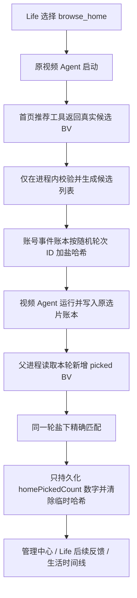

# 2.7.1-dev.33 · 首页闲逛独立决策与候选来源精确归因

> 开发预览，未发布。`releaseReady:false`；未完成真实 Windows、B站首页接口及 72 小时运行验收。

## 解决的问题

1. dev.32 的首页读取诊断已经区分“未观察到工具调用、接口失败、空列表、取得候选”，但 `browse_home` 的候选菜单和前置 `nothing-to-do` 判断仍依赖 `lifeEvents`。当 `quiet-window` 没有成功入队时，Life 即使有可用视频能力，也可能在模型调用前返回 `nothing-to-do`。这与“无兴趣契机也可以闲逛”冲突。
2. dev.32 的 `pickedCount` 是本轮所有来源新增入选总数。若首页取得 12 条候选、视频 Agent 后续又搜索其他视频，只看总数无法判断实际挑中的是首页候选还是搜索结果。

## 决策门禁

`browse_home` 现在独立于匿名事件：

- Life 必须处于 `active`，且当前账号作用域可验证。
- 原 `bilibili.video-explore` 能力必须可用，视频 Agent 未忙且原 20 分钟启动间隔通过。
- `homeRecommendationsEnabled` 必须开启。
- 每日 Life 模型预算、调度时间窗、模型失败退避仍照常生效。
- 模型仍可选 `skip`；首页来源读取最多一次、最多 12 条候选，接口失败不重试，不强迫入选、观看或评论。
- 通用 `use_capability` 仍需要具体生活事件/机会，不因本次修改变成任意工具委派。

## 首页候选来源归因

- `summarizeHomeFeedResult(..., {includeCandidateBvids:true})` 仅供工具包装层与本地桥接使用；原始候选 BV 不进入 Life prompt 或匿名事件账本。
- `recordHomeFeedRead` 使用随机 24 位轮次 ID 为候选 BV 生成 24 位十六进制摘要。摘要只暂存在本轮 `homeCandidateRefs`，不会长期作为 BV 索引。
- 子进程正常退出后，父进程只从原选片账本提取本轮新增 `pickedBvids`，与本轮候选摘要匹配。`homePickedCount` 是精确来源数量；总 `pickedCount` 仍包含所有来源。
- 完成或失败结算时立即清空 `homeCandidateRefs`。如果本轮选片账本无法读取，`homePickedCount` 为 `null`（未知），不是 0。
- 只读来源归因不证明完整观看、听取、喜欢或评论。评论/点赞/收藏/关注仍走原授权和写入网关。

## 观察方式

管理中心「Life 自主生活」最近视频轮次显示：

- `homeRead`：是否实际观察到首页工具调用、空列表或失败。
- `homeCandidates`：真实有效候选数量。
- `pickedCount`：原选片账本本轮新增入选总数。
- `homePickedCount`：其中与本轮首页候选精确匹配的数量；若账本读回失败则显示未核实。

混合探索即使 `entryMode=mixed`，只要本轮实际调用过首页工具，也会显示首页来源归因。

## 不改变的边界

无新视频 Agent、无新定时器、无第二记忆库、无额外模型调用、无强制刷片或评论、无新增写权限。Life 可以闲逛、带兴趣搜索、沿社交线索探索，也可以休息。`releaseReady:false`。
