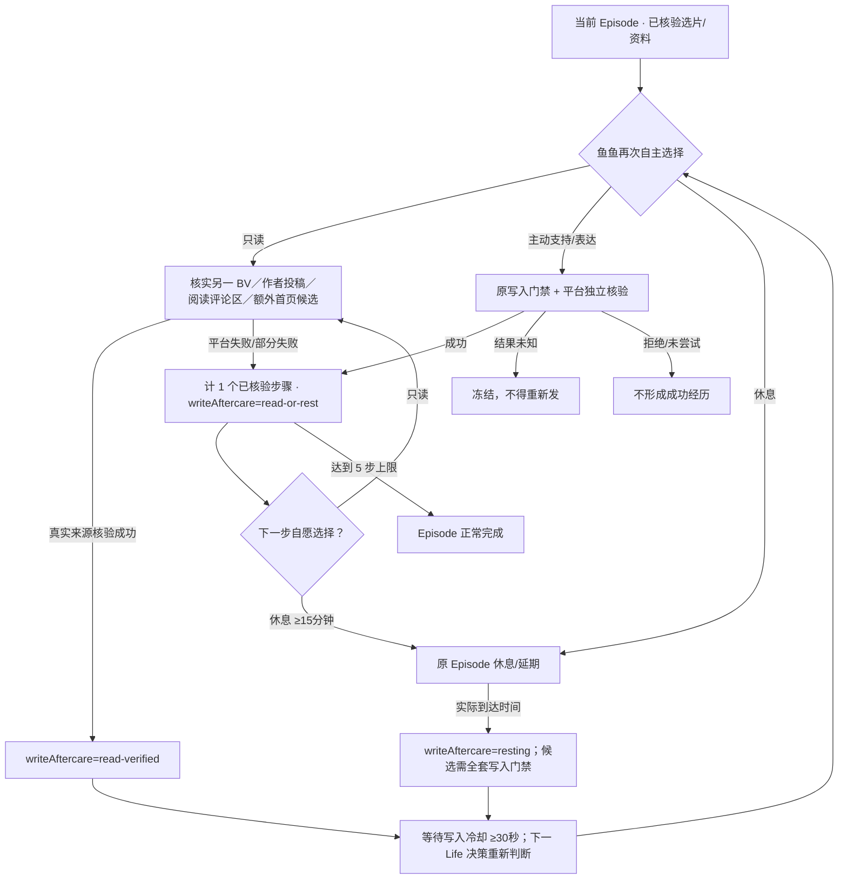

# 2.7.1-dev.35 · P1/P2 Life Episode 自然连续性收口

> **开发预览；`releaseReady:false`**。源自真实 dev.34 Episode 代码审查。所有代码接线/离线测试不能代替真实 Windows/B站/本地 GGUF/72h 自主行为验收。

## 最重要的用户约束

**鱼鱼已核验点赞后仍可以生活，不代表她下一步一定评论。** 已核验写入只是最多五个真实 Episode 步骤中的一个；下一步可自主选择只读、主动休息或放下，但写入必须跨越可信事实和实际冷却。一次 Life tick 最多发送一个操作。

### 实际状态机

- 原平台写入仍使用 Life 意愿审批、账号核实、渠道额度、跨渠道冷却、真实平台回执和原记忆 outbox；`writeAftercare` **不能授权发送**，只是进一步缩小可选菜单。
- 当前 Episode 只保留上一条写入动作的临时再写限制、最多五条已核验动作摘要和一个时间。任意一条未经核验的选中、模型自述、评论接口部分失败均不能解除限制。
- **同一次 Life 模型轮最多一个写动作**：即使写入后再读取，也不可在这同一 tick 连发另一条。下一轮必须重新明确选择合法的不同写操作，并由执行层复核。
- 对已有相同 BV、相同写操作的回执，不允许再执行；结果未知依旧冻结整个 Episode。
- 主动休息必须真实经过原暂停时间（最短 15 分钟），不允许只输出“休息了”就立即写。

## P1：读评论和再次逛首页

`inspect_video_discussion` 仅对已有可信元数据、且 24 小时内的**当前已核实 BV**提供；原 `bili_comments` 限制为最多 10 条，失败或部分失败不记已读、不保存评论正文／作者 ID／楼层，也不会因此自动触发主评论。模型可以选择不看、不评论。

`browse_home_more` 仅对 `home-browse` 源 Episode 可用，且最多一次、当前步骤不超过 3；从原 B站首页推荐来源获得最多 5 条去重候选。不新增第二个 Video Agent、不扩大 B站 API 域名或发送权限；失败、空列表、仅重复候选都消耗这次补充读取机会，不循环刷新。

## P2：既有经历影响下一步，但不伪装长期人格因果

将 `episodeHistory`（最多 5 条已核验动作类型／可信 BV／时间；无原评论正文、UID 或好友私信）存于原 `life-opportunities` 账号隔离账本，交给同一 Life 模型作为本 Episode 上下文。这样模型不再只有“刚才读取成功”，而能看到自己已经浏览、核实、点赞、看过评论区还是休息过。**是否因此更自然仍需要真实模型多日反事实评估。**

长期趋势仍由既有 `LifeInterests`、Life Reflection、Life Memory Coordinator/Recall 提供；本次不把单次点赞推断为稳定兴趣或交友意愿。

## 安全／兼容性

- 老 Episode 缺少 `writeAftercare` / `episodeHistory` / `homeRefreshCount` 时采用兼容默认值，不迁移或重建任何已遗忘数据。
- 所有新动作仅**只读**；写入仍使用原 4 类续行动作和各自独立审批；不开放对任意评论者跨串回复／私信。
- 不扩充模型日额度，保留所有 5 步/时窗/权限及评论冷却；真实角色决策仍可随时 `stop`。
- 每次修改 P1/P2 路径必须同步 Mermaid 三图和 `npm run check:life-architecture`，运行专项及全量测试，并采集真实 Windows/B站/72h 脱敏回执后才谈正式发布。
