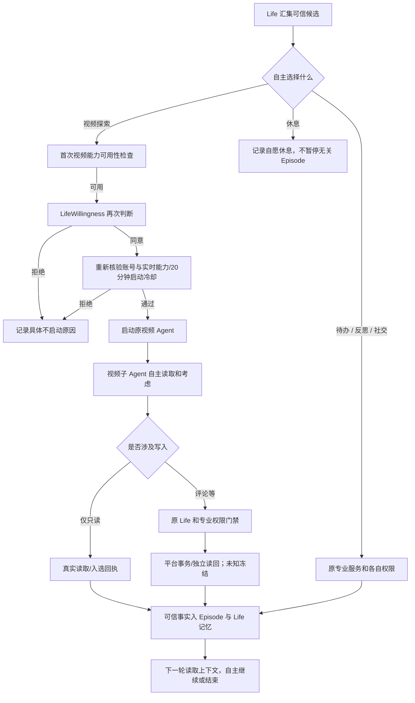

# DSH 2.7.1-dev.37 · Life / 专业 Agent 跨系统编排审计（同版本维护，未发布）

> 基线：`DSH-dev37-VIDEO-COOLDOWN-LIFE-FIX-source.zip`。本次是源码审计与定点修复，不是 Windows/B站/GGUF/72h 实机验收。`releaseReady:false`。

## 实际生产编排，不把愿景写成已实现

| 入口 / 专业系统 | 发起和意愿 | 委派 / 执行 | 可信回执和 Episode | 当前剩余限制 |
| --- | --- | --- | --- | --- |
| Life 自主视频探索 | `AutonomousPlanner` 选择 `browse_home` 或能力；`LifeWillingness` 再核验是否真的愿意开始 | **统一能力注册表** `bilibili.video-explore` → `runDuty()` → 子视频 Agent。子 Agent 自主选择原工具 | `life-agent-events` 子进程生命周期 + 原入选账本精确匹配；仅匹配成功才生成对应 Episode。评论/点赞等写入另经原 Life 和平台门禁 | 两次独立 Life 意愿选择可能不同；模型不想开始不是故障。仅该能力注册在统一 `LifeCapabilities` 中 |
| 已接受的只读待办 | `AutonomousPlanner` 的 `execute_read`；主人触发也可走旧服务 | `ownerTodos.run()` / 原专业读取器，不走 `LifeCapabilities` | 原待办完成回执 → `life-action-attribution` → 同一 Episode；完成后回访由独立定时器执行 | 写入型待办不允许通过 `execute_read` 越权；回访仍是独立调度 |
| 反思 | Life 选择 `reflect`，独立 `LifeReflection` 也会定时检查 | 原反思执行器，非视频能力注册表 | 原真实批次回执去重后才可进入 Episode/记忆 | 不保证每次反思自动产生新行动 |
| 原创视频顶层评论 | 视频子 Agent 自主考虑与调用工具 | 原 MCP、`life-video-action-bridge`、授权/额度/选择证据与平台校验 | 原平台收据和读回核验为事实；Episode 不替代发送事务 | **不是 Life 注册表中独立可随意调用的评论 Agent**；楼中楼回复陌生评论未开放为视频自动通用能力 |
| 入站私信 / 评论回复 | 专业收到入站事件，并请求 Life 意愿决策 | 原私信/评论 Agent、社会策略及平台发送适配器 | 平台回执按消息幂等归属，未知结果冻结；部分路径关联 Episode | 独立轮询/队列未全部并入通用能力总线；收到主人请求≠Life 主动搭话 |
| 待办完成后的回访 | 独立回访调度器重新征求 Life 意愿 | 原发送事务 | 成功回执归到原待办 Episode | 不把已完成任务重新跑一遍，不把回访视作无条件授权 |
| 记忆、关系、情绪成长 | 可信事实与状态输入 Life | 各原领域服务 | 可信回执再由 Life Memory 读取；遗忘和账号边界独立 | 无权从匿名 Episode 推断真实平台动作或实机成长结果 |

## 本次确认并修复的协调缺陷

1. **任意休息误暂停不相关 Episode**：原普通 `skip` 调用了 `pauseLatest()`，可以错误暂停上一段待办/社交经历。现在普通 `skip` 只表示本轮自愿休息；仅明确的 `resume_episode → stop` 等目标化操作才能暂停对应 Episode。同时为仅由 Episode 到期触发的唤醒提供正常休息间隔，避免每两分钟重复消耗模型预算。
2. **视频最终启动的授权时效**：原 Planner 先检查视频可用，再等待第二次异步 Life 意愿选择，期间账号、子进程忙闲、冷却可能变化。现在第二次意愿证明通过后、`runDuty()` 前重新核验账号、实时能力状态及冷却；失败不启动、不算已看过、已允许的证明标记 `not-sent`。
3. **人工启动与自主启动之间的冷却遗漏**：Life 视频冷却以前只读取 Planner 自己的 `videoStarts`；人工启动的子视频轮次也真实占用资源。现在只用当前账号事件账本中的最近真实 `startedAt` 来计算同一 20 分钟启动间隔；不将手动视频计入 Life 日配额。`video-feedback` 只读考虑仍然可以在冷却期间执行。
4. **不启动的原因被折叠**：第二次 Life 意愿拒绝、能力不可用、冷却、账号变化曾归为泛化 `capability-not-started`。现在保留单独安全枚举 `diagnosticCode`，含终次可用性检查和能力注册表 `run()` 的变化窗口；绝不输出原始上下文或内部错误原文。

## 修复后的关键闭环

这张图是逻辑示意。`F` 仅表示启动子进程，绝不等于已看完视频。`L` 必须有实际可信成功证据，失败或未确认不准冒充完成。

## 仍未完成的架构工作 / 不应越界声称

- **统一能力表不等于全专业 Agent 总线**：目前只有视频 `bilibili.video-explore` 通过 `LifeCapabilities`。待办、反思由 Planner 直接接线，入站私信/评论及待办回访有独立调度器，虽受 Life 意愿与平台授权约束，但并不共享同一通用委派接口。
- **不强制有第二步或发评论**：Episode 是因果连续性而非固定五步脚本；真正的实机多轮自然续行仍需要模型、B站读回和时间线证据。
- **第二次独立意愿投票仍可能放弃**：这体现自治，但会增加一次模型判断与失败点；已改为可诊断而非删除权限审查。将来若合并为单次意愿证明，需先做跨进程安全设计，不得直接绕过。
- **账号/授权/模型失败**：任一来源不可信就拒绝执行；未知平台结果不可自动再发。匿名 Episode 不是私信/评论事实主账本。
- **正式发布**：Windows 实际模型、多账号、旧版恢复、72h 长期行为、跨日成长及真实平台审批/读回都没有完成；`releaseReady:false`。

## 离线验证摘要

- 新增 `test/v271-dev37-life-agent-coordination-audit.test.mjs`：6 项，手动/自主共享冷却、二次检查及原因分类、普通休息不暂停不相关 Episode、视频被 Life 拒绝诊断、休息唤醒节流。
- 协同回归组合：35/35 通过。插件自检和 4 张 Mermaid / 70 代码关联节点检查通过。
- 首次全仓 Node：2,144 项中 2,136 通过、7 跳过、1 失败；失败为 Node 测试运行器的 IPC 反序列化错误，并非 Life 行为断言。相关文件隔离复跑 20/20 通过。**该次全仓不能宣称全部通过**。
- **受控并发全仓复跑** `node --test --test-concurrency=4 test/*.test.mjs`：**2,146 项，2,139 通过、7 跳过、0 失败**。保留第一次异常记录，不能据此断言高并发运行永远稳定。
