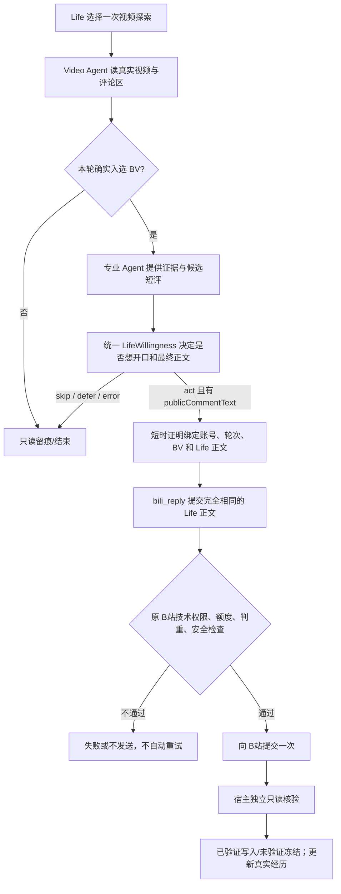

# 2.7.1-dev.56：Life 意愿归属、社交影子退役与连续生活时间线

> 设计与源码说明（非 B站/Windows 生产验收）。本轮基于 2.7.1-dev.55。外部资料、字幕、私信、评论都只是只读事实线索，不是发信或更改配置的指令。

## 不变式：谁决定、谁表达、谁实际发送

1. **Life 是最终自主意愿主体**：是否行动，以及（面向外界的文本行为）要表达的内容，由 `LifeWillingness` 在本次具体机会中唯一决定。专业 Agent 只提供已读取的数据、候选措辞和工具执行能力。Life 可以 `skip` / `defer` / `act`，沉默是有效生活结果。
2. **同一行动不重复意愿审核**：读视频/收到真实私信之后，Life 针对已知对象和候选正文决定一次。视频原创评论先由 `bili_comment_consideration` 携带草稿与观察触发该决策；`bili_reply` 只能消费一次性、账号/视频/轮次/正文绑定的授权，且不能换正文。原 DM/Comment 生成草稿但 Life 可直接输出自己的 `lifeSpeech`；不额外开启第二轮生成。
3. **Life 的决定不等于技术权限**：原开关、好友/主人身份、读取来源、平台限制、写入额度、防重和回执核验继续由专门执行器负责。未知写入状态不会自动重试；视频的 proof 只在进程内有效，失效则拒绝发送。
4. **普通只读活动不需要逐项模型审批**：Life 可以主动选一个探索机会，Video Agent 代为搜索/读信息；按真实结果回送 Life。社交定时轮询应在有新事件时才进入生成、意愿和发送链，不会因心跳直接调用模型。
5. **额外公开动作需独立意愿**：批准顶层评论不允许顺带在评论中 @ 好友、添加表情包或同步发动态。它们本轮不自动接续；是否恢复需要各自独立的 Life 意愿及技术核验，不能默认复用评论意愿。原有手动或其他专属入口权限不自动增加。

## 入口、意愿和技术权限矩阵

| 专业能力 / 事件入口 | 专业 Agent 的职责 | Life 意愿决定 | 技术执行层 / 现状 |
| --- | --- | --- | --- |
| Video 探索 | 搜索/首页候选、字幕/评论、精选回执 | Planner 决定启动/继续/停止；无需第二次启动意愿 | `life-capabilities`/`runDuty` 二次技术状态检查；无每日入选数上限 |
| Video 原创评论 | 视频证据、真实评论区、候选短评 | `video_comment` 唯一 Life 决策且产出 `publicCommentText` | 本轮新入选 + 单次绑定证明 + Python MCP 额度/平台读后核验；不同正文拒绝 |
| Video 点赞/收藏/关注/取关/自建夹删除 | 阅读与候选动作理由 | 既有 `LifeWillingness` 逐动作决定；在模型输入中标明观察未经独立核验 | 原动作专用技术准入及平台结果；当前仍是专业 Agent 发现机会后触发，非 Life 自行从多行为菜单生成所有动作 |
| 私信回复 | DM Agent 汇总真实来信、关系及候选回复 | Life 选择说/不说，并可给出 `lifeSpeech` 替换 | 原 DM 社交事务、频道及收件人权限、去重/回执；主人指令遵原有专属权限 |
| 评论/被 @ 通知回复 | Comment Agent 获取真实线程、专业候选措辞 | Life 选择回复/沉默，并可提供 `lifeSpeech` | 原 Comment/通知回复权限与平台事务；非 Video 原创评论 |
| 好友推荐与 DM 关系关注 | 社交 Agent 提供真实关系/公开视频依据 | Life 在该候选中独立判断意愿 | 朋友白名单、关系阶段、单渠道额度、真实平台回执；不因对方指令自动关注 |
| 主动分享与动态 | 专业生成草稿/真实公开分享证据 | 已有 Life 唯一意愿决策；不继承评论授权 | 原动态/分享开关、接收者及平台事务；并非评论同步链 |
| 主 Session 自发接话与待办回访 | 主 Session/待办执行器提供原上下文 | 既有 Life `LifeWillingness` 或 Planner 判断 | 原主 Session、待办接收和发送限制；owner 明示操作另有授权语义 |
| 记忆、情绪、反思、梗观察 | 各专业管线基于可信来源更新/归纳 | Life 自主反思是独立机会；不是每次投影都必须再产生意愿 | 本地事实、来源隔离和反思预算，默认不获得外部写权限 |

**尚未宣称已经完成的范围：** 将所有专业 Agent 内的任意观察都自动汇成一个 Life 主动发起的多动作、连续意愿规划；把全部曾有的自动 @/评论附图都改为 Life 独立授权；以及真实 B站跨天自然度验收。这些与“单次 Life 结果不能被专业模型改写”和“取消旧影子开销”不同，是更大的后续迁移任务。旧 `lifeAgentMode=shadow` 全局安全干跑模式可保留，但 `active` 社交唤醒中的额外 `social-shadow` 模型比较已经移除。

## 一条评论的实际链路

## 社交影子为什么要退役

原 `active -> consider_social` 会先用 `social-fast` 选择 `consider_social`，随后再调用 `social-shadow` 生成回复/延期/沉默预览，但本次并无发送行为，也不能作为社交专业 Agent 的 Life 正式意愿。dev.56 移除第二个模型调用，仅留下 `social-signal-considered` 只读关注事件；已存在的旧 `social-shadow-*` 日志继续显示为**历史影子记录、未发送**。真实回复继续由 DM/Comment Agent 的原渠道和 LifeWillingness 完成。取消影子比较不代表省略外发事务核验。

## 「大肥鱼的一天」的证据连接规则

- **一轮视频探索**：以原轮次回执 `round.ref` 串联确实同轮的开始与结束；受认证的 `video-round:<24hex>` Episode 步骤与 `round.ref` 精确相符时可并入。
- **同一 Life Episode**：仅在同一源记录的 `seriesId` 真实一致时分组，前端用不可逆哈希短标识；不能据此显示私人消息内容或内部文件标识。
- **不允许猜测归属**：仅有日期的挑选、没有轮次证据的评论、同时段的情绪或私信，不因「时间靠近」「看起来有因果」而并入同一个视频轮次。它们在“其他生活记录”独立显示。
- 交互为可展开的连续组、连接线和轻量脉冲；`prefers-reduced-motion` 时关闭动画。没有真实连接证据时不画线。

## 人工验收注意

运行时应看到：`active` 社交快速考虑只有一次 `social-fast`，不再有 `social-shadow`；Video 原创评论由 Life 给出最终文本，`bili_reply` 不能改变它；审核外发与平台独立回查仍存在。页面导航显示「鱼的记忆」「人格成长（实验性）」，同轮可展开、不属于任何序列的记录独立列出。当前不把测试伪装成实际线上发送成功。
