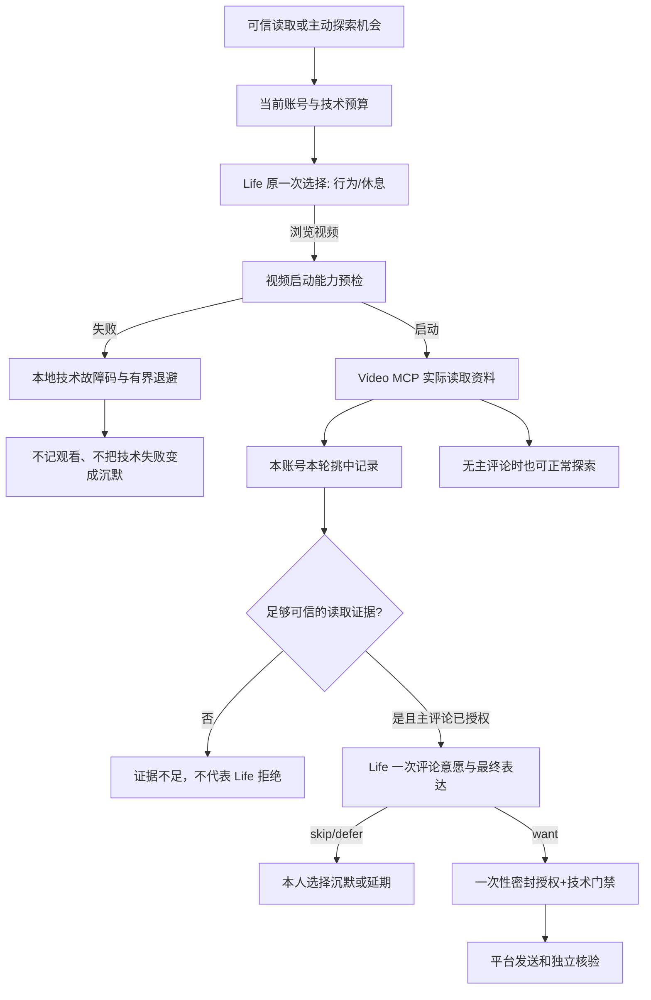

# dev.61 · Life 状态机、原创主评论与视频委派技术失败（开发预览）

**基线：dev.60。所有变更仅调整实际代码/版本化契约，不迁移用户密钥、私人聊天，也不清除已发送/结果未知记录。** 本文描述本版本已接线部分，不能当成 Windows 或真实 B站验收结论。

## 来自日志的缺陷和状态归属

- 在 50 个视频轮次样本中记录 63 个入选、34 个评论考虑、28 个 `pass`、6 次 `want` 候选、2 次有效授权，平台可见确认 1 次。原 `pass` 可能是专业 Video Agent 自行决定；不是 Life 真实沉默。
- 11 月 11 日 09:20、09:30、09:40 Life 已选 `browse_home`，但 `video-delegation-not-started`。模型选择 ≠ 能力真正启动，更不等于视频实际阅读。重复 Life AI 选择同一故障源浪费预算。
- 家目录 `duty.md` 仍有 `挑中·值得看/可以看`、三级档位强制、旧 `seen.md` 授权、附图/@ 描述；旧兼容器只覆盖每日 50 条描述而不能保证工具契约一致。
- 宿主读取共享 `seen.md` 合并日报，与 Python 账号级 SQLite 的单独事实源不一致，存在跨账号错配风险。

## 当前实现

| 边界 | 唯一权威和措施 | 无法保证 |
|---|---|---|
| 入选、判重、评论准入 | 当前已登录 UID 的 `video-actions.sqlite3`，仅 `status="挑中"`；评论准入同时绑定当前 BV 和 round ID | 旧 Markdown 无账号信息，不能自动变成可信入选；旧历史仅作为人类可读资料保留 |
| 主评论意愿 | 视频 MCP 在本轮真实入选之后，从工具已经实际返回的 `bili_video_info`、`bili_subtitle` 和 `bili_comments` 汇集证据；在同一次 `bili_ledger_mark` 返回中给出 Life 评论考虑结果。证据不足只标技术不足，Video Agent 禁止 `pass`。Life 自己决定 `skip/defer/want` 与最终正文。| 并非一定想评论；未取得真实视频证据时不调用 Life；模型失败不能自动重试或解释成沉默 |
| 实际评论发送 | 原 Life 视频动作桥一次性密封账号、BV、轮次、完整正文；技术额度、防重复、独立平台核验均不变 | `want` 不等于送达。未确认的写入不补发 |
| 生效章程 | 版本化 `prompts/duty.md` 为唯一工具契约；本地旧章程不改写，仅导入明确标注且通过非权限过滤的选片口味 | 未经标注的旧自定义偏好不会生效，需复制到 `## 自定义偏好`；不能恢复旧强制档位 |
| 启动器失败 | 结构化稳定故障码、进程内技术退避、能力 `inspect()` 给出退避至何时及失败类型；Life 未做成真实探索，不再为技术冷却重复调模型 | 不凭静态代码声称已修好用户机器上具体的 `video-delegation-not-started` 启动故障；后续需现场错误码定位 |
| 成长与真实经历 | 当前账号的实际入选记录进入兴趣/成长观察，报告档位不再作为当前生产成长的来源 | 历史档位不升级成可验证的新生活事实 |
| 多样生活候选 | 保留待办/兴趣线索、Episode 续行、公共只读、反思、社交入站、主人对话和自然休息；视频技术退避不会伪装 Life 对其他事情没有兴趣 | 当前通用能力注册主要仍是 `bilibili.video-explore`；不能在没有合法真实来源时制造虚假社交机会 |

## 状态机

## AI 次数与发布限制

- **DM/Comment 回复路径不变**：沿用 dev.59/60 的原有一次联合 Life 决策，不会为了专业 Agent 不再代替沉默而额外增加一次审批。
- **主评论是另一条链**：启用评论后，每个真正新入选且内容足够的 BV 可触发一次 Life 意愿模型调用，可能比旧版大量 `pass` 增加模型使用量；仍受原模型/平台额度，后续发送不再调用第二次 Life。
- 实机验收须记录：一次视频轮次调用数、评论考虑漏斗、技术退避、账号切换、未知发送不重试、原始旧章程文件保留、真实 Windows DSH/B站，持续 72 小时。未经验证不可发布 2.7.1 RC。
