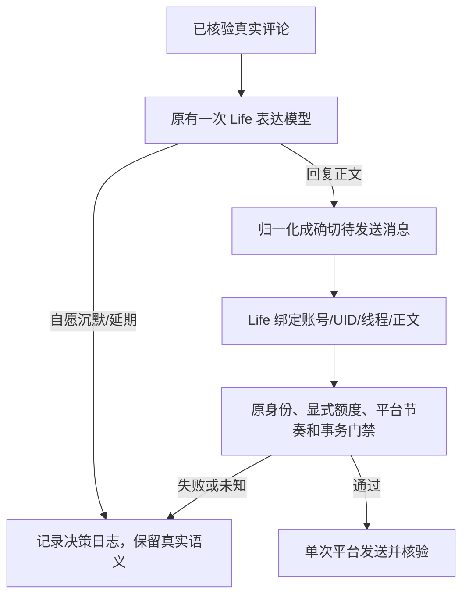

# 2.7.1-dev.69 · 生活自主额度显性化与社交表达修复（未发布）

## 原则与本轮边界

Life 可以根据真实体验自主选择交流、探索或沉默。开发者不能在用户不知道的情况下再以固定的“每天考虑次数”“每轮可读条目”拦截真实机会；用户可理解的后台资源预算在管理页配置。另一方面，账号归属、真实来源、发送授权、平台风控、发送去重、未知结果冻结等**不是社交自主额度**，不能删除。

## 实际入口与单一事实源

| 入口 | 复用的唯一实现 | dev.69 调整 | 保留的安全边界 |
|---|---|---|---|
| 已核验动态/视频评论 | `interaction-batch` → `index.js generateReply` → `life-willingness.adoptSocialDecision` → `comment-interact` 原发送事务 | 普通模式字符串回复先归一化为 130 字以内的一条消息，Life 对**实际发送的精确正文**封存一次授权。原笼统 `life-social-expression-invalid` 改为目标/正文/长度/@ 等具体错误 | 账号、UID、rpid、动态 ID、可信评论来源与本次正文完全匹配；失败不发送或无凭据重放 |
| 已核验评论延期 | `comment-interact` 原 `replyRecords`/`preflightDefers` | 旧每陌生人 24 小时两次“考虑额度”已在 dev.68 退役。本轮每人**成功回复条数**上限不永久写 `seen`，记录可恢复的限时延期 | 仍受管理页明确设置的每天总发送数、本人顶层/楼中楼单人已发送上限，以及平台风控约束 |
| 陌生人公开资料阅读 | `social-cognition` 账号绑定的原真实交往来源 | 退休隐性每人 2 次/天、全局 35 次/天的只读了解次数 | 限定可核验的公开身份与来源；不得把阅读授权当成私信、评论发送权 |
| 自由探索意愿线索 | `life-opportunities` 原账本 | “读失败三次永远暂停”变为最长六小时技术冷却后再试，保留已确认经历 | 过期候选、身份切换、实际来源失败仍不得伪造候选 |
| 视频评论区/视觉读取 | `vendor/bilibili-mcp/mcp_server.py` 原本轮实际证据 | 退休每轮 6 BV / 2 楼层及 2 条视觉硬上限 | 真正阅读才能生成回执；来源 root 必须在本轮可核验；由共享只读节奏和平台真实限流兜底 |
| 后台社交注意力/只读节奏 | `autonomous-planner` 和 `bili-read-budget` 现有账本 | 原固定背景社交考虑 24 次/日及 B站后台读取 30 次/分、450 次/时，暴露为管理页可调设置；保存后动态生效 | 模型额度与外发权限相互独立；真实 403/412/429 平台退避不可通过放大设置绕过 |
| 视频主评论 | `video Agent` → `bili_comment_consideration` → `life-video-action-bridge` → 原 Python 平台事务 | 对审阅尝试、Life 自主延期、技术失败分别留下匿名证据；允许在同轮新补充证据后再次向 Life 提交 | 仍须真正入选、同轮原件、Life 本人决定及明确公开评论授权。历史已入选不能无证据重放 |

## 诊断与行动语义

- `life-social-expression-empty`：模型没有提供可发送的完整正文，保留技术失败退避；不应冒充主动沉默。
- `life-social-target-invalid`：通知或发送目标绑定失败，需重新核验来源，不能直发。
- `life-social-expression-too-long` / `life-social-expression-unapproved-mention`：表达不符合精确发送合约，拒绝发送并在决策日志记录原因。
- `comment-review-technical-failure`、`comment-review-no-final-decision`、`life-deferred`：分别是技术失败、已尝试但缺终态、鱼鱼明确延期，不都叫作“主动没想评论”。
- 本轮未改变「大肥鱼的一天」的生活呈现原则：开发者诊断继续留在决策日志。

## 迁移、安全与验收

1. 保留既有用户配置及已核验外发回执；新三个后台预算配置仅填入原默认值，不自动开启任何外发开关。
2. 升级后依旧不自动补发 `seen=sent/uncertain`、旧版已终结的 `stranger-budget`、以及重复入选视频；未完成的最新有效来信应在后续独立轮询中重新核验。
3. Node 回归重点检查普通动态评论字符串 → 精确授权 → 消费一次，P6 多消息、长度、禁止 @、配置动态生效、主评论审阅状态；Python 回归检查删去隐性读取次数后依旧验证 root 来源与隐私记录。
4. 本轮只完成无平台写入的本地测试。真实 Windows DSH、B站发送、平台风控、长时间运行和 RC 自然行为仍需使用者自行验收；不能把本地测试宣称为已发成功。

