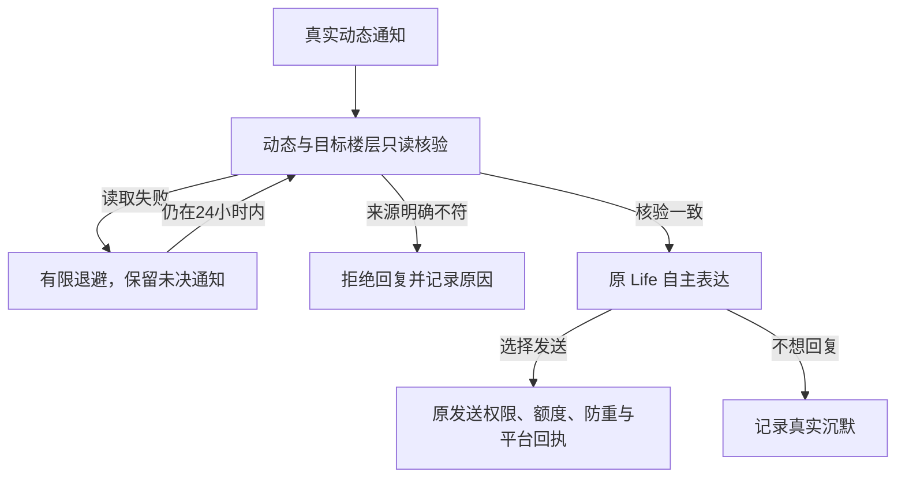

# 2.7.1-dev.70 · 动态评论核验恢复与 Life 额度边界（未发布）

## 现场来源与不能凭空补出的事实

11 月 11 日 14:50 前的上传运行账本确认：动态 `1267086296612864004`，评论者 UID `382440088`，通知目标 rpid `319847247793`，根评论 `319798167777`，直接父回复 `323612080800`。该父回复有当天 12:34 的主人 Session 已确认回执。用户后来提供的 15:52:41 管理页状态是「动态评论核验暂失败，将稍后重试」，说明**已进入读取核验，尚未进入 Life 表达或平台发送**。

15:52 的完整 Python MCP 返回体未随新问题上传，因此不能确定当次是网络限流、评论区临时不可用、翻页未找到目标，还是另一种只读错误。任何一项都不能被写成已证实的平台根因。

## 代码路径与修复

1. `normalizeReplyNotifications` 从真实 B站通知提取 `dynamicId`、`oid`、目标 `rpid`、根评论及父回复；这些只是定位线索。`index.js getDynamicContext` 通过 `bili_dynamic_comment_context` 读取 B站动态、评论区及精确作者；失败携带截短的安全错误信息供决策诊断。
2. Python `_find_dynamic_target` 的真实楼中楼只读查找由最多三页扩大到最多十二页；仍严格验证根评论、目标 ID、目标 UID 和直接父评论 UID。未找到继续算技术核验失败，绝不按通知文本猜测发送。
3. `comment-interact` 原本连续三次 `getDynamicContext` 不成功后永久写 `seen=dynamic-context-unavailable`，把**只读失败误作最终处理**。现改为 5→10→20→30 分钟的有界退避，保留原通知发送时间的 24 小时新鲜度限制，不消耗发送回执或永久作废。
4. 升级后只对仍在 24 小时窗口的旧 `dynamic-context-unavailable` 恢复核验。`sent`、`pending`、`uncertain`、账号冲突以及真实作者/来源不匹配绝不能恢复为自动发送许可。
5. 管理页仍只显示后台诊断，不把技术重试写进「大肥鱼的一天」。核验失败现在应显示原 MCP 的安全原因和下次重试时刻；真实平台发送仍取决于鱼鱼自主表达、原发送权限和一次性平台事务。

## 本轮额外解除的不透明限制

| 旧版实现 | dev.70 行为 | 安全或预算边界 |
|---|---|---|
| Life 意愿最终核验成功后跨渠道固定静默 30 秒 | 宿主设置为 0，改由同一意愿在途互斥和原账户发送防重控制 | 不能重复消费授权，未知事务继续冻结 |
| 无待办、仅好奇线索时自动静默 6 小时 | 删除额外静默条件，按管理页「Life 自动考虑间隔」及可见的每日模型额度执行 | 仍不会在没有真实候选时伪造行动 |
| Life 普通调用＋社交额外调用合计暗中限 288 次/天 | 以两个公开设置的每日上限**相加**为实际最大值 | 仍各有 0–288 的用户配置范围，额外唤醒不构成发送许可 |
| 视频原创评论审阅中 `reviewed>=20` 直接返回「轮次不正确」 | 删除无诊断的额外审阅次数闸 | 同一 BV 不重复结算，仍遵守可见的每轮发送上限、同账号同轮入选和原内容证据 |

## 当前仍需进一步实施的事项

- **跨轮次自动恢复历史入选视频的主评论**仍未完成。当前只有本轮可信新入选和同轮获取补充证据后的再次考虑；不能拿旧轮的入选记录直接授权新一轮评论。后续实现必须在现有账号级真实选片/评论回执账本中保存可恢复的未决资格，并让新一轮实际读取的证据重新过账，不能伪造新入选、强迫评论或重发未知平台结果。
- B站动态回复在 Windows 与真实登录账号上的完整重试→Life 意愿→平台确认过程仍待实机检验。源码测试没有发送评论。

## 不变的许可边界

当前账号、动态及作者的精确验证、B站平台退避、显式公开评论开关、发送配额、生命周期及去重事务仍为必要条件；平台是否允许写入不由模型或本地测试推断。

