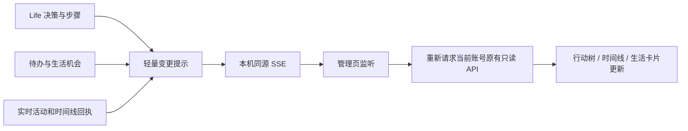

# dev.77 · 生活历史状态、来源直达与本地实时 UI

## 唯一事实源与兼容性

- **入口**：原 Life 管理中心的「鱼鱼正在做」和「鱼鱼想做」。
- **复用层**：`LifeOpportunities.status()`、`OwnerTodos.status()`/分页、`LiveLifeActivity.snapshot()`、`LifeDecisionTrace.list()`、`buildLifeTimeline()`。
- **原始数据**：账号范围内的机会决策、原待办账本、原决策步骤及运行活动；不建立第二套事项账本。新 SSE 只是变更提示，不保留个人或平台目标。
- **来源链接**：仅由已存在的 `BVxxxxxxxxxx`、`origin.commentBvid`、探索候选中的已核验 BV 和显式指定的公开主页 UID 推导。评论没有可核实的视频号时不构造假链接；不得将目标主页误标为私信来源。
- **保留的安全边界**：`eligible=false` 只是当前不能作为**新一轮**机会；`inspect/review` 不意味着观看完成，`defer/skip` 不意味着永久丢弃，`dismiss` 不应被重新激活。旧历史不被改写。禁止把决策树的“已批准”当成外发成功。

## 事件推送

`index.js` 保留原只读 HTTP API，新增 `GET /api/bili-duty/life-management/stream`，挂在原同源本机安全门禁之下。`LifeManagementEvents` 只发送 `{kind:"life"|"plans"|"timeline"}` 和服务器版本序号，不包含 UID、BV、正文、提示词或配置。`LifeDecisionTrace` 每次步骤变更、`LiveLifeActivity` 启停、`OwnerTodos` 状态写入、`LifeOpportunities` 状态写入、`ActivityFeed` 新记录通过可选回调发出事件。

浏览器用一个 `EventSource` 连接监听；事件会被 260ms 合并，然后仅针对当前打开的生活页面重新读取对应的**账号隔离** API。隐藏页保留待同步提示，前台重新可见或 SSE 重新连接时读取最新快照。手动刷新保留。SSE 心跳仅维护连接，不是业务刷新或隐形定时调度。由于部分旧插件/宿主能力不具备事件钩子，本版**不保证整个管理台每一项均实时**；其它页面按原功能和手动刷新，且部署环境仍需实机验证 SSE 能否穿过宿主网关。

## 故障与发布门禁

- SSE 不可用：保留普通页面加载、手动刷新和断线重连；不能静默声称实时。
- 账号变更：流不包含事实，重新拉取仍必须经原接口身份隔离；账户未准备好不提供旧账号记录。
- 禁止在浏览器收到事件后触发 Life 模型决策、平台读取或外部写入。只能调用原管理只读 API。
- 实机待验证：Windows DSH 连接生命周期、宿主 SSE 网关兼容、前后台及切页更新、PC/手机宽度、暗色和减少动画、跨账号切换、长时间连接释放。
- 正式版 `releaseReady:false` 直到原 RC 系统验收补齐。
