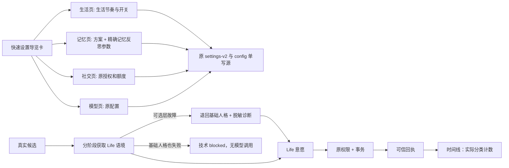

# 2.7.1-dev.8 · 快速设置 V3、上下文容错与真实时间线（未发布）

## 单一配置来源

- 管理中心保留旧版顶部四组横向导航、已有 URL 页签和全部业务表单 ID。
- 「快速设置」（`firststart` 是兼容性页签 ID）放置四张**导航卡**：生活节奏 → `life-agent`，记忆反思 → `life`，社交权限 → `social`，模型 → `models`。导航卡没有复制配置字段、不自动保存、不新增另一套方案账本。
- 实际生活开关和活跃档位在「鱼鱼此刻 → 生活节奏与整体方案」顶部折叠设置；原跨系统 `life-organic-presets` 迁入「经历与记忆 → 记忆与检索设置」折叠栏，记忆方案与其控制的字段同屏。选定后可展开查看**精确字段值**，点击预览比较，显式确认后才写回现有 `/life-agent/settings-v2` 与 `/config`。目前是两次顺序保存，不是跨接口原子事务；第二次失败会明确告警，应在生产持久调度里进一步治理。
- 旧配置保持原值；记忆方案仍会联动既有生活活跃档位，应用前对用户明确说明。

## 所有用户每版本查看一次快速设置

`lib/first-start.mjs` 保留原 `version:1` 和 `first-start-v1.json`，不更换安全首次安装门禁。新增独立 `quickSetupSeenRevision:2` 与只读状态 `quickSetupSeen`。旧版已经完成验证的安装，首次打开 V3 管理页跳到快速设置，但**不会中断后台进程、要求重扫 B站、清空资料或重置权限**；用户点「我已查看」后同版本不再打断。新安装必须继续通过 B站凭据和 Headless 模型验证；确认快速设置不等于完成安全初始化。同源 POST `/api/bili-duty/onboarding/quick/seen` 只写独立已看标记。后续新版本如确需再提示须显式提升修订常量，不能偷偷强制反复弹出。

## Life 意愿上下文失败

以前 `life-willingness.mjs` 对 `getContext` 任何异常都统一返回 `life-context-unavailable` 并结束，**未调用模型、未产生任何行动授权**。可选兴趣索引、公开视频的可衰减记忆或公开回复证据读取出错时，可使用空线索继续，而不是把技术错误当成“鱼鱼主动选择休息”。若成长/心情语境不可用，则仅用现有基础 persona/lore 组装最小身份语境，不添加未经证实的经历和权限。连基础身份都无法组装仍 fail closed。

Life DEBUG 记录 `blocked/context/life-context-unavailable` 或 `journal/life-context-degraded/{interests,public-memory,public-speech,growth-or-emotion}`。仅使用固定故障类别；不写 UID、用户名、路径、私信正文或原始异常。生产日志也只记录类别。真实用户此前两次 blocked 的准确依赖异常未提供本机日志，不能假称已复现原始环境中的特定坏数据。必须在 Windows + 真实数据里确认不再连续阻断。

## 真实生活时间线的证据边界

`/life-timeline` 现额外返回各类**实际可展示记录的条数**（video/video-round/comment/emotion/relationship）。界面显示已证实的评论、心情、关系事件数，没有出现就是未查到可信回执，不会创造假的“评论/关注/点赞”事件。视频 Agent 一轮入选 2 条只是轮次自报的统计；只有标准化 `seen.md` 能为具体 BV 形成视频记录。Python 网关自报点赞或关注结果仍属于 `accepted-unverified`，不能直接变成“已在平台完成”时间线。后续版本需要明确为这些平台操作建立独立的读后验证回执与展示源。活跃 10/100 只是生活模型决策间隔和上限，不控制原视频 Agent 自身冷却，也不会强迫鱼鱼发评论。

## 生产风险与验证

- 仍保持 `2.7.1-dev.8`，无外发权限调整、无自动开启社交、无新模拟事件；不封 RC、不创建 Tag。
- 重点实机用例：已配置旧用户第一次打开 → 快速设置 → 确认 → 原后台继续；新用户未验证不能绕过；切换记忆组合后回读精确参数；强制制造兴趣数据读取异常时 Life 可以安全降级，但人格缺失 fail closed；真实视频 Agent 完成后对比 `seen.md`、评论主账本和时间线分项计数；`life-context-unavailable` 必须定位具体依赖层。
- 依然缺少持久跨进程机会池、动作执行证据的全链路纳入与长期 Windows/B站验收，`releaseReady=false`。

