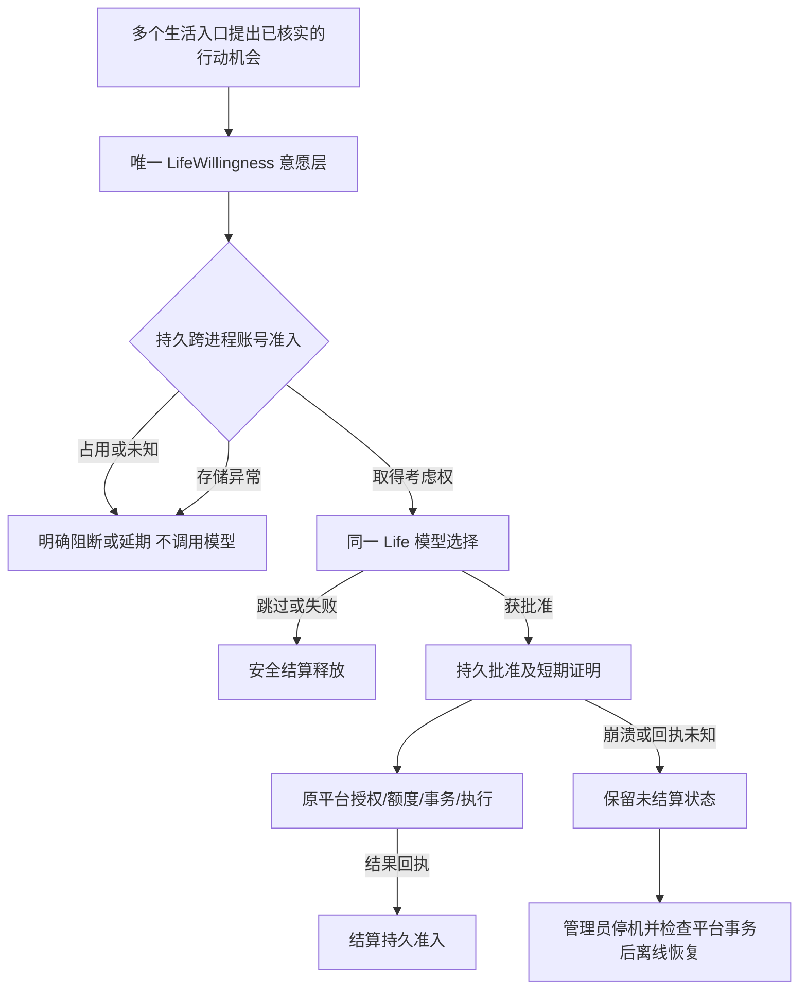

# 2.7.1-dev.9 · Life 决策持久准入（历史设计，非当前语义）

> dev.9 的“所有 approved 一律离线复核”是当时的保守策略。dev.71 已为新账本增加 `used` 标记并修复未消费证明过期后的持久锁滞留；当前规则以 [dev.71 授权恢复契约](./2.7.1-dev71-life-admission-recovery.md) 为准。

## 目标与唯一职责

**入口 → 共享层 → 状态源 → 增量 → 安全边界 → 渠道 → 回归**

- 入口：DM/评论/@、主动视频推荐、主人回访、动态、视频探索与视频 Agent 逐动作的现有 `lifeWillingness.decide()` / `verify()` / `receipt()`。
- 共享层：`lib/life-willingness.mjs` 是唯一意愿模型选择器；**仅为跨进程竞争新增** `lib/life-willingness-admission.mjs`，不制造第二套意愿、模型、平台发送或记忆。
- 状态源：`$DSH_HOME/bili-duty/life-willingness-admission.json`。只存账号域的 SHA256 摘要、随机令牌、最少量状态和时间，不存原始账号号、UID、消息、候选文案或平台 Cookie。
- 安全门禁：用 `withLifeWillingnessLedgerLock` 按目录短事务串行化 `acquire → approve → settle`；决策前必须取得持久 `considering`，批准后必须成为 `approved`，回执结算后才释放。同一账号另一 DSH 进程在此期间只可延期。
- 原安全层：`SocialPolicyGate`、账号识别、跨进程发送事务和每条实际 API 回执完全保留。Life 准入不代表获得外发权限。

## 准入与恢复语义

1. `considering` 在模型调用**之前**持久化，阻止跨进程同时请求模型批准；`approved` 在返回行动证明**之前**持久化。
2. 历史 dev.9 规则：只有 `considering` 且原进程确认终止的记录可自动回收；当时所有 `approved` 都需离线复核。**当前 dev.71 规则已细化**：过期且明确 `used:false` 的新格式批准可释放；`used:true` 或旧版没有 `used` 字段的批准仍显示 `life-choice-review-required` 并要求离线核查。
3. 模型拒绝、无行动、错误且尚未尝试平台动作时，按同一持久令牌结算；平台回执 `verified`/`delegated` 更新账号级冷却，其他结果不虚构成功。视频委派仍不意味着真的看完或听到。
4. 网络共享文件系统不支持该锁的可靠性保证；本地 NTFS/POSIX 文件系统的原子目录锁为前提。异常写入/损坏时拒绝新的 Life 许可，而非绕过门禁。
5. 历史 dev.9 单 scope 恢复只允许显式调用 `recoverLifeWillingnessOffline({dataDir,scope,confirmedAllStopped:true,platformTransactionReviewed:true})`。dev.71 另提供 `allScopes:true` 的离线批量恢复与 CLI 检查工具；必须先停止所有 DSH 实例并核查未知平台事务。这是技术状态维护，不是对鱼鱼每条社交行为的人类审批。
6. 真实平台动作可能由同一证明分多个消息气泡产生，各气泡原有发送事务仍分别验证；本阶段未改旧多气泡契约。需 Windows 实机确认最终回执边界。

## 设置保存差异与故障排查

- 原版 `persistCfg` 先写本地 `config.json`，再尝试 `ctx.settings.update` 写 DSH 原生设置。宿主可能无可写命名空间、重载失败或无法回读用户层。先前统一显示「已保存，但 DSH 同步失败」，无法判断插件实际配置是否有效。
- dev.9 仍保留**两份写入的真实状态**，但保存成功必须逐字段回读本地持久值与运行生效值；不一致直接报错，不返回成功。
- 如插件本地两份均一致且宿主设置镜像失败，明确显示「插件已保存并生效；原生 DSH 镜像未同步」并附宿主原因。并未冒称 DSH 原生表单已经修好，真实原因需 Windows 日志。
- 快速设置、正式社交页复用原 API 及其账号验证、朋友许可、冷却和额度；升级不会提高已有自主外发权限。

## 本次未解决、必须继续开发

- **持久化候选池与自动续行**：当前只持久化「谁有准入权」，不会存原始社交正文，也不会替生产者自动重放平台动作。失败/溢出候选仍由现有生产者新一轮核实后再报送，跨重启完整队列和公平仲裁待下一批。
- **平台与长期验收**：Windows Desktop、多进程/账号切换、真实 B站隔离、旧数据升级、72 小时运行、跨日成长因果未验收，`releaseReady:false`。
