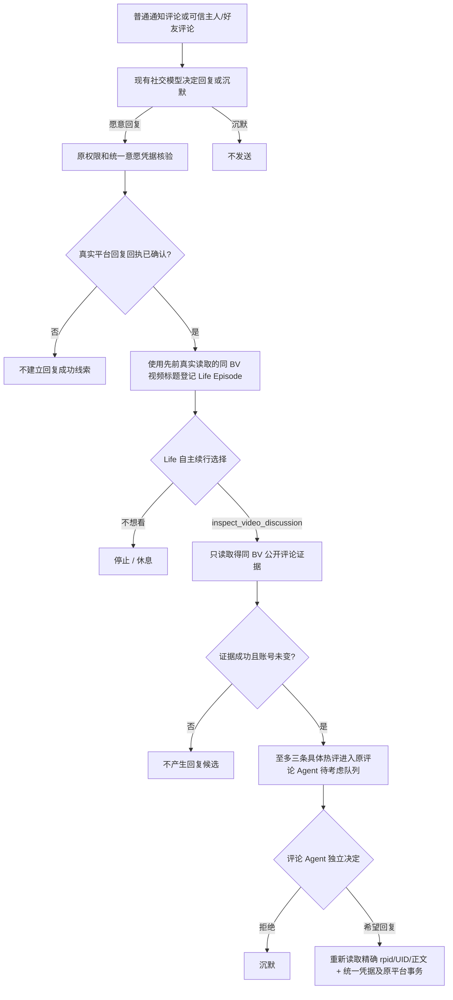

# 2.8.0-dev.11 · 视频评论探索与自主行动入口统一

> 开发预览。源码目录以本交付包 `source/` 为准；真实 Windows DSH 与 B站账户外发尚未验收。

## 1. 为什么删除 30 字和 2 条评论

`index.js` 的旧 `lifeContinuationEvidence()` 曾使用 `description.length >= 30 || comments.length >= 2` 作为 `commentReady`，在 `lib/life-continuation.mjs` 中将其变成 `comment_video` 候选的额外先决条件。这不是平台协议，也不是已核实的风控要求；简介短或零评论不等于鱼鱼没有资格考虑原创表达。dev.11 从执行候选中移除此人为代理指标；视频 Agent 的可配置播放/点赞/评论量门槛只用于正常视频选片，不再阻断 Life 已经选择了解的真实视频；保留可信 BV/标题、账号身份、`autoComment`、`commentDailyLimit`、`commentPerRound`、评论内容事实检查、幂等和平台实际回执。

“可获得发表选择权”不等于“可以把视频资料当作看过画面”；模型只能根据实际取得的标题、简介、字幕、公开讨论等作有据表达，不能声称读到了不存在的内容。

## 2. 退休单独开关，归属统一 Life

旧 `commentSideHotEnabled` 从配置 UI/管理提交/默认字段删除，`sideHotQueue` 在状态文件加载时丢弃；不再触发“原评论发送成功 → 直接抓取其他热门评论 → 旧后台独立回复”。升级不会把历史队列重新授权或自动补发。

这两次选择属于**不同意愿**：第一次 Life 选择“是否看评论”，随后评论 Agent 选择“要不要回复某一条”。观察不产生发送许可。

## 3. 代码位置

- `lib/life-continuation.mjs`：`lifeWriteKinds()` 取消 `commentReady` 门槛；`continuationMenu()` 中的 `inspect_video_discussion` 是可选动作，不会自动运行。
- `index.js`：`lifeContinuationEvidence()` 仅返回可信元数据，不再因简介短而附加读取其他热评，也不计算旧 `commentReady` 或套用视频 Agent 选片热度门槛；`registerConfirmedVideoCommentObservation()` 仅在已确认平台回执后登记 Episode；`executeVideoDiscussion()` 精确核验目标并返回必要字段。
- `lib/life-action-protocol.mjs`：`comment-reply-receipt` 是允许的已验证观察来源。
- `lib/life-opportunities.mjs`：`beginVideoObservation()` 复用账号隔离的 Episode 账本。
- `lib/autonomous-planner.mjs`：只有模型选择 `inspect_video_discussion` 且工具真实成功时，调用 `onLifeSelectedDiscussion`；轨迹增加脱敏的动作菜单和评论可选诊断。
- `lib/comment-interact.mjs`：`offerLifeSelectedDiscussion()` 是唯一跨串热评候选生产者，不会执行新读取或发送；评论 Agent 后续发送前再次核验目标/权限/身份。
- `lib/management-console.html`、`lib/management-console.js`：去除独立热评开关，改为只读说明。

## 4. 边界及仍需验收

- Life 读取热门评论是**只读候选**；回复还需要现有独立外发授权。账号切换、权限撤销、评论目标变化、重复发送、未知送达继续阻断或冻结。
- 回复所需的**当前楼层原评论/父评论上下文**与“回复后另找其他热评”不同；前者可在原评论 Agent 准备回复时为上下文而读取，不能自行扩散发送。
- 现有 Episode 仍有 5 步上限；本版补上续行 `menuActions/commentOffered/commentNotOfferedCode` 诊断，但**没有**将模型超时、平台接口限流或 5 步限制伪装成鱼鱼主动不想评论。
- 验证仅限模拟发送与程序测试。正式版仍需 Windows DSH、真实平台回执、重启切号与长期稳定性验收。
