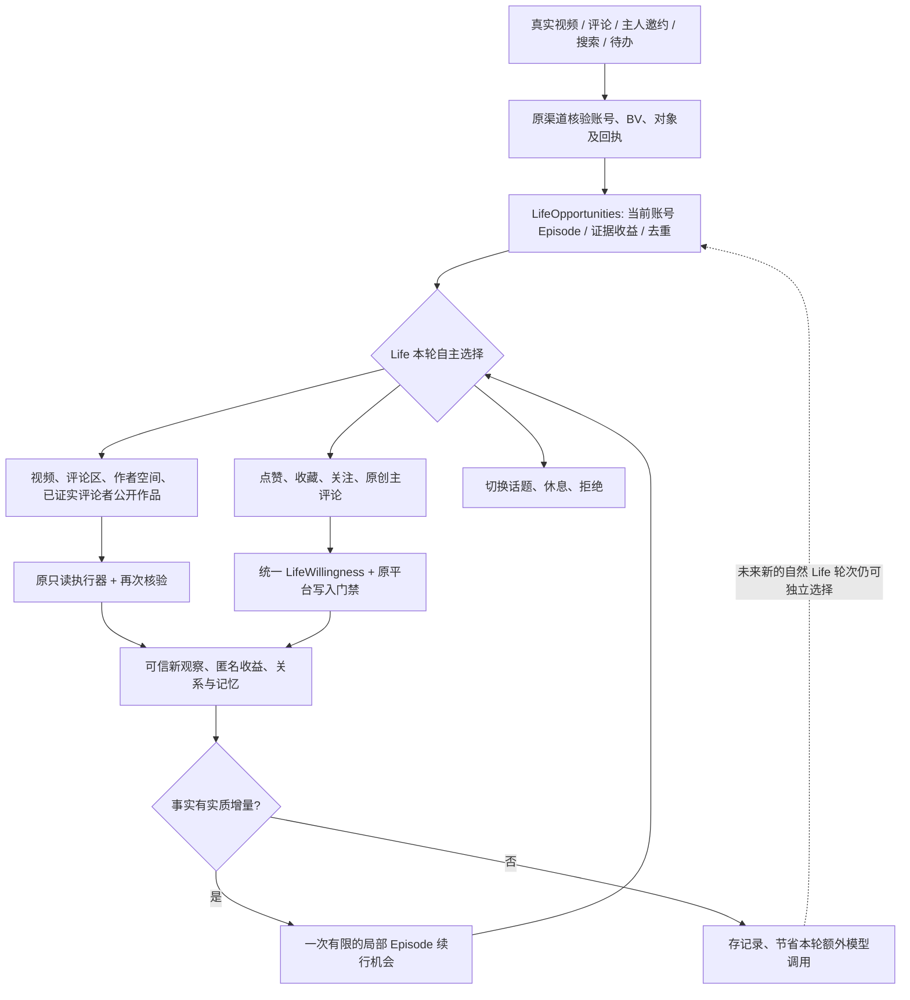

# 2.8.0-dev.12 · 自然生活：事件增量、开放行动与成长归因

> 状态：开发预览；代码级/离线回归不等于 Windows DSH、真实 B站外发、跨进程恢复和长期自然度验收。

## 目标和设计原则

继承 dev.9–11 的统一 Life 行动协议：一次真实意愿只决定一次，原账号/授权/权限/额度/幂等/未知发送冻结不得放宽。此次着重解决“评论后的菜单被描述为看热评”“高频意愿与契机重复核实”“Episode 为填满步数而持续推理”“五步截断有价值新信息”“成长与成本无法归因”“设置页没有可见的版本状态”。

不新增平行 Agent、自动点赞评论或独立设置开关。不以经验兴趣分数裁定鱼鱼是否喜欢；节流只基于**经核验的事实是否发生变化**，而非替代自主意愿。

## 统一数据及行动链

### 1. 社交成功回复是开放经历，不是热评命令

成功平台回执 + 同 BV 可信视频标题只登记可选 Episode。`goal` 允许自由决定继续读视频、读同视频评论、看作者、在已有跨日公共关系证据下查看评论者作品，以及必要时表达或休息。`continuationMenu` 仍以实时证据/权限产生最终菜单；不是“列出即承诺可执行”。尤其从评论读取产生的目标不代表平台已读画面/音频，不默认点赞/主评论。

### 2. `inspect_commenter_works` 的资格

- 评论工具返回真实且已核验的 `mid` 与 `rpid`；和 `SocialPortrait.resolvePublicOpportunity`、`LifeOpportunities` 的现有公共人物 `public-person-observation` 相交；只将最多三个不透明、24 位的 `personId` 纳入 Episode。
- 前端模型只收到这些 ID，不允许指定任意 UID、从私信主体取得身份，亦不得联系评论者；执行前后均重新核验账号与该公共人物资格。
- 只有原只读公共作品执行器完成真实回执才生成公共人物 Episode；失败、切号或撤权均不得形成已完成经历或外发。
- 若评论者尚无独立跨日可信关系证据，此动作不出现；这是原关系与隐私门禁，不是 Life 兴趣评分。

### 3. 证据增量、局部推理和资源治理

- `verifiedEpisodeYield` 比较本轮只读前后实际观察：同 BV 未变化、评论区零条、作者空间没有新 BV、首页零条新增，标为 `novel:false`。这**不改变**鱼鱼已有的历史喜欢/不喜欢意愿，也不改变任何写入资格。
- Episode 本轮成功只读但无信息增量时，不再自动唤醒**又一轮**完整 Life 规划，也不强制再调用局部推理；仍保存真实只读行为和未来自然 Life 轮次可选性。
- 仅当原配置允许实际外发候选、写入后护理已满足、BV/标题已核验、当前 Episode 可续行时，才请求可能需要的视频外发证据。相同本地续行轮对同 BV 最多一分钟复用只读结果；实际发送器仍独立检查新鲜权限与平台事实。
- 没有合法动作或者只剩“主动放弃”时，技术层面结束本次局部续行，而不是为得到一条预设停止答案再消耗模型；不会把它记成鱼鱼自主放弃或休息。
- 保留现有全局普通 Life 调度和显式配置节奏；局部“少调用”不是人为设定新的强制 30 分钟休息，也不是削减平台读写许可。

### 4. Episode 步数与自然延续

- 五步仍是硬资源/节奏上限，不自动执行第六步。
- 第五步若得到**新且可信的公开观察**，原 Episode 正常 `completed`，另外创建一个同账号、20 分钟后才 eligible 的**一次性可选续章**；不得无限递归（`chapterDepth<=1`），原证据和已读 BV 继承但新收益从零计数。
- 已经读过的 BV/评论区不会因为续章而自动重读；原 writeAftercare、写入结果和未知送达记录完整继承，绝不复制旧平台意愿 proof，也不允许以续章绕过写入节奏。
- 如果第五步没有新证据则不生成续章；鱼鱼可在以后普通规划中选择其他独立合法经历。

### 5. 兴趣和人格归因

- `LifeOpportunities.status().verifiedExplorationYield` 提供当前账号近七天 Episode 的视频元数据、真实评论条目、作者投稿与额外首页候选的**匿名数量摘要**（仅已核验）。计数是探索收益，不是“喜欢程度”。
- `projectLifeGrowthAttribution` 把现有的、独立跨日的 `interest-milestone`（至少三份证据、跨至少两天）和原 `LifeReflection` 处理/接受人格观察计数作**只读投影**，返回管理端 `integration-status.growthAttribution`。不新造人格/兴趣权重，不持久化 DM 正文、UID 或 BV。
- 验收指标：重复读取比、成功但零新增的 Episode、每一段局部实际推理次数、每个已核验新观察的模型调用数（需将真实模型 token usage 接通才可算节省成本）、兴趣独立跨天数与原人格接受数。

### 6. 设置页 npm 升级提醒

- 常驻“检查更新”入口；首次配置引导与常规设置均显示 npm 状态：查询中、无更新、查询失败或发现更高版本。只有确有较新 **npm 版本** 才以红点显示“更新至 vX”。
- 设置页进入时查询一次，手动可用 `source=npm&refresh=1` 绕过 24 小时缓存。无自动轮询、无自动安装。
- 一键升级须由用户点击；前端携带 `source:npm` 和版本观察，后端核对 npm 缓存版本，升级任务固定选择 npm 来源，不沿用最近一次 GitHub 更新查询留下的来源状态。
- 当前 dev.12 预发布版可能大于 npm 正式版：这时应该正常显示“无更高正式版”，**没有红点是正确的**。网络错误必须可见；任何版本检测不能导致降级。
- 新增接口状态并不证明 npm Registry 在线或 DSH 插件实际升级可用；必须在 Windows DSH 进一步验收。

## 现有机制与未完成的工作

- 本次**没有**新增持久化跨进程模型调用队列，原 `LifeWillingness` 的进程内 FIFO 与异常冻结不变。
- 本次采用“新信息才能自动触发额外局部推理”的最小可靠优化；没有改变全局 Life 调度周期或修改人设，也没有宣称已经大幅降低实测 token。
- 注：跨日兴趣归因只是事实投影，判断“因本次读视频导致人格变化”必须依赖未来长期独立因果实验，不能从数量直接推出。

## 测试及正式版验收

`test/v280-dev12-natural-life.test.mjs` 验证：回复开放菜单、不透明人物资格与模型字段拒绝、同来源同 BV 去重、五步续章不重放、事实增量不构成第二意愿、只读成长报告与 npm 常驻入口。再执行既有 dev.9–11 统一写入/社交/Episode 回归、全量 Node/Python、架构锚点检查、`selfcheck.mjs`、npm pack。最后必须 Windows DSH、真实 B站、npm 网络、主人撤权/账号切换、DNS/-509、重启后无外发重放及长时间自然度回放验收，才可发布正式版。
