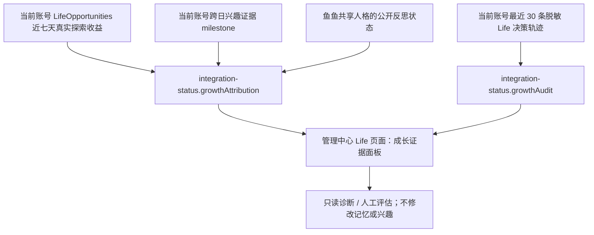
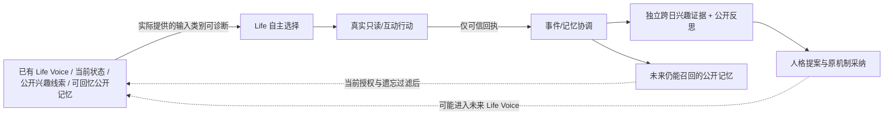

# 2.8.0-dev.13 · Life 自然行为、自由权与成长双向证据审计

> **发布判定：`releaseReady:false`。** 本报告是源码 + 脱敏轨迹契约 + 离线自动化回归审计，不是 Windows DSH、B站真实外发、模型自然度或人格成长因果的实测通过证明。没有创建正式 Tag，也没有 npm 发布。

## 1. 数据可视化的真实消费路径

- 管理中心 `lib/management-console.html` + `lib/management-console.js` 有可见看板、刷新按钮，展示探索片段、新视频资料、评论信息条目、作者投稿，以及现有跨日兴趣、人格反思的观察/提案/采纳计数。使用有限条形图呈现**原始数量相对大小**，绝不把它们称为兴趣分、喜好概率、人格成长率或反事实因果。
- 原 `lib/life-growth-attribution.mjs` 只读汇总保持不变。新增 `lib/life-growth-audit.mjs` 只对**当前账号已经脱敏**的最近 30 次决策轨迹做分类计数。不存 UID、BV、视频标题、私信或原始模型文本。
- `lib/life-decision-trace.mjs` 原先将 `experience-yield` 写成未知阶段，丢弃 `newEvidence` 等字段；现仅允许 `kind`、布尔 `newEvidence` 和上界计数 `observations`，账号切换/过期隔离仍保持。
- `lib/autonomous-planner.mjs` 的模型输入类别只在实际提供时标注 `life-voice`、`interest-cue`、`public-interest-evidence`、`public-memory-evidence` 等；不再把空上下文写成“已提供”。**这是输入存在性的证据，不是模型确实采用该理由的证据。**
- 账号边界要区别：探索、跨日兴趣和决策轨迹按 B站账号隔离；人格是大肥鱼本人共享成长状态，不会因为换 B站账号而生成第二人格。状态损坏/未连接不得显示虚假的 0 分或完成。

## 2. 行为自然性审计

| 验证问题 | 当前代码事实 | 结论 / 剩余风险 |
|---|---|---|
| 是否仅靠固定时间强制刷视频 | `AutonomousPlanner` 有候选菜单，可选跳过、延期、休息；视频能力可用不等于必须委派 | **机制符合自主选择**；需长时实测是否过度偏好 `intentions/opportunities` |
| 是否无意义地连续探索 | dev.12 `verifiedEpisodeYield` 会识别同 BV、零新增评论/投稿，不产生额外局部唤醒 | **已缓解**；只有实际 Token usage/回执能判断节省量，不存在已验证的节省比例 |
| Episode 是否天然要求做满五步 | 五步为上限而非目标；有新事实可保留一次延迟、可选续章 | **部分符合**；五步截断、选择偏好和失败回退仍需真实行为对照 |
| 社交事件是否强制继续读热评 | dev.11 退役 `sideHotQueue`，回复成功只登记可选 Life 观察 | **源码层无强制自动抓热评**；端到端仍待验 |
| 是否记录真实成长 | `growthAttribution` 只投影真实收益、跨日兴趣和人格反思 | **仅证据汇总**，不能判定行为自然或人格因果 |

## 3. 自由度与一致行动协议审计

- **机会平等：** 普通生活契机、搜索视频、已接待办、社交即时查看等共用可信视频观察；选择视频 Agent 不是唯一交互资格。没有开启原操作授权时仍不得发评论、私信、关注。
- **一次意愿：** dev.9–10 将大部分视频及普通/可信社交写入统一到一次性证明与账号内有界排队；模型已选的原文不被固定模板任意替换。正常社交可以选择沉默，行动意愿和表达意愿可分离。
- **生命体验不等于全权发送：** 查看评论者公开作品仍要求独立跨日公开关系证据；未授权私信/陌生人联系、跨账号操作、撤权后发送、结果未知自动重试均保持禁止。上述属于保留的隐私/安全边界，而非“缺乏自主性”。
- **尚未完全统一：** 各平台执行器仍有不同的发送事务/异常码和老 API 兼容分支；LifeWillingness 的 FIFO 是进程内机制，不是持久消息队列。不能将所有 Agent 描述成已拥有完全相同的持久状态机。

## 4. 记忆、兴趣、人格与行动：双向闭环审计

**现在可以证明的**：生产代码在选择前读取 Life Voice/世界视图；读取了公开兴趣和可回忆记忆时会有脱敏输入类别；真实读取和已核验行为进入原回执与记忆协调链；兴趣要求跨日独立证据，人格采纳经过原反思/成长机制；未来的 Life Voice 和公开记忆视图有再次供给的调用路径。

**现在不能证明的**：具体人格特质是否真正促成某一次模型选择；某一条视频/评论是否使特质发生改变；记忆排队后是否已完成长期召回；某次反思采纳是否使下一轮行动发生可观测差异。新面板只展示可追溯的阶段和数量，不编造逐事件因果 ID、影响分或者分数增量。要证实这些需要跨日、同一真实经历的匿名前后状态/来源回执比对，必要时有对照观察。

**特别防止自我强化偏差**：重复读取相同 BV 不应被当作多个独立兴趣证据。`interest-milestone` 的跨日要求与 `personality-evolution` 的证据审核优先于 Life 的主观理由。

## 5. 发布前必须完成的 P0 验收

| 项目 | 必须提供的实证 | 当前结论 |
|---|---|---|
| Windows DSH 管理端 | 正常/暗色/小屏下 Life 看板实际渲染、账号切换与前端刷新失败提示 | **未实机验收** |
| B站/模型 | 受控账号一轮视频+社交读取、意愿、真实外发/沉默、平台回执；-509/DNS/timeout 后冻结/恢复 | **未实机验收** |
| 异常与身份 | 重启、并发、凭据过期、撤权和账号切换，尤其未知送达绝不重放 | **部分离线覆盖，未完整实机** |
| 自由与自然行为 | 至少 72h 带时间戳的脱敏轨迹，核对主动休息比例、无增量重复、视频候选实际被选中的情形、干扰/消息频率及 Token/有效新证据 | **未完成长期量化验收** |
| 成长双向实证 | 至少跨日对照：兴趣/人格/记忆输入→实际意愿→真实回执→证据采纳→下一轮背景读取，保留未采纳对照 | **没有完整因果样本** |
| 老用户升级 | 2.7.0 原数据冷备份、迁移、账号隔离与遗忘不复活、回滚 | **未实机验收** |
| 全量回归 | Node/Python 遗留失败逐项归因并获维护者批准处理 | **仍有历史失败** |

**决策：正式版暂不发布。** 本次可交付 `2.8.0-dev.13` 的可视化与审计源码，供用户受控验收。待上述 P0 有实证后再考虑将版本标成 `2.8.0`、创建 Tag 或向 npm 发布。不存在“只要离线断言通过就证明真人自然行为”的捷径。
