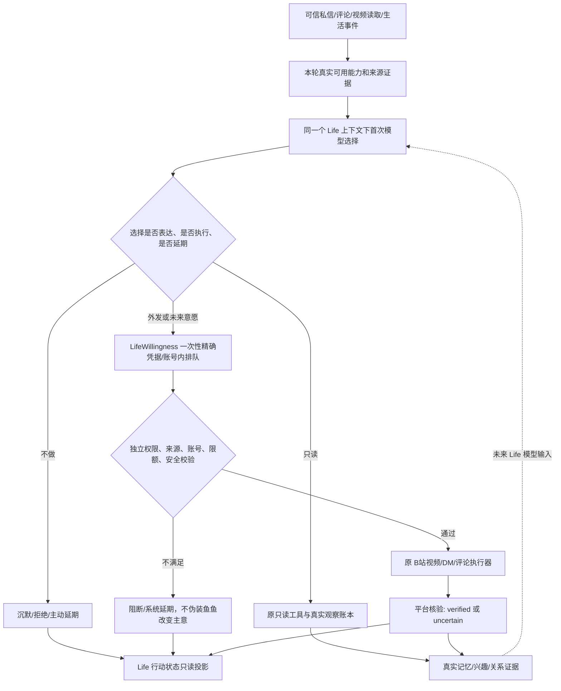

# 2.8.0-dev.14 — 一个鱼鱼，一套 Life 意愿协议，一套行动记录，多种专业执行能力

> **当前 dev.17 勘误：** 下文 dev.14 的“默认仅允许好友／手动扩大授权范围”是历史设计，已废止。当前私信自主关注默认开启、无好友／陌生人目标范围开关；真实已核验的来信联系人可由鱼鱼独立考虑关注或取关。取关仅限本插件曾自主关注满 7 天的联系人，并仍受账号、主人授权、拒联、平台回执保护。

> 版本状态：开发预览；非正式发布，不自动启用任何 B站外发权限。本方案是 **已实现的 dev.14 路径 + 尚待 Windows/平台验证的边界**，不是对所有历史入口已经完全迁移的虚假承诺。

## 1. 根本原则

Life Planner 并不是所有社交模型的第二个裁决者。收到真实私信、评论或 Life Episode 事件后，所在场景的首轮模型可以形成完整意愿；宿主的 `LifeWillingness` 只进行密封、短期准入、排队及凭据核验。`Life Action Records` 只负责**观察已发生的决定**，它没有签发、恢复或重新播放凭据的权力。原视频、私信、评论、动态专业执行器继续实施各自平台授权、来源和回执门禁。

## 2. 私信的开放机会 / 独立表达与行动

真实 `incoming:true` 私信应具有当前账号、非空原消息、有效 `messageId`、匹配 UID；`dmContactFollowCandidates` 从同一已验证发件人生成 **`follow_dm_contact` 供考虑**。它不再用 `friend` 标签、3 次双向对话或跨日规则替代鱼鱼的首次决定。邀请不是许可：对方说“互关”不会自动关注；即使没有“互关”请求，鱼鱼也可能基于真实关系与兴趣想进一步认识对方。

同一次 `interaction-batch` 模型可以独立选择 `reply/skip/defer/close` **与** `nextAction:follow_dm_contact`。选择静默不应剥夺另一项已选择行动。只要动作候选由本轮受信宿主提供，有限延迟意愿会写入原私信 state `pendingLifeAction`（单目标、原 messageId、到期、不重复生成）。`onPendingAction` 写一个脱敏的统一状态行；它不能触发平台发送。过期、历史提案、账号变更、撤权、拒联、在途送达未知都必须阻断。

默认**仅允许向已核验好友实际发送关注**：设置页现有“私信关注”区可明确扩展授权范围到已核验陌生来信人。即使鱼鱼在默认范围之外选择了关注，动作意愿也保留并显示 `blocked`，但不能实际发送。这是主人授权边界，不是第二次意愿评判。

到期时，`onVerifiedReply` **只封存已选行动**，不再次调用意愿模型，发给 `LifeWillingness.adoptSocialDecisionQueued(kind=dm_follow)`。该凭据仍绑定目标 UID、当前账号和消息来源，并由 `bili_follow_dm_contact` 的独立平台安全门禁以及核验结果结算。显式主人手动操作不伪造为鱼鱼的自主意愿。

**对外表达真实性**：选中或排队关注 ≠ 已关注。共同事实验证器 `verifyLifeOutbound` 只允许把真实、当前收件人绑定的 `creator_follow_verified` 回执用于“已经回关/互关成功”的叙述；不得自行修改正文或自动补发。回复模型可自然表述尚未完成的愿望，不必须当场关注。

## 3. 统一行动记录及隐私

- 来源：`LifeWillingness` 的已选、执行、结算事件和 DM 已选但未执行的延迟关注。原记忆、视频观察、只读待办仍以各自可核验来源记录；本表是**跨外发行为的状态视图**，不是取代所有记忆、TODO 的新发送数据库。
- 持久化文件：`life-action-records.json`，同账号的 decision/proof ID、账号 tag、source key、平台 receipt ID 只存不可逆摘要，不写 UID、BV、正文、原始私信或凭据；有大小、行数、状态、符号链接和原子写限制。
- 状态：`queued`, `selected`, `executing`, `verified`, `blocked`, `system_deferred`, `fish_deferred`, `declined`, `uncertain`。系统排队和鱼鱼主动延期是不同含义。
- 结果：管理中心 Life 页只读显示最近状态、时间、是否已有核验回执；**不能在 UI 点击重试或发送**。崩溃后旧选中/排队状态要求重新审查来源和权限，不自动补发。
- `Life Action Records` 不会改变现有兴趣/人格分数；真实行动仍通过原记忆、成长和关系处理链成为未来模型输入。

## 4. 其他专业能力与尚未统一的部分

| 入口 | 当前 dev.14 行为 | 限制 |
|---|---|---|
| Life Episode 视频探索 | dev.9–13 已复用首次意愿和原视频安全写入工具；记录意愿与回执 | 未经 Windows/真实 B站端到端回归 |
| 普通 DM 回复/关注 | dev.14 统一首次表达/行动选择、原准入与只读状态记录 | 对陌生人关注仍独立主人授权；已选延迟行动不能无限重试 |
| 普通评论与可信评论 | dev.10 已密封发送文本及目标、复用原发送事务 | 回复与阅读可产生不同新意愿，不得推断为自动互动 |
| 社交视频推荐/待办 | 仍由原真实读取账本及 Life Episode 继续动作 | 延迟只读 TODO 与外发意愿的恢复门禁不同 |
| 主人明确手动 DM/评论工具 | 保留人工授权及独立审计，不混入鱼鱼自主投票 | 不允许用自主凭据替代主人明确确认 |

全局持续 Life 调度、跨进程持续排队和所有历史独立执行链彻底收敛**不在本次声称完成之列**。如果正式发布前发现还有绕过 LifeWillingness 的自动外发，必须作为发布阻断项处理。

## 5. Windows 测试分级与正式发布门槛

`run-tests.ps1` 每项生成 `dsh-bili-scroll-plus-details-YYYYMMDD-HHMMSS/step-NN.tap.log` 和 `FAILED-TESTS.md`。不能再只保存批次退出码；Linux 既有 80 项失败不能假定等价于 Windows 27 个失败批次。需要逐项检查：历史文档/版本断言；环境差异；行为层实现错误；安全回执、账号切换、社交意愿、陌生人关系、保留许可的负例。

发布前必须：Node 与 Python 全量失败归因、Windows DSH 真实界面、已授权受控 B站端到端回执、断网与异常退出保守恢复、跨日兴趣/人格/记忆双向行为核验。不得通过删除失败测试、关闭门禁或把模型意愿改成硬编码关注让结果变绿。
