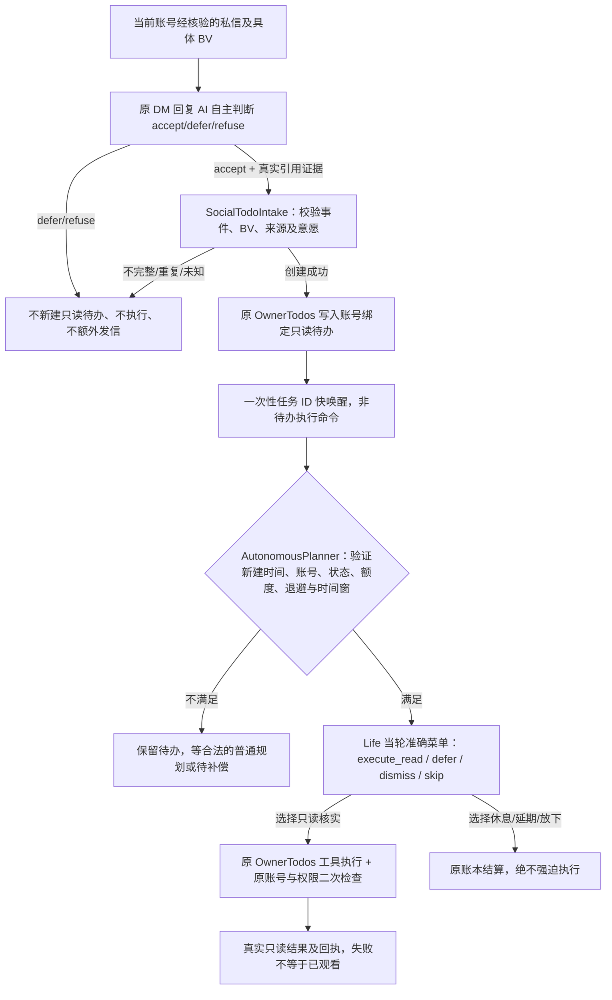

# dev.5：私信作品邀请与 Life 自主只读待办快速唤醒（历史设计，dev.6 已替代）

> **历史架构说明**：dev.5 的第二次模型考虑已在 dev.6 收敛为单次社交意愿与直接只读执行，请以 [dev.6 当前契约](2.8.0-dev6-single-intent-actions.md) 为准。

> 2.8.0-dev.5 离线代码契约，不是 Windows DSH/B站真实端到端验收。参见现有统一 Life 全景及发布门禁。

## 实际问题与来源

2026-11-12 日志中，对方在已提出「去看我的作品」后，补发 `BV1hVWQ6ZEcw`。私信 Agent 能及时回复、原视频推荐入口记录到候选，但没有可信待办执行回执；普通 Life 待办只在 10/30/80 分钟定时轮中考虑，匿名 socialWake 不会主动读取 BV。这使用户误以为提供了 BV 却仍要求提供标题、简介。**收到/候选/接受/执行/核验**必须分别解释。

## 只使用已有归属的数据与工具

- **单一事实源**：已有 `OwnerTodos`、`SocialTodoIntake`、`AutonomousPlanner`、现有工具与原 B站事务账本；不增加对用户消息的关键词规则或第二任务账本。
- **即时唤醒不等于强迫**：仅 `social-ai-read:`、`acceptance.kind=social-willingness`、`origin.kind=bilibili-dm`、刚写入五分钟内且可读／到期的任务可被一次性 ID 提示；Life 自己决定。直接调用 `tick` 的随机 ID 无效。
- **额度和权限**：绕开的是普通 Life 时间间隔，不绕过启用、活跃时间、模型退避、日模型预算或同账号运行锁；发送许可没有改变。执行前再次检查当前账号及同一任务仍处于可用状态。重复提议不会重复唤醒。
- **技术阻塞与恢复**：Life 正忙则保留已持久化待办，后续普通轮仍可考虑；不额外启动并行模型，不自动重发私信。崩溃仍遵守 dev.4 安全自动恢复。
- **用户看得懂的时间**：生活线索、契机、待办显示原记录中可信的发生/更新/完成/下次考虑时间，使用浏览器系统时区；无时间不猜测。
- **限制**：原只读工具读取 BV 元数据、公开文本/字幕/评论不代表真的完整播放视频或听音；完成待办后如需给推荐者回复，仍由原独立社交回访与写入门禁决定，当前不会为即时唤醒生成强制外发。

## 层归属与风险表

| 需求 | 归属与事实源 | 风险与隔离 |
|---|---|---|
| DM 中形成未来只读任务 | 原 `interaction-batch.mjs` → `social-todo-intake.mjs` → `owner-todos.mjs` | 不解析外部指令为自动命令；必须 AI 接受、真实来源、账号验证 |
| 及时而自主的模型考虑 | 同一个 `AutonomousPlanner.tick`，无第二独立 Life 调度器 | 仅新接受任务，固定 5 分钟窗口、原预算和锁，防并发与额度穿透 |
| 实际读取与回执 | 原 `executeRead`，原 `OwnerTodos` 账本、Life 记忆投影 | 不把请求/元数据当作已观看；未核实执行不自动重试外发 |
| 时间显示 | 原管理页只读状态卡片 `formatLocalTime` | 浏览器本地转换，仅显示真实时间，缺失则明确标记 |

主要测试：`test/v280-dev5-dm-read-wake-and-plan-times.test.mjs`；原评论、关系、用户授权、社交快速注意力及完整备份通路必须保持兼容。正式版需继续完成 72 小时、Windows DSH/真实 B站、模型与旧用户恢复门禁。
