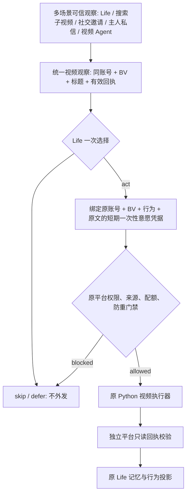

# 2.8.0-dev.9 · 唯一 Life 行动协议与跨场景自由度验收

> 本文对应实际代码迁移，不是 2.8.1 愿景。dev.9 是尚未发布的开发版本；真实 Windows DSH/B站授权账号操作、72 小时和历史旧用户迁移仍需验收。

## 核心约束

**相同的可信经历，获得相同的行动选择权；一项已经由鱼鱼选择的意愿，不再重复投票。** 所有状态、情绪、记忆和关系只是第一模型的上下文，不是第二个公式裁判。专业 Agent 提供视频读取、评论草稿、发送工具；最终“要不要做”由对应的 Life 或社交首轮模型决定。`skip`/`defer` 是主动选择，工具异常或权限拒绝不是鱼鱼主动拒绝。

流程如下：

这一协议不会给任何新入口自动授权。仅有视频信息的 `ok` 字段不代表完成观看，不凭标题假造看过画面或听过音频。评论的具体观点需要足够的真实内容证据，并遵守原评论内容门槛。

## 行为矩阵（生产代码）

| 来源 | 原始事实源 | 第一次决策 | 再次行动机会 | 原外发工具 / 安全说明 |
|---|---|---|---|---|
| Life 自主核实生活契机 | `beginInspectedOpportunity` | Life 自主核实 | 同一 `registerVideoEpisode` | `LifeContinuationWriteExecutor` + 一次性桥授权 |
| Life 普通 `watch_video` 待办 | `verifiedCompletedVideoTodo` | Life 选择执行 | `registerCompletedVideoRead` | 同上；必须有完整待办完成回执 |
| 搜索结果的 `watch_video` 子待办 | `considerChildrenCore` | Life 选择某个视频 | 同一 `registerCompletedVideoRead` | 同上；不能把搜索列表当作已看 |
| 社交已接受立即查看待办 | `executeAcceptedSocialRead` | 原社交模型接受、Life 执行 | 同一 `registerCompletedVideoRead` | 同上；接受不等于视频实际读成功 |
| 社交 `watch_now` | `ownerCommentAgent.perform` | 原社交模型 | `beginVideoObservation` | 同上；首轮模型决定阅读，互动另作决定 |
| 社交 `social_invite` | `ownerCommentAgent.perform` | 原社交模型 | 同一 `beginVideoObservation` | 原独立二次主评论模型/发送器退休；只读后交给 Life |
| 主人 DM Agent `watch` | `ownerDmAgent.onVideoObservation` | 主人 DM 首轮模型 | 同一 `beginVideoObservation` | 读取回执严格匹配 BV 与标题 |
| 视频 Agent 原始视频写入 | `LifeVideoActionBridge` | 原 `LifeWillingness.decide` | 不产生二次意愿 | 原 Python 工具、轮次选片核验及独立回读 |
| Life Episode 点赞、收藏、关注、原创主评论 | `LifeContinuationWriteExecutor` | Episode 模型已决定 | 无重复判断 | `adoptVideoDecision` → `registerTrustedIntent` → 原 Python → `/life-action-result` |
| 主人 DM / 评论 Agent 自主动作 | 原模型明确 `act/skip/defer` | 原社交首轮模型 | 无第二次评分 | `DualContextAgency.recordAI` 仅诊断；原权限/原社交事务 |
| 旧版主人私信明确命令、旧版评论邀请 | 平台核验后旧回退代码 | `unifiedLegacySocialChoice` 调用同一 Life 模型一次 | 无情绪分数 | 原主人显式动作工具及社交门禁，不冒充 Life Episode 一次性视频写入 |
| 普通评论回复与自然私信 | 已核实来信、原回复模型 | 单次原回复模型 | 不再被公式裁判 | `adoptSocialDecision` 封装同 UID/线程/原文的 Life 证明 |
| 生活动态表达 | `daily-dynamic` 选中的 `style` | 原模型 | 不自动改写 | 过去 14 天风格仅作为创作历史信息 |

**主人明确指令与自主行动区分：** 主 Session 明确要求的手动评论、手动关注和手动发私信继续走原确认与平台权限工具，不冒充“鱼鱼自主意愿”。旧回退主人私信/评论在没有独立 Agent 决策时使用同一个 Life 意愿模型，但原手动发送器不会因为获得意愿就跳过主人权限或内容验证。

## 一次性意愿凭据（实现细节）

- `lib/life-action-protocol.mjs`：可信观察、合法视频动作、行为结果枚举及旧请求的统一 Life 意愿适配；不持有 B站 Cookie，不负责平台发送。
- `lib/life-opportunities.mjs`：当前账号下的唯一视频 Episode 观察登记。可从不同来源提议不同 Episode；同一来源完成回执不会被重复登记。`watched:false` 表示仅证实公开视频资料读取。
- `lib/life-willingness.mjs`：同一 `LifeWillingness` 准入账本、TTL、账号隔离、`adoptSocialDecision` 与 `adoptVideoDecision` 共用只进一次的 claim 逻辑。`adoptVideoDecision` 只能由已获模型选择的可信宿主调用，不再调用模型。
- `lib/life-video-action-bridge.mjs`：同一 Node loopback 网关。可信宿主登记 `{scope,uid,kind,target,commentText,proof}` 并取得一次性 `intentTicket`；Python 只能以环境变量传票据，经 Bearer 本地授权、精确 BV/原文、校验后消费；过期、撤权、切号或重复使用全部拒绝。
- `lib/life-continuation-write.mjs`、`lib/life-continuation-write.py`、`vendor/bilibili-mcp/mcp_server.py`：原账号状态、原选择账本、独立公开视频证据和平台写入配额全部执行，成功不能由 Python 的 `ok` 自证。Life 原创主评论不再要求独立视频轮次 `roundId`，但必须有上述密封票据且正文必须原样一致。
- 原视频 Agent 的主评论审阅依旧保留视频轮次校验并进入同一网关；没有可信 Episode 票据时不能借用新入口绕过轮次检查。

**失败状态**：`not_offered`（无合格机会）、`declined`（模型拒绝）、`deferred`（模型延期）、`blocked`（权限/证据不允许）、`executing`（一次性允许尝试）、`verified`（独立平台核验成功）、`uncertain`（无法证明送达，不能自动重试）。这是一套面向诊断的通用分类；原 API 仍保留细化错误码以兼容旧界面，不应把所有旧日志都误称为已迁移成同一个状态字段。

## 防误发、隐私与断电恢复

- 账号 B站 UID 和匿名 accountTag 必须一致；不能拿旧账号视频 Episode 写新账号。
- 精确动作/目标/评论原文绑定；不准在 Life 授权后追加 @、同步动态、改写文案、换目标。
- 视频原标题和作者简介是外部不可信数据；不得执行里面的指令或声称已经看完全部音画。
- 只读失败或缺少可信标题、非完成待办、错误 BV、重复使用同票据都不产生新写入资格。
- 授权已消费但平台回复未知 → `uncertain` 并保留原未知冻结；不能因为进程重启签发同一动作的自动补发。旧账号/未签名迁移内容不能冒充有效 Life 凭据。
- `LifeWillingness` 的已使用证明和原 B站事务是不同层面的事实。只有独立回读 `verified` 可以形成“确实送达”的记忆，不会把 `delegated`、`accepted-unverified` 当成功。
- 诊断只记录动作/原因类别及脱敏引用，不写模型隐藏推理、私信原文、Cookie、真实 UID 或原评论内容。

## 测试和发布门槛

1. 离线合约：新入口证据、相同 BV、同账号、去重；模型拒绝/延期不触发写入。视频 Agent 的旧轮次及 Life Episode 的票据都走原桥。
2. 票据：动作不匹配、评论被修改、换 BV、换账号、重复使用、过期、执行器不可用、平台无法独立核验要失败闭合。
3. 社交：旧回退入口调用同一模型一次；已由模型选定的 DM/Comment 不再被情绪分数否决；社交邀请只读后不得绕过 Life 自行主评论。
4. 运行时：Windows DSH、真实 B站受控账号、旧用户带数据迁移、断电/重启、72 小时、风控状态与各权限开关需单独验证。
5. 未完成真实验收之前仅交付 `2.8.0-dev.9` 预览和补丁，**不自动发布正式 npm 2.8.0**。
