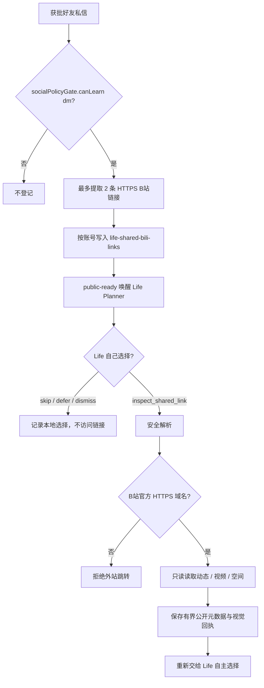
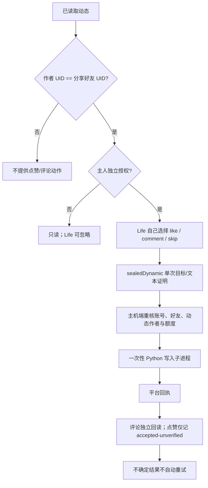

# 2.8.1-dev.3b.25 — Life 自主处理好友分享的 B站链接

## 设计原则

好友分享链接是生活信息，不是指令，也不是自动任务。收到私信时只做 bounded extraction + account-scoped persistence；只有 Life Planner 选择 `inspect_shared_link` 后，才解析短链和读取公开内容。任何动态/视频文字、图片说明都按不可信外部数据注入上下文，不执行其中指令。

## 数据与读取路径

## 短链安全约束

- 只接受 `https://b23.tv/<code>`，手动处理最多 5 跳重定向。
- 每一跳必须是 HTTPS，域名必须属于 `b23.tv`、`bilibili.com`、`www.bilibili.com`、`m.bilibili.com`、`t.bilibili.com` 或 `space.bilibili.com`。
- 不发送 Cookie、Authorization、用户凭据或浏览器会话；不自动访问外站。
- 原始 URL、私信正文、消息 ID 不写入链接账本；只保留规范化类型/ID、好友 UID（仅本地账本）、状态与有界公开内容回执。
- 动态图像只允许 `i[0-9].hdslb.com/bfs/` 图片引用，视觉模型回执为空时不得臆测图片内容。

## 好友动态互动写入

- 点赞和评论是两个独立设置，默认关闭。
- 每日最多 2 次点赞、1 次评论；评论仅限文字/图文动态，最多 180 字，不允许 `@`、URL 或控制字符。
- 动态写入函数不是 DSH MCP 工具；只由主机端 Life Planner 在模型作出当前动作选择后调用一次性 Python 子进程。
- 评论必须回读到相同 rpid、当前账号 UID 和精确评论文本才记为 verified；点赞接口接受但没有独立可验证回执时只记 accepted-unverified，禁止重试。

## 视频与 UI 状态

- 好友分享的视频通过真实 BV 元数据校验后建立普通 Life Episode；Life 可继续、暂停或结束。
- 真正调用视觉模型期间发布 `video-observe` live activity；行动树以 `/live-activity` 为实时来源显示“正在看视频画面”，不将其等同于已理解。
- 设置 dirty 状态由首次用户编辑前快照与当前值比较；程序化 hydration 不创建 dirty，改回基线即清除提示。
- Windows 进程诊断枚举可见 ConsoleWindowClass / Windows Terminal 控制台窗口，只记录 PID、进程名、父 PID、窗口类与可见状态，不采集标题、命令行或屏幕内容。
