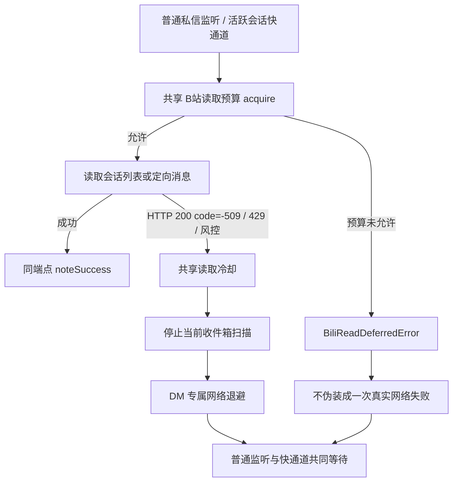
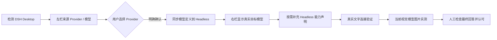

# 2.8.1-dev.3b.20 · 私信限流收口、Headless 双栏能力管理与图片回执诊断

> 当前开发增量，基于 `2.8.1-dev.3b.19`。不是正式发布。没有进行真实 B站私信发送、真实 -509 恢复验证、Windows DSH 或第三方中转站图片端到端验收。

## 1. 本批范围

本批只处理已存在的可靠性问题与用户明确要求的模型管理体验：

1. 私信 -509 时停止当前整轮会话扫描；普通监听与活跃快通道使用同一个 DM 退避；避免连续无新消息时持续 10 秒请求。
2. 修复视觉模式切换后未保存状态判断遗漏。
3. DSH Headless 图片子进程异常退出/超时时，仍读取此前已经产生的固定 MCP 图片回执。
4. 将 Desktop → Headless 模型同步改为双栏联动，并提供只作用于 Headless 的能力声明向导。

不改变 Life 决策、社交权限、B站写入权限、模型选择、API Key、凭据或外发额度。

## 2. 私信读取与共享退避

### 2.1 真实请求路径

- `bili-read-budget.json` 维护跨后台读取任务共享的预算/平台冷却。
- `interaction-network-backoff.json` 的 `dm` lane 维护私信专属网络/平台退避。
- 两个保护各自保留；下一次私信读取必须等待二者都允许，界面显示两者中的较晚恢复时刻。
- `dm` 和 `dmFast` 不再映射成两条不同健康状态。管理中心只显示一条“私信监听与快通道”，避免将同一共享退避误解为两次独立失败。
- `BiliReadDeferredError` 说明读取预算尚未允许请求发出，不是新的 B站失败，也不能清除已有 DM -509 退避。
- 一旦单会话读取返回 -509/平台风控，`collectDmInbox` 立即抛出并结束本轮；普通 `ECONNRESET` 等单会话网络问题仍可隔离后继续检查其他会话。

### 2.2 活跃会话自适应间隔

活跃会话窗口和最多两个会话的既有约束保持不变。基础间隔仍由 `dmActivePollSeconds` 配置，范围 10–60 秒。默认 10 秒时，连续无新消息的定向检查间隔依次为：

| 连续无新消息检查 | 下一间隔 |
|---|---:|
| 初始 / 新消息后 | 10 秒 |
| 第 1 次空检查后 | 20 秒 |
| 第 2 次空检查后 | 30 秒 |
| 第 3 次及以后 | 60 秒 |

新来信或真实确认发出私信会重新建立活跃窗口。没有活跃会话时不运行定向快通道；首次发现新会话仍由普通会话列表轮询负责。实际执行还受共享读取预算和平台退避约束。

## 3. Desktop / Headless 双栏同步

### 3.1 用户流程

UI 结构参考用户提供的“双栏联动”截图：顶部三阶段进度；左侧 `DSH Desktop · 来源模型`；右侧 `DSH Headless · 后台模型`；中间显示同步方向；底部明确说明模型声明、文字连接和图片实测是不同事实。同步后的左侧来源卡片置灰，右侧目标卡片由后端状态生成。每个 Provider 单独确认同步。

### 3.2 能力声明合同

来源和目标模型分别暴露：

- `input` 中是否声明 `text` / `image`；
- 是否声明 `reasoningEfforts` 及声明档位；
- 来源与 Headless 声明是否存在差异（`headlessOnlyOverride`）；
- 文字连接验证回执是否仍绑定当前完整模型指纹。

未声明只代表配置没有声明，不能推断模型不支持。

### 3.3 Headless 专属能力向导

- 向导只对已同步的自定义 Provider 开放。
- 只写 `profiles/headless/cordis.patch.yml` 中目标模型的 `input` 与 `reasoningEfforts` 字段。
- 来源已有声明优先且锁定；向导只增加来源未声明的能力，不覆盖 Desktop 来源值。
- 当前 UI 支持显式确认 `text`、`image` 和 `off/low/medium/high/xhigh/max` 档位。`off` 写为 `null`，其余档位使用同名值；这是 DSH 常见映射，不证明第三方中转站接受这些参数。非标准上游映射不在本版向导范围内。
- 不修改 API Key、Provider 协议、Base URL、headers、其他模型或全局 `cordis.patch.yml`。
- 如果模型来自 DSH 全局共享配置，向导拒绝写入，因为全局变更可能同时影响 Desktop。
- Provider 同步比较允许模型级 `input` / `reasoningEfforts` 不同；验证指纹仍包含完整 Headless 模型声明。重新同步时保留已有 Headless 专属补充；声明变化使旧验证回执失效。
- “恢复来源声明”只移除目标模型在 Headless 中的额外能力声明，不改变来源。

### 3.4 能力声明不等于可用性

| 状态 | 能证明什么 | 不能证明什么 |
|---|---|---|
| 模型能力声明 | DSH 配置中列出了输入/思考档位 | 上游中转站真的接受这些能力 |
| Headless 文字连接验证 | 无工具文字请求可成功 | 图片附件可达、模型理解图片 |
| MCP 固定图片回执 | 受控 MCP 工具返回了指定 ImageContent | DSH 内部附件桥接成功、模型收到图片 |
| 最终视觉回答 | 模型返回了可供人工检查的回答 | 自动替代人工认可 |

## 4. 视觉路由和 MCP 图片回执

- `visionMode` 纳入前端有效路由与未保存比较；模式切换未保存时不允许启动与已保存模式不一致的 DSH 图片验收。
- 保存 `visionMode` 变化时清除旧 DSH 视觉人工验收状态。
- DSH Headless 子进程退出码非零或超时时，先读取 nonce 绑定的固定图片证明文件，再分类后续失败。
- 如果 MCP 图片回执有效但 DSH 子进程异常退出，结果仍然失败，但诊断会保留 `mcpImage=verified`，并将后续 DSH/模型阶段标记失败或超时。
- 如果没有有效回执，则显示未收到/不匹配；不推断模型不支持图片。
- 插件无法独立观测 DSH 内部附件桥接，因此该阶段继续显示不可直接观测，不伪造成功。

## 5. 关键文件

| 文件 | 变更 |
|---|---|
| `lib/dm-inbox.mjs` | 平台限流/共享读取暂停时立即停止整轮私信扫描 |
| `lib/dm-autoreply.mjs` | 活跃会话 10→20→30→60 秒自适应间隔 |
| `lib/interaction-scheduler.mjs` | 共享读取预算 deferral 不清除 DM 退避；暴露自适应间隔 |
| `lib/network-poll-backoff.mjs` | 扩展 B站平台限流码分类 |
| `lib/system-health-projection.mjs` | DM 普通监听与快通道合并成一个状态，并计算最晚恢复时间 |
| `lib/headless-model-sync.mjs` | Headless 专属能力预览/写入、来源保护、指纹与重同步保留 |
| `lib/management-console.html` | 双栏联动 UI、能力解释与能力声明向导 |
| `lib/management-console.js` | 真实后端状态驱动双栏、逐 Provider 同步、能力向导、视觉模式 dirty check |
| `lib/vision_dsh.py` | 非零退出/超时时保留 MCP 图片证明 |
| `index.js` | Headless 能力声明预览/写入 API、视觉模式变更清除旧认可 |

## 6. 验证

本版本新增/更新专项测试：

- DM -509 中止整轮、普通网络错误隔离、共享预算 deferral 不清除退避；
- 活跃私信自适应间隔与新消息重置；
- 普通监听/快通道共享退避显示与两个冷却取最晚值；
- Headless 能力声明只改目标配置、保留来源与凭据、验证指纹失效、重同步保留和全局共享拒绝；
- 视觉模式参与未保存比较；
- DSH 子进程非零退出/超时但 MCP 回执有效时，保留 MCP 成功阶段。

具体测试数量以交付包 `source/TEST-RESULTS.md` 为准。Node/Python 离线测试不代表真实 B站或 Windows DSH 实机通过。

## 7. 未覆盖与实机验收

1. 真实 B站 -509 解除后的下一次读取、持续运行限流频率仍需用户实机验证；不能用模拟响应代替平台验收。
2. Windows DSH Headless 是否实际加载修改后的 profile YAML、第三方中转站是否接受 `image` 与思考档位，仍需用户实机验证。
3. DSH 内部附件桥接没有独立回执，不能自动宣称已证明模型收到图片。
4. 当前思考档位向导使用常见标准映射；非标准中转站参数映射需后续单独设计。
5. 本批不改变 Life 四张核心行为 Mermaid 图的语义，因为没有改动 Life 意愿/行动接线；本文件提供私信读取、模型同步和视觉验收的数据流图。
