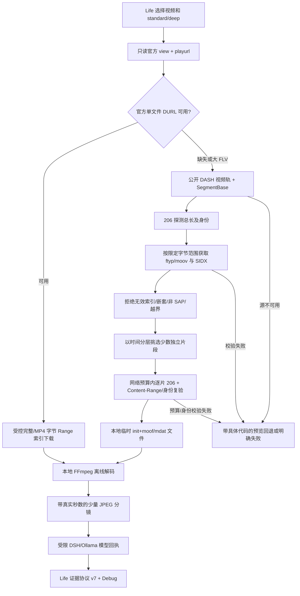

# 2.8.1-dev.3b.33.23 · 受控 DASH 长视频分段视觉与失败原因透传

> 实现记录，2026-11-18。`MAX_SUPPORTED_DURATION=4h` 是离线分析可接受的单视频时间轴上限，**不是完整视频播放承诺**；真实 Windows、B站 CDN、用户选定 DSH/Ollama 视觉模型仍需实机验证。

## 当前入口和真实证据源

`bili_watch_video` 和独立视觉的 `bili_preview_vision` 最终复用 `preview_vision.analyze_perception` → `adaptive_video.acquire_adaptive_frames`。普通 DURL `.mp4/.flv` 分支不变：完整有界文件或 `moov`/FFprobe 索引分段 MP4。官方 `fnval=1` DURL 不存在或只存在不可在既定低档预算内下载的大 FLV 时，额外请求同一 `bvid/cid` 的 `fnval=16` 公开 DASH 清单；仅选择符合 CDN allowlist 的 `.m4s` 轨及官方 `SegmentBase` 字节区间。

实际图像唯一可信回执为本机 FFmpeg 从该次下载的真实 fMP4 片段解出的带时码分镜，不是标题、元数据、播放器网页、模型虚构的网络访问或 `videoshot` 缩略图。DSH/MCP 单次证据透传采样的源类型、下载字节数、窗口和回退原因。Life 唯一的自主观看/社交意愿与账户权限仍由原规划器负责，取帧实现没有任何对外写动作。

## 时间与网络门禁

- `12/24/48` 帧档网络预算分别为 **24 / 50 / 100 MiB**；主人自定义较小网络限额继续生效。DASH 的最小尺寸 Range 探测、本机索引、媒体片段均计入本轮实际接受字节；从不超过当前档位总额。
- DASH 只有官方签名媒体 URL、HTTPS、严格 `bilivideo.com` 多级子域、固定 `/upgcxcode/` 路径及 `.m4s` 后缀可读；所有重定向逐跳校验，最多 3 跳，无 Cookie、Authorization 或任意 URL。
- 禁止 HTTP 200 冒充 206；要求准确 `Content-Range` 和远端总长，ETag/Last-Modified 如果提供则跨 Range 保持一致。拒绝异常索引、过长索引、非首样本 SAP、媒体越界、预算不足；FFmpeg 只接收临时本地文件，不能联网追踪媒体。
- 依旧按全片时间分层选择有限代表窗口；DASH 依据 SIDX 时码挑选独立片段，而不是下载前 50 MiB。**这是稀疏取样，既不逐帧观看全片，也不聆听原声**。
- 公开视频时长硬限制由 45 分钟扩展到 **4 小时**，只增加可取样的时间范围，**没有**增加单视频网络预算、视频并发或外部行动授权。远端虚拟媒体最大 1 GiB，超出明确拒绝。

## 安全失败与兼容

- `dash_stream_unavailable`、`dash_indexed_video_unavailable`、`dash_sidx_unavailable` 等非完整源异常，可以依据既有策略安全回退为 `videoshot`，但回执标明 `image_source=B站低清预览` 且不计为原视频真实解码。`video_range_not_supported`、`video_range_identity_mismatch`、`dash_sidx_invalid`、`dash_sidx_unusable`、`dash_segment_budget_insufficient` 等真实性/预算错误严格失败，不走高风险自动重试。
- `vendor/bilibili-mcp/mcp_server.py` 只在成功实际返回图片证明时写入真实的 `adaptive_fallback.reason`；`vision_dsh.py` 从受限证明文件读取并核对理由，而不再将所有错误硬编码为 `public_stream_unavailable`。若证明没有带原因，写 `fallback_reason_not_reported`，绝不猜测。
- `sampler_version=7` 及对应缓存目录防止旧的 v6 图片回执混用；`lib/video-evidence-bundle.mjs` 接受精确 DASH 下载模式及网络/时间/帧校验，不把模型摘要视为完整播放。旧 v4/v5/v6 的真实 DURL 证据依旧兼容。
- 没有扩大 `-509` 读取共享预算、账号/权限、社交写动作、模型提示、长期 Life 记忆或 2.9.x 跨平台注意力架构。

## 验收

- Python：使用 FFmpeg 本地生成带全局 SIDX、起始时间非零的碎片化 MP4；模拟官方 206 响应，完成分散 Range → 本机解码 → 分镜，确认累计下载小于媒体文件总长度；验证 200、错误总长、ETag 变化、预算过小必须拒绝。
- JavaScript：验证 v7 DASH/DURL 证据来源、超预算与伪造来源拒绝、旧版 v6 不得冒充 DASH。
- 实机待验：Windows 运行模式与 FFmpeg 安装位置、真实 B站免费公开 DASH `SegmentBase` 和 CDN 支持率、DURL 优先来源选择，以及 10/30/45/120 分钟不同公开视频的画面和视觉模型返回。不能把离线片段合成测试当作真实 B站端到端成功。
