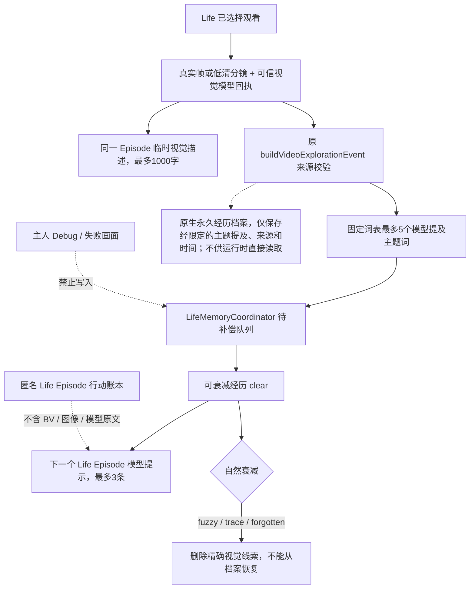

# 2.8.1-dev.3b.17 · 视觉经历跨 Episode 收口审计

本轮是视频感知的最小闭环修复，不改变 Life 意愿、平台授权或写入门槛；`-dev` 不转正式版。

## 已核对的实际链路

- **当轮 Episode**：`lib/autonomous-planner.mjs` 的 `visualObservation` 仍使用 `perceptionHandoff.video.modelDescription`，限制长度并标记不确定性；同轮后续 Life 选择能读取。
- **可衰减经历**：`index.js` → `buildVideoExplorationEvent` → `lifeMemoryCoordinator.recordEvents` → `life-memory-gateway`。此前只保留视觉来源和帧数，且网关仍用“仅看过资料”措辞，本轮增加固定词表的 `visualTopics` 并改正真实取帧/低清采样表述；经过实际验证的焦点复查可贡献主题词。
- **下一轮 Episode**：独立 Life 模型从 `getRecentLifeVideoMemory` 获取当前账号、`stage=clear`、最多 3 条观察提及，不经不可检索的永久档案，也不写入只存匿名行动的 `universalLifeEpisodes`。不仅普通定时 Life 决策，视频契机触发的 `opportunitiesOnly` Life 决策也能获取这些线索。
- **证据边界**：主题词只是模型文字中**出现过的受控词**，不是画面语义真实性证明；本轮未实现逐帧可信事件永久保存或跨天模糊描述自动反定位视频。不存在模型原文、原图、语音/字幕、评论在视觉记忆中无限期可检索的路径。
- **写入隔离**：该读取只增加未来 Life 决策的背景，不修改评论、点赞等外发授权条件。账号切换、主人 Debug、视觉失败、经历变模糊均不得把旧视觉证据加回提示。

## 后台私信 10 秒说明

管理页后台轮询方案下单独提醒：默认开启时，已确认活跃的私信联系人按 `dmActivePollSeconds=10` 定向检查；初次发现新对话仍取决于普通私信轮询，不是每 10 秒全量扫描。平台 -509/429 及共享预算继续生效。

## 发版门槛

本轮是源码/离线测试，未有用户 Windows B站/Ollama/Whisper 端到端验收。Node 全量历史失败及真实下载/转写回执须如实列出；**不可仅凭本轮修复宣称 2.8.1 可以正式发布**。
