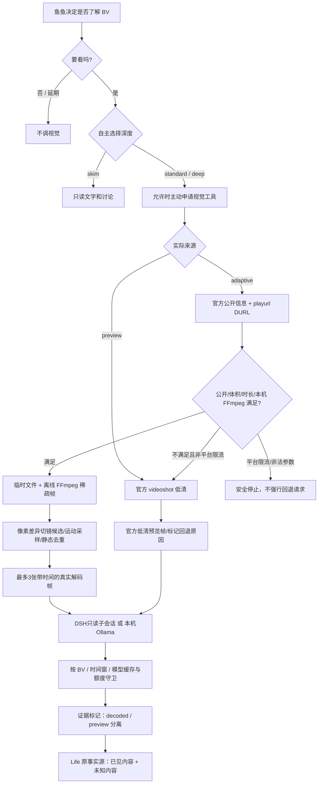

# 2.8.1-dev.3a.3：受控公开视频离线稀疏切镜感知（开发增量）

> 2026-11-14 实施。基于已应用 dev.3a.2 自主深度/统一视觉 UI，以及 2.8.1 模型连接重复测试修复的开发源码。**不代表 Windows/DSH/真实 B站视频已通过端到端验收；不改变 2.8.0 已发布包。**

## 产品契约：两次自主选择

1. **要不要看**：鱼鱼可以拒绝、延期、休息，不应因为有候选 BV 就被强制读取。
2. **看多深**：鱼鱼选择 `skim` 时只读标题/字幕/讨论，不调用图片模型；主动选择 `standard` 时才考虑最多 60 秒真实公开视频片段的稀疏观察；选择 `deep` 时可进一步指定 3～120 秒的时间窗口复查。后续任一步可停止，不因字幕缺失自动提升深度。
3. **来源选择独立于深度**：MCP `bili_preview_vision` 增加显式 `perception_source=preview|adaptive`，默认 `preview` 保持旧调用兼容；Video Agent 可主动提出 adaptive；Life `bili_watch_video` 的 `standard/deep` 尝试 adaptive，低清只作为标明原因的回退。`skim` 不触发任何图片调用。
4. **不得借视觉改变权限**：读取得到的素材不是外发指令或成功观看整个视频的凭证。原 Life 同一意愿、账本、写权限、限流和反重试规则完全保留。

## 核心流程（Mermaid）

## 唯一数据与代码事实源

| 层 | 现行入口 | 职责与限制 |
| --- | --- | --- |
| 意愿/深度 | `index.js` `executeWatchVideo` / Video Agent 提示词 | Life 自主选择；无字幕不会强制升级 |
| 官方公开视频来源 | `lib/adaptive_video.py` | BV、官方 view/playurl、单段 DURL、公开无 Cookie；不接受用户 URL |
| 安全资源边界 | `lib/adaptive_video.py` | 只允许 HTTPS `*.bilivideo.com` 受控视频路径、校验逐跳重定向；**完整临时文件不超过 24 MiB**，最多 25 秒下载，关闭后自动删除；无持久视频缓存 |
| 场景取帧 | `lib/adaptive_video.py` | 可选本机 `ffmpeg`，离线本地输入，2fps、192×108、最多240解码帧、35秒 subprocess 上限；0～60秒默认片段，深度指定 3～120 秒窗口；像素差分仅估计 0.5秒粒度切镜候选，不是逐帧边界 |
| 共用视觉和回退 | `lib/preview_vision.py` | 选择 adaptive 时取得 JPEG，失败时按原因降级为现有 videoshot；DSH和Ollama与各自模型/时间窗缓存隔离 |
| 视觉模型工具 | `vendor/bilibili-mcp/mcp_server.py` 与 `lib/vision_dsh.py` | `bili_preview_vision` 同一只读工具；独立 DSH 模型通过 MCP 图片块及不可跨 BV 的证明，Ollama 走本机白名单；模型调用仍受原每日额度 |
| 证据模型 | `lib/video-evidence-bundle.mjs` | `sampler_version=4` 且 clip/来源/时间/数量一致才认 `decoded_video_frames` / `decoded_visual_analysis`；回退是 `preview_frames`；二者都不代表原音轨或完整播放 |
| 安装暂存 | `lib/state.mjs`、`index.js` | 将新的 Python 脚本部署到 DSH home 且经过完整性校验，不能只在开发目录存在 |

## 限制与不做事项

- **真实视频来源可用率尚未知**。仅支持公开 B站 `playurl` 单段 DURL，拒绝 DASH、多分段、付费/登录媒体、超过 24 MiB 或非常长/无元数据的视频；默认真实流可不成功，届时用已有低清预览并明确标注。不存在任意外站下载、全量/后台视频抓取或绕开平台限制。
- 新算法基于实际解码帧，但只是**局部稀疏变化检测**：不逐帧扫描整片，不保证发现短于采样间隔的动作/镜头，不识别原视频语音，字幕/ASR/OCR/音画对齐留给 dev.3b。
- 只暂存最大 24 MiB 的原媒体文件，JPEG 最多三张内存传递；不将媒体文件、原图、播放地址或视频原声持久保存为 Life 事实。视觉文字描述仍须标注“来自模型”及缺失的信息。
- FFmpeg 是本机可选外部程序，插件不捆绑 FFmpeg 可执行文件；用户自行安装且加入 PATH。缺少 FFmpeg 会自动回到官方低清来源，不影响纯文本探索。
- 尚未验证 Windows 实机 FFmpeg、DSH 子会话、Ollama 图片输入、B站真实 DURL 可用性、不同编码/运动类型的视觉质量、长时负载；离线固色视频不是内容理解准确率证明。

## 发布前验收建议

1. Windows 本机安装 `ffmpeg`，用小于 24 MiB 的**公开且可播放的单段 DURL** 视频跑 `standard`，检查返回 `sampling.strategy=decoded-scene-2fps`、`image_source= B站公开视频片段（离线解码）`、切镜候选和实际帧时间。
2. 对超过 24 MiB、DASH、FFmpeg 缺失、公开流不可用等情况确认回执明确降级成官方低清，不得伪装成 decoded；对 429/-412/-509 平台风控不强制重试。
3. `skim`、放弃、字幕缺失等场景核实不强行识图；`deep` 明确的窗口复查验证时段绑定、DSH 子会话证明、模型限额及多次调用的成本。
4. 先看离线 Python/Node/安全/安装打包回归，再做真实 B站、Windows/DSH/本机 Ollama 受控端到端和长时可靠性验证。未通过前不发布生产验收声明。

## 开源归属

本阶段离线场景差分选择器由本项目独立编写，**没有引入 PySceneDetect 的 Python 包，也没有复制** `SAOS-3624/dsh-video-storyboard` 或 `SAOS-3624/dsh-see-now` 代码；它们只属于方向性参考。运行时可选调用外部 FFmpeg 可执行程序，许可随使用者安装的具体 FFmpeg build 而定。参见仓库 `THIRD_PARTY_NOTICES.md`，直接上游 `adoresever/bilibili-mcp` 的 MIT 声明继续保留。
