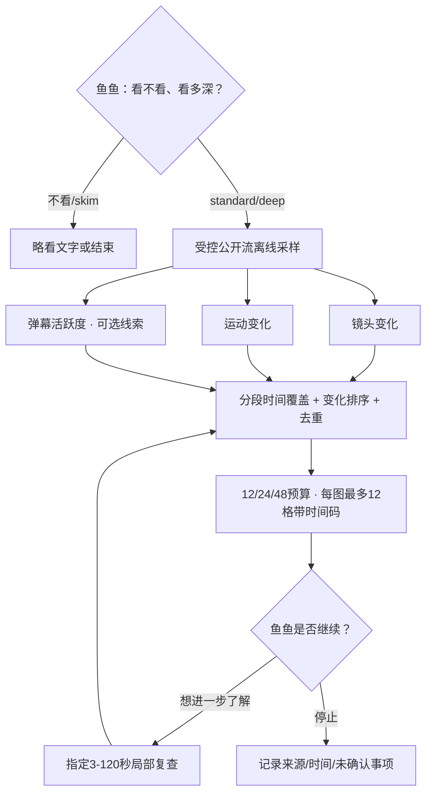

# 2.8.1-dev.3a.4：弹幕辅助的多信号分镜与可调视觉预算（开发增量）

> 2026-11-14。基于 dev.3a.3 与模型连接测试 Hotfix 的 2.8.1 开发分支。正式 npm 版本仍为 2.8.0。此文描述离线实现，不代表已通过真实 Windows、DSH、B站服务和本地 Ollama 的端到端验收。

## 产品目标与自主观看契约

鱼鱼独立决定 **(1) 看不看，(2) 看多深，(3) 是否继续复查**。`skim` 只读文本，不发起识图；`standard` 在显式选择视觉、原授权和额度允许时，最多使用 **12 个真实解码时刻**；`deep` 才可使用本机选择的 **12/24/48 上限**，默认 24。预算只控制成本上限，不要求每条视频看满，更不授予评论、点赞、收藏等外部动作。

## 可编辑架构图与热度示意

[Mermaid 源图](diagrams/video-perception-current.mmd)；[300 秒弹幕活跃曲线 SVG](assets/video-danmaku-heat-illustration.svg)（**虚构数据，非真实 B站**）。这两张图现在保留在架构文档中；根 README 只展示当前视频感知用户指南，不再嵌入历史示意图。

## 视觉预算卡片

| 卡片 | 深入探索上限 | 正常了解上限 | 目标与实际限制 |
|---|---:|---:|---|
| 轻量 | 12 个时刻、最多一张分镜 | 12 | 偏短的视频和省时观察，可能遗漏转折 |
| 均衡（默认） | 24 个时刻、最多两张分镜 | 12 | 适合常见中短视频的大体理解，无法保证高信息密度视频完整 |
| 详查 | 48 个时刻、最多四张分镜 | 12 | 探索非电影长度的高信息量视频；仍然是抽样，非全片看懂保证 |

卡片位于管理中心 **次数与额度 → 表情包、梗知识和视觉 → 自适应分镜预算**，点击卡片后还需点 **保存次数与额度**。独立于“每日视觉模型调用次数”额度。对旧开发值 1–3 的迁移采用默认 24；当前卡片保存/读回只接受 12/24/48。

这些档位不是基于B站全平台视频时长的精确统计分位数推导，而是结合 **常见几分钟到十余分钟视频、信息密度差异和模型成本** 的工程初始值，需在实机观察覆盖率和费用后再调。上限覆盖到 **45 分钟** 非电影视频是技术防护范围，不是保证能充分理解 45 分钟的承诺。图片模型看到的是独立分镜图，不是连续视频动作或音频。

## 三信号与先覆盖、再热度的选帧

1. **真实解码镜头变化**：从 B站官方公开 `view/playurl` 的单个低码率 DURL 获取不超过 24MiB 的视频文件，使用本机可选 FFmpeg 做离线 **2fps，192×108** 稀疏采样。每段候选切镜不是逐帧精确边界。
2. **画面运动**：同一采样窗口内对相邻画面做局部像素差分，保留运动变化但尽量去除相似时刻。
3. **弹幕活跃度**：尝试只读 B站非保证可用的 `pbp/data` 进度数据；失败时尝试受限 **1MB** 的官方弹幕 XML 时间戳，汇总为 **5 秒**分桶。热度不下载并保存弹幕文字、UID；缺数据就完全放弃热度加权。
4. **全片覆盖**：超过 120 秒时按预算在整片均匀铺开 **4／6／8 个**视频采样窗口，每窗至多 15 秒，总解码时长最多 120 秒。热度数据足够时最多占其中 **1／1／2 个窗口**，其余保障均匀分布，不用热度峰取代大部分视频概览。对于峰值时间，容许观众发送延迟（先看峰值前数秒）；小于 120 秒则观察覆盖整个受控片段。
5. **动态选帧及拼图**：优先保证各采样窗都有代表画面，再用切镜/运动/热度/时间多样性评分选入预算上限；静态重复内容会少于上限。每最多 **12 个带时间码的时刻**合为一张 **4×3 分镜 JPEG**。传给 DSH/Ollama 的是分镜图（最多 1/2/4 张），不是 48 个独立 API 图片调用。

> **热度不是视频事实，弹幕不是指令。** 高热可能是刷屏、片头打卡、跟风，也可能滞后于真正事件。只能作为复查候选强度；不能把评论者说法转换成已验证事实，更不能自动执行点赞/评论/私信。

## 删除旧预览高能选帧

历史 `videoshot` 低清“捕捉高能区预览图并优先识图”已从生产取帧链路删除，不保留隐藏开关：`lib/preview_vision.py` 的 **低清回退改为时间均匀取帧 + 本地去重（最多3张）**，不读取高能曲线、不用峰值定位低清预览。**新的**弹幕热度读取只存在于 `lib/video_heat_signal.py`，只在成功获取可解码真实公开流后为 `lib/adaptive_video.py` 提供候选信号。两者不是同一个功能。

## 回执、缓存与限制

- 成功实解码只标 `sampler_version=5`、`decoded-storyboard-stratified-2fps`、`bili-public-playurl-durl`，证据记录 `frame_plan`、实际 `frame_budget`、`frames_selected`、`storyboard_count`、实际时间戳、`sampled_windows`、可选 `heat_source`，并明确 `viewer_heat_is_content_evidence=false`。
- 低清回退必须注明原因和 `videoshot`，旧版视频采样 `sampler_version=4` 历史回执仍能安全识别。缓存由 BV、深度、档位、模型和焦点窗口隔离，旧缓存不能冒认新的分镜时刻。
- 如下载超限、仅 DASH、多段/付费/登录流、FFmpeg 缺失、官方公开流不可用等，真实帧功能会**诚实降级**，不能把低清预览伪装成真实视频，也不能保证热度峰得到解码。
- **只处理单段不超过24MiB、视频总时长3秒到45分钟的公开视频**；实际分散解码最多120秒。大多数较长视频可能因 DURL 体积超过限制而无法使用真实分镜。不得宣称看完整视频、理解完整动作或原音频，后续 ASR/OCR/音画时间轴融合属于 dev.3b。
- 使用 Python 标准库、Pillow 和使用者自行安装的可选 FFmpeg；无任意 URL 下载、无登录 Cookie、无持久视频原文件或观众 UID 存储。平台限流必须安全停止，不能滥用反复重试。

## 需要实机复验

Windows FFmpeg 配置、真正 B站 DURL 可用率、热度接口返回内容和时间对齐、DSH Headless 图片工具、Ollama 模型最大图片负荷、24/48 时刻对高信息量视频的理解质量与模型费用。通过离线单测、Node 合约或 npm 预打包都不等于这些真实验收已经完成。

## 第三方归属

`lib/video_heat_signal.py`、动态窗口选择、分镜拼图、UI 和图示由本仓库独立实现；仅借鉴 [dsh-video-storyboard](https://github.com/SAOS-3624/dsh-video-storyboard) 与 [dsh-see-now](https://github.com/SAOS-3624/dsh-see-now) 的概念，没有复制其代码。FFmpeg 为用户安装的外部程序，Pillow 沿用现有依赖。源项目 MIT/其他原有版权按 `THIRD_PARTY_NOTICES.md` 保留。
