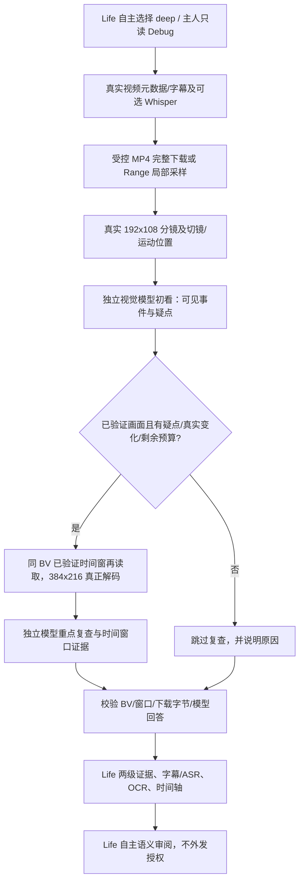

# 2.8.1-dev.3b.10 · 视频感知双阶段与 Debug 可观测性

## 发现与根因

`BV1bkW86bEkj` 的 60s 实机诊断返回 24 个真实解码采样时间、`sampler_version:6`、2 张分镜、视觉文本，却在 Life 中成为 `metadata-only`。原因是 `video-evidence-bundle.mjs` 只识别 `sampler_version:5`。新版本兼容 v5/v6，v6 额外核验输入字节、远程大小、Range 下载方式、实际使用的本视频读取预算，并且保持真实画面/预览/字幕/ASR/观众讨论严格隔离。

## 观察路线

模型的不确定表达仅允许触发一个“是否值得复查”条件；复查位置只能来自经源码验证的切镜/运动秒数，不能由弹幕、字幕、视觉模型文本下令执行任意工具。复查下载使用初看后**同视频剩余字节预算**，最多一次，受相同的白名单、206/Content-Range、重定向、临时文件、FFmpeg 离线执行约束。网络读取预算不足时报告跳过或失败，不借用一份新的卡片预算；暂不尝试超出预算的重复解码。只读 Debug 不记生活经历、不发送评论。

视觉摘要不是逐帧证据。`perceptionHandoff.video.observations` 标注拼图覆盖范围，`focusReviews` 记录独立复查窗口/真正采样时刻/观察描述及未经语义互证的边界，`timeAlignment.focusedAnchors` 表示真实二次采样而不是凭推断添加时间点。原 `coverageAssessment.videoIsFullyObserved` 仍然始终为 false。

## 本轮状态处理

- Ollama tags 的裸 64hex 与 `sha256:` 64hex 规范化后存同一指纹，其他格式一律不得持久认可。
- 快速设置仅在 FFmpeg 合成视频帧实测成功、Whisper 模型/运行环境真实就绪后禁用对应可选安装框；仅发现文件不等于真正就绪。
- `/video-perception-debug` 在本机同源和当前已登录账号下报告 stage、step、updatedAt，管理端显示可见的活动进度与轮次状态；此版本尚无网络字节实时事件，不显示伪造下载百分比。
- Whisper 状态以 `speechAttempt` 返回，区分 `not-enabled`、`official-subtitles`、`asr-success`、`asr-unavailable`、`asr-error`。本地机器转写不是原声听觉。
- Windows FFmpeg、FFprobe、OCR、ASR 等受控子进程启用隐藏控制台窗口标记，不改变 stderr 对诊断的意义。

## 余留验收

在 Windows DSH 上用同一 BV 分别验证 MiniCPM 实际 64hex 摘要认可、重启复原、24 帧完整回执、初看有疑点后的局部高分辨率复查、无字幕且启用 Whisper 的真实 ASR 结果和点击后活动进度；模拟测试不能替代 CDN 和显卡性能实测。音画是否一致仍由 Life 对来源资料作语义判断，不自动声明一致。
