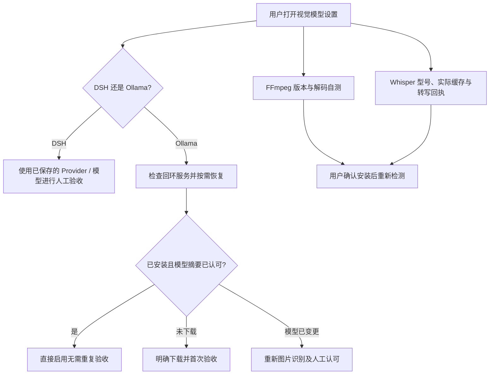

# 2.8.1-dev.3b.4 · 视觉模型设置与依赖体验改造

## 目的和入口

- 管理中心「AI 模型 → 视觉识别模型」：DSH 或 Ollama 模式、唯一大肥鱼真实图片人工验收、Ollama 服务检查/恢复、已下载与已批准状态、FFmpeg 实机版本及解码自测、可选 Whisper 开关/模型/安装/最近实际转写证据。
- 管理中心「快速设置」：独立主依赖安装/修复；另有显式勾选的 FFmpeg/Whisper 辅助组件安装，复用 AI 模型页相同后端，不引入平行安装状态。
- 「B站评论」：评论梗图及调试开关回迁此处；不改变授权额度或任何发送流程。

## 本地模型状态契约

- `GET /local-vision/status` 检测本机回环 Ollama `/api/tags`，服务离线不等于模型已被删除。
- `POST /local-vision/ensure` 在用户选择本地模式/主动刷新时，仅尝试执行已安装 `ollama serve`；不使用 PowerShell、不开远程代理或自动下载新模型。Windows/macOS/Linux 均用原生命令，失败必须报告，不得宣称启动成功。
- 人工审核只有成功识图、获取同一模型的审核 token 时才允许。认可后将模型 ID、Ollama 官方 sha256 摘要、审核时间存入该插件 stateDir 的权限受限 JSON；不保存图片、完整回答、BV 或私密信息。安装与审核 status 不因管理页刷新而消失，只有**摘要完全匹配**时才能跨进程恢复；摘要更换或实际已卸载必须重新验收。若宿主未提供合法摘要，运行期可用但不能持久恢复审核状态。
- 本机模型依赖与 DSH Provider 相互独立；未就绪不能默默切到云端；无浏览视频的强制动作。

## 依赖与版权边界

- 插件不捆绑 FFmpeg、Whisper 可执行文件或模型权重，安装时由本机系统包管理器按原许可分发。FFmpeg：Windows winget 固定 Gyan.FFmpeg.Essentials；macOS Homebrew `brew install ffmpeg`；Linux 使用现有 polkit 图形授权配合 apt-get/dnf/pacman 中已检测到的一个。其余平台给安装说明，不自动绕开授权。不使用 `shell:true` 或用户注入的任意命令。
- 预计体积只是提示：FFmpeg 40MB～1GB 或更多；Whisper tiny/base/small/medium/large-v3 约 75MB/145MB/485MB/1.5GB/3GB 权重，加上 Python 运行环境。
- Whisper 转写仍需要鱼鱼选择合适深度、用户启用及缺少官方字幕，不能因为安装成功主动开始转写。FFmpeg 检测须通过实际 `ffmpeg -version`；解码是否可用须另作解码自测。下载或包管理器退出不等于真实 B站视频可以解码。
- 原 `dev3b3` 之前的 Windows PowerShell 单独启动 Ollama 契约已被本版取代。

## 验收与待检验

- 离线检查不同状态下的按钮禁用、模型摘要变化、持久恢复、不同 OS 安装命令、同源限制；专项测试报告另附。
- 尚需用户的 Windows / macOS / Linux 主机、实际 Ollama、FFmpeg、Whisper 端到端验收。无用户真实许可证检查与下载成本声明时，不应声称正式发布。

## 逻辑示意

