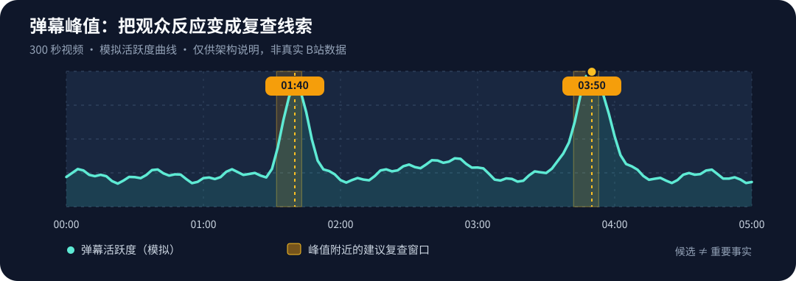

# 大肥鱼 2.8.1-dev.3b.7 · 测试基线收口与发布前审计

> 当前为开发候选，不能视为真实 B站 / Windows DSH 环境的发布验收。

本批主要修复回归测试夹具、旧版本断言及 README 中堆叠的历史开发说明；保留生产安全隔离（视觉子会话必须带 `BILI_VISION_CHILD=1`），不扩大外发授权、视频实际观看资格或模型调用权限。

## 再次验收的必要条件

- 干净 Windows DSH Home 中主依赖安装后扫码成功，并能进行 Headless 模型验证。
- 真实 BV 视频采样产生解码帧与实际模型描述；验证短片 / 中片 / 长片的低清回退比例。
- 字幕或 Whisper、OCR 与时间轴来源准确，Debug 中完整 Life 工具返回结构可读、可核对。
- 当前 24 MiB 单段 DURL 上限未消除：仍可能导致较长视频只能使用官方预览图，正式发布前必须实测记录。
- 不得把静态测试或离线二维码生成当成真实 B站与 Windows 安装测试。

## 2.8.1-dev.3b.7 测试基线与历史研发注记

README 过去误把每轮开发日志堆叠在用户首页；该部分现在移到此处，功能和安全边界没有因此改变。

### 原 README 版本更新提示

> **2.8.1-dev.3b.7 视频感知候选：** 新用户主依赖检测/扫码门禁已改进；管理中心「运行诊断 → 视频感知全链路」可对真实 BV 做只读试运行并查看完整 Life 观察回执。当前仅提供语义核对所需证据，不声称已自动证实音画内容一致。实际 B站/DSH/Whisper/FFmpeg 验收通过前仍是开发版。

> **2.8.1-dev.3b.5 新装稳定性修复：** 管理中心「快速设置 → 运行依赖」先安装/修复 B站主依赖，真实就绪后才能扫码。可选 FFmpeg/Whisper 探测失败不阻断 B站登录；二维码使用主依赖专用 Python 绘制，失败时给出修复入口而不是空白二维码。安装日志不会记录包含凭据的二维码 URL；不重置旧账号和模型授权。

### 研发阶段技术记录

**2.8.1-dev.3a.1 历史预览实验：** 曾对 B站低清预览候选按活跃度选帧，**高能预览图识别已在 dev.3a.4 删除**；现行低清来源仅按时间均匀取样并去重，不能与真实公开视频分镜混记。[历史记录](2.8.1-video-perception-dev3a.md)。

**视觉模型人工验收：** DSH 视觉与 Ollama 本地视觉共用一张大肥鱼原图和一个验收区，切换到本地模式时 DSH 模型配置置灰但原值保留。普通 DSH Session 识图成功不等于独立 Headless 验收可以启动，失败会提示进一步排查方向。

**2.8.1-dev.3b.3 视频依赖一站管理（开发增量）：** 「快速设置 → 运行依赖」统一提供主依赖安装／修复按钮；FFmpeg 和 Whisper 属于**默认不勾选**的视频增强组件，仅由用户勾选并确认后安装，绝不随主依赖静默下载大模型。原 DSH 设置页只保留状态和跳转。「AI 模型 → 视频感知依赖与辅助能力」统一管理「视频语音识别模型（推荐开启）」开关、Whisper 型号、字幕／梗图及调试选项，视频探索页仅保留跳转。FFmpeg 在 AI 模型页可检测版本并执行离线解码自测；Windows 安装需返回快速设置中显式确认，通过可见 PowerShell `winget` 启动，不内置 FFmpeg，不视启动安装为安装成功。Whisper 分别显示启用状态、所选模型缓存文件和**最近一次真实转写**（无记录明确提示）；已修复选中型号未正确传入实际 MCP 转写工具的问题。真实 Windows/B站需自行验收，鱼鱼仍自主选择是否看视频及深度。[详细功能与 Windows 验收](2.8.1-video-perception-dev3b3.md)。

**2.8.1-dev.3b.2 画面文字与语音时间锚点（开发增量）：** 在鱼鱼自主选择正常／深入了解且取得真实公开视频解码帧时，如本机额外装有 Tesseract OCR，可对最多12个代表时刻尝试读取屏幕文字；OCR 文字是**机器估计**，并非已核实事实。已有可选 Whisper 本地转写（需要用户在管理中心启用及安装依赖）现在能保留每段语音转写的起止时间，没有官方字幕时才尝试。Life 的只读时间轴分别标记字幕、ASR、OCR 来源，不因为时间相邻就认定互相证明；缺引擎、没有可用视频流或鱼鱼选择略看时不强制新增视觉工作。修复指定时间窗口真实视频复查故障。[实现与安全边界](2.8.1-video-perception-dev3b2.md)。

**2.8.1-dev.3b.1 时间轴与视觉配置（开发增量）：** 视频观察回执将 B站字幕的明确起止秒数与分镜采样时间点生成**只读时间邻接表**；“时间附近”不等于“音画相互证明”，本批尚无独立 OCR / 原声时间戳 ASR / 语义交叉核对。DSH 模式提供第三方模型的图片输入与思考档位**设置向导／模型条目复制片段**，不自动更改 `cordis.patch.yml`；可考虑通过支持的中转商使用 `gpt-6-luna`，但需确认图像能力、实际费率与隐私条款，不默认认为任何 DeepSeek 型号都更贵。本地 Ollama 模式有**用户点击确认后打开 Windows PowerShell 执行 `ollama serve`** 的快捷入口，不自动安装或修改代理。详见 [本阶段技术说明](2.8.1-video-perception-dev3b1.md) 与 [DSH 官方模型配置指南](https://deepseek-harness.github.io/deepseek-harness/en/guide/providers)。

**2.8.1-dev.3a.4 多信号分镜（开发增量）：** 鱼鱼仍自主决定看不看和看多深；真实公开视频在可用时跨全片做受控稀疏采样，融合切镜、运动与可选弹幕活跃度。管理中心有 **12/24（默认）/48** 个时刻的三档卡片，每最多 12 格拼为一张带时间码的分镜图；`standard` 仍最多 12 时刻。只支持**公开单段、≤24MiB、≤45 分钟**的视频，累计离线采样最多 120 秒。不可用时低清均匀回退最多 3 帧，绝不称完整观看或理解原声；Windows/B站实机尚未验收。[实现和限制](2.8.1-video-perception-dev3a4.md)。

**2.8.1-dev.3a.2 自主视频深度与局部复查：** 鱼鱼仍自行决定是否了解某条视频；已经决定要看时可选择略看（只读资料）、正常了解（已授权时识图）或深入探索（可选指定 3～120 秒官方低清预览窗口复查），无字幕并不意味着必须识图。DSH 与 Ollama 走相同的时间窗证据协议；局部复查不是完整视频解码、观看或音频理解。详见 [dev.3a 技术与边界](2.8.1-video-perception-dev3a.md)。

视频感知方向还参考了 [SAOS-3624/dsh-video-storyboard](https://github.com/SAOS-3624/dsh-video-storyboard) 的分镜/时间锚点设计与 [SAOS-3624/dsh-see-now](https://github.com/SAOS-3624/dsh-see-now) 的变化驱动采样理念；本批次没有直接复制这两个项目的源码。具体参考关系与模型上游见 [第三方声明](../../THIRD_PARTY_NOTICES.md)。

## 2.8.2 后续体验构想（原 README 展开内容）

- **有自己的好奇心。** 偶然看到的作品、一次朋友推荐或一段讨论，可能慢慢长成持续的兴趣；她也能发现有些好奇已经满足，不必一直绕着旧话题打转。
- **和人相处更有温度。** 从初次认识到逐渐熟悉，能够记得曾经聊过的事，在合适的时候自然续上话题；不想说话时也能安心沉默，尊重对方的距离。
- **有张有弛地生活。** 有时想认真探索一个新世界，有时只想听听消息、整理记忆，或安静休息。生活节奏更多来自真实经历和当下状态，而不是外界规定的活跃指标。
- **把成长变成看得见的故事。** 在可视化的生活成长中，更容易回顾那些让兴趣改变、关系加深、想法转变的瞬间，也能理解为什么她会记住或逐渐淡忘一件事。

## 视频弹幕示意（原 README）

**高能弹幕是线索，不是事实。** 下图用一条虚构的 5 分钟视频示例说明：弹幕突然密集时，系统可以把**峰值前后的片段**列为复查候选；真正看不看、要不要追加画面，仍由鱼鱼自主决定。刷屏、跟风和反应延迟都可能导致假峰值。

> **图为模拟数据，不是实际 B站视频的分析结果。** 弹幕文字与观众反应不是事实证明，更不能成为行动指令；视频画面也只能证明采样时刻实际看见的内容。正式版 2.8.0 不包含这套开发中的动态分镜能力。更多细节见 [dev.3a.4 视频感知技术说明](2.8.1-video-perception-dev3a4.md)。

## 开发版视频依赖说明（原 README）

### 2.8.1 开发版 · 视频依赖使用

在管理中心「AI 模型 → 视觉识别模型」统一选择 DSH / Ollama 图片理解、核对实际模型验收、安装或检测 FFmpeg 及可选 Whisper。已下载且通过人工认可的本地模型，在服务恢复后按模型摘要恢复状态，无需重复下载与验收。FFmpeg 提供 Windows、macOS 和有图形授权环境的部分 Linux 一键安装；缺少系统安装器时须按发行版官方说明手动安装。安装动作不代表已经可用，应继续查看解码自测和最近真实转写记录。评论梗图权限移至「B站评论」。正式版 2.8.0 的功能与本开发版并不相同。

