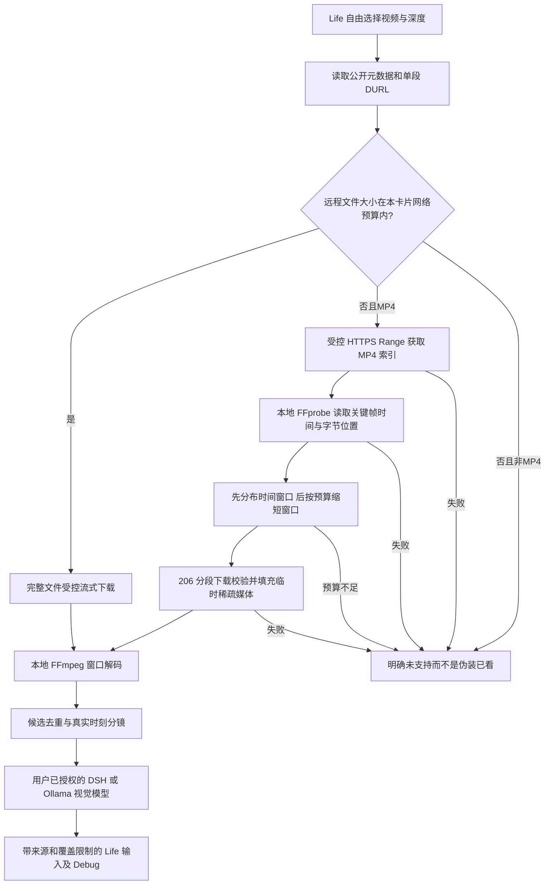
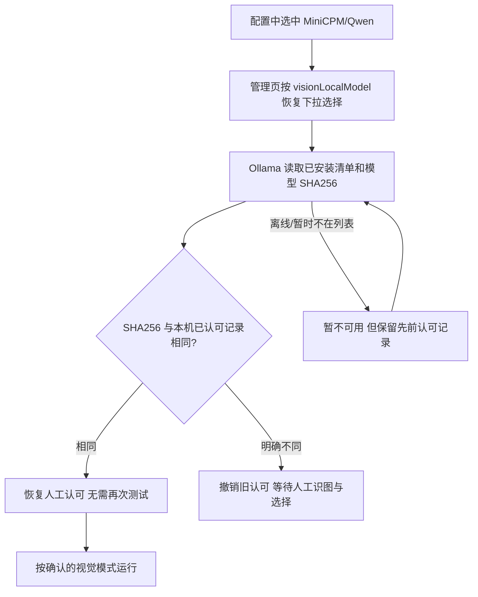

# 2.8.1-dev.3b.9 真实视频分段与本地视觉模型恢复

## 目标、统一层与唯一真值

- 入口：`bili_preview_vision` / `bili_watch_video` 生产只读工具及主人「视频感知全链路 · Life 最终输入 Debug」。
- Life 自主选择是否看和 `skim/standard/deep`；只有确认要读取时才沿 `preview_vision.py` 调用 `adaptive_video.py`，没有第二个行为意愿裁决。
- 视频索引/实际帧唯一来源：B站公开 `view` + `playurl`（优先 `fnval=1` 的 MP4）给出的同一 BV/CID/CDN 源；下载器校验来源域名、响应头/身份/版本，运行时累计计数。字幕/ASR/OCR 保持独立事实来源。
- 人工验收唯一状态：`stateDir/local-vision-approvals.json` 的 `(预设模型 ID, Ollama sha256 digest, reviewedAt)`；实际选中模型仍以插件 `config.json` 中 `visionLocalModel`/`visionMode` 为准。不得持久保存自测图片和模型回答。
- 只读视觉没有 B站点赞/评论/关注授权；权限、账号隔离、缓存与 Life 回执来源不变化。

## 运行路径

### 精确网络与资源上限

| 卡片 | 深入画面时刻上限 | 每条视频最大实际网络接收字节 |
|---|---:|---:|
| 轻量 | 12 | 24 MiB |
| 均衡（默认） | 24 | 50 MiB |
| 详查 | 48 | 100 MiB |

`standard` 只选最多12时刻，`skim` 不主动识图；视频最多45分钟，抽取窗口总时长最多120秒。大于预算的 MP4 使用 `ftyp/moov/mdat` 顶层索引及本地 FFprobe 生成关键帧定位，分散取样而非下载开头的一半。要求 CDN 真正支持 HTTP `206 Partial Content` 和准确 `Content-Range`。Range 超出预算前停止；必须禁止 Cookie、任意用户 URL、重定向到非 CDN、FFmpeg HTTP/HTTPS 远程探测和最终音视频数据永久落地。

读取范围使用统一的 CDN URL；若服务器返回 `200`，或者 `Content-Range` 的起止/总大小不匹配、ETag/Last-Modified 已变化，立即失败，不把整文件读取下来的字节算作允许的请求。FFprobe 与 FFmpeg 只读取本机受控临时文件。MP4 可能为头部或尾部 moov；两种布局通过真实本地合成媒体回归。媒体外层上限1 GiB，moov 索引上限8 MiB，防止异常媒体消耗无限资源。

遇到 FLV、其他非MP4超预算容器、不可访问的索引、缺 FFprobe、无法提供关键帧数据或服务器不支持 Range，返回明确失败状态 `video_range_*` 或 `video_mp4_*`，**不触发三帧低清预览来冒充深入观看**。这不是已解决所有 B站视频容器格式；需要在真实 Windows/真实 CDN 明确验证支持率。

## Ollama 认可恢复

模型自测可以重新执行，但开始自测/自测超时不使已认可模型版本突然失效；只有主人明确拒绝、真实摘要改变或者删除模型才撤销。Ollama 模型清单缺乏可信摘要时不能推断为已验收，重试恢复后按同摘要恢复。保存模型选择由受控 `/local-vision/select` 执行并双重回读插件 `config.json`。

## 验收门槛及已知缺口

- 本地合成 MP4 测试：超过允许网络预算仍在相距较远的真实时间窗口解码（包括索引在尾部）、请求字节总和小于视频总大小；模拟 CDN `200`、错误 `Content-Range`、过小预算时禁止冒认成功。
- 本地 Ollama 模拟测试：MiniCPM 被主人认可，重测失败后不掉认可；停机/模型暂时未列出不删认可；重新启动相同摘要时恢复；摘要变动则必须重新验收。
- **尚待 Windows DSH + 真实 BV 验收：** 非 MP4 源与 Range 不兼容 CDN 的覆盖率、真实来源 `.mp4`/`.flv` 分布、FFprobe 安装路径、缓存、跨主机磁盘稀疏支持和物理磁盘占用。没有这些证据不得称为正式版。
