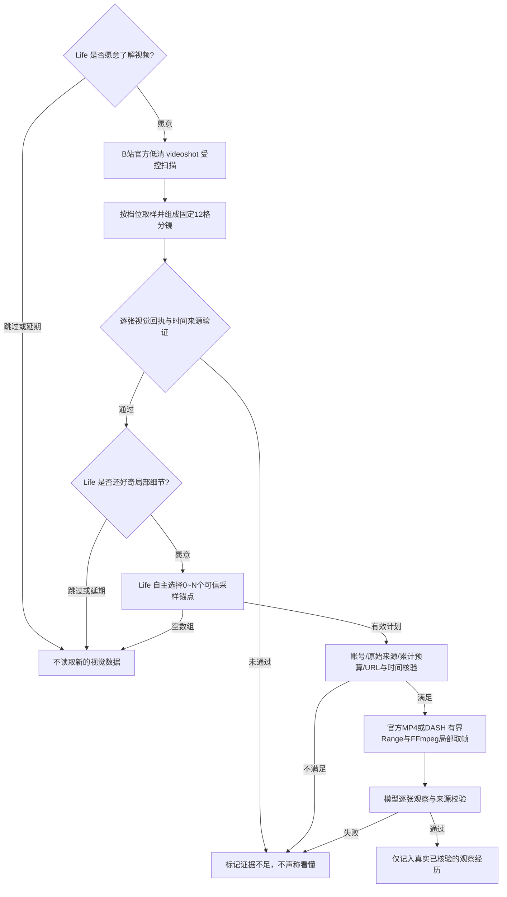

# 2.8.2 当前架构 · 视频感知与 Life 自主局部观察

> 这是当前源码的架构入口，不是历史开发阶段的验收记录。用户介绍参见 [README](../../README.md)，正式版功能摘要参见 [发布说明](../release/RELEASE_NOTES_v2.8.2.md)。

## 实际流程

- **Life 决策：** `lib/life-willingness.mjs` 是唯一意愿层。首次看不看与全局之后要不要局部深入是不同机会；后者明确为只读探索，不套用外发打扰风险。`lib/life-video-read-admission.mjs` 维护候选时间与 Life 自主选择、账户证明、主动跳过/延期。
- **局部规划：** `lib/video-exploration-budget.mjs` 约束三档累计窗口、帧数、时长与流量；`lib/life-video-read-admission.mjs` 只接受可信锚点，允许空选择和再次停止。
- **媒体与证据：** `lib/adaptive_video.py` 仅使用可核验官方媒体来源与有界取帧；视觉回执和来源校验不能用模型单独文字替代。正式来源与确切帧对应时刻均需验证；低清预览不是原视频完整播放。
- **语音：** `lib/asr.py` 负责可选 Whisper 转写，按兼容环境尝试 CUDA 再回退 CPU；缓存命中不等于本轮 GPU 推理。
- **调试：** 主人局部识图为只读验证，不自动获得 Life 意愿，也不创造 Life 观看经历。`lib/video-owner-focus-debug.mjs` 与管理页输出分阶段结果和 Life 现有拒绝理由，不为显示理由额外调用模型。
- **权限：** 视频/评论/私信提供的文字不是指令；原有账号作用域、网络预算、限流和外发授权始终独立。桌宠开放平台仍仅静态预告，无可调用公共 API。

## 维护与校验

- [视频感知流程图（Mermaid 源）](diagrams/video-perception-current.mmd) · [视频感知示意（SVG）](assets/video-perception-current.svg)
- [Life 源码全景与自动同步图](life-system-current-view.md) · [原有架构与历史开发文档](README.md)
- `npm run check:life-architecture` 验证四张 Life 生产接线图；`npm run check:video-tool-contract` 验证视频工具协议；`npm run check:test-governance` 核验保护测试清单。

真正的 Windows DSH、B站真实流、Ollama 及 GPU CUDA 运行表现需要在维护者对应环境中确认；离线测试不能替代这些外部条件。
