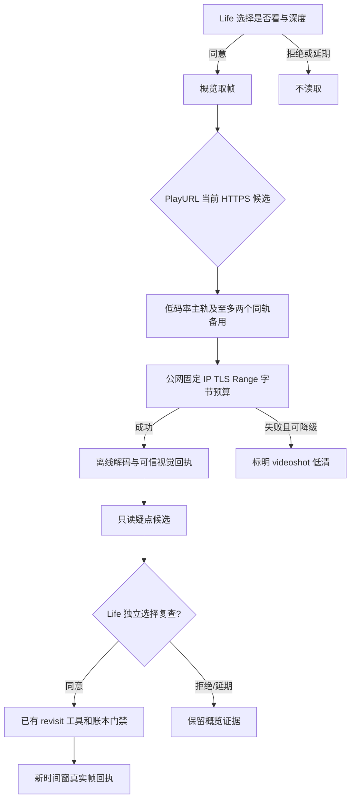

# 2.8.2-dev.18：视频官方源动态授权与 Life 自主聚焦

- **主体与权限**：Life 通过现有 `runLifeChosenVideoRead` 选择是否观看、观看深度；主 Session/Debug 不冒充 Life。概览完成后 `planVideoFocusReview` 只产出一个已证实的场景变化候选，不再触发取帧；`focusReviewSuggestion` 只是建议，随后只能由 Life 再次通过 `bili_video_revisit_moment` 的统一意愿（包含拒绝/延期）完成聚焦。无新的独立决策者、调度器或外发权限。
- **事实来源**：`api.bilibili.com/x/web-interface/view` 和 `api.bilibili.com/x/player/playurl` 校验 BV/CID 后给出本次 DURL/DASH 媒体候选。执行器只读取当前官方响应中的 `baseUrl`/`base_url`、有限 `backupUrl`/`backup_url`，不接受模型、用户输入的原始媒体 URL。低码率轨优先，聚焦不自动提画质。带签名 URL 不持久化、不打印。
- **网络安全**：HTTP 不接受；拒绝用户信息、URL 片段、错误结构、IP 字面量和不规范媒体路径。每跳解析公网 IP 后连接同一 IP 并校验 TLS 原域名；禁环境代理；仅 206 严格 Range、身份/ETag 检查、字节和时间上限；FFmpeg 只读取一次性本地文件；平台限流和证据不一致不通过备用源重试。
- **恢复边界**：只对同一轨的主地址的探针连接/HTTP 失败，最多尝试两个官方备用 URL；其它错误不扩大预算或放松核验。原视频无法安全解码时如实降级到 `videoshot`，不登记原视频回执。
- **隐私/作用域**：账户授权、Life 现有门禁和记忆入口不变；视频 URL、签名和多模态完整原始内容不写长期记忆。失败不能变成成功观看经历。Windows / DSH / B站实机待验。

## 生命周期图（本增量）

