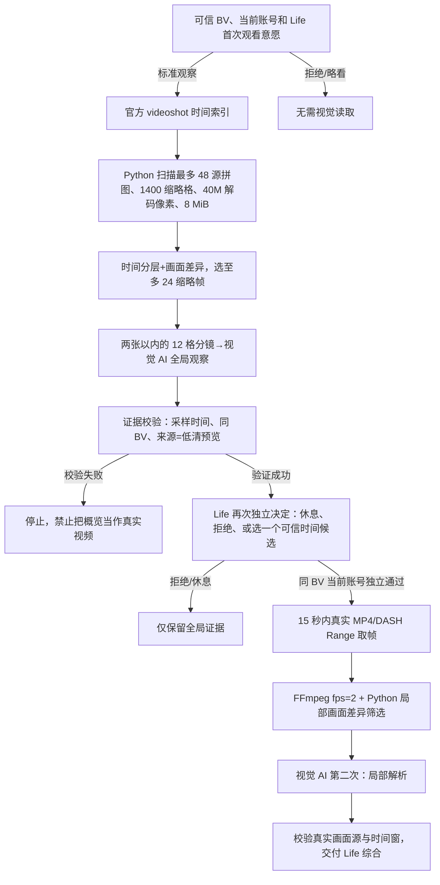

# 2.8.2-dev.20 · 全片缩略候选、Life 看后再决策与全量测试修复

> 开发候选；尚无 Windows/DSH/B站真实媒体端到端验收。以源码为准，不宣称已经看完原视频。

## 设计边界

用户发现的旧流程缺陷：观看前由 Life 决定 deep，或先做原视频局部取帧，会在缺少全片证据时过早决定深入。本批对自主 Life 入口改成**先自愿观看全局 → 实际取得可信回执 → Life 二次选择具体时间窗口或拒绝 → 真实局部读取**。专业识图 Agent 只提供观察与候选，不代替 Life 做行动决定。主人手动 Debug 独立于 Life 意愿：**默认使用全片官方 videoshot 概览**，可显式切换原视频 MP4/DASH+FFmpeg 专项；手动深度不是 Life 决定，手动 Debug 不发起看后第二次自主复查。

## 实际流程

`preview_vision.py` 的低清采样并没有 FFmpeg：B站返回的缩略格已经存在，Python 用 Pillow 分析图像差异与时间覆盖；完成的低清概览不表示视频被连续观看。只有 Life 看后选择某个已核实的时间锚点，才允许 `adaptive_video.py` 依据原 B站官方 PlayURL 安全策略解码本地视频；`fps=2` 代表半秒一个候选，仍可能漏掉瞬时动作。全局 24 帧是 **Life 均衡档深度上限**，首次 `standard` 观察实际可能低于该上限，不承诺次次 24。

超过 48 源拼图、8 MiB 或像素/格数上限时，优先保守停止扫描，使用已采集候选并标明未覆盖；不将 24 张最终分镜误记为全片完整理解。局部真实取帧额外消耗的字节不可重置整个视频预算；Life 之后如果仍有疑问需要新回合再次决定，不能被执行器自动无限补看。

## 旧 Windows 全量测试失败的收口

2026-11-19 `run-tests.ps1 -Mode full` 提供的日志：595 个 Node 文件，Python 392 项通过。Node 共有 5 个批次不通过、七条失败断言（六个测试文件）。其中部分断言固定匹配旧局部变量/过时版本号；图片 Debug 两个测试沙箱缺失现有 `beginVideoObservationRead` 生产包装层，导致没跑到原图隔离验证。修复的是测试夹具/当前调用形状，继续保留图片作用域、同 BV 防串及当前账号保护断言，不停用测试。

相关六文件：`v281-dev2b-local-vision-manager.test.mjs`、`v281-dev3a3-adaptive-source-contract.test.mjs`、`v281-dev3b12-debug-images-agency.test.mjs`、`v281-dev3b311-debug-images-scope-hotfix.test.mjs`、`v281-rc-life-tree-bv-and-new-user-install.test.mjs`、`v281-release-preflight-no-prepare.test.mjs`。这批只在云端完成针对性复现，不能由此宣称 Windows full 已重新通过。

## 证据、隐私与测试

- 视频来源保持 `low-resolution-preview` / `decoded-public-video` 严格不同；实际 Vision 模型返回不表示完整视频播放。
- 只用真实回执中的时间码做局部候选；不会相信画面描述内的 URL、脚本或伪造的时间。
- Life 第二次选择复用当前账号意愿证明；原外发写入、隐私、账号记忆和 -509 退避不改变。
- 新增 Node 安全行为测试和 Python 91 缩略图测试；全量测试留给 Windows/DSH 实机，尤其需要确认实际官方拼图返回数量和处理时限、模型耗时及流量统计。
