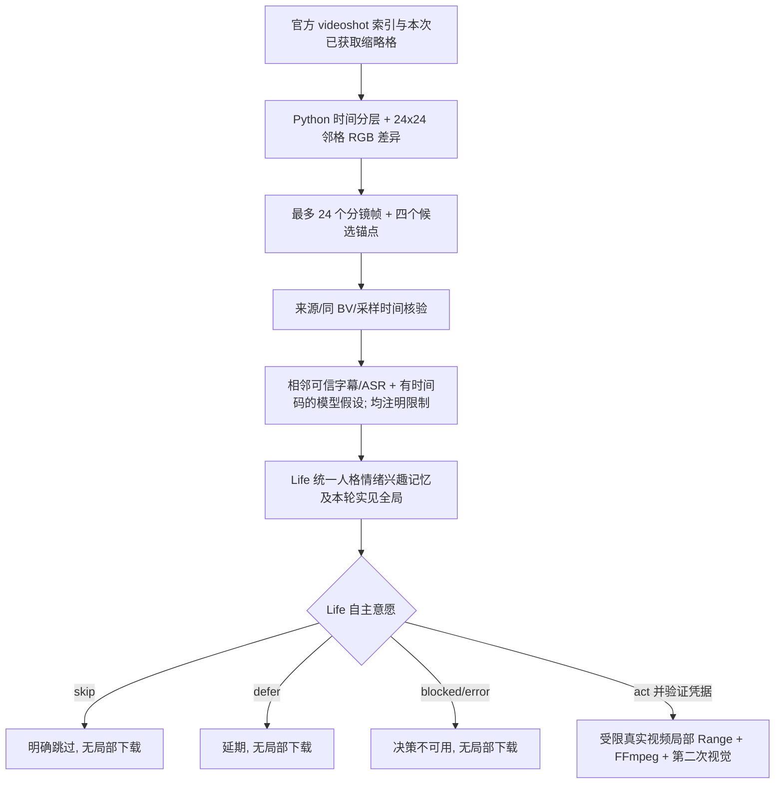

# 2.8.2-dev.21 · 全片缩略图候选评分与 Life 二次意愿证据

> 开发候选；没有 Windows/DSH/真实 CDN 端到端成功回执。相对 dev.20 最终两阶段 Debug＋分镜放大补丁新增，保留同一 Life 意愿主体和权限门禁。

## 行为归属

- 采样者：Python `preview_vision.py` 在 dev.20 的 8 MiB、48 张源拼图、1400 格、40M 像素限制内扫描官方 videoshot，使用时间覆盖与局部 RGB 变化选代表帧；没有视频解码，也**不决定重要事件**。
- 候选规划者：`video-focus-review.mjs` 仅从受核验的 `preview_frames` 中选择最多四个约 15 秒的局部时间窗。优先使用 Python 选中画面与邻近已取得缩略帧的差异得分，并保留不同时间区域的覆盖；返回的时间必属于首次预览的已核验帧。
- 证据组织：附近字幕与 ASR 必须来自同 BV 的 `subtitle`/`asr_transcript` 可信来源，时间与窗口有明确邻接；不能证明字幕和画面语义一致。视觉模型若在**真正已取帧的时间码**下输出 `[MM:SS]` 描述，只作为不可信画面假设，不形成新可执行时间。
- 意愿主体：统一 `lifeWillingness.decide` 仍接收 Life Voice（人格/情绪/成长）、现有兴趣、同账号可访问视频记忆和历史 Episode 摘要；额外输入本次全局观察摘要与每个候选的有限证据。**不额外添加第二套兴趣模型或记忆事实库**。
- 执行者：仅在 Life `act` 选择菜单里的精确候选、`verify` 证明与账号一致且总下载预算足够时，原 MP4/DASH/FFmpeg 执行器才读取局部帧。`skip` 不读；`defer` 不读；模型错误、不合法候选、账号切换都不读。

## 候选生成与含义

**可靠性边界：** Python 差异量测只说明相邻两格像素不同。即便某窗口得分高，也可能只是镜头晃动、字幕变化、过曝，不能等同剧情关键。官方视频快照可能遗漏短暂动作；受到网络/尺寸预算限制时扫描不完整。图像模型输出即使标了已核验的时间码，仍是待核实假设；字幕来自音频/文字，不代表视觉证实。四个窗口是有限观察机会，而不是关键事件命中率保证。

## 调试与状态

管理中心选择「完整两阶段 · videoshot → Life 决策 → FFmpeg」。在「Life 看后第二次选择」下展示最多四个候选的时间、来源、视觉模型假设、同期可信字幕及 Python 变化值；会明确说明仅为技术线索，以及全片扫描是否完成。`life-declined` 仅表示模型明确 skip；`life-deferred` 表示延期；`choice-unavailable` 是模型未产生有效决定。避免所有没有二次取帧都显示成「自主拒绝」。

## 回归与剩余验收

定向覆盖：旧 dev.20 两阶段正常/拒绝、真实 Life 意愿凭据、账号变更、证据失败、字幕同 BV 和来源、伪造的未来时间码、非法窗口、skip/defer/blocked 区分、Python 91 张缩略格四处候选与 8 MiB 预算。Windows full 与实际 DSH 模型意愿仍由维护者验收，不能由模拟测试替代。
