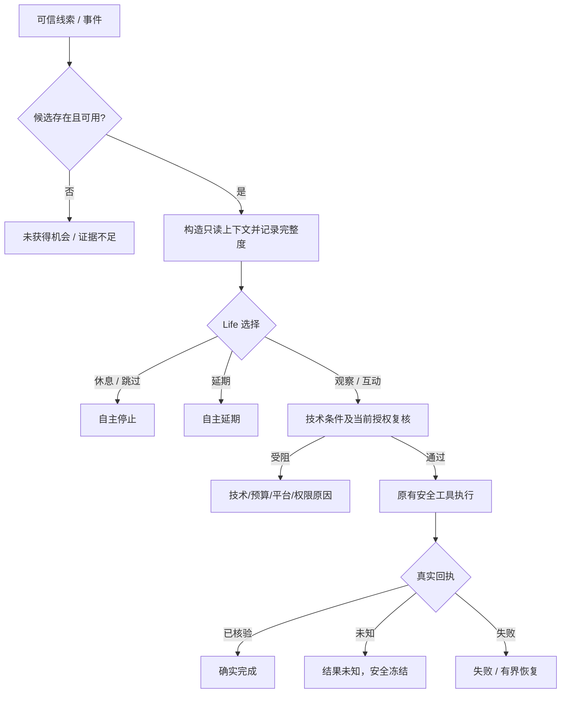

# 大肥鱼 Plus 2.8.2 实施方案 V2（开工版）

> 状态：**开发中（PR-0 基线盘点 + PR-1A 首批语义预算与视觉边界）；未运行真实 B站写操作**
> 编制依据：用户上传的 `dsh-bili-scroll-plus2 (2).zip`、上下文《发布审计与文档修订_2026-11-18 20_31_34.md》，特别是源码根目录 `AGENTS.md`、`docs/ROADMAP.md`、`docs/architecture/2.8.1-context-budget-audit-20261118.md` 与现有生产模块。
> 基线说明：压缩包中 `package.json` 为 `2.8.1`；用户此前表示 2.8.1 已发布，但该压缩包内仍有发布前状态的历史 `TEST-RESULTS.md`、发布检查单。因此**不能用包内历史发布状态代表当前 Git HEAD／实际发布结果**。正式 PR-0 必须核对真实 Git 标签、当前工作树与已发布包。
> 长期约束：以仓库现行 `AGENTS.md` 为第一开发规范；项目路线图是功能范围来源；历史方案不是现行代码事实。
> 开发批次版本：从 `2.8.2-dev.1` 起逐批递增，每批同步包版本、lockfile、README 源码提示和 CHANGELOG；`2.8.2` 正式版须另经发布门禁。

## 0. 决策摘要

**版本主题：视频感知深化、证据可追溯、Life 行为可解释、上下文完整性。**

2.8.2 是现有 Life 认知链路的**质量版本**，而不是新增一套人格、关系、调度或社交系统。把 2.8.1 已实现的真实视频观察、时间锚点、Life 意愿、记忆网关、预算门禁和平台回执连成可追溯且可准确解释的闭环。

必须实现七个工作包：

| 编号 | 工作包 | 主要交付 | 级别 |
| --- | --- | --- | --- |
| M1 | 视频证据—Episode—记忆回执追溯 | 既有来源记录上的稳定关联、账号/遗忘校验、可信覆盖说明 | P0 |
| M2 | 视频感知深化 | 真实视频覆盖说明、长视频分段、字幕/ASR/OCR/画面时间核对、有界自主补看 | P0 |
| M3 | 11 类截断风险全部收口 | 统一只读语义预算与实际入模材料报告，防静默丢失 | P0 |
| M4 | 读取预算与退避统一可解释展示 | 聚合现有账本、分清 `-509`/网络/额度/等待/自主决定 | P0 |
| M5 | Life 全链路意愿诊断 | 候选→证据→上下文→选择→权限→执行→平台回执的状态分类 | P0 |
| M6 | 管理中心呈现 | 用户看得懂的观察、未观察、意愿与阻断原因；按需高级诊断 | P1 |
| M7 | 安全回归、Windows 实机与正式发布门槛 | 受保护测试、上下游兼容、升级及真实视频只读核验 | P0 |

**此前已明确追加的范围不可遗漏**：11 项上下文截断与语义完整性问题，包括 Reflection、Memory Retriever、后台社交、主 Session 和 Python 视觉指令，**均纳入 2.8.2**。不把它们再次默默顺延到 2.9.0。

**明确不做**：2.9.0 的新角色实体/二创版本认知、视频触发角色长期记忆、人设重置、人格情绪成长机制重构、关系与经历成长；2.10.x 的统一注意力/活动管理；2.11.x 跨平台 Adapter；Vue/Pinia 全面重构；新增对外写权限、提高互动次数的 KPI、额外写入调度器或事实库。

## 1. `AGENTS.md` 统一层归属检查（开工前必须完成）

| 问题 | 2.8.2 归属与唯一事实源 | 不能发生的事情 |
| --- | --- | --- |
| 谁决定要不要看、补看、回复、停止？ | **Life**（现有 Planner / Willingness）；专业视频 Agent 只给观察与候选 | 专业 Agent 另行投票、以“诊断建议”强制互动 |
| 视频实际观察了什么？ | `video-evidence-bundle`、`video-perception-timeline`、`video-perception-handoff`，经原工具真实回执核验 | 标题=看过画面；时间邻近=语义互证；低清预览=原视频完整观看 |
| 经历和长期记忆来自哪里？ | 现有 Life Memory Gateway / Coordinator、Episode、真实行为回执 | 第二事实库；从永久审计档案恢复已遗忘事实；跨账号拼接 |
| 谁管账号、许可与外发？ | 原 `SocialPolicyGate`、发送侧账号、目标、额度、幂等、真实回执 | 诊断页、证据引用、模型输出成为新的写入授权 |
| 谁管读取限制？ | `bili-read-budget`、Python 共享预算、交互轮询/网络退避以及既有宿主资源协调 | 新建“统一调度控制器”、改变平台保护时长或重试绕过 `-509` |
| 谁管可解释日志？ | `life-decision-trace`、`read-action-diagnostics` 和管理投影 | 存原始私信、Cookie、模型思维链、私人提示词、无法核实的行为因果 |
| 谁管模型语境？ | `SocialContextAssembler`、`life-voice-context`、场景提示词的只读 Context Budget | 私密数据进入公开上下文；提示词压缩变成持久数据更新 |

实际对接前逐模块标注：账号作用域、ID 来源、权限主体、生命周期、失败重试策略、回滚方法、是否涉及旧数据迁移。**只读观察、记忆投影、调试归因、平台执行四种状态互不冒充。**

## 2. 现状与真正缺口：只补缺口，不重新发明

| 现成基础（在上传源码中可见） | 本版补齐的问题 |
| --- | --- |
| `lib/video-evidence-bundle.mjs`（`life-video-evidence/v1`）按证据类型验证 | 观察事件、时间范围、真实凭据与可回忆 Episode 的稳定关联及来源追溯 |
| `lib/video-perception-timeline.mjs`（`time-proximity-only`） | 覆盖缺口及片段级理解状态；保持时间邻近≠语义互证 |
| `lib/video-perception-handoff.mjs`（`life-video-perception-handoff/v1`） | 需要进一步核对的疑点、缺失区间及逐次 Life 选择的补看交接 |
| `lib/adaptive_video.py` 与现有 DURL/DASH SIDX 按需取帧 | 多长度实机基准、分段失败归因、有界再观察；不承诺完整播放 |
| `lib/video-experience.mjs` 已生成可信观看经历及部分视觉回执 | 将本次观察与已有 Episode、Reflection、动作回执关联；旧记录无依据则显示未知 |
| `lib/life-memory-gateway.mjs` 有权限/淡忘/遗忘机制 | 所有查询先经网关，再决定能否展示引用；杜绝审计日志绕过遗忘 |
| `lib/life-decision-trace.mjs` 已有限制日志（7 天、60 轮、96 步） | 形成面向用户的原因分类、完整度状态和有来源的关联，不写私人原文 |
| `lib/bili-read-budget.mjs` 与 `lib/network-poll-backoff.mjs` | 单一只读投影，准确显示各限制的来源与恢复条件 |
| `lib/context-budget.mjs` 已有 `boundedJson/Text/Transcript` | 防止结构合法但重要语义静默缺失，提供“实际进入模型”的元数据说明 |

本方案可新增小型**纯函数投影模块**，不得擅自新增跨账号/跨进程的事实账本、发送许可或轮询调度器。

## 3. 最小跨模块契约（先评审、后接线）

### 3.1 统一的来源引用：`ObservationLink/v1`（设计候选）

仅在**真实生产视频事件**及其可信回执存在时产生引用；主人 Debug dry-run 不创建 Life 经历。示例**不是已存在的运行接口**：

```json
{
  "schema": "life-observation-link/v1",
  "observationId": "opaque-current-account-id",
  "sourceType": "video-watch",
  "sourceKind": "decoded_video_frames",
  "timeWindowMs": [240000, 247000],
  "evidenceStatus": "observed",
  "receiptRef": "opaque-verified-receipt-ref",
  "memoryRef": "optional-accessible-episode-ref",
  "limitations": ["sampled-frames-only"]
}
```

设计限制：

- `observationId` 与 `receiptRef` 必须可绑定**同一已认证账号和原始实际执行轮次**；不要只用 `BV + 时间接近` 推算。外部私密引用只保存/显示不可逆的有界键，不把私信对象标识写进普通决策诊断。
- `timeWindowMs` 表示**确实观察/处理的片段或采样时间点**；若只有单帧，明写“采样点”，不得把零散帧扩展成连续已观看区间。若原来只有标题或字幕，`sourceKind` 与状态要相应降低。
- `evidenceStatus` 以有限枚举区分 `metadata-only / caption-read / machine-asr / sampled-preview / sampled-decoded / model-observation / unavailable`；“核验”限定为来源与工具回执通过，不是模型语义绝对真实。
- 不复制大幅原文、图片、音频到新持久账本；精确真实观察事件使用既有 `buildVideoExplorationEvent`、Episode、记忆相关接口补足受限元数据与引用。完整模型回执仅保留现有生命周期要求。
- `memoryRef` 只能由 **LifeMemoryGateway 当前仍可访问**的 Episode 产生；遗忘、切号或过期后拒绝引用访问，索引中的孤儿链接不可还原被遗忘细节；历史无可信键时返回 `unattributed`。
- 源事件与外发的动作回执是两个独立引用；没有平台确认，`actionVerified=false`。追溯只解释，不执行任何实际写操作。

### 3.2 上下文完整度：`ContextDeliveryReport/v1`（只读、脱敏）

建议在现有 `context-budget.mjs` 外围增加**只读包装器**（名字由代码评审核定）：

```json
{
  "schema": "life-context-delivery/v1",
  "scene": "video-life-choice",
  "status": "partial",
  "sourceCounts": {"candidate": 5, "timedSegment": 92, "verifiedReceipt": 2},
  "includedCounts": {"candidate": 5, "timedSegment": 11, "verifiedReceipt": 2},
  "omissionReasons": ["bounded-context", "unselected-timed-spans"],
  "missingCriticalEvidence": false,
  "sourceRefsIncluded": ["opaque-ref-1"],
  "rawContentStored": false
}
```

- 区分 `complete / partial / unavailable`；不以“JSON合法”代表内容完整；中间省略有清楚来源/条数/范围，**不暴露省略原文**。
- “模型已经收到的材料”与“程序源数据中存在的材料”必须分别计数；引用成功不表示模型一定阅读理解或用于决策。绝不记录推理链、完整 prompt 或未授权私人文本。
- 关键候选的 ID/身份/权限/证据可用性必须同时保留；预算不足应返回明确 `unavailable` 或请求安全补读，**不可无提示地只给前几个候选造成决策偏置**。
- 只作用于提示词材料展示，**不得用于**账本、权限、签名/ID、平台发送参数、事实数据库或原始回执本身。

### 3.3 统一原因分类：`LifeOutcomeReason/v1`（诊断层，不改变 Life）

至少区分：`no-opportunity`、`not-offered`、`insufficient-evidence`、`context-partial`、`life-chose-skip`、`life-deferred`、`life-rest`、`model-unavailable`、`resource-deferred`、`local-read-budget`、`platform-rate-limit`、`network-backoff`、`account-auth`、`permission-denied`、`execution-pending`、`result-uncertain`、`action-verified`。独立保存 `stage` 与 `reason`：*Life 不想做*≠*还不能做*。

平台写入未知时原持久事务必须冻结；诊断字段不能解锁或诱发重试。`life-decision-trace` 只保存枚举、布尔、计数和脱敏引用。对于 Life 输出理由，标注“模型本轮陈述的理由”，不表示经过独立因果证明。

## 4. M3：11 类截断风险逐项整改矩阵（不可删项）

> 项次按此前用户认定的原始 11 项排列。带行号的原始名单属于 2.8.1 历史定位；实际开工以最新 HEAD 搜索为准。

| # | 重点入口 / 当前表现 | 本版改造策略 | 行为验收 |
| --- | --- | --- | --- |
| 1 | `life-continuation.mjs`，Voice 1900 字前缀裁剪 | 统一 Voice 必需栏目与 `life-voice-context` 预算，避免下游再静默裁断；输出遗漏状态 | 后半段重要当前状态不无声消失，且不重复叠加 Persona |
| 2 | `life-willingness.mjs`，World 1800 / Experience 1400 | 结构化重要字段、来源 ID、敏感作用域和总预算报告；关键缺证据拒绝“已确认” | 长输入可解析，入模来源与不足明确 |
| 3 | `life-willingness.mjs`，候选证据 4200 | 各候选公平保留 ID、状态、成本/授权与必要来源；仅按需展开详情 | 不因先后顺序对末尾候选静默歧视 |
| 4 | `life-continuation.mjs`，视觉 1300、增量 180、公开视频 1850 | 将短 `recentVerifiedReadYield` 升为高价值字段摘要+缺失说明，支持现有按需补读；视听来源保留 | 关键转折落在输入中间仍有明确遗漏/补读途径 |
| 5 | `index.js` 长字幕 12000 | 保留现有首/中/尾策略；增加按已知时间锚点或 Life 主动疑问提取原文的安全只读补读 | 长视频后半段关键结论不能被“未读=已知”伪装 |
| 6 | `index.js` 视频工具菜单 2700、生活片段 950 | 行动名、必需参数、状态与来源必须完整；超预算明确拒绝该候选或分层菜单 | 不生成不可执行的半截工具信息 |
| 7 | `interaction-batch.mjs` 当前消息 700 / 历史 240 / 普通上下文 1500 | `compact` 仍为默认，按需查证重要原话、转折和关系限定；准确记录实际已入模条目 | 重要后文或否定不被裁掉；跨公私消息不串域 |
| 8 | `owner-dm-agent.mjs` 主 Session 3000、私信历史 2800 | 优先保留完整对话轮次、承诺/确认状态和时间关系，逐轮均衡摘要 | 跨日承诺不被前缀裁剪；主人/其他联系人严格隔离 |
| 9 | `life-reflection.mjs` 候选备注 260、文本摘要（原 320） | 来源事件先验有效；反思前保留可追溯关键片段和遗漏声明，关键资料不足不形成长期“事实” | 中间重要纠错/否定仍能导致反思保守或拒绝固化 |
| 10 | `memory-retriever.mjs` 单条/总预算 | 区分检索命中、实际注入、被遗忘/未获授权、仅有摘要；谨慎二次按需检索 | 不能把命中但未注入说成 Life 已经知道；遗忘即时生效 |
| 11 | `lib/vision_dsh.py` 视觉指令 `[:4000]` | 消除**静默**裁断：设计明确 UTF-8 字节/字符边界、超限可读错误或受确认的压缩显示，不改变受限宿主的工具/身份权限 | 超限明确报 `vision-instruction-too-long`，不会截去后段安全约束后继续执行 |

所有改动都要保证成本/令牌上界仍然存在；改造目标是**缺失可见、关键证据公平、来源完整**，不是无限上下文。针对 `boundedJson` 新增语义层测试，而不只是检查 JSON 解析成功。保留 `npm run check:context-budget`，扩展/新建契约审计但不误报普通安全 `slice()`。

## 5. M1：视频—Episode—记忆的可信来源链

### 生产链条

`B站可信 BV + 当前账号` → `bili_watch_video 真实只读执行回执` → `buildVideoEvidenceBundle` → `buildVideoPerceptionTimeline` → `buildVideoPerceptionHandoff` → `buildVideoExplorationEvent` → `LifeMemoryGateway/Coordinator 的既有 Episode` → `Life 使用的只读 ContextDeliveryReport` → `LifeDecisionTrace（不存原文）` → `原执行侧授权 / 实际平台 Receipt`。

### 必须覆盖的细节

1. 同一 BV 的不同观察轮次采用不同稳定观察标识；元数据读取、公开视频解码、低清预览、字幕/ASR/OCR 不能揉成“看完了”。
2. 对 Frame 只记录真实采样时刻集合与来源；没有连续视频播放证明，就不写“已看了 xx%”或“观看了 N 分钟”。视觉模型说明是模型观察，不是原视频本身的经过人类核实的剧情事实。
3. 从 Episode 回查时先经现有账号与可回忆性过滤，再解引用；已遗忘条目显示“记忆不可追溯/已不可用”，**不借 archive、trace、缓存补回正文**。
4. Memory Retriever / Reflection / 主 Session 只消费已授权的存活来源，不因调试记录尚在就重新注入。
5. 评论、动态、关注等社会行为依靠**原有已确认平台 Receipt** 才能显示“已完成”；模型“我想评论”与“草稿生成”不能算已发布。
6. 旧数据无观察标识不强行迁移猜测；用 `legacy-unattributed` 并留在旧格式正常可用。不得因升级而重置既有用户记忆和私人配置。

### 验收案例

- A：某 BV 只有标题，用户页面显示“读取了作品资料，未观察画面”。
- B：同 BV 两次不同时间的片段采样，能分辨各自覆盖与时间点，不合并成完整观看。
- C：画面与字幕某段时间临近，但语义冲突，显示“需要进一步核对”，不得自动互证。
- D：用户遗忘 Episode 或切换 B站账号后，旧来源链不得通过诊断恢复其具体内容。
- E：被拒绝、延期、未知发送不得留下一条“已经发出”的成功经历。

## 6. M2：深化视频理解（先正确覆盖，再谈理解深度）

现有 `adaptive_video.py`、公开视频 DURL/DASH SIDX 稀疏采样与 12/24/48 档规划继续复用。不能因为一次模拟 206 Range 请求成功就推断所有 B站长视频均可解析。

**分层实施：**

1. **覆盖报告**：明确公开源类型（DURL/DASH/低清预览/只有元数据）、尝试片段范围、已取帧时刻、模型回答状态、官方字幕/ASR/OCR 可用性、未覆盖区间和读/模型预算限制。分母是视频真实时长，*不能*把观测帧数当“观看百分比”。
2. **时间片段核对**：保留现有 `time-proximity-only`，增加“疑点候选（可能一致/可能冲突/证据不足）”供 Life 判断。自动文本比对可提出问题，但只有真实来源足够时才形成带引用的**受限**证据判断。弹幕/评论始终是第三方观点。
3. **自主补看**：仅在 Life 已经选择进一步理解、原视频源可安全读取、当前读与模型预算允许时，利用**现有局部复查**覆盖有限缺口；不要默认对每条视频增加另一轮模型调用。Life 可以放下。
4. **失败与成本**：网络超时、官方 DASH 元数据异常、206 Range 不支持、采样预算耗尽、模型失败和未配置 FFmpeg/ASR/OCR 必须分别记录；不能通过不安全的大文件下载或重试绕过预算。
5. **人工评估**：真实公开视频的短（约 3–5 分钟）、中（约 10–15 分钟）、长（约 30–45 分钟）、超长（约 60–120 分钟）分层样本；对比是否真的拿到解码帧、片段覆盖、回退率、重复请求、语义误称，记录来源和日期。时长是**验收样本分层**，不是宣称全部支持的正式承诺。

## 7. M4：统一读预算与退避的**只读投影**

**不新建第二个 limiter**。从 `bili-read-budget.status()`、Python 共享读取预约（如可公开提供合规的分类摘要）、`network-poll-backoff`、互动调度现有状态与 Life 资源协调状态中读取脱敏快照。

建议标准展示：

| 状态 | 用户能看到什么 | 后台动作 |
| --- | --- | --- |
| `life-chose-skip/rest` | 鱼鱼这次选择不继续/休息 | 不触发重试，不计技术失败 |
| `local-read-budget` | 本地后台读取预算暂时不足，显示窗口/下次允许条件 | 不借手动按钮或其他 Agent 绕过预算 |
| `platform-rate-limit` | B站 `-509` 等平台风控，显示**已记录**的最早可尝试时间 | 按原持久保护和观察策略恢复，不清零冷却 |
| `network-backoff` | DNS/网络故障及受控探测窗口 | 与平台 `-509` 分别维持，不用网络好转消除平台冷却 |
| `reservation-held` | 同一读取/资源已占用 | 只读等待或明确延期，不复制任务 |
| `model-unavailable` | 模型不可用/超时 | 不冒充鱼鱼沉默 |
| `permission-denied` | 独立授权未开启/已撤销 | 不开放新的发送能力 |
| `result-uncertain` | 平台结果无法确认，安全冻结 | 必须人工或现有核验流程处理，不自动重发 |

**重要声明**：项目的 `minuteLimit/hourLimit` 是本地安全预算，**不是 B站官方公开配额**；现有 `status().note` 已强调“只统计已接入后台只读接口”。需要把这一限制原样准确展示。不同端点可有不同下次尝试条件；没有依据不要承诺“精确几秒后恢复”。

## 8. M5：Life 全链路意愿诊断

基于 `life-decision-trace` 现有 `start / candidate-scan / context-evidence / model-choice / preflight / execution-result / finish` 等阶段补投影，不复制整个模型/发送系统。

**建议状态机：**



**追踪规则：**

- 诊断指出“本轮给 Life 的候选包括哪些**脱敏类别**、有哪些可信证据进入模型”，不存私密原文或 Chain-of-thought，不声称模型思考的真实因果已被证明。
- “没有发表评论”要区分：没有机会、未提供评论选项、证据不足、Life 选择不评、写权限未开、发送前门禁阻止、远端拒绝、回执未知。
- 平台验证仍由原发送事务层判定，诊断只读取结论；Trace 里的行动阶段不具有发送权。
- 现有 Life Trace 7 天/60 轮/96 步上界继续遵守；不要为了永久可解释性将原始日志转成无限期长期记忆。

## 9. M6：管理中心 UX 与 API 设计

**最小改动目标：基于当前 `lib/management-console.html`/`.js`，不全面重构。**

- **「鱼鱼正在做」**：只显示用户友好的摘要（例如“在看某段公开视频的有限画面”“这次想休息”“B站限制读取，稍后再试”），避免直接展示锁/队列/协议术语。
- **「运行诊断 → 视频证据」**：主人可从**当前可访问的观察记录**展开：视频来源类型、已采样时间点、未覆盖与模型失败、可回忆 Episode、关联动作是否有回执；默认折叠高级 JSON。
- **「运行诊断 → Life 行动解释」**：展示某次机会各阶段、所选行动/不行动及技术状态；如果证据无法关联，明确“无法确定”而非补造。
- **「读取保护状态」**：按平台/本地预算/网络/模型/权限分组；下次时间显示为“最早可再次尝试”，不作为平台恢复保证。

API：优先扩展现有本机同源、主人身份校验的只读查询；必须明确响应体上界、分页、当前账号约束和防 symlink；**禁止**为便于调试添加访问任意文件/URL、请求任意 BV 后自动外发、或公开私信内容的接口。已有视频调试 `__debugDryRun` 继续不记 Life 真实经历。

建议每个用户状态都必须有：**触发条件、用户看到的位置、成功凭据、失败/延期原因、撤销/清除方法**。

## 10. 开发顺序：8 个可独立评审的 PR

| PR | 任务及具体代码接线 | 交付/关口 |
| --- | --- | --- |
| **PR-0 基线锁定** | 以实际已发布 2.8.1 Tag/HEAD 比对本 ZIP；梳理所有入口、用例清单与受保护安全约束；冻结设计契约 | `baseline.md`、变更影响矩阵、测试清单；确认版本号/账号配置和现有关键门禁 |
| **PR-1 语义预算基础与 11 项治理** | `context-budget`、`life-continuation`、`life-willingness`、`index.js`、`interaction-batch`、`owner-dm-agent`、`life-reflection`、`memory-retriever`、`vision_dsh.py` 等 | 每项至少一个真实入口行为用例；`ContextDeliveryReport` 有界、隐私安全、能说明缺失；原 `compact` 不回退 |
| **PR-2 证据来源关联** | `video-evidence-bundle`、`video-experience`、原 Episode / `life-memory-gateway`、动作回执引用 | 同 BV 两轮不混淆；忘记/切号/旧记录无法补链时安全失败；无新事实库 |
| **PR-3 视频深度与覆盖** | `adaptive_video.py`、视频 Timeline/Handoff、现有局部观察工具 | 有限长视频样本的来源/片段/缺口/失败解释；只在 Life 自主选择且预算通过后补看 |
| **PR-4 读取退避聚合** | `bili-read-budget`、`network-poll-backoff`、现有调度状态、纯读投影 | 无新 limiter；不同退避不相互解除；手动诊断不绕过安全门禁 |
| **PR-5 意愿解释闭环** | `life-decision-trace`、原 Planner / Willingness / 执行回执上的只读节点 | 至少 8 类停止/错误/完成结果不混淆；诊断不记录模型原文，也不触发外发 |
| **PR-6 管理中心 UX** | 现有管理页面 + 原本机受保护只读 API | 说明清楚、老用户 UI 不破、数据脱敏、账号/遗忘立即生效、移动/只读视图安全 |
| **PR-7 联合验证和发布准备** | 关联测试、实机样本、架构图/CHANGELOG/README/Release Notes/升级指南/回滚 | 受保护门禁 + Windows full + 实机 + CI；无未经解释的 FAIL/ERROR/安全 SKIP |

依赖：PR-0 → PR-1（统一最小契约）→ PR-2；PR-3 基于 PR-2，PR-4 可与 PR-3 并行但不得改调度所有权；PR-5 依赖 PR-1/2/4；PR-6 依赖 PR-5；PR-7 完成最终横向验收。

**为什么先做 PR-1？** 解决“源数据有但实际模型没拿到”的基础问题，否则后面的证据追溯与意愿解释会生成貌似完整、实则遗漏的链路。

## 11. 自动化测试、实机验收与明确阻断条件

### 11.1 新测试必须先登记

所有新增 Node/Python 测试先登记 `test/governance/catalog.json`（负责模块、测试意图、类型），受保护安全测试继续保留；不靠跳过、改运行器或删除断言使 CI 变绿。改需求时根据影响报告逐项维护测试。建议新增：

- `test/v282-context-delivery-and-truncation.test.mjs`：11 类截断联合场景，特别测试重要信息位于**中间/末尾**、否定纠错、候选公平性、实际入模报告及跨公私隔离。
- `test/v282-video-evidence-provenance.test.mjs`：不同 BV/不同轮/元数据/预览/真实解码及伪造来源拒绝；遗忘后无法借诊断重建。
- `test/v282-life-outcome-projection.test.mjs`：自主不做、证据不足、预算、-509、模型失败、权拒、未知回执、已核验送达的状态不混淆。
- `test/v282-read-budget-diagnostics.test.mjs`：多进程/重启/账号切换/网络 vs 平台退避独立，状态聚合不会改写原预算。
- `test/v282-management-readonly-diagnostics.test.mjs`：同源/当前主人/响应上限/脱敏/无法解引用的遗忘记录。
- `test/test_v282_vision_instruction_boundary.py`、`test/test_v282_video_time_coverage.py`：超过视觉提示长度明确拒绝，DASH/时间片段失败安全回退。以上为**建议新文件名**，尚未创建/登记。

### 11.2 必须满足的端到端场景

| 场景 | 核验要求 |
| --- | --- |
| 只有标题与简介 | 不声称看过画面或原音；没有虚构记忆 |
| 跨视频中段关键反转 | 未覆盖区间明确提示；Life 可以自主选择补看或停止；不强制额外模型调用 |
| 同一 BV 不同轮与不同 BV | 引用不会时间串线；源身份必须来自原始真实回执 |
| 关闭视觉/无 FFmpeg/模型错误 | 文字探索依旧可用；有界降级且反馈真实原因 |
| 官方字幕 vs ASR/OCR/画面 | 只将时间邻近标为核对候选；不自动制造共识/矛盾已证实结论 |
| 遗忘、旧档案、账号切换 | 记忆与引用访问同时失效；日志不得反向恢复 |
| `-509`、DNS 故障、限额、资源占用 | 原门禁仍生效；恢复时间来自真实状态；不强制重试 |
| Life 自主休息 vs 模型失败 | 状态展示正确；技术延期不记作鱼鱼拒绝 |
| 公开写入未知结果 | 冻结、不重复发送、绝不冒充已成功 |
| 2.8.1→2.8.2 原地升级 | 登录、记忆、权限、现有个性化配置、备份与旧数据目录不自动清空/开权 |
| 普通 Windows / 管理员 Windows | 完整 Node/Python full 到最终汇总，必要 symlink 与权限安全用例有合法证明 |

### 11.3 测试纪律与发布阻断

依据 `AGENTS.md`，**云端 Agent 禁止运行全量 Node 测试**；开发阶段只运行新增和受影响的定向 Node/Python 测试、语法检查、`node selfcheck.mjs`、`npm run check:context-budget`、`npm run check:life-architecture`、`npm pack --dry-run`。实际完整 `run-tests.ps1 -Mode full` 由维护者在目标 Windows/DSH 上执行，并分别保存普通/管理员 PowerShell 汇总。

任何有效安全失败、来源证据造假、隐私跨域、忘记后可从日志恢复、真实平台结果未知自动重发、关键上下文静默失真、Node/Python FAIL/ERROR、未解释的安全 SKIP、真实视频实机验收缺失，**均阻断正式 2.8.2 发布**。

## 12. 文档、版本与提交约束

- 本文应在实际立项后纳入 `docs/architecture/2.8.2-implementation-plan.md`，状态始终写清 `规划/开发中/已验收`；`docs/ROADMAP.md` 保留未来版本总览，不混入开发日志。
- 架构接线发生变化时更新现行架构说明及四张 Life Mermaid 源图；`npm run write:life-architecture-view` 再 `npm run check:life-architecture`。仅文档变化则标注“架构接线未变”。
- `README.md` 按 `AGENTS.md` 第 5 节写给用户：完整特色→**2.8.2 新特性**→开始使用→隐私/反馈→**`## 🌱 未来规划：让生活更有故事`**→**`## ❤️ 致谢`**。详细失败记录和测试统计放在 CHANGELOG/release 文档，非 README 首页。
- 版本单一来源 `package.json`，开发阶段用合理的 dev 预发行标记并同步 lock；正式版必须核对 Tag、npm、GitHub 与 DSHMarket。**不因为制定方案就提前打 tag 或发布。**
- 若用户后续要求补丁且已有未提交本地改动，必须提供相对明确基线的**仅本轮增量 Patch**；UTF-8 无 BOM、Unicode 路径原样、先 `git apply --check` 和独立回放；无需用户先 commit。未经明确请求不执行 git commit/push/npm publish。

## 13. 建议的 PR-0 开工清单（最先执行）

- [ ] 对照 `git tag`、实际发布的 2.8.1 源码以及当前工作树，确认本 ZIP 是否与当前 HEAD 一致。
- [ ] 精确列出上述 11 个截断风险在 HEAD 的实际调用位置、已有测试和仍未修复的语义案例。
- [ ] 找出所有 `bili_watch_video` 生产入口、Debug dry-run、Life 真实观看、`buildVideoExplorationEvent`、Episode 写入和 `life-decision-trace` 调用点。
- [ ] 列出 B站已接入与仍未纳入统一读预算的入口；不以 `status()` 覆盖范围冒称全量。
- [ ] 在变更设计评审中确定 `ObservationLink` 与 `ContextDeliveryReport` 是否只需现有事件结构增加字段（优先），不建立新持久库。
- [ ] 固定数据隐私/遗忘/账号切换/未知结果/退避共计 5 组不可退让的 P0 契约。
- [ ] 为 PR-1 准备“中间重要信息被截掉”“模型没拿到却声称理解”两类真实调用链测试。
- [ ] 规划最小回滚路径：撤掉 UI/投影不触碰原授权与数据；旧结构保持可读。

**完成定义（DoD）**：不是“页面看起来合理”，而是一次视频经历的真实证据、上下文实际送达、Life 选择、权限判定、执行回执与记忆可见性逐项可验证；不知道的明确说不知道；鱼鱼有自由停止和延期；保护机制不退化；实机验证可复现。
