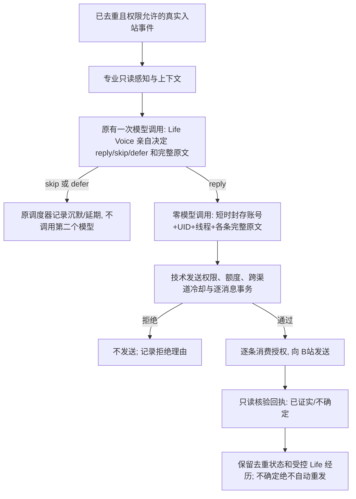

# 当前生产接线事实 · 2.7.1-dev.62（开发预览，未发布）

> **唯一当前入口。** 其他 dev.1–dev.60 文档仅表示各版本当时的设计/变更；不能把当时的“当前”当成 dev.60 的现行事实。2.7.1 RC/Windows/B站 72h 尚未验收。

## 目标、权限与唯一事实源

| 入口 | 现有统一层和职权 | 事实/授权源 | 限制 |
|---|---|---|---|
| 真实私信／评论通知 | `interaction-scheduler` 经可信源过滤，现有 `interaction-batch` 的**一次**模型判断由 Life Voice 直接作 `reply/skip/defer` 和最终表达；DM、Comment 子 Agent 提供上下文/候选能力 | `lib/life-willingness.mjs` 的 `adoptSocialDecision` 仅本地登记模型已给出的结果；`social-send-transaction` 持有每条发送事务 | `adoptSocialDecision` 本身**零 AI 调用**；UID、线程、正文、账号与一次性消息消费不匹配拒发；不改变原技术授权、平台未知回执不盲重试。主 Session／主人专属独立授权仍保留 |
| 视频入选 | Video Agent 搜索、视频详情、字幕等专业感知；真正正向记录仅 `挑中` | `vendor/bilibili-mcp/mcp_server.py` 中 `selected_videos` 和 `seen_observations` 使用真实登录账号 UID 的 SQLite 事务；`seen.md`/日报为旧历史投影 | 旧无 UID 的 Markdown 不授予相遇、点赞、关注或本账号判重。被拒绝的别名不能假冒挑中。每日 50 条限制已退役；每轮目标仍是柔性的 |
| 视频原创主评论 | Video Agent 真正 `挑中` 后，原 MCP 使用同轮实际读取的字幕/详情/评论工具结果，自动向 Life 提交评论机会；Life 在唯一 `life-comment-review` 决定意愿并亲自生成最终正文 | `lib/life-video-action-bridge.mjs` 绑定账号、BV、轮次、正文的一次性授权，Python MCP 原发送技术门禁 | 发送时无第二次 Life 模型判断；平台状态未知必须独立复核；附加 @、附图或同步动态不继承评论授权 |
| 点赞、收藏、关注/取关、文件夹整理 | Video Agent 提交能力和理由；Life 意愿层选择是否愿意 | `life-video-action-bridge` + 原 Python MCP 账号/额度/判重/平台回执 | 理由仍可能是专业 Agent 的未核实概括：需要继续完善同轮已核验的证据包；入选或喜欢不自动授予权限 |
| Life Planner／Episode | 自主考虑何时探索/休息/继续；可信事件才形成 Episode | `autonomous-planner`, `life-opportunities`, `life-action-attribution` 及原 `LifeMemoryGateway` | 不凭日期相同编造因果，不把模型声称的动作算作平台成功；没有新增陌生人无授权私信能力 |
| 主人私信／主 Session／公开动态 | 各自专业入口；复用 Life Voice/统一意愿/技术门禁 | 既有 owner/host/dynamic 事务和主人显式授权 | 本轮没有把这些路径重写成万能调度器；账号身份/私密域不能交叉继承，续聊回执仍需实机验证 |
| 模型调用 | 各原调用入口：Planner、interaction、Video Headless、记忆、反思、Owner 等 | `lib/model-invocation-journal.mjs` 只对**宿主直接模型请求**记录安全元数据、调用场景/耗时/错误类别 | 不新增 AI 请求；**Headless 视频内部模型逐次请求及 Token/价格未覆盖**，不得用宿主日志统计代表全部模型消耗 |

## dev.60 社交错误恢复边界（非另一个 AI 决策器）

- `lib/autonomous-planner.mjs` 的社交快速考虑只有匿名 `consider_social` / `skip`，选择 `consider_social` 仅更新 Life 关注账本，不构成 DM/评论回复收据，也不保证该事件再次触发 Life。真正的收件箱仍由 `lib/interaction-scheduler.mjs` 驱动 `lib/dm-autoreply.mjs`、`lib/comment-interact.mjs`，其独立开关、B站读取预算及网络退避仍有效。
- 评论陌生人 24h 上限是**有效 Life 意愿模型返回**次数，模型异常不计数；满额新通知记录 `preflightDefers` 并显示 `stranger_budget_deferred`，不会被写入终态 seen。只在下一次轮询仍能获取真实、近 24h 通知且重新核验且权限允许时才可能再次考虑；并不保证一定会回复。既有历史 `seen=stranger-budget` **不迁移或自动恢复**。
- `social-continuity/intentions.json` 按账号记录续聊：私信已读但延期的事件需通过此账本恢复，模型 429 不能 `settle('skipped')`。模型异常以原有 `retryPreflight` 最多允许两次有界延期，再以 `failed` 显示需要诊断；Life 明确沉默仍记 `skipped`，平台发送结果未知仍记 `uncertain` 并禁止重发。
- 这些改动仅修复技术恢复状态和归因，不增加成功路径的新模型审核次数、不更改用户配置或已有写权限。现场 archive 只用于离线分析；没有将账号 ZIP 或私信原文带入发布文件。

## 真实一条社交回复的边界

**不新增模型调用证明**：旧路径合法事件先通过一次 DM/Comment 专业生成；有草稿后再运行一次 Life `decide`。新路径复用原有的一次专业生成，将 prompt 归属改为 Life 本人的联合意愿及表达；`adoptSocialDecision` 只做同步授权数据检验，完全不调用模型。`skip` 仍一次，`reply` 从两次减少到一次。后续模型历史用量可能因其他调度器独立调用而增加，不能简单等同此通道。

## 不可混淆的数据或安全边界

- `seen.md` 和已有日报保留给人类查看；切账号不读取他人的“已看过/已挑中”作为现账号可行动证明。历史无 UID 记录不迁移为可信选片；升级后同账号如需关联旧片，须重新在已认证会话产生当前账号的 `挑中`。
- `duty.md` 原本是用户可改章程。dev.61 生效工具契约永远取插件版，旧家目录文件原样保留；仅显式非权限“自定义偏好”可被安全导入。额度、身份、状态与公开动作的唯一权威是代码和配置。
- 旧 `social-shadow` 额外模型比较在 active 下已退役；历史诊断只读保留。`shadow` 系统干跑仍属独立安全模式，不等同已发送。
- `pick-quota.mjs` 无正式运行依赖，已移除。`cold-state-snapshot.mjs` 有备份维护工具依赖，保留。
- 失败、未核验、已接受但平台不可读、真实公开可见是**不同状态**，不得互相升格。

## 仍阻止正式 2.7.1 发布

1. 全仓 Node 与 Python 测试需全部逐例归因；这次新的安全契约会有意拒绝旧不封存的社交授权。
2. 像 `index.js` 与管理 UI 这样的大文件仅开始渐进梳理，没有一次性拆完；切勿在同一开发分支中无测试地全面重写。
3. 视频 Agent 用于点赞/收藏/关注的 Life 输入当前仍以专业理由为主，尚未完成逐视频独立核验的多来源证据封装；不能将主观摘要当观看证明。
4. DSH Windows、两账号实机、B站真实只读与获授权低频写入、崩溃重启、平台未知回执、72 小时至 7 天连续生活未验收。参见 `CURRENT-RC-ACCEPTANCE.md`。

## 工程门禁

- `npm run check:video-tool-contract`：校验正式章程、MCP/宿主对唯一“挑中”状态及旧每日选片配额的约束一致。
- `npm run check:life-architecture`：四张可编辑 Mermaid 图和源码锚点存在性检查。
- `npm test`、`npm run test:python`、`node selfcheck.mjs`：回归；本次新增 `.github/workflows/ci.yml` 在 PR 与 main push 上运行完整检查，**在未解决既有失败前 CI 仍将红灯**，不通过跳过来伪造绿色。
