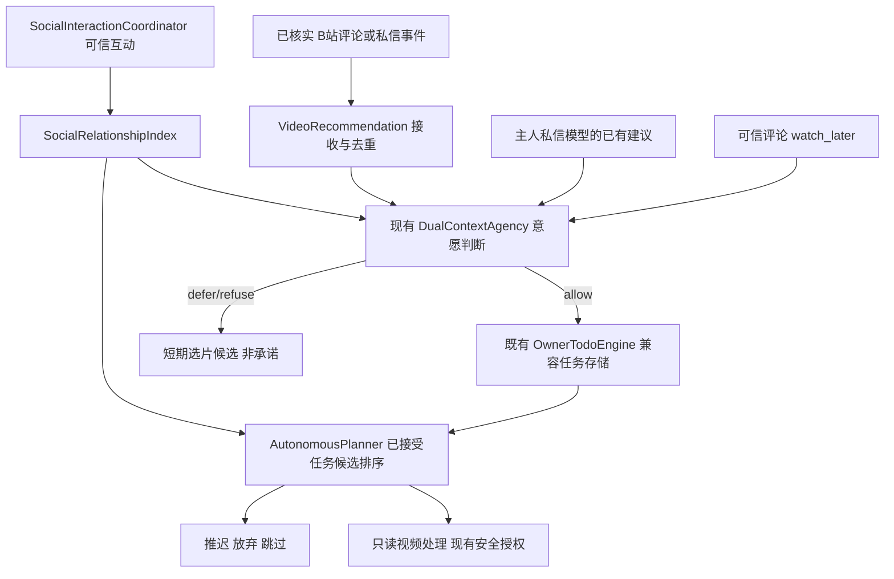

# 2.6.1-dev.2 · 实际社交意愿/自主待办接线（增量）

本文件更新实际调用关系，dev.4 历史架构图不改写。dev.2 仅实现 P4 的视频提议路径和关系偏好；完整统一待办仍是分阶段工作。

- 实际生产：`index.js` 的 `intakeRecommendation` 和 `receiveRecommendations` 分别在 DM 收件及评论回调调用；`syncRecommendations` 在这两个入口要求 `accepted===true`。启动重启仅同步已明确接受的新增推荐，旧已有任务不清理。
- 可信主人评论 `watch_later` 复用已有模型意愿，没模型时走既有本地决策；`defer` 不转为承诺。主人 DM 的模型建议在 `onTodoSuggested` 前独立复用已有本地意愿（不额外请求 LLM）。
- 社会熟悉度：意愿只读 `SocialRelationshipIndex.preferenceHint()`，优先自然成长关系、兼容旧白名单观察回退。`permissionRole` 仍由 `SocialPolicyGate` 和既有身份模块给出。`AutonomousPlanner` 只将分数作为候选展示顺序的提示，不作为执行许可。
- 存储：外部视频推荐的完整原文仍属于既有本地短期候选库，**新加入的正式任务不会复制陌生人的原始评论/DM 正文**。候选展示未接受项 48 小时失效；已接受任务不随此 TTL 遗忘。原候选文件的历史容量/保留仍由原有上限管控。
- 模型自主收藏：视频 Agent 一轮已有 MCP 调用增加 `motivation` 结构化枚举，Python 层校验；动机不是实际回忆证据，无法绕过 MCP 的权限、配额或真实 B站回执。
- 尚未实现：任意非视频待办的全渠道接受、通用候选数据库分页、所有非主人回访、可配置的各类别待办 TTL 及已接受任务的大规模排序优化。
