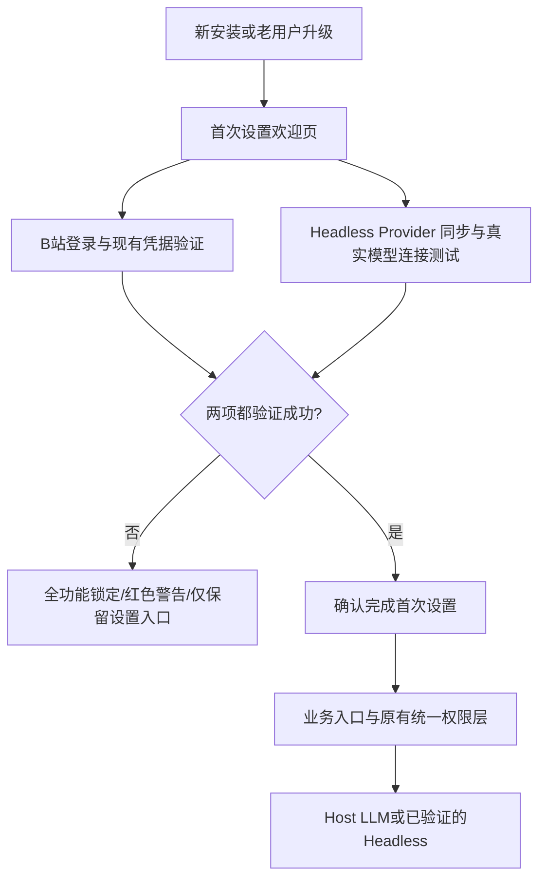

# 首次启动与全功能锁定架构（2.6.0-dev.4）

## 操作链路

- 每个用户的标记在 `$DSH_HOME/bili-duty/first-start-v1.json` 独立持久化；不修改已有 `config.json`、已有 B站凭据、Life Memory 和长期记忆。包含版本号、欢迎页已展示标记、已验证的凭据文件哈希与可选步骤状态；未完成则不会被跳过。
- 旧用户已有 B站凭据必须通过可信 MCP `bili_check_credential` 实际检查，不要求重新扫码；验证标记仅跟随本地凭据的指纹，凭据改动即失效。
- Headless 同步状态复用 `headless-model-verified.json`，与源/目标/全局 YAML 指纹绑定；未验证的 Agent 单独拒绝启动。
- 全局门禁同时设在 HTTP 业务路由、主 Session 大肥鱼工具、Host Model 文本请求、Headless 启动与自动活动中；管理页面、安装环境、扫码登录、同步/连接检测和诊断例外。登录/同步成功不自动开启公开写入权限。
- 向导第 03 步 **「现在设置」进入原有主 Session 表单**，但启用 `setupOnly` 阅读模式：只允许 `GET /main-session` 查看当前在线会话、通过现有 `POST /config` 保存目标会话及同步频率；首页概览、AI 记忆及外发连接测试在这阶段不加载/不运行。`POST /main-session/test`、`sync`、`backfill` 继续由服务端锁定（HTTP 423），并非只靠禁用前端按钮。
- 第 04、05 步在未解锁时不提供虚假的「现在查看」跳转，而明确标记「完成引导后设置」，仍可跳过。
- 必需项通过后**仍需用户主动点击「完成首次设置」**；老用户也至少看一次欢迎页。之后仍可在管理中心主动打开首次设置页重新配置，或重置已失效的登录和后台模型。
- 过去的 `headless-provider-verify-overlay.yml` 拼写错误已改为安全模块允许的 `headless-model-test-overlay.yml`；清空 `llm-pi-ai.config` 或 `.providers` 后重新同步时自动创建缺失 YAML 对象，不覆盖有效的其他 Provider 配置。

## 仍待实际运行验证

- Windows DSH 0.2.1 Desktop 界面实际打开管理中心，真实 B站扫码/已有登录检查，Headless YAML 同步与模型返回标记。
- 如果运行时 `bili_check_credential` 无法启动（Python 依赖缺失），必须先在 DSH 插件页装主依赖，不可通过虚假标记完成设置。
- 当前测试环境未安装 `yaml` 的情况会跳过两个实际 YAML 序列化测试；正式发布需在目标项目环境安装依赖并执行。
- 既有旧测试默认假设未初始化时业务接口可用；需要改为先完成受控测试初始化后再验证业务契约，不能移除新门禁以满足旧断言。
