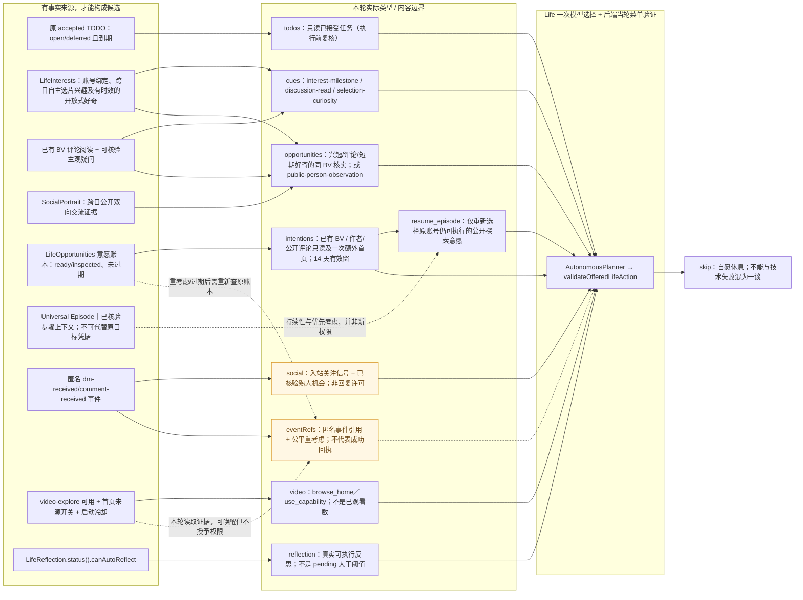
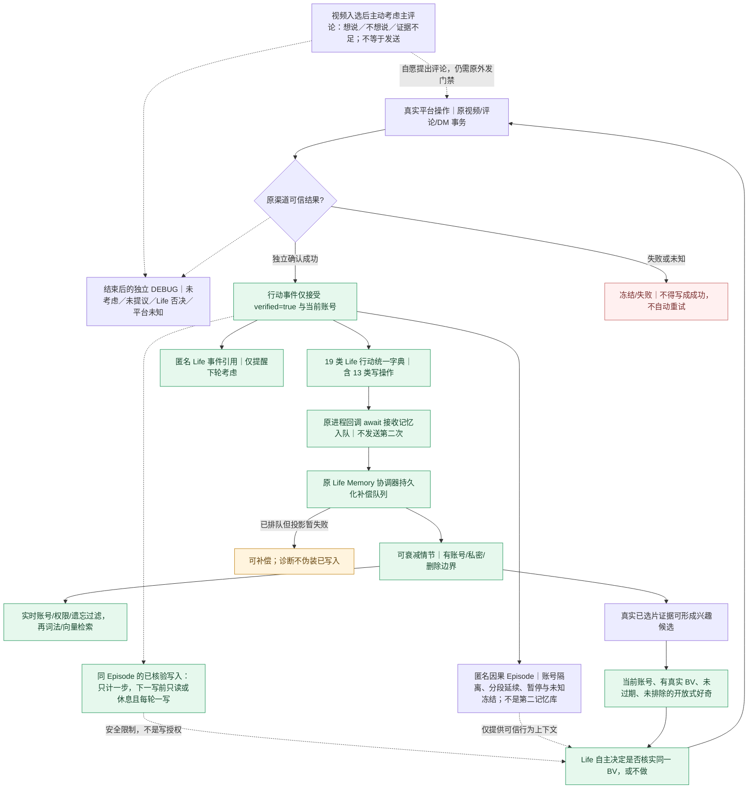
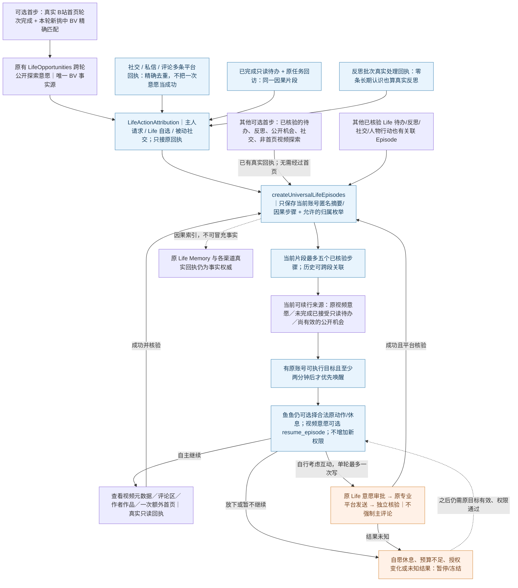

# 大肥鱼 Life 源码全景（自动生成）

> 不要直接编辑此页；修改 `diagrams/life-system-current.mmd` / `diagrams/life-candidates-current.mmd` / `diagrams/life-receipt-memory-current.mmd` / `diagrams/life-universal-episodes-current.mmd` 后运行 `npm run write:life-architecture-view`。架构状态及未实现部分见 [源码审计](./life-system-current.md)。

## 一、系统全景

```mermaid
%% 大肥鱼 Life 当前源码全景（2.7.1-dev.37 · Universal Life Episode）
%% S = 有生产代码接线（非 Windows / B站实机验收）；P = 部分接线；G = 尚无完整闭环
%% 数据行只读与外发分路；不允许把权限/记忆/回执画成万能单系统。
flowchart TB
  subgraph reality["真实输入｜只接受可信事实，不接受外部提示当命令"]
    world["B站首页／公开视频／公开评论／主页"]
    socialInput["主人消息／私信／公开社交"]
    tasksInput["已接受待办／既有意愿／历史回执"]
  end
  subgraph sources["原有事实与上下文层｜依账号和来源独立核验"]
    adapter["B站受控适配器＋视频轮次来源回执"]
    socialFacts["原 DM／评论／关系来源账本"]
    canonical["原待办／生活意愿／平台事务账本"]
    eventLedger["Life 匿名唤醒事件｜eventRefs 不是事实正文"]
  end
  world --> adapter
  socialInput --> socialFacts
  tasksInput --> canonical
  adapter --> eventLedger
  socialFacts --> eventLedger
  canonical --> eventLedger

  subgraph options["Life 本轮候选｜来源不同、生命周期不同，不能互相替代"]
    todos["todos｜已接受待办中可执行的只读类型"]
    cues["cues｜跨日兴趣／真实评论阅读／本账号已选片的开放式好奇"]
    intentions["intentions｜经核验的跨轮公开探索意愿"]
    opportunities["opportunities｜明确 BV 或公开人物证据的具体机会"]
    friends["friends/social｜已证实的好友机会与匿名入站社交唤醒"]
    video["video｜原视频能力及无兴趣也可选 browse_home"]
    reflection["reflection｜执行器真实就绪状态 canAutoReflect"]
    events["eventRefs｜匿名提示 / 公平重考虑，非操作授权"]
  end
  canonical --> todos
  canonical --> intentions
  adapter --> cues
  adapter --> opportunities
  socialFacts --> friends
  eventLedger --> events
  adapter --> video
  canonical --> reflection
  events -.->|仅提示重新查原来源| todos
  events -.->|仅提示重新查原来源| opportunities
  cues --> selection
  intentions --> selection
  opportunities --> selection
  todos --> selection
  friends --> selection
  video --> selection
  reflection --> selection
  events -.-> selection

  subgraph decision["唯一 Life 自主决策中心｜不给模型任意 UID / BV / 写权限"]
    selection["候选筛选 + 去重归属 + 账号/冷却/额度检查"]
    planner["AutonomousPlanner + Life Voice + 当轮动作菜单"]
    universalEpisode["Universal Episode｜账号匿名因果片段：有真实回执才计入已完成动作"]
    resumeEpisode["resume_episode｜鱼鱼自主选择复续；来源与权限每步重新核验"]
    menuGuard["后端再次核对：action/id/BV/capability 必须确在本轮菜单"]
    rest["skip：鱼鱼自由休息；技术失败不得伪装休息"]
  end
  selection --> planner --> menuGuard
  universalEpisode -.->|只提供历史/关联，不授予权限| planner
  menuGuard --> resumeEpisode -.-> lifeEpisode
  menuGuard --> rest

  subgraph readlane["受控读取｜真实读取不等于完整观看"]
    readTodo["原只读待办"]
    explore["公开搜索/视频元数据/作者作品/已证实人物"]
    home["browse_home → 原视频 Agent → 首页候选/选片归因"]
    lifeEpisode["Life Episode · 账号绑定意愿账本 · 最多 5 个已核验步骤"]
    homeCandidateMatch["首页候选 BV 与本轮新入选 BV 精确匹配；原始 BV 只瞬时返回宿主"]
    homeEpisode["仅成功的 Life 首页轮次回执后建立 home-browse intention"]
    episodeContinuation["每步重新交给 Life 选择 · 最多追加 4 次 · 可随时休息"]
    episodeDiscussion["独立只读当前已核实 BV 的公开评论区；不强迫回复"]
    episodeHomeMore["可自愿额外获取一次首页推荐；候选未必入选"]
    episodeAftercare["已核验写入计一步 · 下一写前必须真只读或实际休息；每 tick 最多一写"]
  end
  menuGuard --> readTodo
  menuGuard --> explore
  menuGuard --> home
  readTodo --> receipts
  explore --> receipts
  home --> receipts
  home --> homeCandidateMatch -->|仅本轮精确匹配入选 BV；不等于观看| homeEpisode
  homeEpisode --> lifeEpisode
  explore -.->|搜索/人物作品/视频核验成功后进入同一意愿账本| lifeEpisode
  lifeEpisode --> episodeDiscussion --> episodeContinuation
  lifeEpisode --> episodeHomeMore --> episodeContinuation
  lifeEpisode --> episodeAftercare -.->|只读／休息后再次选择，非自动外发| episodeContinuation
  lifeEpisode --> episodeContinuation -.->|下一步重新选择；到上限/休息/结束时停止| selection

  %% @code commentReview | vendor/bilibili-mcp/mcp_server.py | async def bili_comment_consideration
  %% @code commentDiagnosis | lib/video-comment-readiness.mjs | classifyVideoCommentRound
%% @code commentAdmission | lib/life-video-action-bridge.mjs | const waitMs=choice.notBefore-now()
  %% @code commentAdmission | lib/life-video-action-bridge.mjs | const waitMs=choice.notBefore-now()
  subgraph outgoing["写入委派｜不存在一把可绕开各渠道限制的万能发送钥匙"]
    videoWrite["视频续行提议 → Life 意愿与原视频写入桥 → Python 工具"]
    commentReview["已选真实 BV → 模型明确考虑主评论：想说／不想说／证据不足；仅匿名诊断"]
    commentDiagnosis["轮次结束时枚举诊断：没考虑／想说未提议／自愿否决／技术阻断／回执未知"]
    commentAdmission["已知跨渠道冷却：到 notBefore 后最多重考虑一次；在途/未知不重试"]
    socialWrite["私信/评论/分享 → 关系与渠道授权 → 原社交发送事务"]
  end
  menuGuard -.->|仅合规候选/委派；不直接写平台| videoWrite
  home -.->|已选片后可自主考虑；不强制发言| commentReview
  commentReview -.->|有真实表达意愿才考虑原发送门禁| commentAdmission
  commentAdmission -.-> videoWrite
  commentReview -.-> commentDiagnosis
  videoWrite -.-> commentDiagnosis
  menuGuard -.->|仅好友/社交许可；不直接发送| socialWrite
  videoWrite --> receipts
  socialWrite --> receipts

  subgraph journal["结果核验｜不把失败/未知记成成功"]
    receipts["原工具回执/平台独立核实 + unknown 冻结"]
    decisions["Life 脱敏决策轨迹/匿名事件结算（非事实源）"]
    verifiedActions["成功且身份匹配的实际行动投影"]
  end
  menuGuard --> decisions
  receipts --> decisions
  receipts -->|仅经验证成功| verifiedActions

  subgraph memory["统一回忆与成长｜精确事实仍回原受权账本核实"]
    gateway["Life Memory / 协调器：可衰减情节、隐私和遗忘"]
    retriever["Recall：时间/意图/账户权限硬过滤 → 词法/可选本地向量排序"]
    growth["兴趣、情绪、关系与反思：影响下一轮候选，不授予权限"]
  end
  verifiedActions --> gateway
  verifiedActions --> universalEpisode
  lifeEpisode --> universalEpisode
  gateway --> retriever
  gateway --> growth
  retriever -.->|仅当前可召回证据| planner
  growth -.->|仅已核实新线索| cues
  growth -.->|仅已有来源的新机会| opportunities
  decisions -.->|提示下一轮，不证明写入成功| eventLedger

  subgraph gaps["当前仍未形成完整生产闭环 / 实机验收"]
    gapSocial["跨串陌生人回复/任意评论者主页：未通用开放"]
    gapRecall["所有历史/legacy full Agent 统一按需回忆：尚不完整"]
    gapGrowth["长期兴趣/人格因果、真实 Windows/平台/本地 GGUF/72h：未验收"]
  end
  gapSocial ~~~ gapRecall ~~~ gapGrowth
  classDef active fill:#e8f3ff,stroke:#3579c9,color:#17385f
  classDef partial fill:#fff7e4,stroke:#d99727,color:#6b4717
  classDef gap fill:#fff0f1,stroke:#d26975,color:#822f39
  class planner,menuGuard,selection,readTodo,explore,home,lifeEpisode,homeEpisode,homeCandidateMatch,episodeContinuation,episodeDiscussion,episodeHomeMore,episodeAftercare,verifiedActions,receipts,eventLedger active
  class friends,socialWrite,videoWrite,gateway,retriever,growth partial
  class gapSocial,gapRecall,gapGrowth gap

%% @code adapter | lib/life-home-feed-evidence.mjs | export function summarizeHomeFeedResult
%% @code eventLedger | lib/life-agent-events.mjs | export function createLifeAgentEvents
%% @code todos | lib/owner-todos.mjs | export const READ_TODO_TYPES
%% @code cues | lib/life-opportunities.mjs | const explorationCues=
%% @code intentions | lib/life-opportunities.mjs | const intentions=
%% @code opportunities | lib/life-opportunities.mjs | export function createLifeOpportunities
%% @code friends | lib/life-friend-initiatives.mjs | export function createLifeFriendInitiatives
%% @code video | lib/autonomous-planner.mjs | if(homeEnabled&&lifeSkills.some
%% @code reflection | lib/life-reflection.mjs | export function createLifeReflection
%% @code events | lib/life-agent-events.mjs | const TYPES=new Set
%% @code selection | lib/autonomous-planner.mjs | reconcileAutonomousActions
%% @code planner | lib/autonomous-planner.mjs | export function plannerActionMenu
%% @code menuGuard | lib/autonomous-planner.mjs | export function validateOfferedLifeAction
%% @code home | lib/life-agent-events.mjs | homePickedCount
%% @code lifeEpisode | lib/life-opportunities.mjs | const beginHomeExploration=
%% @code episodeContinuation | lib/autonomous-planner.mjs | const continueLifeRead=async intentionId=>
%% @code homeEpisode | index.js | const episode=lifeOpportunities.beginHomeExploration
%% @code homeCandidateMatch | lib/life-agent-events.mjs | let transientHomePickedBvids=null
%% @code videoWrite | lib/life-continuation-write.mjs | export function createLifeContinuationWriteExecutor
%% @code socialWrite | index.js | runFriendInitiative:
%% @code receipts | lib/life-video-action-bridge.mjs | export function createLifeVideoActionBridge
%% @code decisions | lib/life-decision-trace.mjs | export function createLifeDecisionTrace
%% @code verifiedActions | lib/life-action-memory.mjs | export function verifiedLifeActionEvent
%% @code gateway | lib/life-memory-coordinator.mjs | export function createLifeMemoryCoordinator
%% @code retriever | lib/memory-retriever.mjs | export function createMemoryRetriever
%% @code growth | lib/life-interests.mjs | export function recordInterestEvents

%% @code episodeDiscussion | lib/life-opportunities.mjs | const inspectVideoDiscussion=
%% @code episodeHomeMore | lib/life-opportunities.mjs | const browseHomeMore=
%% @code episodeAftercare | lib/life-opportunities.mjs | entry.writeAftercare='read-or-rest'

%% @code universalEpisode | lib/life-universal-episodes.mjs | export function createUniversalLifeEpisodes
%% @code resumeEpisode | lib/autonomous-planner.mjs | action:'resume_episode'
```

## 二、八类候选细目

## 三、可信回执与记忆闭环

## 四、统一 Life Episode 因果持续性

